> **Author / Rights Holder:** Dongsoo Ryu, Ph.D. (ryudongsoo@jbnu.ac.kr, ryudongsoo@gmail.com), Department of Bio-Industrial Machinery Engineering, Jeonbuk National University

# Week 10: Particle Kinetics — Chapter 3 Part C: Linear and Angular Impulse & Momentum

## 📌 Course Overview & Learning Objectives

- **Chapter**: Engineering Mechanics: Dynamics 9th Edition - Chapter 3 Kinetics of Particles — Part C: Impulse and Momentum (Sections 3.8~3.9 Linear Impulse and Linear Momentum & Section 3.10 Angular Impulse and Angular Momentum)
- **Learning Objectives**:
  - Master the **Principle of Linear Impulse and Linear Momentum** ($\mathbf{G}_1 + \int_{t_1}^{t_2} \Sigma\mathbf{F} dt = \mathbf{G}_2$) derived from the time integration of Newton's second law.
  - Determine resultant force vectors $\mathbf{F}(t) = \dot{\mathbf{G}} - \mathbf{W}$ by time differentiation of momentum vector functions.
  - Apply the **Law of Conservation of Linear Momentum** ($\Sigma \mathbf{G}_1 = \Sigma \mathbf{G}_2$) to isolated systems and quantify mechanical energy dissipation ($|\Delta E|$) in plastic impacts.
  - Formulate **Angular Momentum** ($\mathbf{H}_O = \mathbf{r} \times m\mathbf{v}$) as the moment of linear momentum and derive the fundamental moment relation ($\Sigma\mathbf{M}_O = \dot{\mathbf{H}}_O$).
  - Apply the **Principle of Angular Impulse and Angular Momentum** ($\mathbf{H}_{O1} + \int_{t_1}^{t_2} \Sigma\mathbf{M}_O dt = \mathbf{H}_{O2}$) and the **Conservation of Angular Momentum** ($\Delta\mathbf{H}_O = \mathbf{0}$) to central-force orbits and rotating assemblies.
  - Couple axial angular momentum conservation with work-energy principles to solve 3D curvilinear sliding problems inside hemispherical bowls and funnels.

---

## 📋 Weekly Learning Content & Schedule (21 Complete Simulations)

### Part 1: Linear Impulse and Linear Momentum (Sections 3.8 ~ 3.9, 2 Concept + 9 Problem Simulations)

| Category | Problem No. | Title | Key Mechanics Concept & Verified Formula | Links |
|:---:|:---:|:---|:---|:---:|
| **Concept** | Concept 1 | $F$-$t$ Graph Area & Definite Integral | $m\mathbf{v}_1 + \int_{t_1}^{t_2} F(t)\,dt = m\mathbf{v}_2$ ($F$-$t$ curve area = $\Delta\mathbf{G}$) | [Code](./concept_ft_area_impulse.py) \| [GIF](./concept_ft_area_impulse.gif) |
| **Concept** | Concept 2 | Internal Force Cancellation & Momentum Conservation | $\int_{t_1}^{t_2}(+\mathbf{F})\,dt + \int_{t_1}^{t_2}(-\mathbf{F})\,dt = \mathbf{0} \Rightarrow \Sigma\mathbf{G}_1 = \Sigma\mathbf{G}_2$ | [Code](./concept_internal_force_cancel.py) \| [GIF](./concept_internal_force_cancel.gif) |
| **Sample** | 3.19 | Tennis Racquet Impact Force | $\mathbf{G}_1 + \int_{t_1}^{t_2} \mathbf{R}\,dt + \mathbf{W} \Delta t = \mathbf{G}_2 \Rightarrow R = 107.2\ \mathrm{N},\ \beta = 9.07^\circ$ | [Code](./ex3_19_tennis_ball_impulse.py) \| [GIF](./ex3_19_tennis_ball_impulse.gif) |
| **Sample** | 3.20 | Force Determination from Momentum Derivative | $\mathbf{F} = \dot{\mathbf{G}} - \mathbf{W} \Rightarrow \mathbf{F}(2\mathrm{s}) = 6\mathbf{j} - 6.04\mathbf{k}\ \mathrm{N}\ (F = 8.51\ \mathrm{N})$ | [Code](./ex3_20_momentum_force_derivative.py) \| [GIF](./ex3_20_momentum_force_derivative.gif) |
| **Sample** | 3.21 | 2D Variable Force Impulse Integration | $m\mathbf{v}_1 + \int_0^3 \mathbf{F}\,dt = m\mathbf{v}_2 \Rightarrow \mathbf{v}_2 = -6\mathbf{i} + 8\mathbf{j}\ \mathrm{m/s}\ (v_2 = 10\ \mathrm{m/s},\ \theta_x = 126.9^\circ)$ | [Code](./ex3_21_variable_force_plane_impulse.py) \| [GIF](./ex3_21_variable_force_plane_impulse.gif) |
| **Sample** | 3.22 | Incline Ore Skip & Ramp Cable Tension | $m v_1 + \int_0^t (2P - W_x)dt = m v \Rightarrow t' = 6.46\ \mathrm{s},\ v(8\mathrm{s}) = 4.76\ \mathrm{m/s}$ | [Code](./ex3_22_incline_skip_impulse.py) \| [GIF](./ex3_22_incline_skip_impulse.gif) |
| **Sample** | 3.23 | 2D Bullet-Block Impact & Momentum Conservation | $\Sigma \mathbf{G}_1 = (m_1 + m_2)\mathbf{v}_f \Rightarrow v_f = 16.83\ \mathrm{m/s},\ \theta = 52.4^\circ$ | [Code](./ex3_23_bullet_block_momentum.py) \| [GIF](./ex3_23_bullet_block_momentum.gif) |
| **Practice 1** | 3/140 | Car on 10% Grade Tractive Force | $m v_1 + (F - mg\sin\theta)\Delta t = m v_2 \Rightarrow F = 3030\ \mathrm{N}\ (3.03\ \mathrm{kN})$ | [Code](./prob3_140_car_incline_impulse.py) \| [GIF](./prob3_140_car_incline_impulse.gif) |
| **Practice 2** | 3/142 | Bullet-Cart Plastic Collision & Energy Loss | $m v = (M+m)v_f \Rightarrow v_f = 0.899\ \mathrm{m/s},\ \|\Delta E\| = 13,480\ \mathrm{J}\ (99.9\%)$ | [Code](./prob3_142_bullet_cart_impact.py) \| [GIF](./prob3_142_bullet_cart_impact.gif) |
| **Practice 3** | 3/143 | Bullet Penetrating Wood Block & Kinetic Friction | $m v_1 = m v_2 + M v_b \Rightarrow v_b = 4.0\ \mathrm{m/s},\ \mu_k = 0.302$ | [Code](./prob3_143_bullet_wood_block.py) \| [GIF](./prob3_143_bullet_wood_block.gif) |
| **Practice 4** | 3/152 | 2D Intersection Car Collision Reconstruction | $M\mathbf{v}_f = m_A \mathbf{v}_A + m_B \mathbf{v}_B \Rightarrow v = 28.5\ \mathrm{km/h},\ \theta = 54.6^\circ\ \mathrm{W\ of\ N}$ | [Code](./prob3_152_intersection_car_collision.py) \| [GIF](./prob3_152_intersection_car_collision.gif) |

### Part 2: Angular Impulse and Angular Momentum (Section 3.10, 2 Concept + 8 Problem Simulations)

| Category | Problem No. | Title | Key Mechanics Concept & Verified Formula | Links |
|:---:|:---:|:---|:---|:---:|
| **Concept** | Concept 3 | Angular Momentum & Invariant Moment Arm | $H_O = m v d = m r v\sin\theta = m r v_\theta$ ($d = r\sin\theta$ constant along straight path) | [Code](./concept_angular_momentum_arm.py) \| [GIF](./concept_angular_momentum_arm.gif) |
| **Concept** | Concept 4 | Central-Force Motion & Angular Momentum Conservation | $\Sigma\mathbf{M}_O = \mathbf{r}\times\mathbf{F} = \mathbf{0} \Rightarrow r_1 v_{\theta 1} = r_2 v_{\theta 2}$ (Radial contraction & energy comparison) | [Code](./concept_central_force_orbit.py) \| [GIF](./concept_central_force_orbit.gif) |
| **Sample** | 3.24 | 3D Sphere Angular Momentum & Time Derivative | $\mathbf{H}_O = \mathbf{r}\times m\mathbf{v} = -40\mathbf{i} + 30\mathbf{k}\ \mathrm{N\cdot m\cdot s},\ \dot{\mathbf{H}}_O = \mathbf{r}\times\mathbf{F} = 60\mathbf{i} - 30\mathbf{j}\ \mathrm{N\cdot m}$ | [Code](./ex3_24_cord_table_particle.py) \| [GIF](./ex3_24_cord_table_particle.gif) |
| **Sample** | 3.25 | Comet Elliptical Orbit Angular Momentum | $(H_O)_A = (H_O)_B \Rightarrow m r_A v_A = m r_B v_B \Rightarrow v_B = 59,200\ \mathrm{m/s}$ | [Code](./ex3_25_comet_elliptical_orbit.py) \| [GIF](./ex3_25_comet_elliptical_orbit.gif) |
| **Sample** | 3.26 | Pivoted Bar-Mass Assembly & Putty Impact | $m v_1 l = 3m(l\dot{\theta}_2)l + 4m(2l\dot{\theta}_2)(2l) \Rightarrow \dot{\theta}_2 = \frac{v_1}{19l}\ \mathrm{CW}$ | [Code](./ex3_26_rotating_T_bar_spheres.py) \| [GIF](./ex3_26_rotating_T_bar_spheres.gif) |
| **Sample** | 3.27 | 3D Particle Sliding Inside Hemispherical Bowl | $m v_0 r_0 = m v r\cos\theta,\ v = \sqrt{v_0^2+2gh} \Rightarrow \theta = \cos^{-1}\frac{1}{\sqrt{1+2gh/v_0^2}\sqrt{1-h^2/r_0^2}}$ | [Code](./ex3_27_hemispherical_bowl_particle.py) \| [GIF](./ex3_27_hemispherical_bowl_particle.gif) |
| **Practice 5** | 3/173 | Planar Sphere Angular Momentum (2 Methods) | (a) $\mathbf{H}_O = \mathbf{r}\times m\mathbf{v} = +128.7\mathbf{k}\ \mathrm{kg\cdot m^2/s}$, (b) $d = 9.20\ \mathrm{m} \Rightarrow H_O = 128.7\ \mathrm{kg\cdot m^2/s}$ | [Code](./prob3_173_satellite_angular_momentum.py) \| [GIF](./prob3_173_satellite_angular_momentum.gif) |
| **Practice 6** | 3/175 | 3-kg Sphere Linear/Angular Momentum & Energy | $\mathbf{G} = -12.99\mathbf{i} - 7.50\mathbf{j}\ \mathrm{kg\cdot m/s},\ \mathbf{H}_O = -21.2\mathbf{k}\ \mathrm{kg\cdot m^2/s},\ T = 37.5\ \mathrm{J}$ | [Code](./prob3_175_particle_angular_impulse.py) \| [GIF](./prob3_175_particle_angular_impulse.gif) |
| **Practice 7** | 3/184 | Outward Sliding Spheres on Rotating Rod | $2mr^2\omega_0 = 8mr^2\omega \Rightarrow \omega = \omega_0/4,\ n = \Delta T / T_1 = 3/4\ (75\%)$ | [Code](./prob3_184_pendulum_peg_impulse.py) \| [GIF](./prob3_184_pendulum_peg_impulse.gif) |
| **Practice 8** | 3/192 | Particle Sliding Down Frictionless Funnel | $v_2 = \sqrt{v_0^2+2gr\cos 30^\circ} = 3.95\ \mathrm{m/s},\ m v_0(0.65r) = m v_2\cos\theta(0.15r) \Rightarrow \theta = 52.9^\circ$ | [Code](./prob3_192_slotted_disk_slider.py) \| [GIF](./prob3_192_slotted_disk_slider.gif) |

---

## 1. Linear Impulse & Momentum Core Examples (Sample Problems 3/19 ~ 3/23)

### 1.1 Sample Problem 3.19: Tennis Racquet Impact Force & Linear Impulse

- **Problem Statement**: A tennis ball of mass $m = 60\ \mathrm{g} = 0.060\ \mathrm{kg}$ arrives horizontally to the left at $v_1 = 15\ \mathrm{m/s}$ and rebounds off the racquet strings at $v_2 = 21\ \mathrm{m/s}$ directed $15^\circ$ above the horizontal to the right ($\Delta t = 0.02\ \mathrm{s}$). Determine the magnitude and direction $\beta$ of the average impact force $\mathbf{R}$.
- **Mechanics Analysis**:
  - Impulse-momentum equations:
    $$-0.900 + R_x(0.02) = 1.217 \Rightarrow \mathbf{R_x = 105.9\ \mathrm{N}},\quad (R_y - mg)(0.02) = 0.326 \Rightarrow \mathbf{R_y = 16.89\ \mathrm{N}}$$
    $$R = \sqrt{105.9^2 + 16.89^2} = \mathbf{107.2\ \mathrm{N}},\quad \beta = \tan^{-1}\left(\frac{16.89}{105.9}\right) = \mathbf{9.07^\circ}$$

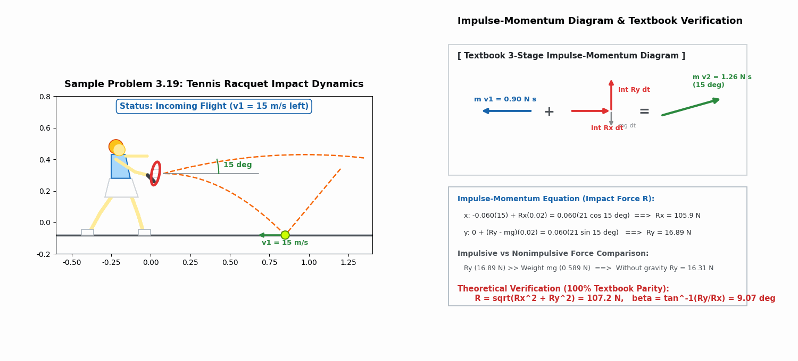

---

### 1.2 Sample Problem 3.20: Force Determination from Momentum Time Derivative

- **Problem Statement**: A particle of mass $m = 0.2\ \mathrm{kg}$ moves in the vertical $y$-$z$ plane with linear momentum $\mathbf{G} = 1.5(t^2 + 3)\mathbf{j} - \frac{2}{3}(t^3 - 4)\mathbf{k}\ \mathrm{N\cdot s}$. Determine the applied force $\mathbf{F}$ at $t = 2\ \mathrm{s}$.
- **Mechanics Analysis**:
  $$\dot{\mathbf{G}} = 3t\mathbf{j} - 2t^2\mathbf{k}\ \mathrm{N},\quad \mathbf{F}(2) = \dot{\mathbf{G}}(2) - \mathbf{W} = \mathbf{6\mathbf{j} - 6.04\mathbf{k}\ \mathrm{N}}\quad (F = \mathbf{8.51\ \mathrm{N}})$$

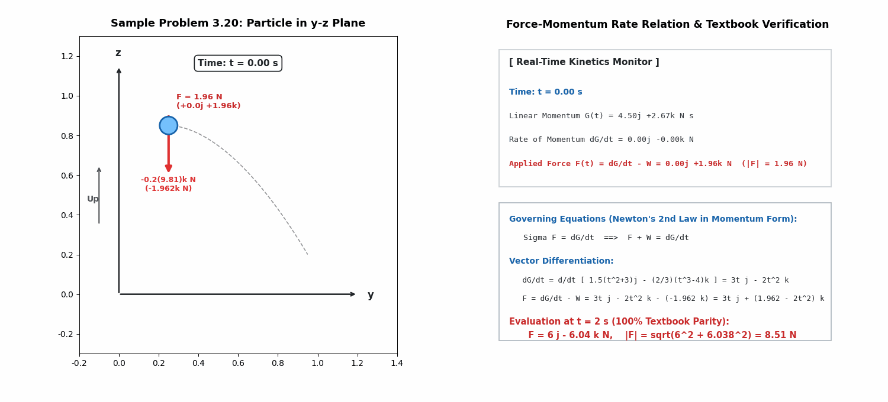

---

### 1.3 Sample Problem 3.21: 2D Variable Force Impulse Integration

- **Problem Statement**: A $0.5\ \mathrm{kg}$ particle moves in the horizontal $x$-$y$ plane with $\mathbf{v}_1 = 10\mathbf{i}\ \mathrm{m/s}$ at $t = 0$. Variable forces $F_1(t)$ ($-x$) and $F_2(t)$ ($+y$) act from $t = 0$ to $3\ \mathrm{s}$. Determine $\mathbf{v}_2$ at $t = 3\ \mathrm{s}$.
- **Mechanics Analysis**:
  $$0.5(10) - 8 = 0.5(v_2)_x \Rightarrow (v_2)_x = -6\ \mathrm{m/s},\quad 0 + 4 = 0.5(v_2)_y \Rightarrow (v_2)_y = +8\ \mathrm{m/s}$$
  $$\mathbf{v}_2 = \mathbf{-6\mathbf{i} + 8\mathbf{j}\ \mathrm{m/s}},\quad v_2 = \mathbf{10\ \mathrm{m/s}},\quad \theta_x = \mathbf{126.9^\circ}$$

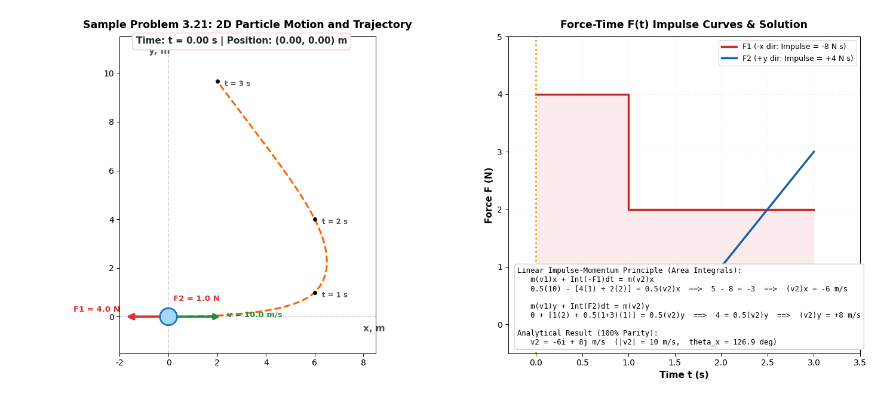

---

### 1.4 Sample Problem 3.22: Incline Ore Skip and Ramp Cable Tension

- **Problem Statement**: A $150\ \mathrm{kg}$ ore skip on a $30^\circ$ incline ($v_1 = -4.0\ \mathrm{m/s}$) is pulled by a 2:1 pulley cable tension $P(t)$ ramping from $0$ to $600\ \mathrm{N}$ in $4\ \mathrm{s}$ and constant thereafter. Find stopping time $t'$ and velocity $v_2$ at $t = 8\ \mathrm{s}$.
- **Mechanics Analysis**:
  $$-600 + 2400 + 1200(t' - 4) - 735.75 t' = 0 \Rightarrow \mathbf{t' = 6.46\ \mathrm{s}},\quad \mathbf{v_2(8\mathrm{s}) = +4.76\ \mathrm{m/s}}$$

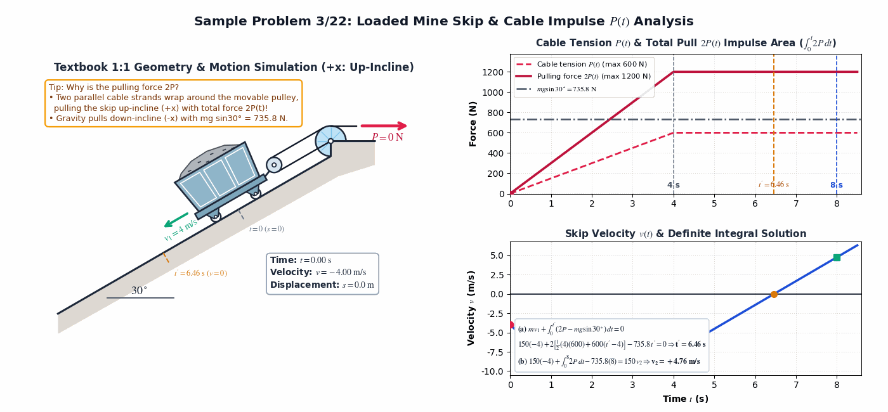

---

### 1.5 Sample Problem 3.23: 2D Bullet-Block Impact & Momentum Conservation

- **Problem Statement**: A $50\ \mathrm{g}$ bullet ($600\ \mathrm{m/s}$ along $+y$) embeds into a $4.0\ \mathrm{kg}$ block moving at $12\ \mathrm{m/s}$ at $30^\circ$ to the $x$-axis. Determine the common final velocity $v$ and angle $\theta$.
- **Mechanics Analysis**:
  $$v_x = \frac{41.57}{4.050} = 10.26\ \mathrm{m/s},\quad v_y = \frac{54.00}{4.050} = 13.33\ \mathrm{m/s} \implies \mathbf{v = 16.83\ \mathrm{m/s}},\quad \mathbf{\theta = 52.4^\circ}$$

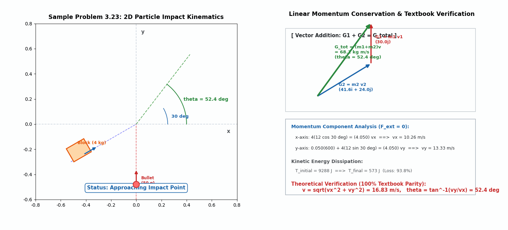

---

## 2. Angular Impulse & Momentum Core Examples (Sample Problems 3/24 ~ 3/27)

### 2.1 Sample Problem 3.24: 3D Sphere Angular Momentum $\mathbf{H}_O$ and Time Derivative $\dot{\mathbf{H}}_O$

- **Problem Statement**: A small sphere of mass $m = 2\ \mathrm{kg}$ has position $\mathbf{r} = 3\mathbf{i} + 6\mathbf{j} + 4\mathbf{k}\ \mathrm{m}$, velocity $\mathbf{v} = 5\mathbf{j}\ \mathrm{m/s}$, and applied force $\mathbf{F} = 10\mathbf{k}\ \mathrm{N}$. Determine its angular momentum $\mathbf{H}_O$ and time derivative $\dot{\mathbf{H}}_O$ about point $O$.
- **Mechanics Analysis**:
  - Angular momentum definition ($\mathbf{H}_O = \mathbf{r} \times m\mathbf{v}$):
    $$\mathbf{H}_O = (3\mathbf{i} + 6\mathbf{j} + 4\mathbf{k}) \times 2(5\mathbf{j}) = \mathbf{-40\mathbf{i} + 30\mathbf{k}\ \mathrm{N\cdot m\cdot s}}\quad (|\mathbf{H}_O| = 50.0\ \mathrm{N\cdot m\cdot s})$$
  - Rate of change of angular momentum ($\dot{\mathbf{H}}_O = \mathbf{M}_O = \mathbf{r} \times \mathbf{F}$):
    $$\dot{\mathbf{H}}_O = (3\mathbf{i} + 6\mathbf{j} + 4\mathbf{k}) \times 10\mathbf{k} = \mathbf{60\mathbf{i} - 30\mathbf{j}\ \mathrm{N\cdot m}}\quad (|\dot{\mathbf{H}}_O| = 67.1\ \mathrm{N\cdot m})$$

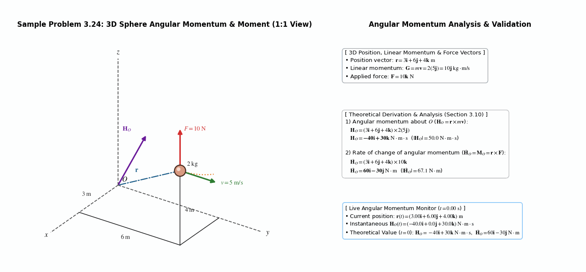

---

### 2.2 Sample Problem 3.25: Comet in Elongated Elliptical Orbit

- **Problem Statement**: A comet in an elongated elliptical orbit around the Sun ($O$) has speed $v_A = 740\ \mathrm{m/s}$ at aphelion $A$ ($r_A = 6000 \times 10^6\ \mathrm{km}$). Determine its speed $v_B$ at perihelion $B$ ($r_B = 75 \times 10^6\ \mathrm{km}$).
- **Mechanics Analysis**:
  - Since gravitational attraction is a central force directed toward $O$ ($\Sigma M_O = 0$), angular momentum about $O$ is conserved:
    $$(H_O)_A = (H_O)_B \implies m r_A v_A = m r_B v_B \implies v_B = \frac{6000(10^6)(740)}{75(10^6)} = \mathbf{59,200\ \mathrm{m/s}\ (59.2\ \mathrm{km/s})}$$

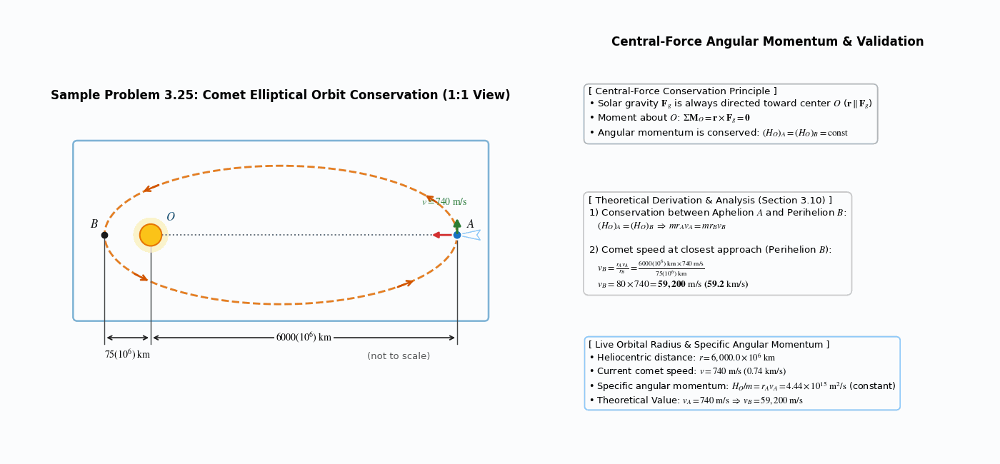

---

### 2.3 Sample Problem 3.26: Pivoted Bar-Mass Assembly Struck by Falling Putty

- **Problem Statement**: A light bar assembly with mass $4m$ at distance $2l$ to the left of frictionless pivot $O$ and mass $2m$ at distance $l$ to the right is initially at rest. A putty blob of mass $m$ falls with speed $v_1$ and sticks to the right mass $2m$. Determine the angular velocity $\dot{\theta}_2$ immediately after impact.
- **Mechanics Analysis**:
  - Conservation of angular momentum about pivot $O$ during impact (CW positive):
    $$(H_O)_1 = (H_O)_2 \implies m v_1 l = (m + 2m)(l\dot{\theta}_2)l + 4m(2l\dot{\theta}_2)(2l) = 19 m l^2 \dot{\theta}_2 \implies \mathbf{\dot{\theta}_2 = \frac{v_1}{19l}\ \mathrm{CW}}$$

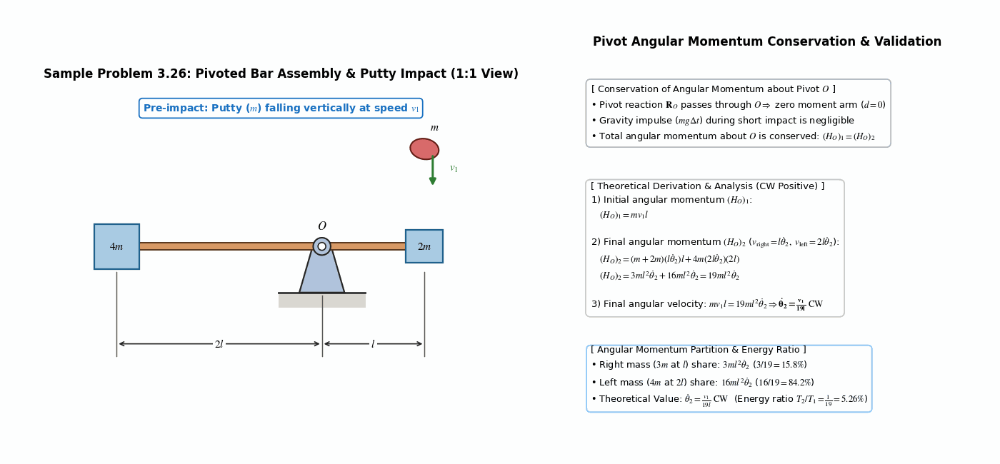

---

### 2.4 Sample Problem 3.27: 3D Particle Sliding Inside a Smooth Hemispherical Bowl

- **Problem Statement**: A particle of mass $m$ is launched tangentially with horizontal velocity $v_0$ at rim $A$ (radius $r_0$) of a smooth hemispherical bowl. When it passes point $B$ at vertical depth $h$ and radius $r$ from the vertical axis $O$-$O$, its velocity $\mathbf{v}$ makes an angle $\theta$ with the horizontal tangent. Determine $\theta$.
- **Mechanics Analysis**:
  - Conservation of angular momentum about vertical axis $O$-$O$ and conservation of mechanical energy:
    $$m v_0 r_0 = m v r \cos\theta,\quad v = \sqrt{v_0^2 + 2gh},\quad r = \sqrt{r_0^2 - h^2}$$
    $$\implies \mathbf{\theta = \cos^{-1}\frac{1}{\sqrt{1 + \dfrac{2gh}{v_0^2}}\sqrt{1 - \dfrac{h^2}{r_0^2}}}}$$

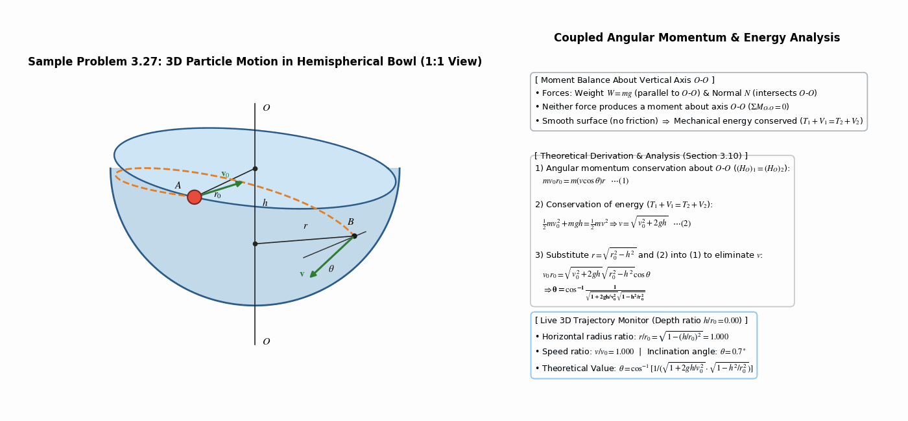

---

## 3. Linear Impulse & Momentum Practice Problems (3/140, 3/142, 3/143, 3/152)

### 3.1 Problem 3/140 — Car Accelerating on a 10% Incline
- **Calculation**: $m v_1 + (F - mg\sin\theta)\Delta t = m v_2 \Rightarrow (F - 1464.2)(8) = 12,500 \Rightarrow \mathbf{F = 3030\ \mathrm{N}\ (3.03\ \mathrm{kN})}$

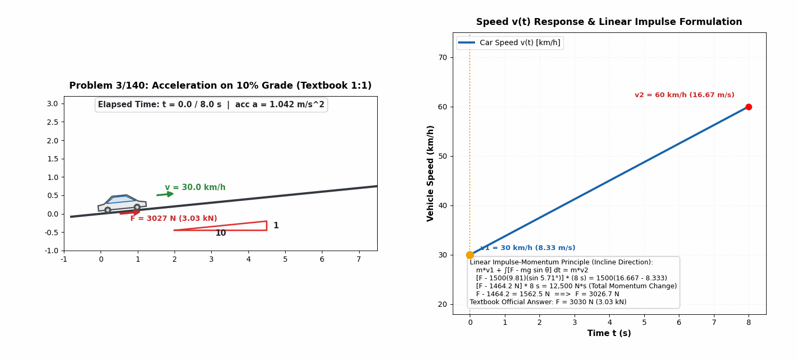

---

### 3.2 Problem 3/142 — Bullet Embedding in Wheeled Cart and Energy Loss
- **Calculation**: $0.075(600) = 50.075\,v_f \Rightarrow \mathbf{v_f = 0.899\ \mathrm{m/s}},\quad |\Delta E| = 13,500 - 20.2 = \mathbf{13,480\ \mathrm{J}\ (99.9\%)}$

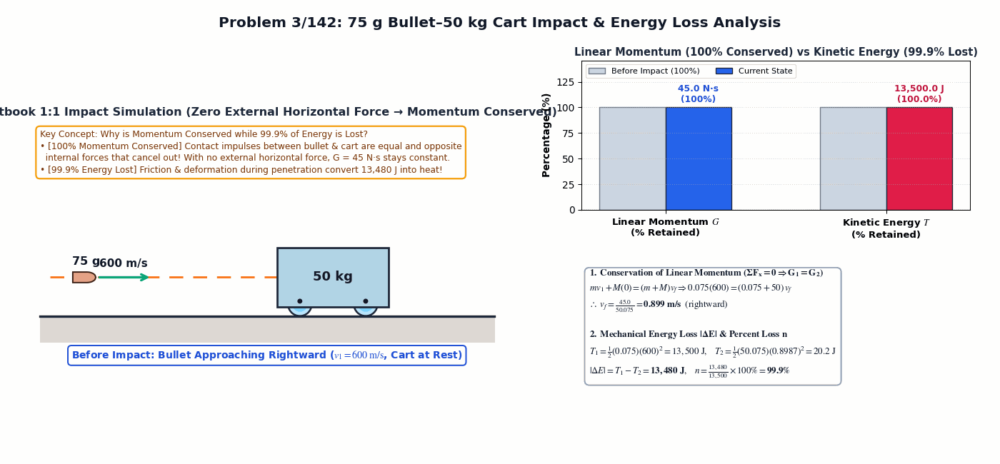

---

### 3.3 Problem 3/143 — Bullet Penetrating Wood Block & Sliding Distance
- **Calculation**: $0.060(600) = 0.060(400) + 3\,v_b \Rightarrow \mathbf{v_b = 4.0\ \mathrm{m/s}},\quad \mu_k = \frac{4.0^2}{2(9.81)(2.70)} = \mathbf{0.302}$

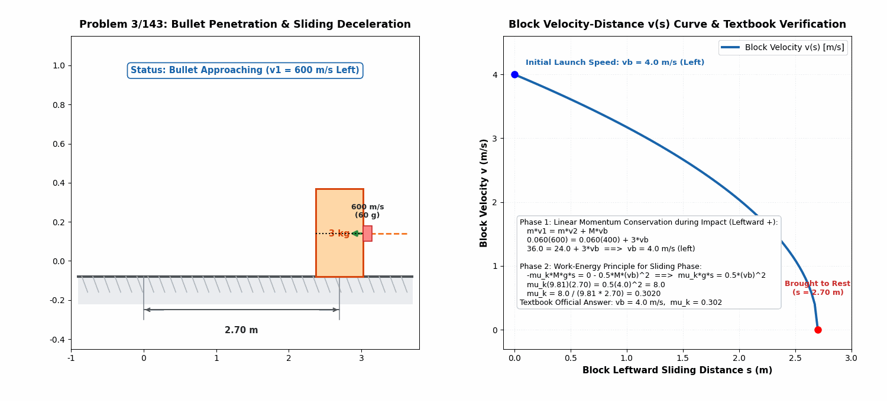

---

### 3.4 Problem 3/152 — 2D Intersection Car Collision Reconstruction
- **Calculation**: $v_x = -23.23\ \mathrm{km/h},\ v_y = +16.52\ \mathrm{km/h} \implies \mathbf{v = 28.5\ \mathrm{km/h}},\quad \mathbf{\theta = 54.6^\circ\ \text{West of North}}$

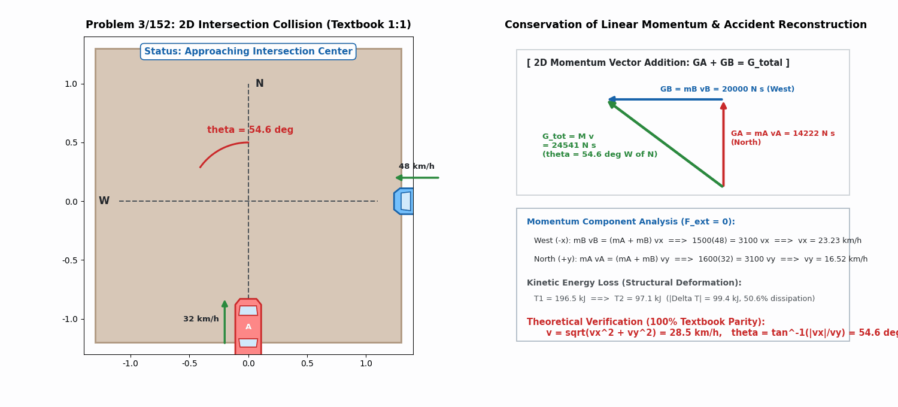

---

## 4. Angular Impulse & Momentum Practice Problems (3/173, 3/175, 3/184, 3/192)

### 4.1 Problem 3/173 — Magnitude of Angular Momentum $H_O$ (Vector vs. Scalar Moment Arm)

- **Problem Statement**: Calculate the magnitude $H_O$ of the angular momentum of the $2\ \mathrm{kg}$ sphere about point $O$ using (a) the vector definition and (b) the equivalent scalar moment-arm approach. The sphere is at $(-6, 8)\ \mathrm{m}$ moving at $7\ \mathrm{m/s}$ at $30^\circ$ to the vertical.
- **Mechanics Calculation**:
  - **(a) Vector Cross Product**:
    $$\mathbf{H}_O = \mathbf{r} \times m\mathbf{v} = (-6\mathbf{i} + 8\mathbf{j}) \times 2(7)(-\sin 30^\circ\mathbf{i} - \cos 30^\circ\mathbf{j}) = \mathbf{+128.7\mathbf{k}\ \mathrm{kg\cdot m^2/s}} \implies \mathbf{H_O = 128.7\ \mathrm{kg\cdot m^2/s}}$$
  - **(b) Scalar Moment Arm**:
    $$d_1 = 6\tan 30^\circ = 3.46\ \mathrm{m},\quad d_2 = 8 - d_1 = 4.54\ \mathrm{m},\quad d = \frac{6}{\cos 30^\circ} + 4.54\sin 30^\circ = 9.20\ \mathrm{m}$$
    $$H_O = m v d = 2(7)(9.20) = \mathbf{128.7\ \mathrm{kg\cdot m^2/s}\ (\text{CCW})}$$

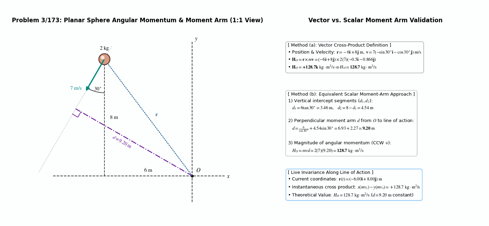

---

### 4.2 Problem 3/175 — Linear Momentum, Angular Momentum, and Kinetic Energy of a $3\ \mathrm{kg}$ Sphere

- **Problem Statement**: The $3\ \mathrm{kg}$ sphere moves in the $x$-$y$ plane at $v = 5\ \mathrm{m/s}$ ($45^\circ$ from the radial line) at $r = 2\ \mathrm{m}$ ($15^\circ$ below $+x$). Determine (a) linear momentum $\mathbf{G}$, (b) angular momentum $\mathbf{H}_O$ about $O$, and (c) kinetic energy $T$.
- **Mechanics Calculation**:
  - **(a) Linear Momentum**: $\mathbf{G} = m\mathbf{v} = 3(5)(-\cos 30^\circ\mathbf{i} - \sin 30^\circ\mathbf{j}) = \mathbf{-12.99\mathbf{i} - 7.50\mathbf{j}\ \mathrm{kg\cdot m/s}}$
  - **(b) Angular Momentum**: $\mathbf{H}_O = \mathbf{r}\times\mathbf{G} = 2(\cos 15^\circ\mathbf{i} - \sin 15^\circ\mathbf{j})\times(-12.99\mathbf{i} - 7.50\mathbf{j}) = \mathbf{-21.2\mathbf{k}\ \mathrm{kg\cdot m^2/s}}$
  - **(c) Kinetic Energy**: $T = \frac{1}{2}m v^2 = \frac{1}{2}(3)(5)^2 = \mathbf{37.5\ \mathrm{J}}$

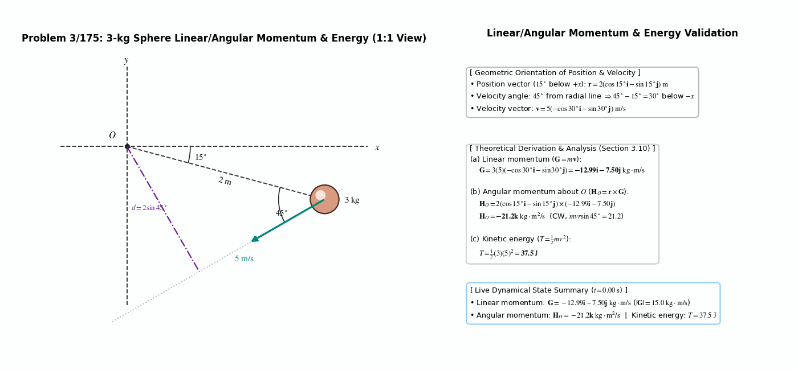

---

### 4.3 Problem 3/184 — Two Spheres Sliding Outward ($r \to 2r$) on a Rotating Horizontal Rod

- **Problem Statement**: Two spheres of equal mass $m$ slide on a freely rotating horizontal rod. Released from radial distance $r$ at initial angular speed $\omega_0$, they slide outward to stops at $2r$. Find (a) the new angular velocity $\omega$ and (b) the fraction $n = \Delta T / T_1$ of lost kinetic energy.
- **Mechanics Calculation**:
  - **(a) Conservation of Angular Momentum ($\Delta H = 0$)**:
    $$2m(r\omega_0)r - 2m(2r\omega)(2r) = 0 \implies \mathbf{\omega = \frac{\omega_0}{4}}$$
  - **(b) Lost Kinetic Energy Fraction $n$**:
    $$\Delta T = 2\left(\frac{1}{2}m[r\omega_0]^2\right) - 2\left(\frac{1}{2}m\left[2r\frac{\omega_0}{4}\right]^2\right) = \frac{3}{4}m r^2 \omega_0^2 \implies \mathbf{n = \frac{\Delta T}{T_1} = \frac{3}{4}\ (75\%)}$$

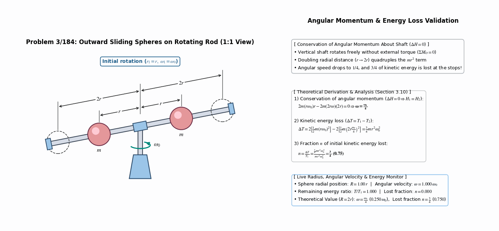

---

### 4.4 Problem 3/192 — Particle Sliding Down a Frictionless Funnel-Shaped Surface

- **Problem Statement**: A particle is released with horizontal velocity $v_0 = 0.55\ \mathrm{m/s}$ at the $30^\circ$ position on a frictionless funnel-shaped surface ($r = 0.9\ \mathrm{m}$, neck radius $0.15r$). Determine the angle $\theta$ between its velocity vector and the horizontal as it passes level $O$-$O$.
- **Mechanics Calculation**:
  - **Angular Momentum Conservation ($H_1 = H_2$)**:
    $$m v_0 [0.15r + (r - r\sin 30^\circ)] = m v_2\cos\theta [0.15r] \implies 0.65\,v_0 = 0.15\,v_2\cos\theta$$
  - **Work-Energy ($T_1 + U_{1-2} = T_2$)**:
    $$\frac{1}{2}m v_0^2 + m g r\cos 30^\circ = \frac{1}{2}m v_2^2 \implies v_2 = \mathbf{3.95\ \mathrm{m/s}} \implies \cos\theta = \frac{0.65(0.55)}{0.15(3.949)} \implies \mathbf{\theta = 52.9^\circ}$$

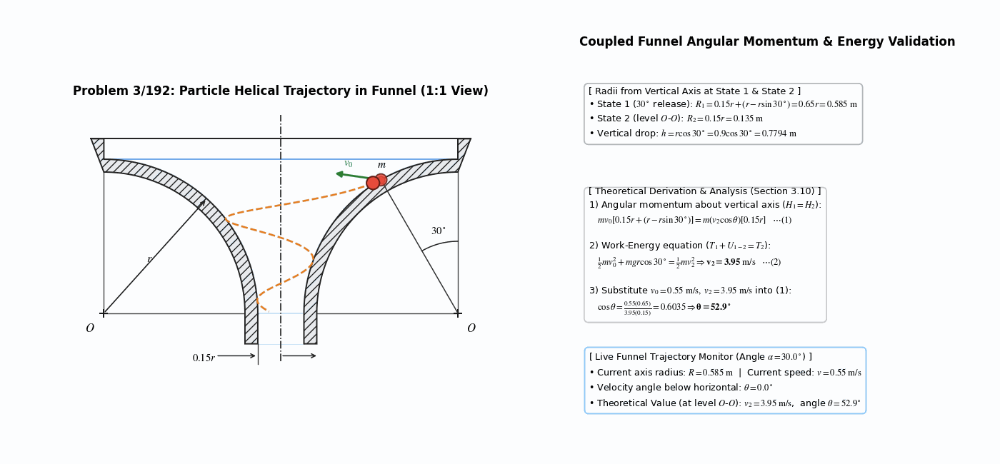

---

## 📝 Changelog

- **2026-11-01** [[ryu-dongsoo](mailto:ryudongsoo@jbnu.ac.kr)] feat(biomechanics): Add 2 supplementary Section 3.10 concept animations (`concept_angular_momentum_arm`, `concept_central_force_orbit`) and refine STIX math typography across all 8 angular impulse/momentum simulations (21 simulations total)
- **2026-10-15** [[ryu-dongsoo](mailto:ryudongsoo@jbnu.ac.kr)] feat(biomechanics): Complete Week 10 Ch.3 Part C curriculum with all 17 simulations (9 Linear + 8 Angular Impulse & Momentum: Sample Problems 3.24~3.27 and Problems 3/173, 3/175, 3/184, 3/192)
- **2026-10-04** [[ryu-dongsoo](mailto:ryudongsoo@jbnu.ac.kr)] feat: Week 10 complete 5 linear impulse examples (3.19~3.23) and 4 practice problems (3/140, 3/142, 3/143, 3/152)

---

## 📝 변경 이력 (Changelog)
- **2026-11-01 23:35:00** [[Dongsoo Ryu](mailto:ryudongsoo@jbnu.ac.kr)] feat: release Weeks 1–15 bilingual biomechanics simulation portfolio & supplementary concept animations
