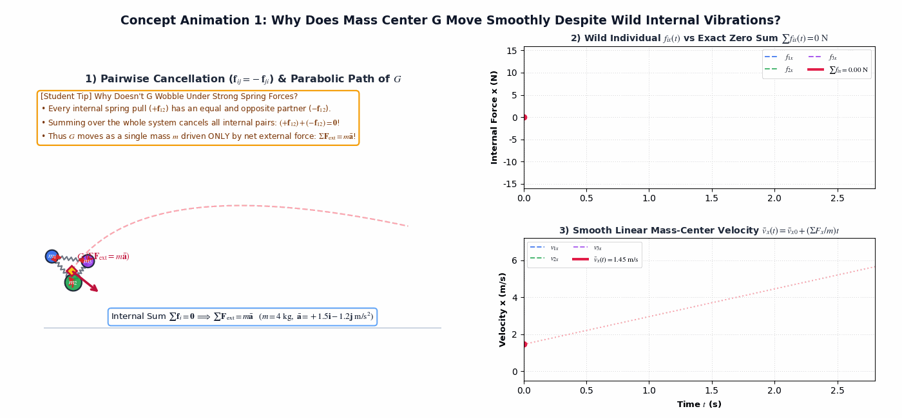
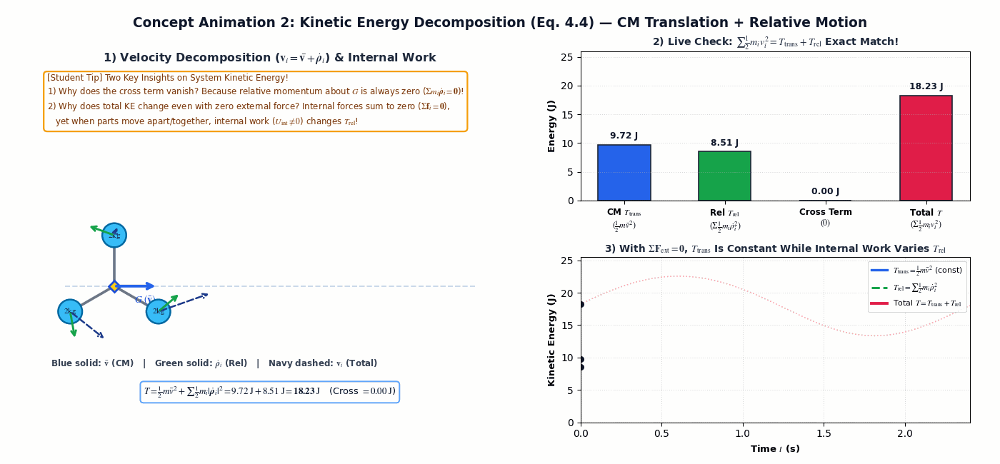
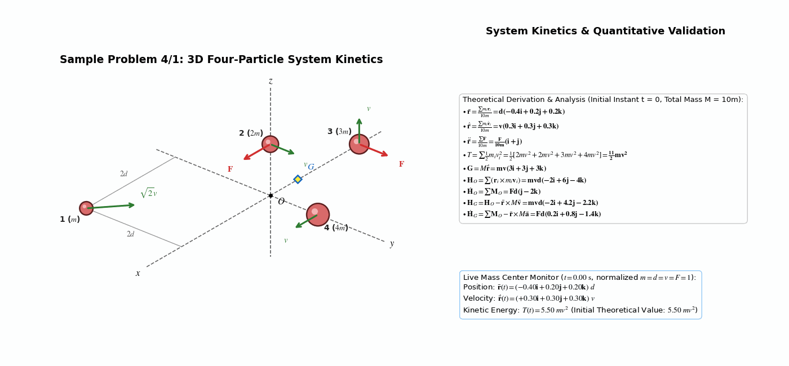
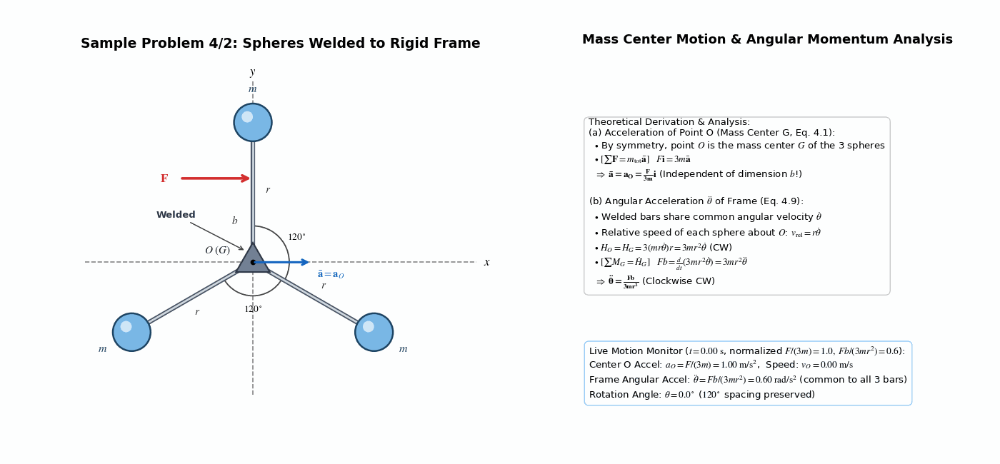
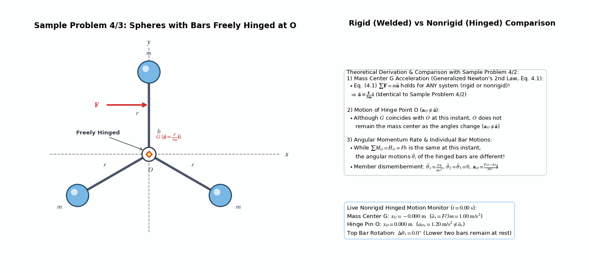
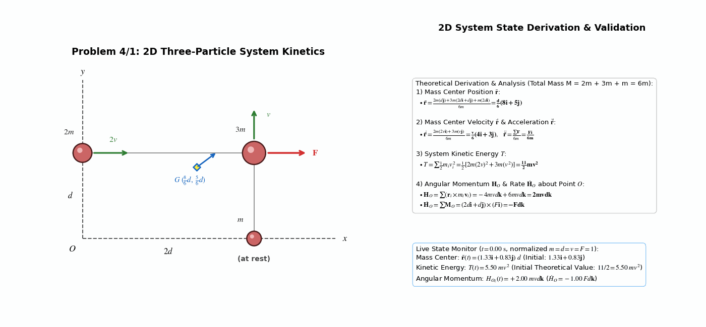
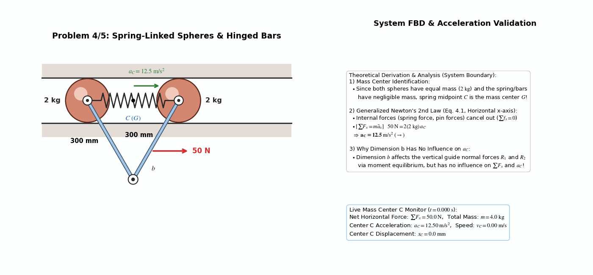
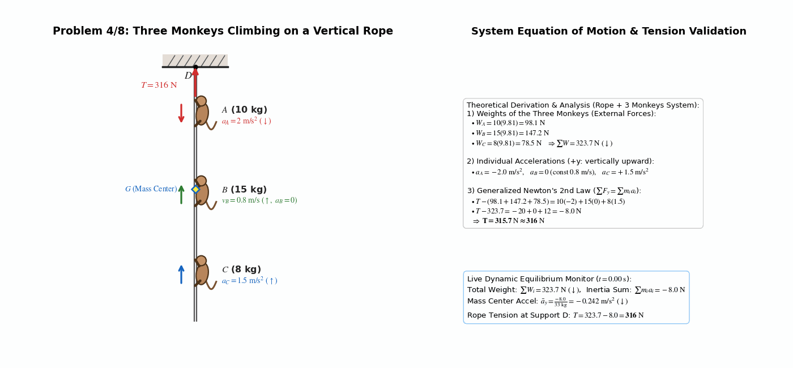
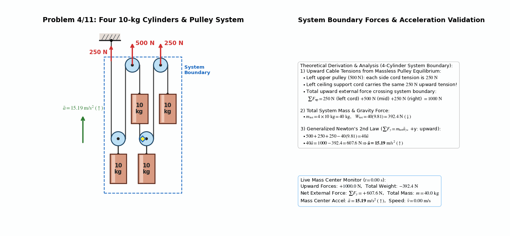

> **Author / Rights Holder:** 전북대학교 생물산업기계공학과 유동수 (ryudongsoo@jbnu.ac.kr)

# Week 11: Kinetics of Systems of Particles I — Generalized Newton's Second Law, Work-Energy, and Impulse-Momentum (Ch.4: 4.1 ~ 4.4)

## 📌 Lecture Overview and Learning Objectives

- **Chapter**: Meriam & Kraige Dynamics 9th Edition Chapter 4: Kinetics of Systems of Particles — Sections 4.1 ~ 4.4
- **Objectives**:
  - Extend particle kinetics to general systems of particles (rigid and nonrigid bodies) and verify cancellation of internal forces ($\Sigma\mathbf{f}_i = \mathbf{0}$)
  - Define mass center position ($\bar{\mathbf{r}}$), velocity ($\bar{\mathbf{v}}$), and acceleration ($\bar{\mathbf{a}}$), applying the **Generalized Newton's Second Law ($\Sigma\mathbf{F} = m\bar{\mathbf{a}}$)**
  - Master the system work-energy equation ($T_1 + U_{1-2} = T_2$) and kinetic energy decomposition theorem ($T = \frac{1}{2}m\bar{v}^2 + \Sigma\frac{1}{2}m_i\dot{\rho}_i^2$)
  - Formulate linear momentum ($\mathbf{G} = m\bar{\mathbf{v}}, \Sigma\mathbf{F} = \dot{\mathbf{G}}$) and angular momentum about a fixed point $O$, the mass center $G$, and an arbitrary point $P$ ($\Sigma\mathbf{M}_O = \dot{\mathbf{H}}_O, \Sigma\mathbf{M}_G = \dot{\mathbf{H}}_G, \Sigma\mathbf{M}_P = \dot{\mathbf{H}}_G + \bar{\boldsymbol{\rho}}\times m\bar{\mathbf{a}}$)

---

## 📋 Course Curriculum and Contents

| Type | No. | Problem Title | Governing Principle & Result | Output Links |
|:---:|:---:|:---|:---|:---:|
| **Concept** | Supp. 1 | Internal Cancellation & CM Path | $\mathbf{f}_{ij} = -\mathbf{f}_{ji} \Rightarrow \Sigma\mathbf{f}_i = \mathbf{0},\quad \Sigma\mathbf{F}_{\mathrm{ext}} = m\bar{\mathbf{a}}$ | [Code](./concept_cm_internal_cancel.py) \| [GIF](./concept_cm_internal_cancel.gif) |
| **Concept** | Supp. 2 | KE Decomposition & Internal Work | $T = \frac{1}{2}m\bar{v}^2 + \Sigma\frac{1}{2}m_i\dot{\rho}_i^2$ (Eq. 4.4), $U_{1-2,\mathrm{int}} \ne 0$ | [Code](./concept_ke_decomposition.py) \| [GIF](./concept_ke_decomposition.gif) |
| **Example** | 4.1 | 3D Four-Particle System | $\bar{\mathbf{r}} = d(-0.4\mathbf{i}+0.2\mathbf{j}+0.2\mathbf{k}),\ T = \frac{11}{2}mv^2,\ \mathbf{H}_G = mvd(-2\mathbf{i}+4.2\mathbf{j}-2.2\mathbf{k})$ | [Code](./ex4_1_four_particles_system.py) \| [GIF](./ex4_1_four_particles_system.gif) |
| **Example** | 4.2 | Spheres Welded to Rigid Frame | (a) $\bar{\mathbf{a}} = \mathbf{a}_O = \frac{F}{3m}\mathbf{i}$, (b) $\ddot{\theta} = \frac{Fb}{3mr^2}$ (CW) | [Code](./ex4_2_rigid_frame_spheres.py) \| [GIF](./ex4_2_rigid_frame_spheres.gif) |
| **Example** | 4.3 | Spheres with Bars Hinged at O | $\bar{\mathbf{a}} = \frac{F}{3m}\mathbf{i}$ (same as 4.2), but $\mathbf{a}_O \ne \bar{\mathbf{a}}$ and $\ddot{\theta}_i$ differ | [Code](./ex4_3_hinged_bars_spheres.py) \| [GIF](./ex4_3_hinged_bars_spheres.gif) |
| **Intro** | 4/1 | 2D Three-Particle System | $\bar{\mathbf{r}} = \frac{d}{6}(8\mathbf{i}+5\mathbf{j}),\ T = \frac{11}{2}mv^2,\ \mathbf{H}_O = 2mvd\mathbf{k},\ \dot{\mathbf{H}}_O = -Fd\mathbf{k}$ | [Code](./prob4_1_three_particles_2d.py) \| [GIF](./prob4_1_three_particles_2d.gif) |
| **Intro** | 4/5 | Spring-Linked Spheres & Bars | $\Sigma F_x = m\bar{a}_x \Rightarrow 50 = 4 a_C \Rightarrow a_C = 12.5\ \mathrm{m/s^2}$ (independent of $b$) | [Code](./prob4_5_spring_linked_spheres.py) \| [GIF](./prob4_5_spring_linked_spheres.gif) |
| **Intro** | 4/8 | Three Monkeys on Vertical Rope | $\Sigma F_y = \Sigma m_i a_i \Rightarrow T - 323.7 = -8 \Rightarrow T = 316\ \mathrm{N}$ | [Code](./prob4_8_three_monkeys_rope.py) \| [GIF](./prob4_8_three_monkeys_rope.gif) |
| **Advanced** | 4/11 | Four Cylinders & Pulley System | $\Sigma F_y = m\bar{a}_y \Rightarrow 1000 - 392.4 = 40\bar{a} \Rightarrow \bar{a} = 15.19\ \mathrm{m/s^2}\ (\uparrow)$ | [Code](./prob4_11_four_cylinders_pulley.py) \| [GIF](./prob4_11_four_cylinders_pulley.gif) |

---

## 0. Supplementary Concept Animations

### 0.1 Concept Animation 1: Pairwise Internal Force Cancellation ($\Sigma\mathbf{f}_i = \mathbf{0}$) & Smooth Mass-Center Trajectory

- **Key Principle**: In a three-particle spring-coupled system, individual particles oscillate wildly under strong internal forces ($\mathbf{f}_{ij} = -\mathbf{f}_{ji}$), yet summing over the system cancels all internal pairs ($\Sigma\mathbf{f}_i = \mathbf{0}$) so mass center $G$ follows a smooth parabolic path governed solely by $\Sigma\mathbf{F}_{\mathrm{ext}} = m\bar{\mathbf{a}}$ (Eq. 4.1).

---

### 0.2 Concept Animation 2: Kinetic Energy Decomposition (Eq. 4.4) & Work of Internal Forces

- **Key Principle**: Using relative velocity $\mathbf{v}_i = \bar{\mathbf{v}} + \dot{\boldsymbol{\rho}}_i$ about mass center $G$, the cross term $2\bar{\mathbf{v}}\cdot\Sigma m_i\dot{\boldsymbol{\rho}}_i = 0$ vanishes identically, decomposing system kinetic energy into $T = \frac{1}{2}m\bar{v}^2 + \Sigma\frac{1}{2}m_i\dot{\rho}_i^2$ (Eq. 4.4) and showing how internal work ($U_{1-2,\mathrm{int}} \ne 0$) changes $T_{\mathrm{rel}}$ even when $\Sigma\mathbf{F}_{\mathrm{ext}} = \mathbf{0}$.

---

## 1. Textbook Core Examples (Sample Problems 4/1 ~ 4/3)

### 1.1 Sample Problem 4/1: 3D Four-Particle System Kinetics

- **Problem Statement**: A system of four particles ($m_1=m, m_2=2m, m_3=3m, m_4=4m$, total mass $M = \Sigma m_i = 10m$) has the given positions, velocities, and external forces. Determine $\bar{\mathbf{r}}, \dot{\bar{\mathbf{r}}}, \ddot{\bar{\mathbf{r}}}, T, \mathbf{G}, \mathbf{H}_O, \dot{\mathbf{H}}_O, \mathbf{H}_G, \dot{\mathbf{H}}_G$.
- **Dynamic Analysis**:
  - **Mass center position, velocity, and acceleration**:
    $$\bar{\mathbf{r}} = \frac{\Sigma m_i\mathbf{r}_i}{\Sigma m_i} = \frac{m(2d\mathbf{i}-2d\mathbf{j}) + 2m(d\mathbf{k}) + 3m(-2d\mathbf{i}) + 4m(d\mathbf{j})}{10m} = \mathbf{d(-0.4\mathbf{i} + 0.2\mathbf{j} + 0.2\mathbf{k})}$$
    $$\dot{\bar{\mathbf{r}}} = \frac{\Sigma m_i\dot{\mathbf{r}}_i}{\Sigma m_i} = \frac{m(-v\mathbf{i}+v\mathbf{j}) + 2m(v\mathbf{j}) + 3m(v\mathbf{k}) + 4m(v\mathbf{i})}{10m} = \mathbf{v(0.3\mathbf{i} + 0.3\mathbf{j} + 0.3\mathbf{k})}$$
    $$\ddot{\bar{\mathbf{r}}} = \frac{\Sigma\mathbf{F}}{\Sigma m_i} = \frac{F\mathbf{i} + F\mathbf{j}}{10m} = \mathbf{\frac{F}{10m}(\mathbf{i} + \mathbf{j})}$$
  - **Kinetic energy and linear momentum**:
    $$T = \sum \frac{1}{2}m_i v_i^2 = \frac{1}{2}\left[m(\sqrt{2}v)^2 + 2m(v^2) + 3m(v^2) + 4m(v^2)\right] = \mathbf{\frac{11}{2}mv^2}$$
    $$\mathbf{G} = (\Sigma m_i)\dot{\bar{\mathbf{r}}} = 10m \cdot v(0.3\mathbf{i} + 0.3\mathbf{j} + 0.3\mathbf{k}) = \mathbf{mv(3\mathbf{i} + 3\mathbf{j} + 3\mathbf{k})}$$
  - **Angular momentum and time rates of change about $O$ and $G$**:
    $$\mathbf{H}_O = \sum(\mathbf{r}_i \times m_i\dot{\mathbf{r}}_i) = \mathbf{0} - 2mvd\mathbf{i} + 3mv(2d)\mathbf{j} - 4mvd\mathbf{k} = \mathbf{mvd(-2\mathbf{i} + 6\mathbf{j} - 4\mathbf{k})}$$
    $$\dot{\mathbf{H}}_O = \Sigma\mathbf{M}_O = -2dF\mathbf{k} + Fd\mathbf{j} = \mathbf{Fd(\mathbf{j} - 2\mathbf{k})}$$
    $$\mathbf{H}_G = \mathbf{H}_O - \bar{\mathbf{r}} \times M\bar{\mathbf{v}} = mvd(-2\mathbf{i} + 6\mathbf{j} - 4\mathbf{k}) - d(-0.4\mathbf{i} + 0.2\mathbf{j} + 0.2\mathbf{k}) \times 10mv(0.3\mathbf{i} + 0.3\mathbf{j} + 0.3\mathbf{k}) = \mathbf{mvd(-2\mathbf{i} + 4.2\mathbf{j} - 2.2\mathbf{k})}$$
    $$\dot{\mathbf{H}}_G = \Sigma\mathbf{M}_O - \bar{\mathbf{r}} \times M\bar{\mathbf{a}} = Fd(\mathbf{j} - 2\mathbf{k}) - d(-0.4\mathbf{i} + 0.2\mathbf{j} + 0.2\mathbf{k}) \times F(\mathbf{i} + \mathbf{j}) = \mathbf{Fd(0.2\mathbf{i} + 0.8\mathbf{j} - 1.4\mathbf{k})}$$

---

### 1.2 Sample Problem 4/2: Three Spheres Welded to an Equilateral Rigid Frame

- **Problem Statement**: Three spheres of mass $m$ each are welded to a light equilateral rigid frame (bar length $r$) resting on a smooth horizontal surface. Determine (a) acceleration of point $O$ and (b) angular acceleration $\ddot{\theta}$ of the frame when a horizontal force $F\mathbf{i}$ is applied at distance $b$ from $O$.
- **Dynamic Analysis**:
  - **(a) Acceleration of point $O$ (mass center $G$, Eq. 4.1)**:
    $$\Sigma\mathbf{F} = m_{\mathrm{tot}}\bar{\mathbf{a}} \implies F\mathbf{i} = 3m\bar{\mathbf{a}} \implies \mathbf{\bar{\mathbf{a}} = \mathbf{a}_O = \frac{F}{3m}\mathbf{i}}$$
  - **(b) Angular acceleration $\ddot{\theta}$ of rigid frame (Eq. 4.9)**:
    - With common angular velocity $\dot{\theta}$, relative speed of each sphere about $O$ is $r\dot{\theta}$:
      $$H_O = H_G = 3(mr\dot{\theta})r = 3mr^2\dot{\theta}$$
      $$\Sigma M_G = \dot{H}_G \implies Fb = \frac{d}{dt}(3mr^2\dot{\theta}) = 3mr^2\ddot{\theta} \implies \mathbf{\ddot{\theta} = \frac{Fb}{3mr^2}} \ (\text{CW})$$

---

### 1.3 Sample Problem 4/3: Three Spheres with Bars Freely Hinged at $O$

- **Problem Statement**: Consider the same conditions as Sample Problem 4/2 except that the bars are freely hinged at $O$ instead of welded. Explain the difference between the two problems.
- **Dynamic Analysis**:
  - **Mass center acceleration**: The generalized Newton's second law $\Sigma\mathbf{F} = m\bar{\mathbf{a}}$ holds for any system of particles, so the acceleration of mass center $G$ is identical to Sample Problem 4/2:
    $$\mathbf{\bar{\mathbf{a}} = \frac{F}{3m}\mathbf{i}}$$
  - **Hinge motion and individual angular accelerations**:
    - Although $G$ coincides with $O$ at this instant, $O$ does not remain the mass center as the angles between the bars change, so $\mathbf{a}_O \ne \bar{\mathbf{a}}$.
    - Furthermore, although $\Sigma M_G = \dot{H}_G = Fb$ is the same at this instant, the angular motions $\ddot{\theta}_i$ of the individual bars differ and must be found by dismembering the system.

---

## 2. Practice Problems (3 Introductory + 1 Advanced)

### 2.1 Problem 4/1: 2D Three-Particle System Kinetics

- **Problem Statement**: For the 2D three-particle system with $m_1 = 2m\ [\mathbf{r}_1 = d\mathbf{j},\ \mathbf{v}_1 = 2v\mathbf{i}]$, $m_2 = 3m\ [\mathbf{r}_2 = 2d\mathbf{i}+d\mathbf{j},\ \mathbf{v}_2 = v\mathbf{j},\ \mathbf{F}_2 = F\mathbf{i}]$, and $m_3 = m\ [\mathbf{r}_3 = 2d\mathbf{i},\ \mathbf{v}_3 = \mathbf{0}]$, find $\bar{\mathbf{r}}, \dot{\bar{\mathbf{r}}}, \ddot{\bar{\mathbf{r}}}, T, \mathbf{H}_O, \dot{\mathbf{H}}_O$.
- **Calculations**:
  - Total mass: $\Sigma m_i = 2m + 3m + m = 6m$
  - Mass center position: $\bar{\mathbf{r}} = \frac{2m(d\mathbf{j}) + 3m(2d\mathbf{i}+d\mathbf{j}) + m(2d\mathbf{i})}{6m} = \mathbf{\frac{d}{6}(8\mathbf{i} + 5\mathbf{j})}$
  - Mass center velocity & acceleration: $\dot{\bar{\mathbf{r}}} = \frac{2m(2v\mathbf{i}) + 3m(v\mathbf{j})}{6m} = \mathbf{\frac{v}{6}(4\mathbf{i} + 3\mathbf{j})}$, $\ddot{\bar{\mathbf{r}}} = \frac{\Sigma\mathbf{F}}{\Sigma m_i} = \mathbf{\frac{F\mathbf{i}}{6m}}$
  - Kinetic energy: $T = \Sigma\frac{1}{2}m_i v_i^2 = \frac{1}{2}\left[2m(2v)^2 + 3m(v^2)\right] = \mathbf{\frac{11}{2}mv^2}$
  - Angular momentum and rate about $O$:
    $$\mathbf{H}_O = \Sigma(\mathbf{r}_i \times m_i\mathbf{v}_i) = -4mvd\mathbf{k} + 6mvd\mathbf{k} = \mathbf{2mvd\mathbf{k}}$$
    $$\dot{\mathbf{H}}_O = \Sigma\mathbf{M}_O = (2d\mathbf{i} + d\mathbf{j}) \times (F\mathbf{i}) = \mathbf{-Fd\mathbf{k}}$$

---

### 2.2 Problem 4/5: Spring-Linked Spheres in Horizontal Guide with Hinged Bars

- **Problem Statement**: Two smooth $2\ \mathrm{kg}$ spheres connected by a light spring slide in a smooth horizontal guide. Two light $300\ \mathrm{mm}$ bars are hinged to the spheres and at their lower ends. If a horizontal force $F = 50\ \mathrm{N}$ is applied to the right bar at distance $b$, find the acceleration $a_C$ of the spring center $C$ and explain why it is independent of $b$.
- **Calculations**:
  - Since both spheres have equal mass ($2\ \mathrm{kg}$) and the spring and bars have negligible mass, $C$ is the mass center $G$ of the system ($m_{\mathrm{tot}} = 4\ \mathrm{kg}$).
  - Horizontal equation of motion:
    $$\Sigma F_x = m_{\mathrm{tot}}\bar{a}_x \implies 50 = 2(2) a_C \implies \mathbf{a_C = 12.5\ \mathrm{m/s^2}}$$
  - Dimension $b$ influences the vertical guide reactions $R_1$ and $R_2$, but has no effect on $\Sigma F_x$ or $a_C$.

---

### 2.3 Problem 4/8: Three Monkeys Climbing on a Vertical Rope

- **Problem Statement**: Three monkeys $A, B, C$ of masses $10, 15, 8\ \mathrm{kg}$ climb up and down a rope suspended at $D$. At the instant shown, $A$ accelerates downward at $2\ \mathrm{m/s^2}$, $B$ climbs upward at constant speed $0.8\ \mathrm{m/s}$, and $C$ accelerates upward at $1.5\ \mathrm{m/s^2}$. Find the rope tension $T$ at $D$.
- **Calculations**:
  - Weights: $W_A = 10(9.81) = 98.1\ \mathrm{N}$, $W_B = 15(9.81) = 147.2\ \mathrm{N}$, $W_C = 8(9.81) = 78.5\ \mathrm{N}$ ($\Sigma W = 323.7\ \mathrm{N}$)
  - System vertical equation of motion ($\Sigma F_y = \Sigma m_i a_i$, upward $+y$):
    $$T - (98.1 + 147.2 + 78.5) = 10(-2) + 15(0) + 8(1.5)$$
    $$T - 323.7 = -8 \implies \mathbf{T = 316\ \mathrm{N}}$$

---

### 2.4 Problem 4/11: Four 10-kg Cylinders and Pulley System

- **Problem Statement**: Determine the mass center acceleration $\bar{a}$ of the system of four $10\ \mathrm{kg}$ cylinders connected by light pulleys and cords under the applied upward forces of $500\ \mathrm{N}$ and $250\ \mathrm{N}$.
- **Calculations**:
  - From equilibrium of the massless upper left pulley ($500\ \mathrm{N}$), each side cord carries $250\ \mathrm{N}$. Thus, the total upward force crossing the system boundary enclosing the four cylinders is $250 + 500 + 250 = 1000\ \mathrm{N}$.
  - Generalized Newton's second law ($\Sigma F_y = m\bar{a}_y$, total mass $m = 40\ \mathrm{kg}$):
    $$500 + 250 + 250 - 40(9.81) = 40\bar{a}$$
    $$40\bar{a} = 1000 - 392.4 = 607.6\ \mathrm{N} \implies \mathbf{\bar{a} = 15.19\ \mathrm{m/s^2}\ (\uparrow)}$$

---

## 📝 변경 이력 (Changelog)
- **2026-11-01 23:35:00** [[Dongsoo Ryu](mailto:ryudongsoo@jbnu.ac.kr)] feat: release Weeks 1–15 bilingual biomechanics simulation portfolio & supplementary concept animations

- **2026-11-01 21:20:00** [[Dongsoo Ryu](mailto:ryudongsoo@jbnu.ac.kr)] feat(biomechanics): add 2 supplementary Ch.4 concept animations (`concept_cm_internal_cancel`, `concept_ke_decomposition`), apply STIX math rendering, and refine `prob4_11` ceiling support geometry with full ko/en parity
- **2026-10-15 00:15:00** [[Dongsoo Ryu](mailto:ryudongsoo@jbnu.ac.kr)] feat(biomechanics): complete Week 11 Chapter 4 (4.1~4.4) Kinetics of Systems of Particles curriculum with 3 sample problems and 4 practice problems
- **2026-10-03 17:22:26** [[Dongsoo Ryu](mailto:ryudongsoo@jbnu.ac.kr)] feat(biomechanics): complete Week 7 Part B Work and Energy curriculum overhaul with 5 examples and 4 practice problems
