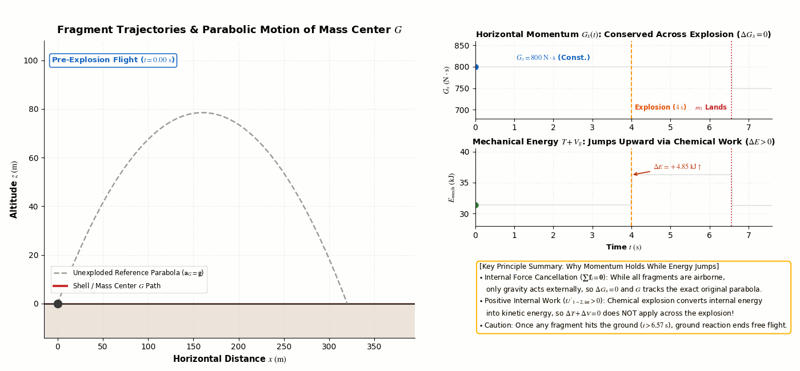
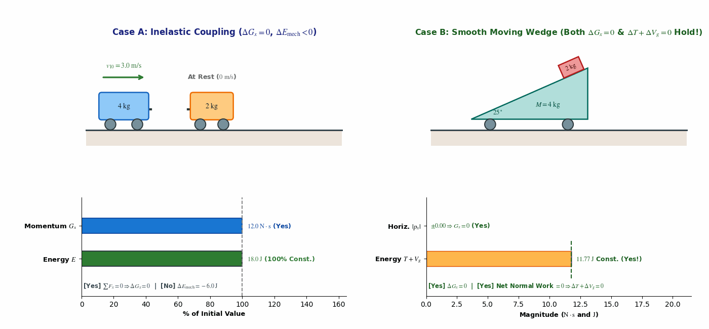
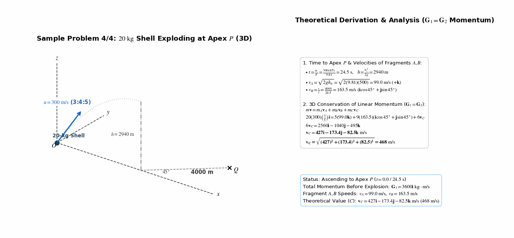
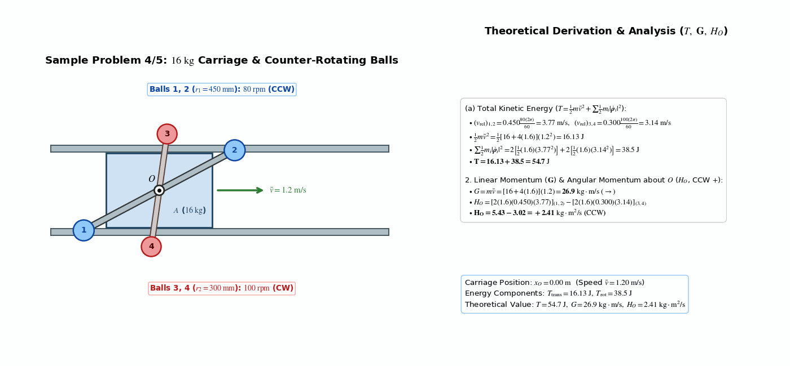
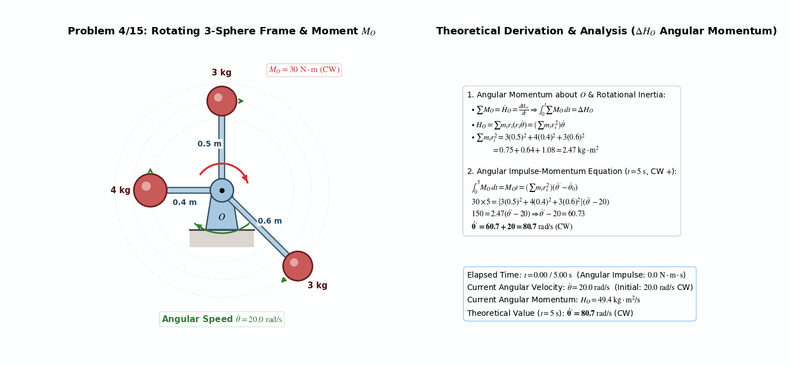
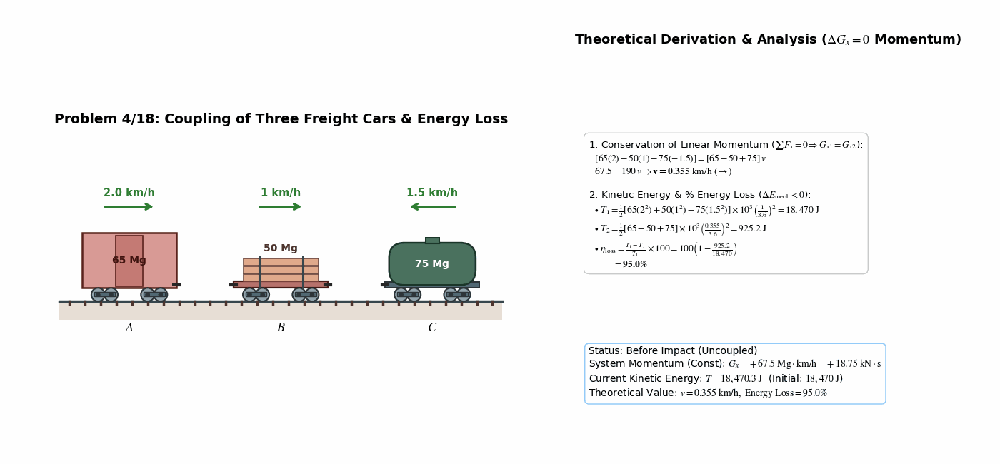
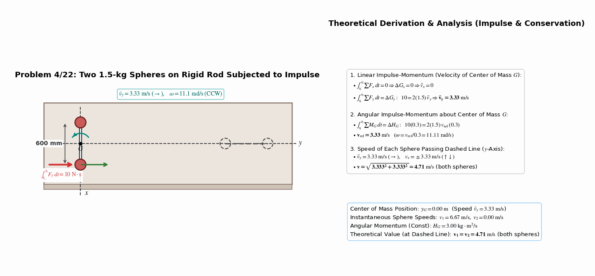
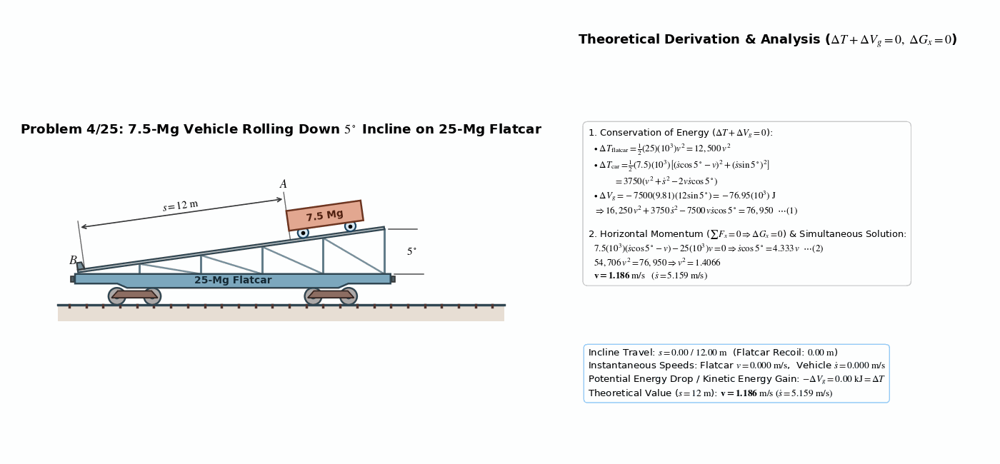

> **Author / Rights Holder:** 전북대학교 생물산업기계공학과 유동수 (ryudongsoo@jbnu.ac.kr)

# Week 12: Kinetics of Systems of Particles II — Chapter 4 Section 4.5: Conservation of Energy and Momentum

## 📌 Lecture Overview and Learning Objectives

- **Chapter**: Meriam & Kraige Dynamics 9th Edition Chapter 4: Kinetics of Systems of Particles — Section 4.5: Conservation of Energy and Momentum
- **Objectives**:
  - Master the law of conservation of dynamical energy ($\Delta T + \Delta V = 0,\ V = V_g + V_e$) for conservative particle systems including internal elastic springs
  - Apply conservation of linear momentum ($\Delta \mathbf{G} = \mathbf{0} \Rightarrow \bar{\mathbf{v}} = \text{const}$) and understand center-of-mass trajectory invariance during internal explosions
  - Formulate conservation of angular momentum about a fixed point $O$ or the mass center $G$ ($\Delta \mathbf{H}_O = \mathbf{0},\ \Delta \mathbf{H}_G = \mathbf{0}$) and angular impulse-momentum relations
  - Evaluate total kinetic energy ($T = \frac{1}{2}m\bar{v}^2 + \sum \frac{1}{2}m_i|\dot{\boldsymbol{\rho}}_i|^2$), linear momentum ($\mathbf{G} = m\bar{\mathbf{v}}$), and angular momentum ($\mathbf{H}_O$) for coupled translating-rotating multi-body assemblies
  - Solve coupled multi-body dynamics problems combining relative velocity kinematics with conservation of energy and momentum

---

## 📋 Course Curriculum and Contents

| Type | No. | Problem Title | Governing Principle & Verified Result | Output Links |
|:---:|:---:|:---|:---|:---:|
| **Concept** | C1 | Midair Shell Explosion: CM Parabola vs. Energy Jump | $\sum \mathbf{f}_i = \mathbf{0} \Rightarrow \Delta G_x = 0,\ \mathbf{a}_G = \mathbf{g}$ (airborne) vs. $\Delta E_{\mathrm{mech}} > 0$ | [Code](./concept_explosion_cm_parabola.py) \| [GIF](./concept_explosion_cm_parabola.gif) |
| **Concept** | C2 | Conservation Checklist (Coupling vs. Smooth Wedge) | Case A: $\Delta G_x = 0,\ \Delta E < 0$ / Case B: $\Delta G_x = 0,\ \Delta T + \Delta V_g = 0$ both hold | [Code](./concept_conservation_checklist.py) \| [GIF](./concept_conservation_checklist.gif) |
| **Example** | 4.4 | 20-kg Shell Exploding at Apex P (3D) | $\mathbf{G}_1 = \mathbf{G}_2 \Rightarrow \mathbf{v}_C = 427\mathbf{i} - 173.4\mathbf{j} - 82.5\mathbf{k}\ \mathrm{m/s}\ (468\ \mathrm{m/s})$ | [Code](./ex4_4_shell_explosion_3d.py) \| [GIF](./ex4_4_shell_explosion_3d.gif) |
| **Example** | 4.5 | Carriage with Counter-Rotating Balls | (a) $T = 54.7\ \mathrm{J}$, (b) $G = 26.9\ \mathrm{kg\cdot m/s}$, (c) $H_O = 2.41\ \mathrm{kg\cdot m^2/s}$ | [Code](./ex4_5_carriage_rotating_balls.py) \| [GIF](./ex4_5_carriage_rotating_balls.gif) |
| **Intro** | 4/15 | Rotating Frame with Three Spheres | $\int_0^5 M_O\,dt = \left(\sum m_i r_i^2\right)\Delta\dot{\theta} \Rightarrow 150 = 2.47(\dot{\theta}' - 20) \Rightarrow \dot{\theta}' = 80.7\ \mathrm{rad/s}$ | [Code](./prob4_15_rotating_frame_spheres.py) \| [GIF](./prob4_15_rotating_frame_spheres.gif) |
| **Intro** | 4/18 | Coupling of Three Freight Cars | $G_1 = G_2 \Rightarrow v = 0.355\ \mathrm{km/h}\ (\rightarrow)$, Energy Loss $n = 95.0\%$ | [Code](./prob4_18_three_freight_cars.py) \| [GIF](./prob4_18_three_freight_cars.gif) |
| **Intro** | 4/22 | Two Spheres on Rigid Rod with Impulse | $v_y = 3.33\ \mathrm{m/s},\ v_x = 3.33\ \mathrm{m/s} \Rightarrow v = 3.33\sqrt{2} = 4.71\ \mathrm{m/s}$ | [Code](./prob4_22_rigid_rod_two_spheres.py) \| [GIF](./prob4_22_rigid_rod_two_spheres.gif) |
| **Advanced** | 4/25 | Vehicle on 5° Incline of 25-Mg Flatcar | $\Delta T + \Delta V_g = 0,\ \Delta G_x = 0 \Rightarrow v = 1.186\ \mathrm{m/s}\ (\dot{s} = 5.159\ \mathrm{m/s})$ | [Code](./prob4_25_flatcar_incline_car.py) \| [GIF](./prob4_25_flatcar_incline_car.gif) |

---

## 0. Supplementary Concept Animations

### 0.1 Parabolic Center-of-Mass Trajectory vs. Energy Jump in Midair Explosion

- **Core Principles**:
  - Because explosive forces are internal ($\sum \mathbf{f}_i = \mathbf{0}$), gravity remains the sole external force while all fragments are airborne; thus $\Delta G_x = 0$ and the mass center $G$ continues along the exact unexploded parabola ($\mathbf{a}_G = \mathbf{g}$)
  - Meanwhile, positive nonconservative internal work ($U'_{1-2,\mathrm{int}} > 0$) from chemical energy causes a discontinuous jump in total mechanical energy ($\Delta E_{\mathrm{mech}} > 0$)
  - Once any fragment hits the ground ($t > t_{\mathrm{hit}}$), external ground reaction acts on the system and ends the free-flight CM parabola rule

---

### 0.2 Multi-Body Conservation Checklist: Inelastic Coupling vs. Smooth Moving Wedge

- **Core Principles**:
  - **Case A (Horizontal Inelastic Coupling)**: Zero horizontal external force ensures $\Delta G_x = 0$, whereas internal coupling deformation dissipates mechanical energy ($\Delta E_{\mathrm{mech}} < 0$)
  - **Case B (Frictionless Moving Wedge + Block)**: Zero horizontal external force ensures $\Delta G_x = 0$, AND the internal normal force pair ($\mathbf{N},\ -\mathbf{N}$) performs zero net work on the 2-body system so $\Delta T + \Delta V_g = 0$ holds simultaneously

---

## 1. Textbook Core Examples (Sample Problems 4/4 ~ 4/5)

### 1.1 Sample Problem 4/4: 20-kg Shell Exploding at Trajectory Apex in 3D

- **Problem Statement**: A $20\ \mathrm{kg}$ shell is fired from point $O$ with initial velocity $u = 300\ \mathrm{m/s}$ at a $3:4:5$ slope in the vertical $x$-$z$ plane. At the apex $P$, it explodes into three fragments $A(5\ \mathrm{kg}),\ B(9\ \mathrm{kg}),\ C(6\ \mathrm{kg})$. Fragment $A$ rises $h_A = 500\ \mathrm{m}$ vertically above $P$, while fragment $B$ leaves $P$ horizontally and lands at point $Q$ ($s = 4000\ \mathrm{m}$ at $45^\circ$ in the $x$-$y$ plane). Determine the velocity of fragment $C$ immediately after the explosion.
- **Dynamic Analysis**:
  - Time to reach apex $P$ and altitude $h$:
    $$t = \frac{u_z}{g} = \frac{300(4/5)}{9.81} = 24.5\ \mathrm{s}, \qquad h = \frac{u_z^2}{2g} = \frac{[300(4/5)]^2}{2(9.81)} = 2940\ \mathrm{m}$$
  - Speeds of fragments $A$ and $B$ immediately after explosion:
    $$v_A = \sqrt{2gh_A} = \sqrt{2(9.81)(500)} = 99.0\ \mathrm{m/s} \quad (\mathbf{v}_A = 99.0\mathbf{k}\ \mathrm{m/s})$$
    $$v_B = \frac{s}{t} = \frac{4000}{24.5} = 163.5\ \mathrm{m/s} \quad (\mathbf{v}_B = 163.5(\mathbf{i}\cos 45^\circ + \mathbf{j}\sin 45^\circ)\ \mathrm{m/s})$$
  - Conservation of 3D linear momentum ($\mathbf{G}_1 = \mathbf{G}_2 \Rightarrow m\mathbf{v} = m_A\mathbf{v}_A + m_B\mathbf{v}_B + m_C\mathbf{v}_C$):
    $$20(300)\left(\frac{3}{5}\right)\mathbf{i} = 5(99.0\mathbf{k}) + 9(163.5)(\mathbf{i}\cos 45^\circ + \mathbf{j}\sin 45^\circ) + 6\mathbf{v}_C$$
    $$6\mathbf{v}_C = 2560\mathbf{i} - 1040\mathbf{j} - 495\mathbf{k} \implies \mathbf{\mathbf{v}_C = 427\mathbf{i} - 173.4\mathbf{j} - 82.5\mathbf{k}\ \mathrm{m/s}}$$
    $$\mathbf{v_C = \sqrt{(427)^2 + (173.4)^2 + (82.5)^2} = 468\ \mathrm{m/s}}$$

---

### 1.2 Sample Problem 4/5: Translating Carriage with Counter-Rotating 4-Ball Assemblies

- **Problem Statement**: A $16\ \mathrm{kg}$ carriage $A$ moves horizontally at $v = 1.2\ \mathrm{m/s}$ while carrying two rotating subassemblies of four $1.6\ \mathrm{kg}$ balls about $O$ (front pair 1, 2: $r = 450\ \mathrm{mm}$ at $80\ \mathrm{rev/min}$ CCW; rear pair 3, 4: $r = 300\ \mathrm{mm}$ at $100\ \mathrm{rev/min}$ CW). Compute (a) total kinetic energy $T$, (b) linear momentum $\mathbf{G}$, and (c) angular momentum $\mathbf{H}_O$ about $O$.
- **Dynamic Analysis**:
  - **(a) Kinetic Energy ($T$)**:
    - Relative speeds about $O$:
      $$(v_{\mathrm{rel}})_{1,2} = 0.450 \frac{80(2\pi)}{60} = 3.77\ \mathrm{m/s}, \qquad (v_{\mathrm{rel}})_{3,4} = 0.300 \frac{100(2\pi)}{60} = 3.14\ \mathrm{m/s}$$
    - Translational part: $\frac{1}{2}m\bar{v}^2 = \frac{1}{2}[16 + 4(1.6)](1.2^2) = 16.13\ \mathrm{J}$
    - Rotational part: $\sum \frac{1}{2}m_i|\dot{\boldsymbol{\rho}}_i|^2 = 2\left[\frac{1}{2}(1.6)(3.77^2)\right]_{(1,2)} + 2\left[\frac{1}{2}(1.6)(3.14^2)\right]_{(3,4)} = 22.7 + 15.79 = 38.5\ \mathrm{J}$
    - Total kinetic energy: $\mathbf{T = 16.13 + 38.5 = 54.7\ \mathrm{J}}$
  - **(b) Linear Momentum ($\mathbf{G}$)**:
    $$\mathbf{G = m\bar{v} = [16 + 4(1.6)](1.2) = 26.9\ \mathrm{kg\cdot m/s}\ (\rightarrow)}$$
  - **(c) Angular Momentum about $O$ ($\mathbf{H}_O$, CCW positive $+$)**:
    $$H_O = \sum |\mathbf{r}_i \times m_i\mathbf{v}_i| = [2(1.6)(0.450)(3.77)]_{(1,2)} - [2(1.6)(0.300)(3.14)]_{(3,4)} = 5.43 - 3.02 = \mathbf{+2.41\ \mathrm{kg\cdot m^2/s}\ (\mathrm{CCW})}$$

---

## 2. Practice Problems (3 Introductory + 1 Advanced)

### 2.1 Problem 4/15: Rotating Light Rigid Frame with Three Welded Spheres

- **Problem Statement**: A light rigid frame with three welded spheres ($3\ \mathrm{kg}$ @ $0.5\ \mathrm{m}$, $4\ \mathrm{kg}$ @ $0.4\ \mathrm{m}$, $3\ \mathrm{kg}$ @ $0.6\ \mathrm{m}$) rotates in a horizontal plane about a vertical axis through $O$ with $\dot{\theta} = 20\ \mathrm{rad/s}$. Determine the new angular velocity $\dot{\theta}'$ after a constant couple $M_O = 30\ \mathrm{N\cdot m}$ is applied for $5\ \mathrm{s}$.
- **Calculations**:
  - Angular impulse-momentum relation ($\sum M_O = \dot{H}_O = \frac{dH_O}{dt} \Rightarrow \int_0^5 \sum M_O\, dt = \Delta H_O$, CW positive $+$):
    $$M_O t = \Delta \left|\sum m_i r_i (r_i \dot{\theta})\right| = \left(\sum m_i r_i^2\right) \Delta\dot{\theta}$$
    $$30 \times 5 = \left[3(0.5)^2 + 4(0.4)^2 + 3(0.6)^2\right] (\dot{\theta}' - 20)$$
    $$150 = 2.47(\dot{\theta}' - 20) \implies \mathbf{\dot{\theta}' = 60.7 + 20 = 80.7\ \mathrm{rad/s}}$$

---

### 2.2 Problem 4/18: Coupling of Three Freight Cars and Energy Loss

- **Problem Statement**: Three freight cars $A(65\ \mathrm{Mg},\ 2\ \mathrm{km/h}\rightarrow)$, $B(50\ \mathrm{Mg},\ 1\ \mathrm{km/h}\rightarrow)$, and $C(75\ \mathrm{Mg},\ 1.5\ \mathrm{km/h}\leftarrow)$ roll on a horizontal track and couple together after impact. Compute the final common velocity $v$ and percentage loss of system kinetic energy.
- **Calculations**:
  - Conservation of horizontal linear momentum ($\sum F_x = 0 \Rightarrow G_1 = G_2$):
    $$[65(2) + 50(1) + 75(-1.5)] = [65 + 50 + 75]\,v \implies 67.5 = 190\,v \implies \mathbf{v = 0.355\ \mathrm{km/h}\ (\rightarrow)}$$
  - Percentage loss of energy ($\frac{T_1 - T_2}{T_1}\times 100$):
    $$\text{Loss }\% = 100\left(1 - \frac{\frac{1}{2}[65+50+75]\times 10^3 [0.355/3.6]^2}{\frac{1}{2}[65(2^2) + 50(1^2) + 75(1.5^2)]\times 10^3 (1/3.6)^2}\right) = 100\left(1 - \frac{925.2}{18,470}\right) = \mathbf{95.0\%}$$

---

### 2.3 Problem 4/22: Two Spheres on a Light Rigid Rod Subjected to an Impulse

- **Problem Statement**: Two $1.5\ \mathrm{kg}$ spheres connected by a $600\ \mathrm{mm}$ light rigid rod rest on a smooth horizontal surface. One sphere is struck with a $y$-directed force imparting a $10\ \mathrm{N\cdot s}$ linear impulse over a very short duration. Calculate the speed of each sphere as the assembly passes the dashed line ($y$-axis).
- **Calculations**:
  - Linear impulse-momentum equations:
    $$\int_{t_1}^{t_2} \sum F_x\, dt = 0 \implies \Delta G_x = 0, \qquad \int_{t_1}^{t_2} \sum F_y\, dt = \Delta G_y:\ \ 10 = 2(1.5)\,v_y \implies v_y = 3.33\ \mathrm{m/s}$$
  - Angular impulse-momentum about mass center $G$:
    $$\int_{t_1}^{t_2} \sum M_G\, dt = \Delta H_G:\ \ 10(0.3) = 2(1.5)\,v_x\,(0.3) \implies v_x = 3.33\ \mathrm{m/s}$$
  - Speed of each sphere passing the dashed line:
    $$\mathbf{v = 3.33\sqrt{2} = 4.71\ \mathrm{m/s}\ (\mathrm{both\ spheres})}$$

---

### 2.4 Problem 4/25: 7.5-Mg Vehicle Rolling Down a 5° Incline on a 25-Mg Flatcar

- **Problem Statement**: A $7.5\ \mathrm{Mg}$ vehicle rests on a $5^\circ$ incline mounted on a $25\ \mathrm{Mg}$ flatcar. If both are initially at rest and the vehicle rolls $s = 12\ \mathrm{m}$ down the incline before hitting stop $B$, determine the speed $v$ of the flatcar just before impact with $B$ (neglect all friction).
- **Calculations**:
  - Conservation of mechanical energy ($\Delta T + \Delta V_g = 0$):
    - Flatcar: $\Delta T_{\mathrm{flatcar}} = \frac{1}{2}(25)(10^3)v^2 = 12,500\,v^2,\quad \Delta V_g = 0$
    - Vehicle: $\Delta T_{\mathrm{car}} = \frac{1}{2}(7.5)(10^3)\left[(\dot{s}\cos 5^\circ - v)^2 + (\dot{s}\sin 5^\circ)^2\right] = 3750(v^2 + \dot{s}^2 - 2v\dot{s}\cos 5^\circ)$
    - Gravitational potential drop: $\Delta V_g = -mg\Delta h = -7500(9.81)(12\sin 5^\circ) = -76.95(10^3)\ \mathrm{J}$
    - Combined equation (1): $12,500\,v^2 + 3750\,v^2 + 3750\,\dot{s}^2 - 7500\,v\dot{s}\cos 5^\circ - 76.95(10^3) = 0$
  - Conservation of horizontal linear momentum ($\sum F_x = 0 \Rightarrow \Delta G_x = 0$):
    $$7.5(10^3)(\dot{s}\cos 5^\circ - v) - 25(10^3)v = 0 \implies \dot{s}\cos 5^\circ = 4.333\,v \quad \cdots \text{Eq. (2)}$$
  - Simultaneous solution of (1) and (2):
    $$16,250\,v^2 + 3750\left[\frac{4.333\,v}{\cos 5^\circ}\right]^2 - 7500(4.333\,v^2) = 76,950 \implies 54,706\,v^2 = 76,950 \implies v^2 = 1.4066$$
    $$\mathbf{v = 1.186\ \mathrm{m/s}} \quad (\dot{s} = 5.159\ \mathrm{m/s})$$

---

## 📝 변경 이력 (Changelog)
- **2026-11-01 23:35:00** [[Dongsoo Ryu](mailto:ryudongsoo@jbnu.ac.kr)] feat: release Weeks 1–15 bilingual biomechanics simulation portfolio & supplementary concept animations

- **2026-11-01 21:20:00** [[Dongsoo Ryu](mailto:ryudongsoo@jbnu.ac.kr)] feat(biomechanics): add 2 supplementary Ch.4.5 concept animations, enforce STIX math & explicit integral limits across all 8 GIFs (ko/en 1:1 parity)
- **2026-10-15 00:15:00** [[Dongsoo Ryu](mailto:ryudongsoo@jbnu.ac.kr)] feat(biomechanics): complete Week 12 Ch.4.5 Conservation of Energy and Momentum curriculum, slides, and 6 simulation GIFs (ko/en 1:1 parity)
