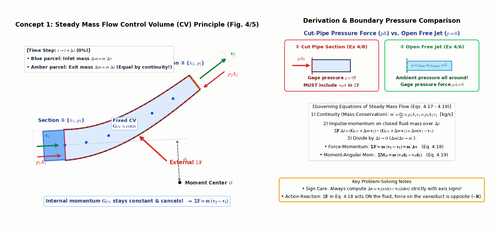
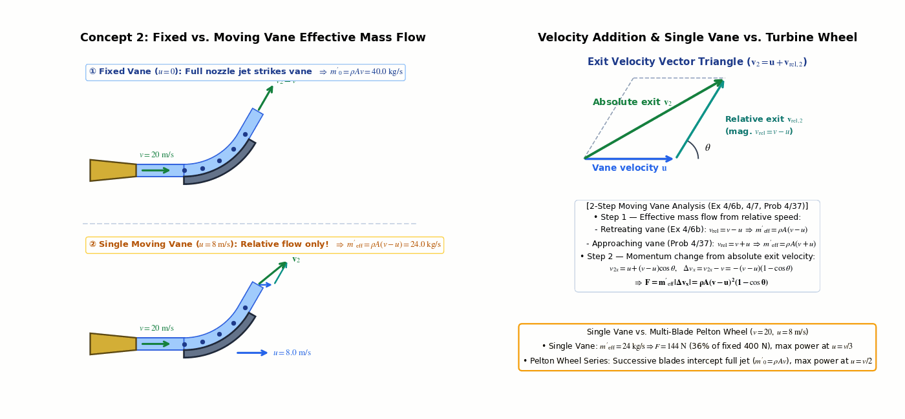
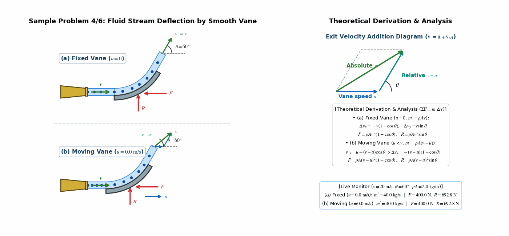
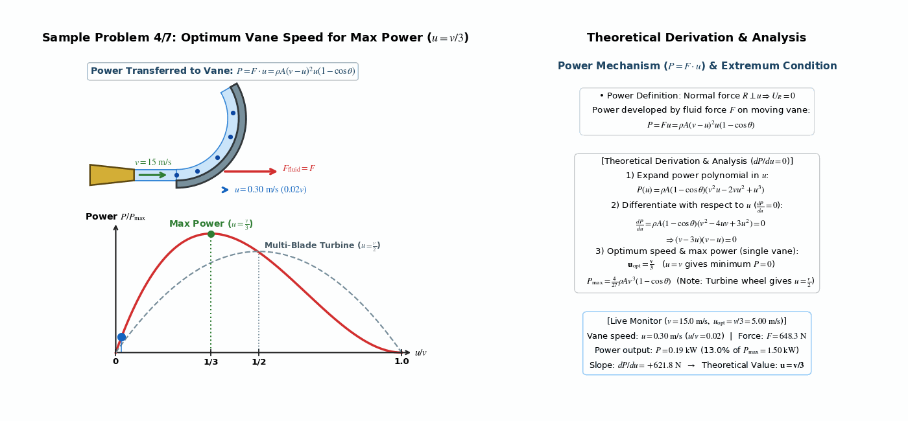
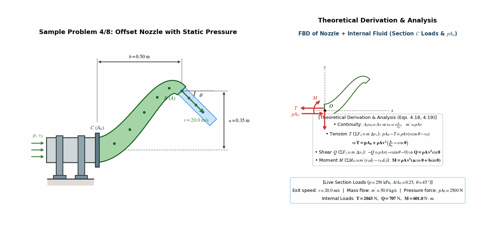
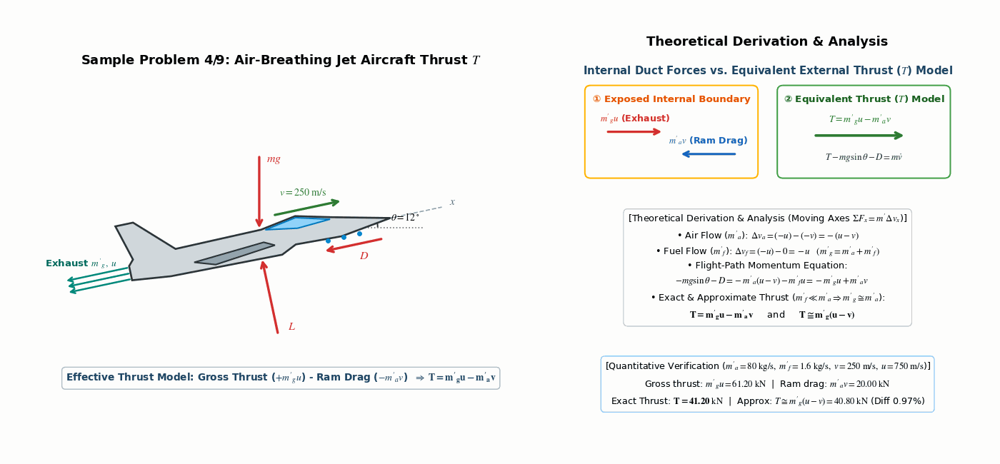
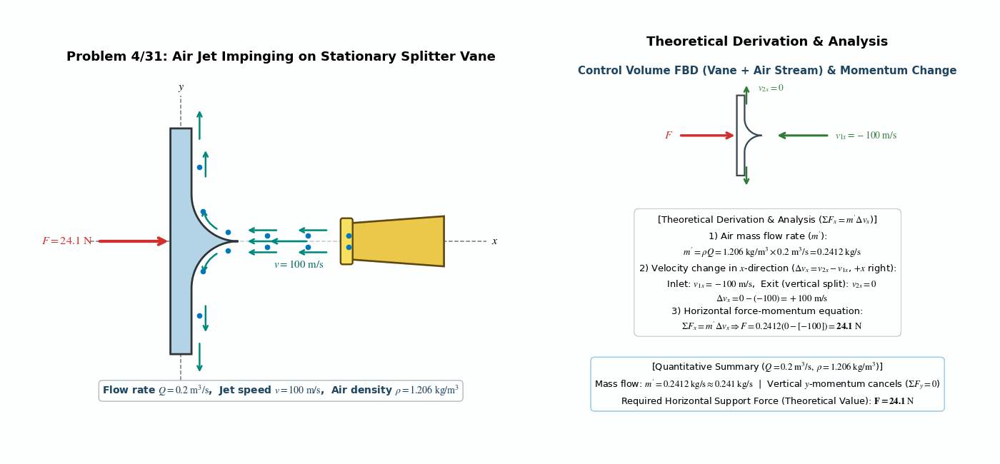
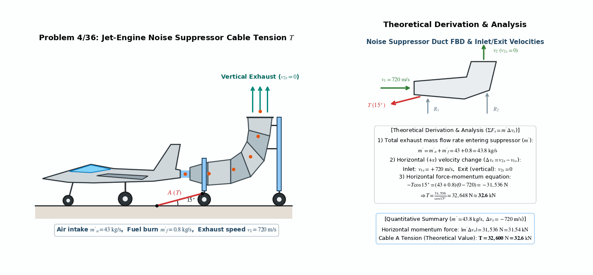
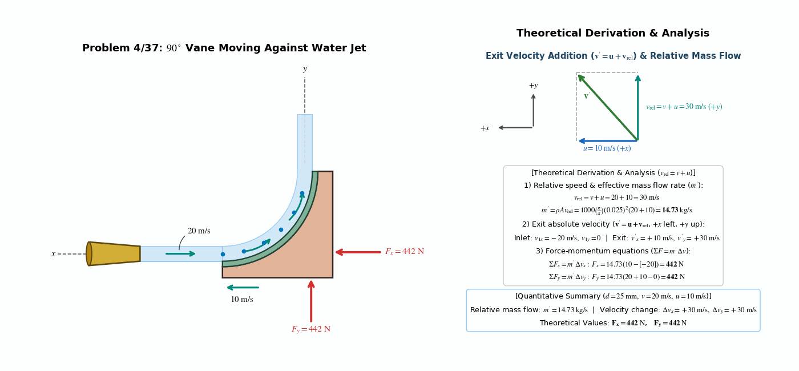
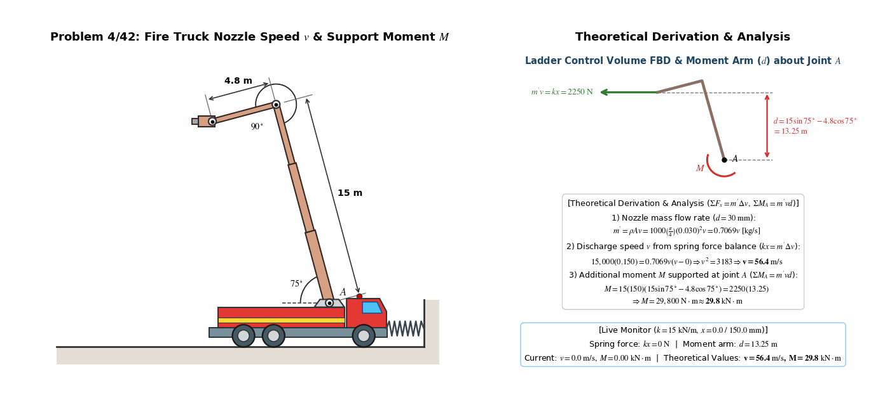

> **Author / Rights Holder:** 전북대학교 생물산업기계공학과 유동수 (ryudongsoo@jbnu.ac.kr, ryudongsoo@gmail.com)

# Week 13: Kinetics of Systems of Particles III — Chapter 4 Section 4.6: Steady Mass Flow

## 📌 Lecture Overview and Learning Objectives

- **Chapter**: Meriam & Kraige Dynamics 9th Edition Chapter 4: Kinetics of Systems of Particles — Section 4.6: Steady Mass Flow
- **Objectives**:
  - Understand the Control Volume concept and apply the conservation of mass continuity equation ($m' = \rho_1 A_1 v_1 = \rho_2 A_2 v_2$)
  - Derive and apply the steady-flow force-linear momentum equation ($\Sigma\mathbf{F} = m'\Delta\mathbf{v} = m'(\mathbf{v}_2 - \mathbf{v}_1)$) via incremental momentum analysis
  - Construct complete Free-Body Diagrams (FBDs) of fluid-plus-container control volumes including structural reactions, static gage pressure forces ($pA$), and weight
  - Apply the angular momentum principle for steady-flow systems ($\Sigma M_O = m'(v_2 d_2 - v_1 d_1)$) to pipe flanges and articulated ladder structures
  - Analyze relative velocities and thrust ($T$) in moving vanes, turbine blades, and air-breathing jet aircraft

---

## 📋 Course Curriculum and Contents

| Type | No. | Problem Title | Governing Principle & Verified Result | Output Links |
|:---:|:---:|:---|:---|:---:|
| **Concept** | 4.6-1 | Steady-Flow Control Volume & Pressure | $\Delta m = m'\Delta t,\ \Sigma\mathbf{F} = m'(\mathbf{v}_2 - \mathbf{v}_1)$, Cut-pipe $pA$ vs. Free jet $p=0$ | [Code](./concept_steady_flow_cv.py) \| [GIF](./concept_steady_flow_cv.gif) |
| **Concept** | 4.6-2 | Fixed vs. Moving Vane Relative Flow | Single moving vane $m'_{\mathrm{eff}} = \rho A(v-u)$ vs. Turbine $m'_0 = \rho A v$, $\mathbf{v}_2 = \mathbf{u} + \mathbf{v}_{\mathrm{rel},2}$ | [Code](./concept_moving_vane_rel_vel.py) \| [GIF](./concept_moving_vane_rel_vel.gif) |
| **Example** | 4.6 | Fluid Deflection by Smooth Vane | (a) Fixed $F = \rho Av^2(1-\cos\theta)$, (b) Moving $F = \rho A(v-u)^2(1-\cos\theta)$ | [Code](./ex4_6_fluid_vane_deflection.py) \| [GIF](./ex4_6_fluid_vane_deflection.gif) |
| **Example** | 4.7 | Moving Vane Maximum Power | $P = Fu = \rho A(v-u)^2 u(1-\cos\theta),\ \frac{dP}{du}=0 \Rightarrow \mathbf{u = \frac{v}{3}}$ | [Code](./ex4_7_moving_vane_max_power.py) \| [GIF](./ex4_7_moving_vane_max_power.gif) |
| **Example** | 4.8 | Offset Nozzle Pipe Loads | $T = pA_0 + \rho Av^2(\frac{A}{A_0}-\cos\theta),\ Q = \rho Av^2\sin\theta,\ M = \rho Av^2(a\cos\theta+b\sin\theta)$ | [Code](./ex4_8_offset_nozzle_pipe.py) \| [GIF](./ex4_8_offset_nozzle_pipe.gif) |
| **Example** | 4.9 | Air-Breathing Jet Thrust | $m'_g u - m'_a v = mg\sin\theta + D \Rightarrow \mathbf{T = m'_g u - m'_a v \cong m'_g(u-v)}$ | [Code](./ex4_9_jet_aircraft_thrust.py) \| [GIF](./ex4_9_jet_aircraft_thrust.gif) |
| **Intro** | 4/31 | Air-Jet Splitter Vane Force | $m' = \rho Q = 0.241\ \mathrm{kg/s},\ \Sigma F_x = m'\Delta v_x \Rightarrow \mathbf{F = 24.1\ \mathrm{N}}$ | [Code](./prob4_31_air_jet_vane.py) \| [GIF](./prob4_31_air_jet_vane.gif) |
| **Intro** | 4/36 | Jet Noise Suppressor Cable | $m' = 43 + 0.8 = 43.8\ \mathrm{kg/s},\ -T\cos 15^\circ = m'(0-720) \Rightarrow \mathbf{T = 32.6\ \mathrm{kN}}$ | [Code](./prob4_36_jet_noise_suppressor.py) \| [GIF](./prob4_36_jet_noise_suppressor.gif) |
| **Intro** | 4/37 | $90^\circ$ Moving Vane Forces | $v_{\mathrm{rel}} = 30\ \mathrm{m/s},\ m' = 14.73\ \mathrm{kg/s} \Rightarrow \mathbf{F_x = 442\ \mathrm{N},\ F_y = 442\ \mathrm{N}}$ | [Code](./prob4_37_moving_90deg_vane.py) \| [GIF](./prob4_37_moving_90deg_vane.gif) |
| **Advanced** | 4/42 | Fire Ladder Truck Nozzle | $kx = m'v \Rightarrow \mathbf{v = 56.4\ \mathrm{m/s}},\ \Sigma M_A = m'vd \Rightarrow \mathbf{M = 29.8\ \mathrm{kN\cdot m}}$ | [Code](./prob4_42_fire_truck_nozzle.py) \| [GIF](./prob4_42_fire_truck_nozzle.gif) |

---

## 0. Supplementary Concept Animations

### 0.1 Concept 1: Control Volume (CV) Steady Mass Flow Principle & Boundary Pressure Forces

- **Core Principle**:
  - During time increment $\Delta t$, the fluid mass entering inlet section ① ($\Delta m = m'\Delta t$) equals the mass leaving exit section ② ($\Delta m = m'\Delta t$, $m' = \rho_1 A_1 v_1 = \rho_2 A_2 v_2$). Because internal fluid momentum $\mathbf{G}_{\mathrm{CV}}$ remains constant in steady flow, it cancels out, yielding $\Sigma\mathbf{F} = m'(\mathbf{v}_2 - \mathbf{v}_1)$.
  - **Boundary Pressure Forces**: At a cut pipe section (Sample Problem 4/8), static gage pressure exerts an inward external force $+pA$ that must be included in $\Sigma\mathbf{F}$; for an open free jet in atmosphere (Sample Problem 4/6, Problems 4/31, 4/37), $p_{\mathrm{gauge}} = 0$ so pressure force vanishes.

---

### 0.2 Concept 2: Fixed Vane ($u=0$) vs. Single Moving Vane ($u>0$) Effective Mass Flow & Velocity Triangle

- **Core Principle**:
  - While a fixed vane ($u=0$) intercepts the full nozzle mass flow $m'_0 = \rho A v$, a **single retreating vane** moving at speed $u$ recedes by $u\Delta t$ during $\Delta t$, reducing the effective deflected mass flow to $m'_{\mathrm{eff}} = \rho A(v - u)$ (whereas a multi-blade Pelton turbine wheel intercepts the entire jet $m'_0 = \rho A v$).
  - The absolute exit velocity is obtained via the vector sum of vane velocity and relative tangential exit velocity ($\mathbf{v}_2 = \mathbf{u} + \mathbf{v}_{\mathrm{rel},2}$).

---

## 1. Textbook Core Examples (Sample Problems 4/6 ~ 4/9)

### 1.1 Sample Problem 4/6: Fluid Stream Deflection by Smooth Vane (Fixed & Moving)

- **Problem Statement**: A smooth vane diverts an open stream of cross-sectional area $A$, mass density $\rho$, and velocity $v$ through an angle $\theta$. Determine the force components $R$ and $F$ required (a) to hold the vane in a fixed position and (b) when the vane moves with constant velocity $u < v$ in the direction of $v$.
- **Dynamic Analysis**:
  - **(a) Fixed Vane ($u = 0$)**:
    - Exit speed $v' = v$, mass flow rate $m' = \rho A v$
    - Velocity changes: $\Delta v_x = v\cos\theta - v = -v(1 - \cos\theta),\ \Delta v_y = v\sin\theta - 0 = v\sin\theta$
    - Force components: $-F = m'\Delta v_x \Rightarrow \mathbf{F = \rho A v^2(1 - \cos\theta)},\quad R = m'\Delta v_y \Rightarrow \mathbf{R = \rho A v^2\sin\theta}$
  - **(b) Moving Vane ($u < v$)**:
    - Effective mass flow rate over the vane: $m' = \rho A(v - u)$
    - Exit absolute velocity ($\mathbf{v}' = \mathbf{u} + \mathbf{v}_{\mathrm{rel}}$): $v'_x = u + (v - u)\cos\theta,\ v'_y = (v - u)\sin\theta$
    - Velocity changes: $\Delta v_x = v'_x - v = -(v - u)(1 - \cos\theta),\ \Delta v_y = (v - u)\sin\theta$
    - Force components: $\mathbf{F = \rho A(v - u)^2(1 - \cos\theta)},\quad \mathbf{R = \rho A(v - u)^2\sin\theta}$

---

### 1.2 Sample Problem 4/7: Optimum Vane Speed for Maximum Power

- **Problem Statement**: For the moving single vane of Sample Problem 4/6, determine the optimum speed $u$ of the vane for the generation of maximum power from the action of the fluid on the vane.
- **Dynamic Analysis**:
  - Force $R$ is normal to the velocity $u$ and does no work ($U_R = 0$)
  - Power developed by the fluid force $F$ acting on the moving vane:
    $$P = F u = \rho A(v - u)^2 u (1 - \cos\theta)$$
  - Extremum condition ($\frac{dP}{du} = 0$):
    $$\frac{dP}{du} = \rho A(1 - \cos\theta)(v^2 - 4uv + 3u^2) = \rho A(1 - \cos\theta)(v - 3u)(v - u) = 0$$
  - Optimum vane speed and maximum power:
    $$\mathbf{u = \frac{v}{3}} \implies P_{\max} = \frac{4}{27}\rho A v^3(1 - \cos\theta)$$
    *(Note: For a multi-blade turbine wheel where all nozzle discharge impacts the blades, $m' = \rho A v$ and the optimum speed is $u = \frac{v}{2}$.)*

---

### 1.3 Sample Problem 4/8: Offset Nozzle Pipe Internal Section Loads

- **Problem Statement**: The offset nozzle has a discharge area $A$ at $B$ and an inlet area $A_0$ at $C$ (vertical offset $a$, horizontal distance $b$). Liquid of density $\rho$ enters at static gage pressure $p$ and is discharged at velocity $v$ at angle $\theta$. Determine the tension $T$, shear $Q$, and bending moment $M$ in the pipe at $C$.
- **Dynamic Analysis**:
  - Continuity for incompressible liquid: $A_0 v_0 = A v \Rightarrow v_0 = v\frac{A}{A_0},\quad m' = \rho A v$
  - **$x$-direction (Tension $T$)**: Including static pressure force $+pA_0$ pushing on the inlet fluid section,
    $$\Sigma F_x = m'\Delta v_x \implies p A_0 - T = \rho A v(v\cos\theta - v_0) \implies \mathbf{T = p A_0 + \rho A v^2\left(\frac{A}{A_0} - \cos\theta\right)}$$
  - **$y$-direction (Shear $Q$)**:
    $$\Sigma F_y = m'\Delta v_y \implies -Q = \rho A v(-v\sin\theta - 0) \implies \mathbf{Q = \rho A v^2\sin\theta}$$
  - **Moment about $O$ (Bending Moment $M$, clockwise positive)**:
    $$\Sigma M_O = m'(v_2 d_2 - v_1 d_1) \implies M = \rho A v(v\cos\theta\cdot a + v\sin\theta\cdot b - 0) \implies \mathbf{M = \rho A v^2(a\cos\theta + b\sin\theta)}$$

---

### 1.4 Sample Problem 4/9: Air-Breathing Jet Aircraft Motion and Thrust $T$

- **Problem Statement**: An air-breathing jet aircraft of total mass $m$ flies at constant speed $v$ at climb angle $\theta$, taking in air at mass rate $m'_a$, burning fuel at rate $m'_f$, and exhausting gas at rate $m'_g = m'_a + m'_f$ with relative rearward velocity $u$. Write the equation of motion and determine the thrust $T$.
- **Dynamic Analysis**:
  - In translating $x$-$y$ axes attached to the aircraft ($+x$ forward):
    - Air flow ($m'_a$): $\Delta v_a = -u - (-v) = -(u - v)$
    - Fuel flow ($m'_f$): $\Delta v_f = -u - 0 = -u$
  - Flight-path momentum equation:
    $$\Sigma F_x = m'\Delta v_x \implies -mg\sin\theta - D = -m'_a(u - v) - m'_f u = -(m'_a + m'_f)u + m'_a v = -m'_g u + m'_a v$$
    $$\implies m'_g u - m'_a v = mg\sin\theta + D$$
  - **Effective Thrust $T$ and Approximation ($m'_f \ll m'_a \Rightarrow m'_g \cong m'_a$)**:
    $$\mathbf{T = m'_g u - m'_a v} \qquad \text{and} \qquad \mathbf{T \cong m'_g(u - v)}$$

---

## 2. Practice Problems (3 Introductory + 1 Advanced)

### 2.1 Problem 4/31: Air Jet Impinging on Stationary Splitter Vane

- **Problem Statement**: The air jet is discharged from the nozzle at a volume flow rate $Q = 0.2\ \mathrm{m^3/s}$ with a velocity $v = 100\ \mathrm{m/s}$ to the left. Calculate the horizontal force $F$ required to hold the splitter vane in a fixed position ($\rho = 1.206\ \mathrm{kg/m^3}$).
- **Calculations**:
  - Mass flow rate:
    $$m' = \rho Q = 1.206(0.2) = 0.2412\ \mathrm{kg/s} \approx 0.241\ \mathrm{kg/s}$$
  - Horizontal force-momentum equation ($+x$ to the right):
    $$\Sigma F_x = m'\Delta v_x \implies F = 0.2412(0 - [-100]) = \mathbf{24.1\ \mathrm{N}}$$

---

### 2.2 Problem 4/36: Jet-Engine Noise Suppressor Cable Tension

- **Problem Statement**: A jet-engine noise suppressor consists of a movable duct secured directly behind the jet exhaust by cable $A$ at $15^\circ$. During a ground test, the engine sucks in air at $m'_a = 43\ \mathrm{kg/s}$ and burns fuel at $m'_f = 0.8\ \mathrm{kg/s}$ with horizontal exhaust velocity $v_1 = 720\ \mathrm{m/s}$, which is deflected vertically upward. Determine the tension $T$ in the cable.
- **Calculations**:
  - Total exhaust mass flow rate entering suppressor:
    $$m' = m'_a + m'_f = 43 + 0.8 = 43.8\ \mathrm{kg/s}$$
  - Horizontal force-momentum equation ($+x$ right, $v_{1x} = +720\ \mathrm{m/s},\ v_{2x} = 0$):
    $$\Sigma F_x = m'\Delta v_x \implies -T\cos 15^\circ = (43 + 0.8)(0 - 720) = -31,536\ \mathrm{N}$$
    $$\implies T = \frac{31,536}{\cos 15^\circ} = 32,648\ \mathrm{N} \approx \mathbf{32.6\ \mathrm{kN}\ (32,600\ \mathrm{N})}$$

---

### 2.3 Problem 4/37: $90^\circ$ Vane Moving Against Water Jet

- **Problem Statement**: A water jet of diameter $d = 25\ \mathrm{mm}$ is discharged to the right with speed $v = 20\ \mathrm{m/s}$. A $90^\circ$ vane moves to the left ($+x$) against the jet with speed $u = 10\ \mathrm{m/s}$. Determine the forces $F_x$ and $F_y$ required to maintain the motion of the vane.
- **Calculations**:
  - Relative speed and effective mass flow rate over the vane:
    $$v_{\mathrm{rel}} = v + u = 20 + 10 = 30\ \mathrm{m/s}$$
    $$m' = \rho A v_{\mathrm{rel}} = 1000\left(\frac{\pi}{4}\right)(0.025)^2(20 + 10) = \mathbf{14.73\ \mathrm{kg/s}}$$
  - Final absolute velocity of diverted water ($\mathbf{v}' = \mathbf{u} + \mathbf{v}_{\mathrm{rel}}$, $+x$ left, $+y$ upward):
    $$v'_{x} = +10\ \mathrm{m/s},\quad v'_{y} = +30\ \mathrm{m/s} \qquad (\text{Inlet: } v_{1x} = -20\ \mathrm{m/s},\ v_{1y} = 0)$$
  - Force-momentum equations:
    $$\Sigma F_x = m'\Delta v_x \implies F_x = 14.73(10 - [-20]) = \mathbf{442\ \mathrm{N}}$$
    $$\Sigma F_y = m'\Delta v_y \implies F_y = 14.73(20 + 10 - 0) = \mathbf{442\ \mathrm{N}}$$

---

### 2.4 Problem 4/42: Fire Ladder Truck Nozzle Speed and Joint Moment

- **Problem Statement**: In a test of a fire ladder truck with brakes released, the horizontal water stream discharged from the $30\ \mathrm{mm}$ diameter nozzle causes the truck to compress a spring ($k = 15\ \mathrm{kN/m}$) by $x = 150\ \mathrm{mm}$. Calculate the discharge velocity $v$ of the water stream and the additional moment $M$ which must be supported at joint $A$ when the pump and nozzle are operating ($15\ \mathrm{m}$ main ladder at $75^\circ$, $4.8\ \mathrm{m}$ upper boom at $90^\circ$ to the main ladder).
- **Calculations**:
  - **(1) Nozzle discharge velocity $v$**:
    - Mass flow rate: $m' = \rho A v = 1000\left(\frac{\pi}{4}\right)(0.030)^2 v = 0.7069 v\ [\mathrm{kg/s}]$
    - Horizontal force-momentum balance ($kx = m'\Delta v$):
      $$15,000(0.150) = 0.7069 v(v - 0) \implies v^2 = 3183 \implies \mathbf{v = 56.4\ \mathrm{m/s}}$$
  - **(2) Additional moment $M$ at joint $A$**:
    - Vertical moment arm $d$ from joint $A$ to horizontal nozzle jet line of action:
      $$d = 15\sin 75^\circ - 4.8\cos 75^\circ = 14.489 - 1.242 = 13.25\ \mathrm{m}$$
    - Angular momentum equation ($\Sigma M_A = m' v d$):
      $$M = (15 \times 150)(15\sin 75^\circ - 4.8\cos 75^\circ) = 2250(13.25) = 29,800\ \mathrm{N\cdot m} \approx \mathbf{29.8\ \mathrm{kN\cdot m}}$$

---

## 📝 변경 이력 (Changelog)
- **2026-11-01 23:35:00** [[Dongsoo Ryu](mailto:ryudongsoo@jbnu.ac.kr)] feat: release Weeks 1–15 bilingual biomechanics simulation portfolio & supplementary concept animations

- **2026-11-01 21:20:00** [[Dongsoo Ryu](mailto:ryudongsoo@jbnu.ac.kr)] feat(biomechanics): add 2 supplementary concept animations (CV steady flow & moving vane relative flow) and enforce STIX math rendering across all 10 Week 13 scripts
- **2026-10-15 00:25:00** [[Dongsoo Ryu](mailto:ryudongsoo@jbnu.ac.kr)] feat(biomechanics): complete Week 13 Ch.4.6 Steady Mass Flow curriculum with 4 sample problems and 4 practice problems verified quantitatively
- **2026-10-03 17:22:26** [[Dongsoo Ryu](mailto:ryudongsoo@jbnu.ac.kr)] feat(biomechanics): complete Week 7 Part B Work and Energy curriculum overhaul with 5 examples and 4 practice problems verified quantitatively
- **2026-10-02 23:28:18** [[Dongsoo Ryu](mailto:ryudongsoo@jbnu.ac.kr)] feat(patent): Leave applicant blank and set inventors to Yoo Dongsoo and Kim Sungmin for portable Brix meter patents (07, 08)
