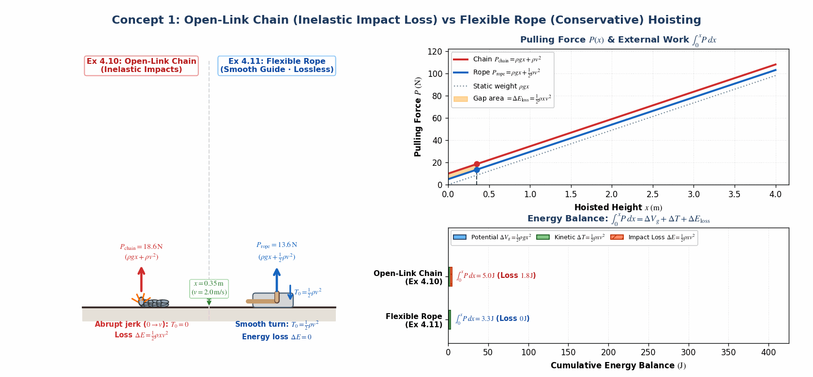
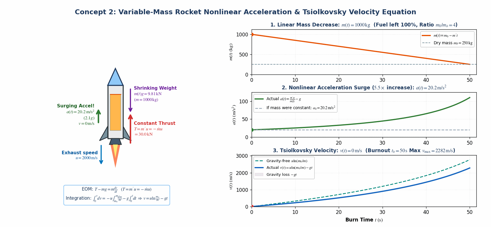
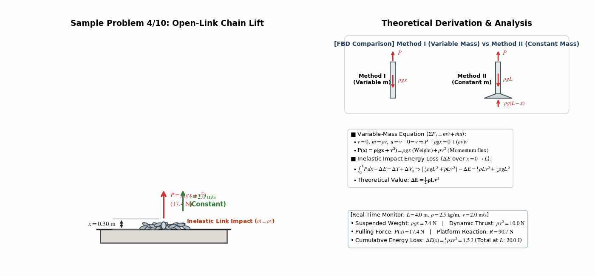
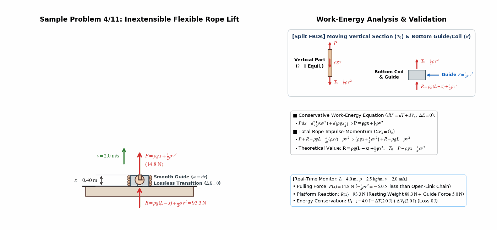
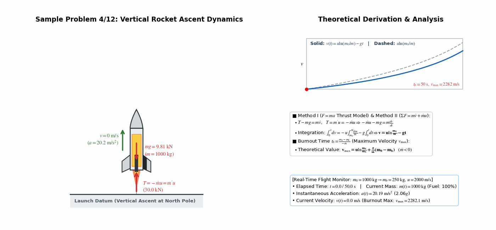
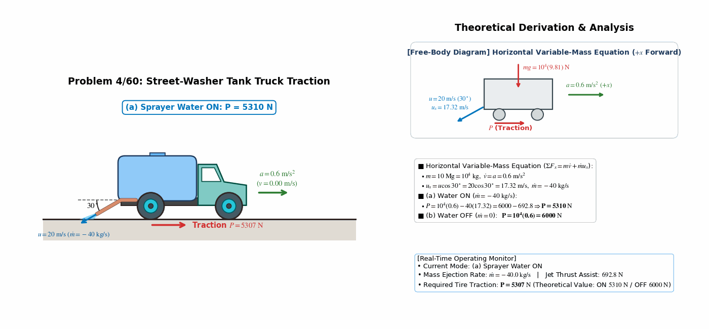
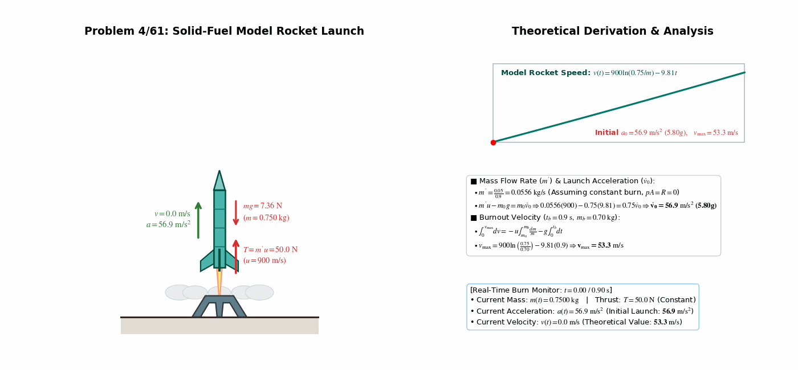
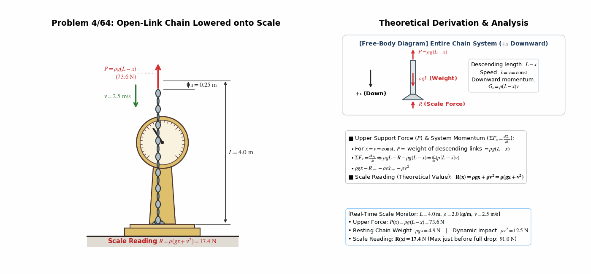
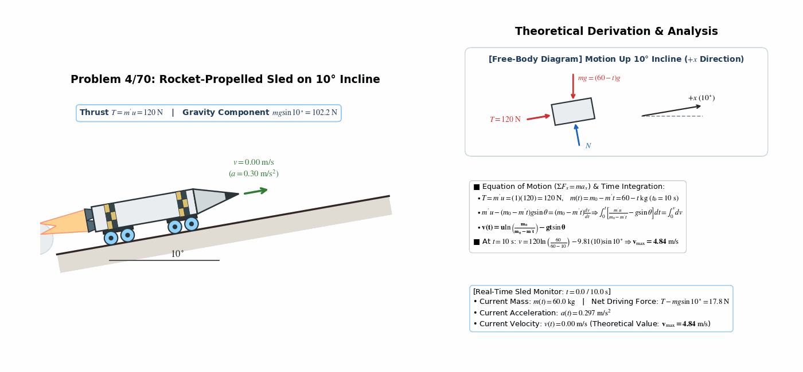

> **Author / Rights Holder:** 전북대학교 생물산업기계공학과 유동수 (ryudongsoo@jbnu.ac.kr)

# Week 14: Kinetics of Systems of Particles IV — Variable Mass Dynamics & Part I (Ch.1~4) Synthesis

## 📌 Lecture Overview and Learning Objectives

- **Chapter**: Meriam, Kraige & Bolton *Engineering Mechanics: Dynamics* 9th Edition — Chapter 4: Section 4.7 Variable Mass & Section 4.8 Chapter Review
- **Objectives**:
  - Derive the governing equation of motion ($\Sigma F = m\dot{v} + \dot{m}u$) for variable-mass systems that absorb ($\dot{m} > 0$) or eject ($\dot{m} < 0$) mass, establishing strict sign conventions for relative velocity $u = v - v_0$
  - Identify the special condition ($v_0 = 0 \implies u = v$) under which the direct time derivative of linear momentum $\Sigma F = \frac{d}{dt}(mv)$ holds
  - Contrast inelastic internal impact energy dissipation ($\Delta E = \frac{1}{2}\rho Lv^2$) in an open-link chain (Sample Problem 4/10) against lossless work-energy conservation ($\Delta E = 0$) in an inextensible flexible rope (Sample Problem 4/11)
  - Formulate rocket propulsion dynamics ($m'u + pA - mg - R = m\dot{v}$) and integrate the Tsiolkovsky rocket equation for burnout velocity $v_{\max}$
  - Synthesize the complete Part I (Chapters 1 ~ 4) problem-solving methodology across Particle Kinematics, Particle Kinetics, and Systems of Particles

---

## 📋 Course Curriculum and Contents

| Type | No. | Problem Title | Governing Principle & Verified Formula | Output Links |
|:---:|:---:|:---|:---|:---:|
| **Concept** | Concept 1 | Open-Link Chain vs Flexible Rope Hoisting | $P_{\mathrm{chain}} = \rho(gx+v^2)$ ($\Delta E = \frac{1}{2}\rho Lv^2$) vs $P_{\mathrm{rope}} = \rho gx + \frac{1}{2}\rho v^2$ ($\Delta E = 0$) | [Code](./concept_chain_vs_rope_energy.py) \| [GIF](./concept_chain_vs_rope_energy.gif) |
| **Concept** | Concept 2 | Rocket Propulsion & Tsiolkovsky Velocity | $m(t) = m_0 - m't,\ a(t) = \frac{m'u}{m(t)} - g,\ v(t) = u\ln\frac{m_0}{m(t)} - gt$ | [Code](./concept_rocket_tsiolkovsky_thrust.py) \| [GIF](./concept_rocket_tsiolkovsky_thrust.gif) |
| **Example** | 4.10 | Open-Link Chain Vertical Lift | $P = \rho(gx + v^2),\ \Delta E = \frac{1}{2}\rho Lv^2$ (Inelastic impact loss) | [Code](./ex4_10_open_link_chain_lift.py) \| [GIF](./ex4_10_open_link_chain_lift.gif) |
| **Example** | 4.11 | Inextensible Flexible Rope Lift | $P = \rho gx + \frac{1}{2}\rho v^2,\ R = \rho g(L-x) + \frac{1}{2}\rho v^2\ (\Delta E = 0)$ | [Code](./ex4_11_inextensible_rope_lift.py) \| [GIF](./ex4_11_inextensible_rope_lift.gif) |
| **Example** | 4.12 | Rocket Vertical Ascent | $v_{\max} = u\ln\left(\frac{m_0}{m_b}\right) + \frac{g}{\dot{m}}(m_0 - m_b)$ (Tsiolkovsky Eq.) | [Code](./ex4_12_rocket_vertical_ascent.py) \| [GIF](./ex4_12_rocket_vertical_ascent.gif) |
| **Intro** | 4/60 | Street-Washer Tank Truck | (a) Water ON $P = 5310\ \mathrm{N}$, (b) Water OFF $P = 6000\ \mathrm{N}$ | [Code](./prob4_60_street_washer_truck.py) \| [GIF](./prob4_60_street_washer_truck.gif) |
| **Intro** | 4/61 | Solid-Fuel Model Rocket Launch | Launch $\dot{v}_0 = 56.9\ \mathrm{m/s^2}\ (5.80g),\ v_{\max} = 53.3\ \mathrm{m/s}$ | [Code](./prob4_61_model_rocket_launch.py) \| [GIF](./prob4_61_model_rocket_launch.gif) |
| **Intro** | 4/64 | Chain Lowered onto Platform Scale | $P = \rho g(L-x),\ \Sigma F_x = \dot{G}_x \Rightarrow R = \rho(gx + v^2)$ | [Code](./prob4_64_chain_lowering_scale.py) \| [GIF](./prob4_64_chain_lowering_scale.gif) |
| **Advanced** | 4/70 | Rocket-Propelled Sled on $10^\circ$ Incline | $v = u\ln\left(\frac{m_0}{m_0 - m't}\right) - gt\sin\theta \Rightarrow v_{\max} = 4.84\ \mathrm{m/s}$ | [Code](./prob4_70_rocket_incline_sled.py) \| [GIF](./prob4_70_rocket_incline_sled.gif) |

---

## 0. Supplementary Concept Animations

### 0.1 Concept 1: Open-Link Chain (Ex 4.10) vs Flexible Rope (Ex 4.11) Hoisting & Energy Loss

- **Core Principle**:
  - **Open-Link Chain ($T_0 = 0$)**: Stationary links are abruptly accelerated from $0 \to v$ via inelastic micro-impacts at the base $\Rightarrow$ pulling force $P_{\mathrm{chain}} = \rho gx + \rho v^2$, dissipating $\Delta E = \frac{1}{2}\rho x v^2$ as heat and sound.
  - **Flexible Rope ($T_0 = \frac{1}{2}\rho v^2$)**: Redirected smoothly through a frictionless bottom guide with zero impact loss ($\Delta E = 0$) $\Rightarrow$ conservative differential work-energy yields $P_{\mathrm{rope}} = \rho gx + \frac{1}{2}\rho v^2$.

### 0.2 Concept 2: Variable-Mass Rocket Propulsion & Tsiolkovsky Velocity Integration

- **Core Principle**:
  - Under constant burn rate $m' = -\dot{m} > 0$ and relative exhaust speed $u$, forward thrust $T = m'u = -\dot{m}u$ stays constant while total mass $m(t) = m_0 - m't$ decreases linearly, causing upward acceleration $a(t) = \frac{m'u}{m(t)} - g$ to surge nonlinearly.
  - Definite integration $\int_0^v dv = -u\int_{m_0}^m \frac{dm}{m} - g\int_0^t dt$ yields the Tsiolkovsky rocket velocity profile $v(t) = u\ln\left(\frac{m_0}{m(t)}\right) - gt$.

---

## 1. Textbook Core Examples (Sample Problems 4/10 ~ 4/12)

### 1.1 Sample Problem 4/10: Vertical Lifting of an Open-Link Chain & Energy Loss

- **Problem Statement**: The end of a pile of open-link chain of length $L$ and mass per unit length $\rho$ is lifted vertically at constant speed $v$ by a variable force $P$. Express $P$ as a function of height $x$ and determine the energy $\Delta E$ lost during the lift.
- **Dynamic Analysis**:
  - **Method I (Variable-Mass Approach)**:
    - Isolate the moving suspended portion of length $x$: $m = \rho x,\ \dot{m} = \rho\dot{x} = \rho v,\ \dot{v} = 0$
    - Relative velocity of the stationary links ($v_0 = 0$) joining the moving section: $u = v - 0 = v$
    - $\Sigma F_x = m\dot{v} + \dot{m}u \Rightarrow P - \rho gx = 0 + (\rho v)v \Rightarrow \mathbf{P(x) = \rho(gx + v^2)}$
  - **Method II (Constant-Mass System Approach)**:
    - Isolate the entire chain of mass $\rho L$: platform normal force $N = \rho g(L - x)$, total system momentum $G_x = \rho xv$
    - $\Sigma F_x = \frac{dG_x}{dt} \Rightarrow P + \rho g(L - x) - \rho gL = \frac{d}{dt}(\rho xv) = \rho v^2 \Rightarrow \mathbf{P(x) = \rho(gx + v^2)}$
  - **Energy Loss ($\Delta E$) due to Inelastic Link Impacts**:
    - External work supplied by $P$: $\int_0^L P\,dx = \int_0^L (\rho gx + \rho v^2)\,dx = \frac{1}{2}\rho gL^2 + \rho Lv^2$
    - Mechanical energy gains: $\Delta T = \frac{1}{2}\rho Lv^2,\ \Delta V_g = \rho gL\left(\frac{L}{2}\right) = \frac{1}{2}\rho gL^2$
    - Work-energy balance: $U'_{1-2} = \int_0^L P\,dx - \Delta E = \Delta T + \Delta V_g \Rightarrow \mathbf{\Delta E = \frac{1}{2}\rho Lv^2}$

---

### 1.2 Sample Problem 4/11: Inextensible Flexible Rope / Bicycle Chain Lift

- **Problem Statement**: Replace the open-link chain of Sample Problem 4/10 with a flexible but inextensible rope or bicycle chain of length $L$ and linear density $\rho$. Determine the upward force $P(x)$ required to elevate the end at constant speed $v$ and the corresponding reaction $R(x)$ between the coil and the platform.
- **Dynamic Analysis**:
  - **Smooth Constraint Guide & Energy Conservation ($\Delta E = 0$)**:
    - For an inextensible continuous rope to follow a strictly 1D vertical trajectory without energy loss, a smooth bottom guide (visualized as a cylinder rotating at $\omega = v/r$) must transition elements smoothly from rest to upward speed $v$.
  - **Conservative Differential Work-Energy Equation ($dU' = dT + dV_g$)**:
    $$P\,dx = d\left(\frac{1}{2}\rho xv^2\right) + d\left(\rho gx\frac{x}{2}\right) = \frac{1}{2}\rho v^2\,dx + \rho gx\,dx \Rightarrow \mathbf{P(x) = \rho gx + \frac{1}{2}\rho v^2}$$
  - **Platform Reaction $R(x)$ and Bottom Tension $T_0$**:
    - Impulse-momentum on the entire rope ($\Sigma F_x = \dot{G}_x$):
      $$P + R - \rho gL = \frac{d}{dt}(\rho xv) = \rho v^2 \Rightarrow \left(\rho gx + \frac{1}{2}\rho v^2\right) + R - \rho gL = \rho v^2 \Rightarrow \mathbf{R(x) = \rho g(L - x) + \frac{1}{2}\rho v^2}$$
    - Equilibrium of the vertical section gives bottom tension $T_0 = P - \rho gx = \frac{1}{2}\rho v^2$, while the smooth guide provides the remaining upward force $F = \frac{1}{2}\rho v^2$ transmitted to the platform.

---

### 1.3 Sample Problem 4/12: Vertical Rocket Ascent & Burnout Velocity

- **Problem Statement**: A rocket of initial total mass $m_0$ is launched vertically from the north pole and accelerates until fuel burning at a constant rate is exhausted, leaving structural mass $m_b$. With constant relative exhaust velocity $u$, atmospheric nozzle exit pressure ($p = 0$), negligible air resistance ($R = 0$), and constant $g$, determine the maximum velocity $v_{\max}$ at burnout.
- **Dynamic Analysis**:
  - **Thrust Equation of Motion**:
    - Rocket thrust: $T = m'u = -\dot{m}u$ ($\dot{m} = dm/dt < 0$)
    - Equation of motion: $T - mg = m\dot{v} \Rightarrow -\dot{m}u - mg = m\frac{dv}{dt}$
  - **Separation of Variables & Integration (Tsiolkovsky Equation)**:
    $$dv = -u\frac{dm}{m} - g\,dt \implies \int_0^v dv = -u\int_{m_0}^m \frac{dm}{m} - g\int_0^t dt \implies \mathbf{v(t) = u\ln\left(\frac{m_0}{m}\right) - gt}$$
  - **Maximum Velocity at Burnout ($t_b = \frac{m_b - m_0}{\dot{m}} = \frac{m_0 - m_b}{-\dot{m}}$)**:
    $$\mathbf{v_{\max} = u\ln\left(\frac{m_0}{m_b}\right) + \frac{g}{\dot{m}}(m_0 - m_b) = u\ln\left(\frac{m_0}{m_b}\right) - \frac{g}{m'}(m_0 - m_b)}$$

---

## 2. Practice Problems (3 Introductory + 1 Advanced — Homework #13)

### 2.1 Problem 4/60: Street-Washer Tank Truck Traction Force

- **Problem Statement**: The tank of a street-washer truck has a total mass of $10\ \mathrm{Mg}$ ($10^4\ \mathrm{kg}$) when full. The sprayer discharges $40\ \mathrm{kg/s}$ of water at a $30^\circ$ angle with a relative velocity of $u = 20\ \mathrm{m/s}$. If the truck accelerates on a level road at $a = 0.6\ \mathrm{m/s^2}$, determine the required tire traction force $P$ when (a) the water is ON and (b) the water is OFF.
- **Calculations**:
  - Horizontal component of relative discharge velocity: $u_x = u\cos 30^\circ = 20\cos 30^\circ = 17.32\ \mathrm{m/s}$
  - Mass change rate: $\dot{m} = -40\ \mathrm{kg/s}$
  - Horizontal variable-mass equation: $\Sigma F_x = m\dot{v} + \dot{m}u_x \Rightarrow P = ma + \dot{m}u_x$
  - **(a) Water ON ($\dot{m} = -40\ \mathrm{kg/s}$)**:
    $$P = 10^4(0.6) - 40(17.32) = 6000 - 692.8 = \mathbf{5310\ \mathrm{N}}$$
  - **(b) Water OFF ($\dot{m} = 0$)**:
    $$P = 10^4(0.6) = \mathbf{6000\ \mathrm{N}}$$

---

### 2.2 Problem 4/61: Solid-Fuel Model Rocket Launch

- **Problem Statement**: A model rocket has a prelaunch mass of $m_0 = 0.75\ \mathrm{kg}$. Its experimental solid-fuel motor burns $0.05\ \mathrm{kg}$ of propellant in $0.9\ \mathrm{s}$ with an exhaust speed of $u = 900\ \mathrm{m/s}$. Neglecting air resistance, determine the initial launch acceleration $\dot{v}_0$ and the burnout velocity $v_{\max}$.
- **Calculations**:
  - Average fuel burn rate: $m' = -\dot{m} = \frac{0.05\ \mathrm{kg}}{0.9\ \mathrm{s}} = 0.05556\ \mathrm{kg/s}$
  - **Initial Launch Acceleration ($\dot{v}_0$)**:
    $$m'u - m_0 g = m_0\dot{v}_0 \implies 0.05556(900) - 0.75(9.81) = 0.75\dot{v}_0 \implies \mathbf{\dot{v}_0 = 56.9\ \mathrm{m/s^2}\ (5.80g)}$$
  - **Burnout Velocity ($m_b = 0.70\ \mathrm{kg}$)**:
    $$v_{\max} = u\ln\left(\frac{m_0}{m_b}\right) + \frac{g}{\dot{m}}(m_0 - m_b) = 900\ln\left(\frac{0.75}{0.70}\right) + \frac{9.81}{-0.05556}(0.05) = 62.09 - 8.83 = \mathbf{53.3\ \mathrm{m/s}}$$

---

### 2.3 Problem 4/64: Open-Link Chain Lowered onto Platform Scale

- **Problem Statement**: The upper end of an open-link chain of length $L$ and mass $\rho$ per unit length is lowered at a constant speed $v$ by a force $P$. Determine the reading $R$ of the platform scale in terms of $x$.
- **Calculations**:
  - For constant lowering speed $\dot{x} = v = \mathrm{const}$, the upper tension $P$ supports the weight of the descending links of length $L - x$:
    $$P = \rho g(L - x)$$
  - Applying the impulse-momentum equation ($\Sigma F_x = \frac{dG_x}{dt}$, $+x$ downward) to the entire chain of mass $\rho L$:
    $$\rho gL - R - P = \frac{d}{dt}\big[\rho(L - x)v\big] \implies \rho gL - R - \rho g(L - x) = -\rho\dot{x}v = -\rho v^2$$
    $$\rho gx - R = -\rho v^2 \implies \mathbf{R(x) = \rho gx + \rho v^2 = \rho(gx + v^2)}$$

---

### 2.4 Problem 4/70: Rocket-Propelled Sled on $10^\circ$ Incline

- **Problem Statement**: A small rocket-propelled vehicle has a total initial mass of $m_0 = 60\ \mathrm{kg}$, including $10\ \mathrm{kg}$ of fuel. The rocket burns fuel at a constant rate of $m' = 1\ \mathrm{kg/s}$ with a relative exhaust nozzle speed of $u = 120\ \mathrm{m/s}$. Released from rest on a $10^\circ$ incline upon ignition, find the maximum velocity $v_{\max}$ reached by the vehicle (neglect friction).
- **Calculations**:
  - Constant rocket thrust: $T = m'u = (1)(120) = 120\ \mathrm{N}$
  - Instantaneous vehicle mass: $m(t) = m_0 - m't = 60 - t\ \mathrm{kg}$ (burn time $t_b = \frac{10}{1} = 10\ \mathrm{s}$)
  - Equation of motion up the incline ($+x$) and time integration:
    $$\Sigma F_x = ma_x \implies m'u - (m_0 - m't)g\sin\theta = (m_0 - m't)\frac{dv}{dt}$$
    $$\int_0^t \left[\frac{m'u}{m_0 - m't} - g\sin\theta\right]dt = \int_0^v dv \implies v(t) = u\ln\left(\frac{m_0}{m_0 - m't}\right) - gt\sin\theta$$
  - Maximum speed at burnout ($t = 10\ \mathrm{s}$):
    $$v_{\max} = 120\ln\left(\frac{60}{60 - 10}\right) - 9.81(10)\sin 10^\circ = 21.879 - 17.035 = \mathbf{4.84\ \mathrm{m/s}}$$

---

## 📝 변경 이력 (Changelog)
- **2026-11-01 23:35:00** [[Dongsoo Ryu](mailto:ryudongsoo@jbnu.ac.kr)] feat: release Weeks 1–15 bilingual biomechanics simulation portfolio & supplementary concept animations

- **2026-11-01 21:20:00** [[Dongsoo Ryu](mailto:ryudongsoo@jbnu.ac.kr)] feat(biomechanics): add 2 variable-mass concept animations (chain vs rope energy, rocket Tsiolkovsky thrust) and refine STIX math typography across Week 14
- **2026-10-15 00:18:00** [[Dongsoo Ryu](mailto:ryudongsoo@jbnu.ac.kr)] feat(biomechanics): complete Week 14 Ch.4 Variable Mass Dynamics and Part I synthesis with 3 sample problems and 4 practice problems
- **2026-10-03 17:22:26** [[Dongsoo Ryu](mailto:ryudongsoo@jbnu.ac.kr)] feat(biomechanics): complete Week 7 Part B Work and Energy curriculum overhaul with 5 examples and 4 practice problems
- **2026-10-02 23:28:18** [[Dongsoo Ryu](mailto:ryudongsoo@jbnu.ac.kr)] feat(patent): Leave applicant blank and set inventors to Yoo Dongsoo and Kim Sungmin for portable Brix meter patents (07, 08)
- **2026-10-02 23:22:53** [[Dongsoo Ryu](mailto:ryudongsoo@jbnu.ac.kr)] docs(patent): Complete comprehensive domestic and international prior art deep search and FTO analysis for 4 patent drafts
- **2026-10-02 23:17:31** [[Dongsoo Ryu](mailto:ryudongsoo@jbnu.ac.kr)] feat(patent): Add Kim Sungmin as co-inventor and establish 4-tier extra-large shell module for watermelon
- **2026-08-12 05:04:33** [[Dongsoo Ryu](mailto:ryudongsoo@jbnu.ac.kr)] docs: update assembly process and cost estimate for full SMT including ESP32-C6
