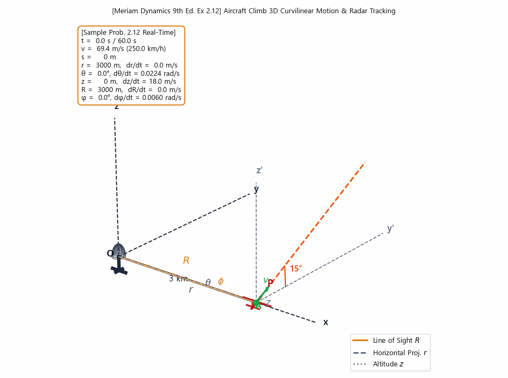
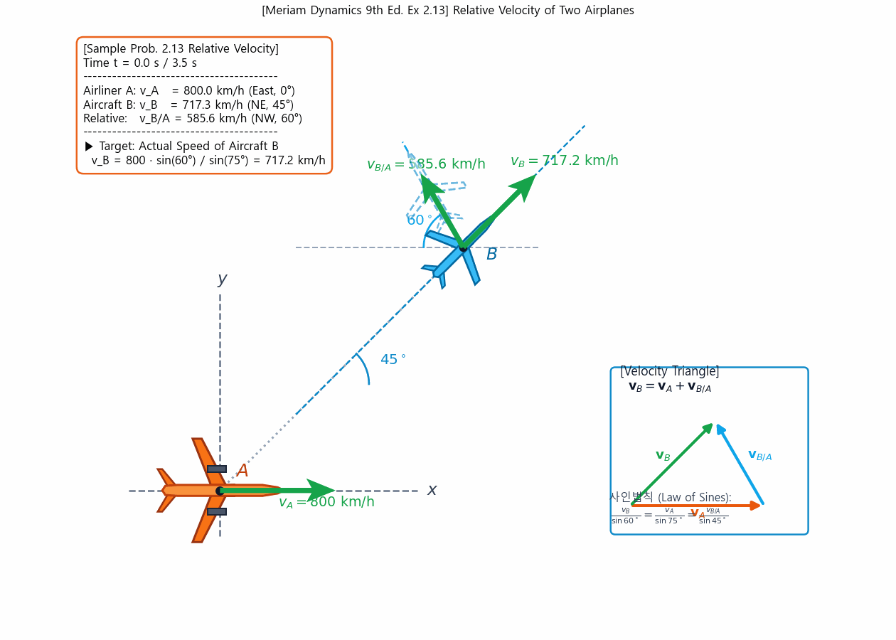
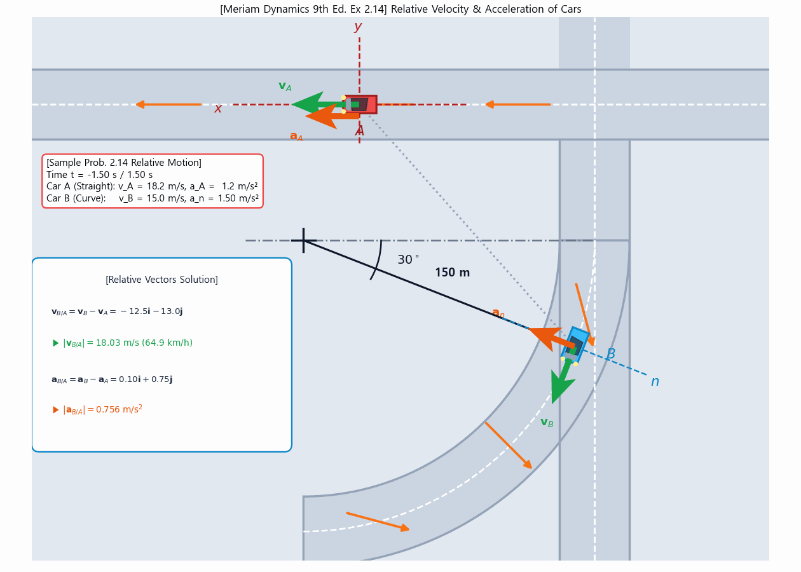
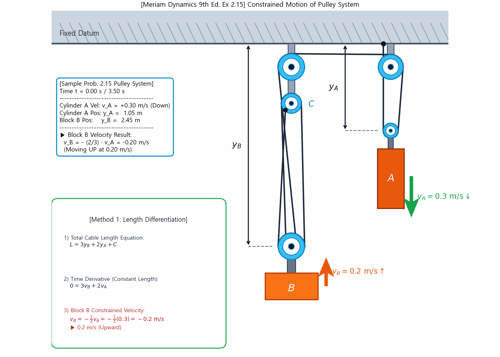
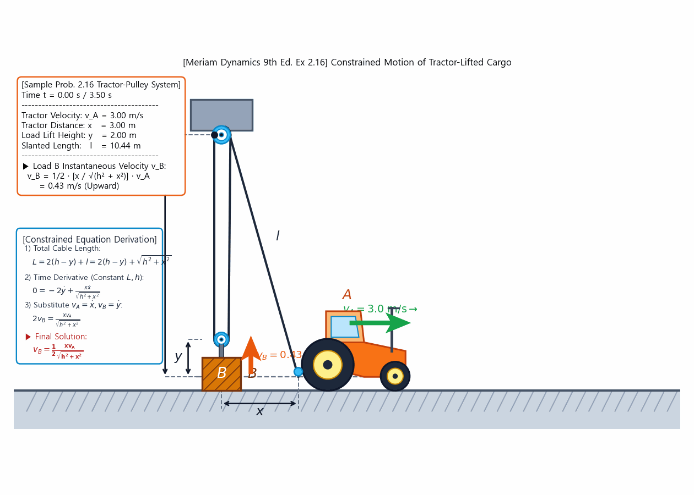
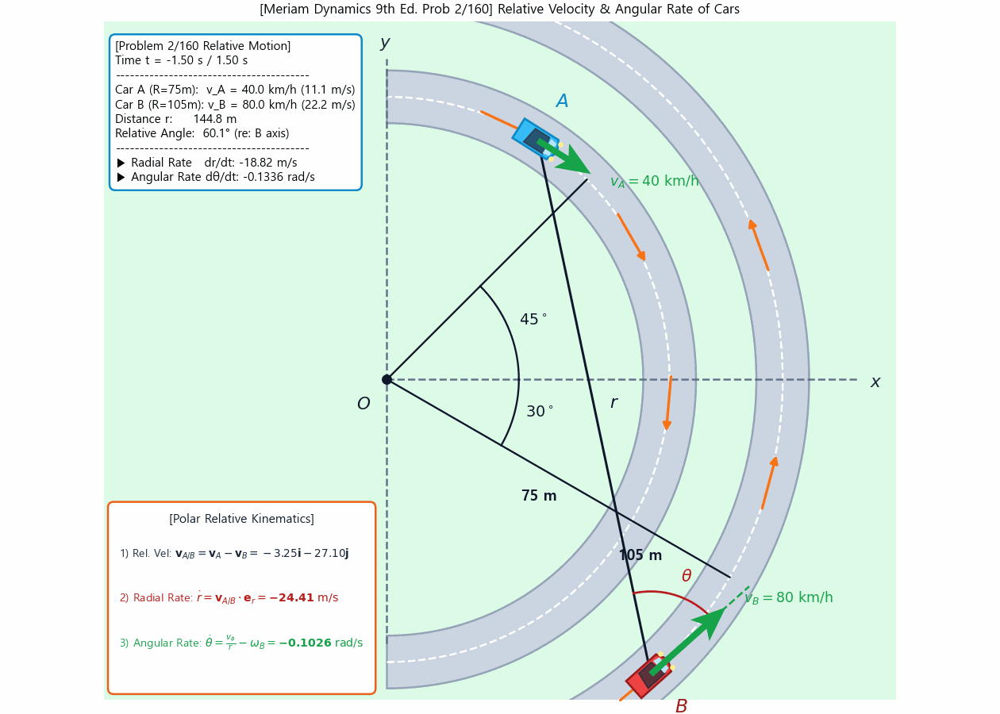
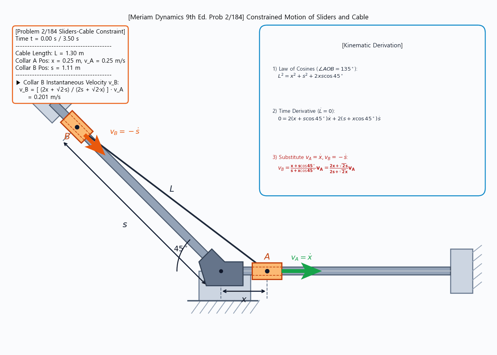
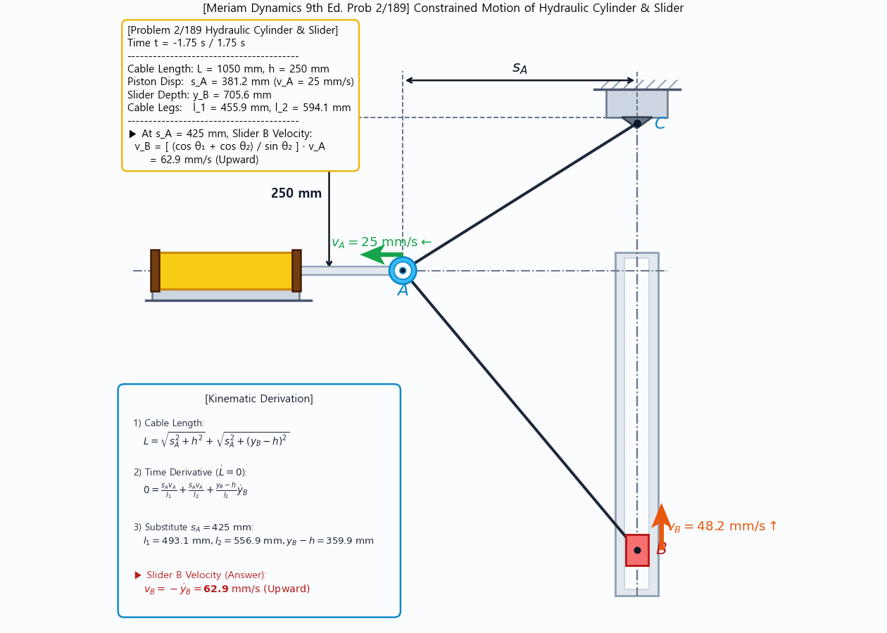
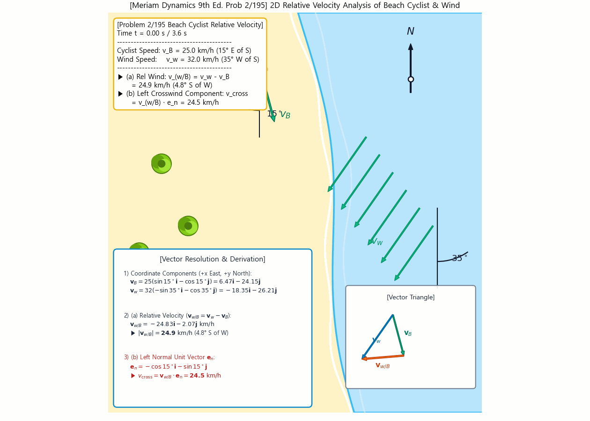

# Week 4: Relative Motion & Constrained Motion Dynamics

> **Author / Rights Holder:** 전북대학교 생물산업기계공학과 유동수 (ryudongsoo@jbnu.ac.kr, ryudongsoo@gmail.com)

---

## 1. Overview & Learning Objectives
- **Course**: Biomechanics
- **Textbook Scope**: Engineering Mechanics: Dynamics (Meriam & Kraige, 9th Edition), Chapter 2 Kinematics of Particles
  - Section 2.7 Space Curvilinear Motion
  - Section 2.8 Relative Motion (Translating Axes)
  - Section 2.9 Constrained Motion of Connected Particles
- **Objectives**:
  - Master both textbook sample problems (Examples 2.12–2.16) and selected intermediate problems
  - Implement 30 FPS dynamic GIF simulations and Python numerical models

---

## 2. Textbook Sample Problems (Examples 2.12 ~ 2.16)

### 📌 [Example 2.12] Airplane Climb 3D Space Motion (Radar Coordinates)
- **Source**: Dynamics 9th Ed. Sec 2.7 Ex 2.12 (p.57)
- **Script**: [`ex2_12_airplane_climb.py`](ex2_12_airplane_climb.py)
- **Simulation**:



---

### 📌 [Example 2.13] Jet Airliner & Plane 2D Relative Velocity
- **Source**: Dynamics 9th Ed. Sec 2.8 Ex 2.13 (p.64)
- **Script**: [`ex2_13_plane_crosswind.py`](ex2_13_plane_crosswind.py)
- **Simulation**:



---

### 📌 [Example 2.14] Straight Accelerating Car & Curved Road Car Relative Acceleration
- **Source**: Dynamics 9th Ed. Sec 2.8 Ex 2.14 (p.65)
- **Script**: [`ex2_14_car_curve.py`](ex2_14_car_curve.py)
- **Simulation**:



---

### 📌 [Example 2.15] Complex Pulley Constraint Velocity
- **Source**: Dynamics 9th Ed. Sec 2.9 Ex 2.15 (p.73)
- **Script**: [`ex2_15_pulley_2d.py`](ex2_15_pulley_2d.py)
- **Simulation**:



---

### 📌 [Example 2.16] Tractor Pulley 2D Geometric Constraint
- **Source**: Dynamics 9th Ed. Sec 2.9 Ex 2.16 (p.73)
- **Script**: [`ex2_16_tractor_pulley.py`](ex2_16_tractor_pulley.py)
- **Simulation**:



---

## 3. Selected Textbook Problems

### 📌 [Problem 2/160] 2D Polar Relative Velocity & Angular Rate on Concentric Tracks
- **Source**: Dynamics 9th Ed. Sec 2.8 Prob 2/160 (p.67)
- **Conditions**: $R_A = 75\text{ m}$ ($45^\circ$, $v_A = 40\text{ km/h}$ CW), $R_B = 105\text{ m}$ ($-30^\circ$, $v_B = 80\text{ km/h}$ CCW)
- **Results**: $\dot{r} = -24.41\text{ m/s}$, $\dot{\theta} = -0.1026\text{ rad/s}$ (re: Car B longitudinal axis)
- **Script**: [`prob2_160_cars_intersection.py`](prob2_160_cars_intersection.py)
- **Simulation**:



---

### 📌 [Problem 2/184] Sliders & Cable Constraint on 45° Inclined Guide
- **Source**: Dynamics 9th Ed. Sec 2.9 Prob 2/184 (p.76)
- **Conditions**: $L^2 = x^2 + s^2 + 2xs\cos 45^\circ \implies v_B = -\dot{s} = \frac{x + s\cos 45^\circ}{s + x\cos 45^\circ} v_A = \frac{2x + \sqrt{2}s}{2s + \sqrt{2}x} v_A$
- **Script**: [`prob2_184_sliders_cable.py`](prob2_184_sliders_cable.py)
- **Simulation**:



---

### 📌 [Problem 2/189] Hydraulic Cylinder & Slider Constraint
- **Source**: Dynamics 9th Ed. Sec 2.9 Prob 2/189 (p.77)
- **Problem Statement**: $L = \sqrt{s_A^2 + h^2} + \sqrt{s_A^2 + (y_B - h)^2} = 1050\text{ mm}$, $h = 250\text{ mm}$, $v_A = 25\text{ mm/s}$ (Leftward)
- **Kinematic Solution**: At $s_A = 425\text{ mm}$, $l_1 = 493.1\text{ mm}$, $l_2 = 556.9\text{ mm}$, $y_B - h = 359.9\text{ mm} \implies v_B = -\dot{y}_B = \mathbf{62.9\text{ mm/s}}$ (Upward)
- **Script**: [`prob2_189_cylinder_slider.py`](prob2_189_cylinder_slider.py)
- **Simulation**:



---

### 📌 [Problem 2/195] 2D Relative Velocity of Cyclist and Wind
- **Source**: Dynamics 9th Ed. Review Prob 2/195 (p.80)
- **Problem Statement**: Cyclist $v_B = 25\text{ km/h}$ ($15^\circ$ E of S), Wind $v_w = 32\text{ km/h}$ ($35^\circ$ W of S)
- **Kinematic Solution**:
  - (a) Relative wind velocity: $\mathbf{v}_{w/B} = \mathbf{v}_w - \mathbf{v}_B = -24.83\mathbf{i} - 2.07\mathbf{j}\text{ km/h} \implies |\mathbf{v}_{w/B}| = \mathbf{24.9\text{ km/h}}$ ($4.8^\circ$ S of W)
  - (b) Perpendicular crosswind: $v_{\text{cross}} = \mathbf{v}_{w/B} \cdot \mathbf{e}_n = \mathbf{24.5\text{ km/h}}$
- **Script**: [`prob2_195_beach_cyclist.py`](prob2_195_beach_cyclist.py)
- **Simulation**:



---

## 4. Directory Structure
```
biomechanics/en/week4/
├── ex2_12_airplane_climb.py
├── ex2_12_airplane_climb.gif
├── ex2_13_plane_crosswind.py
├── ex2_13_plane_crosswind.gif
├── ex2_14_car_curve.py
├── ex2_14_car_curve.gif
├── ex2_15_pulley_2d.py
├── ex2_15_pulley_2d.gif
├── ex2_16_tractor_pulley.py
├── ex2_16_tractor_pulley.gif
├── prob2_160_cars_intersection.py
├── prob2_160_cars_intersection.gif
├── prob2_184_sliders_cable.py
├── prob2_184_sliders_cable.gif
├── prob2_189_cylinder_slider.py
├── prob2_189_cylinder_slider.gif
├── prob2_195_beach_cyclist.py
├── prob2_195_beach_cyclist.gif
└── README.md
```

---

## 📝 변경 이력 (Changelog)
- **2026-11-01 23:35:00** [[Dongsoo Ryu](mailto:ryudongsoo@jbnu.ac.kr)] feat: release Weeks 1–15 bilingual biomechanics simulation portfolio & supplementary concept animations
