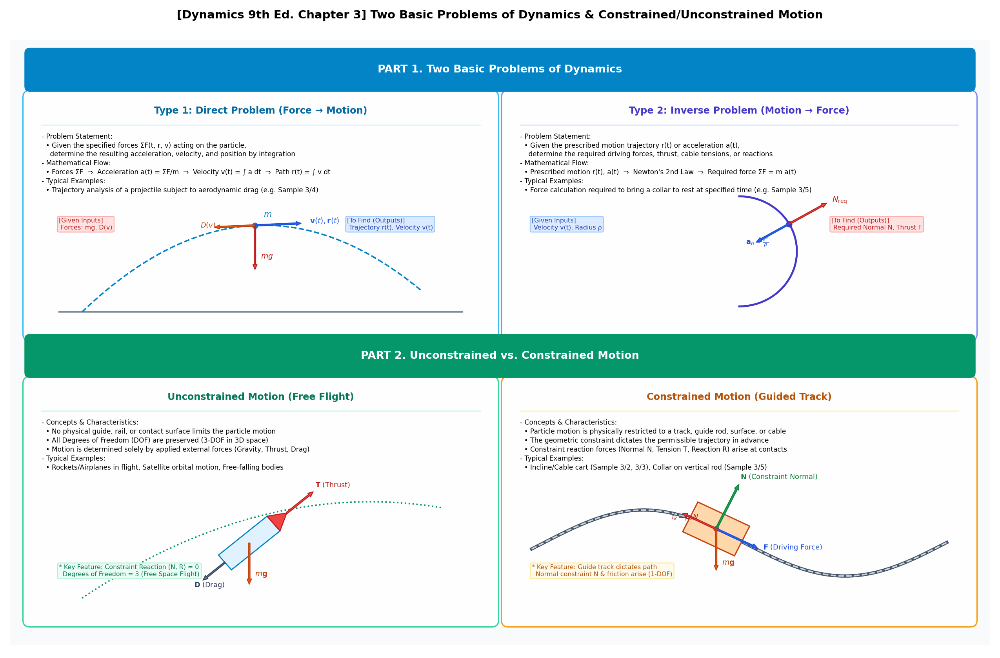
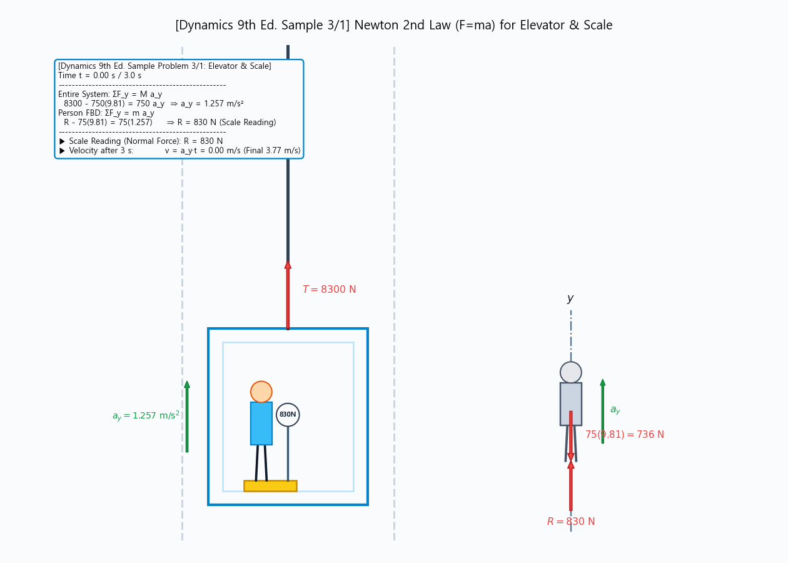
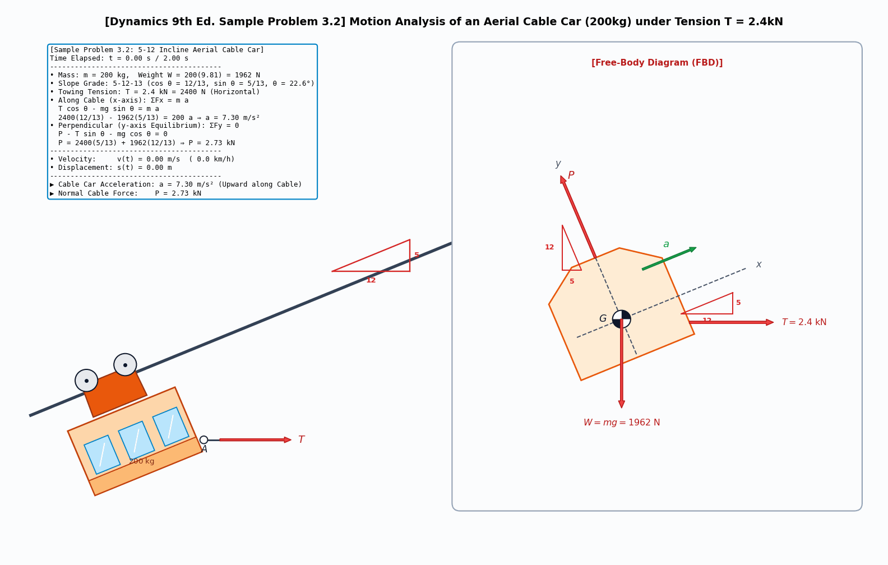
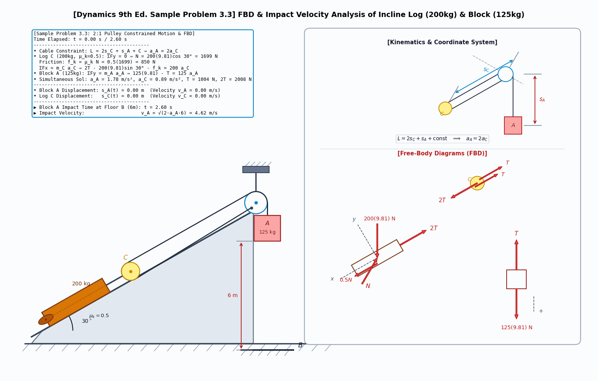
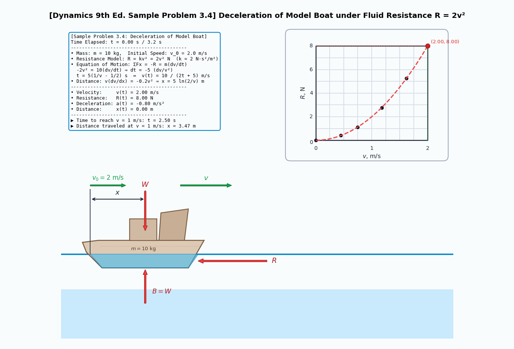
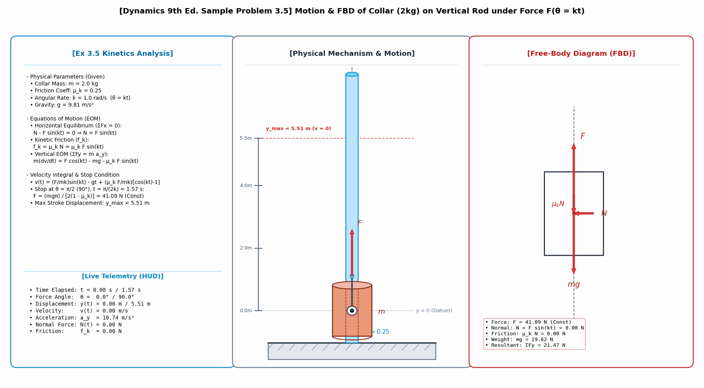
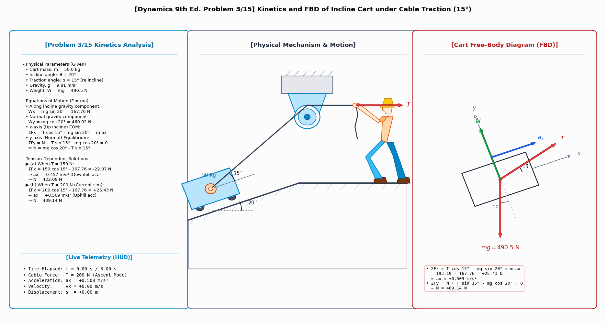
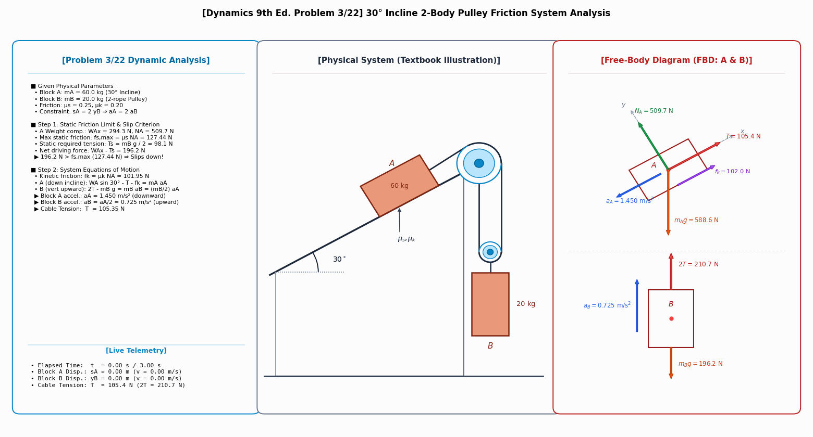
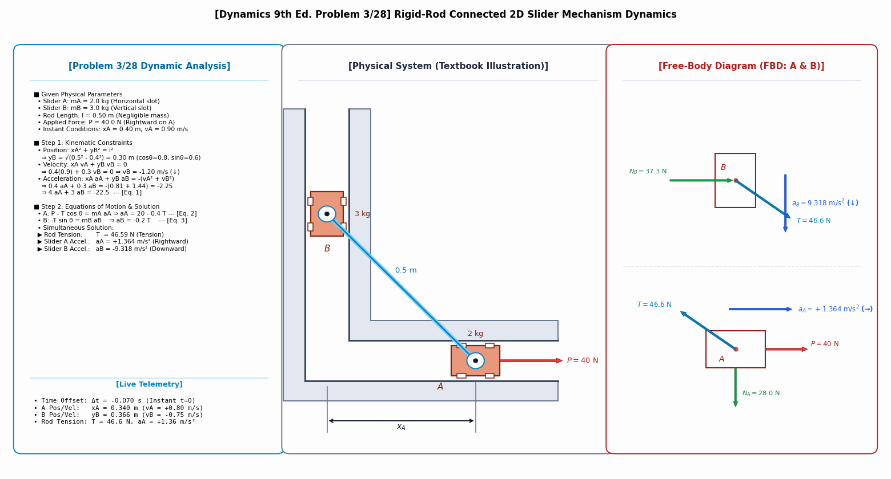
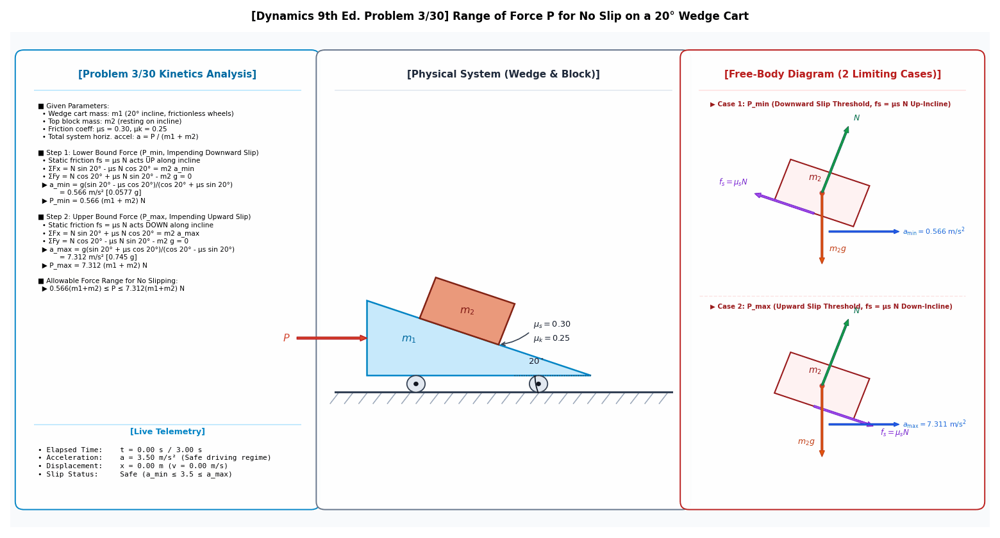

# Week 5: Particle Kinetics (Rectilinear Motion F=ma & Rectangular Coordinates)

> **Author / Rights Holder:** 전북대학교 생물산업기계공학과 유동수 (ryudongsoo@jbnu.ac.kr, ryudongsoo@gmail.com)

---

## 1. Overview and Learning Objectives
- **Course**: Biomechanics
- **Coverage**: Dynamics (Meriam & Kraige, 9th Ed.) Chapter 3: Kinetics of Particles
  - Sections 3.1–3.3: Newton's Second Law, Free Body Diagrams (FBD), Inertial Reference Frames
  - Section 3.4: Rectilinear Motion and Rectangular Coordinate Equations ($\Sigma F_x = ma_x, \Sigma F_y = ma_y$)
- **Objectives**:
  - Model and solve FBDs with friction, cable tensions, inclined plane gravity components, and multi-body constraints
  - Integrate differential equations for non-linear fluid resistance forces ($R=kv^2$)
  - Verify theoretical kinetics via Python numerical simulations and 30 FPS dynamic GIF animations

---

## 2. Fundamental Dynamics Concepts & Classification

### 📌 [Concept Infographic] Two Problems of Dynamics & Constrained/Unconstrained Motion


#### 1) Two Basic Problems of Dynamics
- **Type 1: Direct Problem (Force $\to$ Motion)**
  - **Definition**: Given the forces $\Sigma\mathbf{F}(t, \mathbf{r}, \mathbf{v})$ acting on the particle, integrate Newton's second law over time to compute the resulting **acceleration $\mathbf{a}(t)$, velocity $\mathbf{v}(t)$, and path $\mathbf{r}(t)$**.
  - **Mathematical Flow**: $\Sigma\mathbf{F} \implies \mathbf{a} = \frac{\Sigma\mathbf{F}}{m} \implies \mathbf{v}(t) = \int\mathbf{a}\,dt \implies \mathbf{r}(t) = \int\mathbf{v}\,dt$
  - **Examples**: Projectile trajectory under aerodynamic drag, motorboat deceleration ([Sample 3/4](ex3_4_boat_resistance.py))
- **Type 2: Inverse Problem (Motion $\to$ Force)**
  - **Definition**: Given the prescribed trajectory $\mathbf{r}(t)$ or acceleration $\mathbf{a}(t)$, determine the **required driving forces, engine thrust, cable tensions, or reaction forces** needed to sustain that motion.
  - **Mathematical Flow**: Prescribed motion $\mathbf{r}(t), \mathbf{a}(t) \implies \Sigma\mathbf{F}_{\text{req}} = m\mathbf{a}(t)$
  - **Examples**: Required force to bring a collar to rest at specified angle/time ([Sample 3/5](ex3_5_collar_rod_force.py)), normal reaction required in a roller-coaster loop $N_{\text{req}}$

#### 2) Unconstrained vs. Constrained Motion
- **Unconstrained Motion**
  - **Characteristics**: The particle moves freely in 3D space with all 3 Degrees of Freedom (3-DOF) preserved, without contacting any physical guide rails or surfaces.
  - **Governing Factors**: Motion is dictated purely by applied external forces (Gravity, Thrust, Aerodynamic Drag/Lift). Constraint reactions are zero ($N = 0$).
  - **Examples**: Rockets/Airplanes in flight, satellite orbital motion, free-falling bodies
- **Constrained Motion**
  - **Characteristics**: The particle motion is restricted to a specific 1D or 2D geometric path by contact with guide rails, slots, inclined planes, or cables.
  - **Constraint Reactions**: Contact surfaces automatically generate **normal constraint forces ($N$), friction forces ($f_k$), or cable tensions ($T$)** to enforce the trajectory.
  - **Examples**: Incline/Cable freight cars ([Sample 3/2](ex3_2_cable_car.py), [Problem 3/15](prob3_15_cart_incline.py)), compound pulley systems ([Sample 3/3](ex3_3_cart_incline_blocks.py)), sliding collar on vertical rod ([Sample 3/5](ex3_5_collar_rod_force.py))

---

## 3. Official Textbook Sample Problems

### 📌 [Sample Problem 3/1] Elevator Scale & Passenger Vertical Contact Force
- **Textbook Source**: Dynamics 9th Ed., Chapter 3, Section 3.4, Sample Problem 3/1
- **Problem Parameters**:
  - Passenger mass $m_p = 75\text{ kg}$ ($W_p = 75 \times 9.81 = 736\text{ N}$)
  - Total mass $M = 750\text{ kg}$ ($W_{tot} = 750 \times 9.81 = 7360\text{ N}$)
  - Cable upward force $T = 8300\text{ N}$
  - Duration: $t = 3.0\text{ s}$
- **Theoretical Solution**:
  - System equation of motion: $\Sigma F_y = T - W_{tot} = M a_y \implies 8300 - 7360 = 750 a_y \implies a_y = 1.257\text{ m/s}^2$ (Upward)
  - Passenger scale reading $R$: $\Sigma F_y = R - W_p = m_p a_y \implies R - 736 = 75(1.257) \implies R = 830\text{ N}$
  - Velocity after 3 s: $v = a_y t = 1.257 \times 3.0 = 3.77\text{ m/s}$
- **Python Script**: [`ex3_1_elevator_scale.py`](ex3_1_elevator_scale.py)
- **Simulation Animation**:



---

### 📌 [Sample Problem 3/2] Cable-Towed Freight Car Acceleration & Normal Reaction
- **Textbook Source**: Dynamics 9th Ed., Chapter 3, Section 3.4, Sample Problem 3/2
- **Problem Parameters**:
  - Mass $m = 200\text{ kg}$ cable car ($W = 200 \times 9.81 = 1962\text{ N}$)
  - Cable force $T = 2.4\text{ kN} = 2400\text{ N}$ (5-12-13 slope triangle: $\cos\theta = 12/13, \sin\theta = 5/13$)
  - Frictionless rollers
- **Theoretical Solution**:
  - Along cable ($x$-axis): $\Sigma F_x = T\cos\theta - mg\sin\theta = m a \implies 2400(12/13) - 1962(5/13) = 200 a \implies a = 7.30\text{ m/s}^2$
  - Normal ($y$-axis) equilibrium: $\Sigma F_y = P - mg\cos\theta - T\sin\theta = 0 \implies P = 1962(12/13) + 2400(5/13) = 2734\text{ N} = 2.73\text{ kN}$
- **Python Script**: [`ex3_2_cable_car.py`](ex3_2_cable_car.py)
- **Simulation Animation**:



---

### 📌 [Sample Problem 3/3] 30° Incline 2:1 Connected Block-Pulley System
- **Textbook Source**: Dynamics 9th Ed., Chapter 3, Section 3.4, Sample Problem 3/3
- **Problem Parameters**:
  - Suspended concrete block A: $m_A = 125\text{ kg}$, drop height $h = 6.0\text{ m}$
  - Incline log C: $m_C = 200\text{ kg}$, slope $30^\circ$, friction coefficient $\mu_k = 0.5$
  - Kinematic constraint: $L = 2 s_C + s_A + C \implies a_A = 2 a_C$
- **Theoretical Solution**:
  - Log C FBD: $2T - m_C g \sin 30^\circ - \mu_k m_C g \cos 30^\circ = m_C a_C \implies 2T - 200(9.81)\sin 30^\circ - 0.5(200)(9.81)\cos 30^\circ = 100 a_A$
  - Block A FBD: $m_A g - T = m_A a_A \implies 125(9.81) - T = 125 a_A$
  - Simultaneous solution: $a_A = 1.777\text{ m/s}^2$, $a_C = 0.888\text{ m/s}^2$, $T = 1004\text{ N}$
  - Impact velocity at floor B: $v_A = \sqrt{2 a_A s_A} = \sqrt{2 \times 1.777 \times 6.0} = 4.62\text{ m/s}$
- **Python Script**: [`ex3_3_cart_incline_blocks.py`](ex3_3_cart_incline_blocks.py)
- **Simulation Animation**:



---

### 📌 [Sample Problem 3/4] Motorboat Deceleration with Non-linear Drag ($R=2v^2$)
- **Textbook Source**: Dynamics 9th Ed., Chapter 3, Section 3.4, Sample Problem 3/4
- **Problem Parameters**:
  - Mass $m = 10\text{ kg}$, initial speed $v_0 = 2\text{ m/s}$
  - Hydrodynamic drag: $R = 2 v^2\text{ N}$
  - Target terminal speed: $v_1 = 1.0\text{ m/s}$ ($50\%$ of $v_0$)
- **Theoretical Solution**:
  - Equation of motion: $m \frac{dv}{dt} = -2v^2 \implies \frac{dv}{v^2} = -0.2 dt$
  - Velocity law: $v(t) = \frac{10}{5 + 2t}$
  - Time to reach $1.0\text{ m/s}$: $t = 2.5\text{ s}$
  - Distance traveled: $x(t) = 5 \ln\left(\frac{5+2t}{5}\right) \implies x(2.5) = 5\ln(2) = 3.47\text{ m}$
- **Python Script**: [`ex3_4_boat_resistance.py`](ex3_4_boat_resistance.py)
- **Simulation Animation**:



---

### 📌 [Sample Problem 3/5] Vertical Rod Collar under Variable-Direction Force ($\theta = kt$)
- **Textbook Source**: Dynamics 9th Ed., Chapter 3, Section 3.4, Sample Problem 3/5
- **Problem Parameters**:
  - Cylindrical collar with mass $m = 2.0\text{ kg}$ on a fixed vertical shaft
  - Kinetic friction coefficient $\mu_k = 0.25$, angular rate $k = 1.0\text{ rad/s}$ ($\theta = kt$)
  - Applied force $F$ starts vertically upward at $\theta = 0^\circ$ and rotates to $\theta = 90^\circ$
- **Theoretical Solution**:
  - Horizontal equilibrium ($\Sigma F_x = 0$): $N = F\sin(kt)$
  - Friction force: $f_k = \mu_k N = \mu_k F \sin(kt)$
  - Vertical equation of motion ($\Sigma F_y = m \frac{dv}{dt}$):
    $$m\frac{dv}{dt} = F\cos(kt) - mg - \mu_k F\sin(kt)$$
  - Velocity integral:
    $$m v(t) = \frac{F}{k}\sin(kt) - mgt + \frac{\mu_k F}{k}[\cos(kt) - 1]$$
  - Stop condition ($v = 0$) at $\theta = 90^\circ\ (\frac{\pi}{2}\text{ rad}),\ t = 1.57\text{ s}$:
    $$F = \frac{mg\pi}{2(1-\mu_k)} = \frac{2.0 \times 9.81 \times \pi}{2 \times 0.75} = \mathbf{41.09\text{ N}}\ \text{(Constant)}$$
  - Max stroke displacement: $y_{\max} = \mathbf{5.51\text{ m}}$
- **Python Script**: [`ex3_5_collar_rod_force.py`](ex3_5_collar_rod_force.py)
- **Simulation Animation**:



---

## 4. Selected Textbook Practice Problems

### 📌 [Problem 3/15] Incline Cart 15° Cable Traction & Tension-Dependent Acceleration
- **Textbook Source**: Dynamics 9th Ed., Chapter 3, Section 3.4, Problem 3/15
- **Problem Parameters**:
  - Mass $50\text{ kg}$ cart on $20^\circ$ incline, cable traction angle $\alpha = 15^\circ$ relative to incline
  - Gravity component along incline: $W_x = mg\sin 20^\circ = 167.76\text{ N}$
  - (a) $T = 150\text{ N} \implies \Sigma F_x = 150\cos 15^\circ - 167.76 = -22.87\text{ N} \implies a = -0.457\text{ m/s}^2$ (Down incline)
  - (b) $T = 200\text{ N} \implies \Sigma F_x = 200\cos 15^\circ - 167.76 = +25.43\text{ N} \implies a = +0.509\text{ m/s}^2$ (Up incline)
- **Python Script**: [`prob3_15_cart_incline.py`](prob3_15_cart_incline.py)
- **Simulation Animation**:



---

### 📌 [Problem 3/22] 30° Incline 2-Body Pulley Overcoming Static Friction & Motion
- **Textbook Source**: Dynamics 9th Ed., Chapter 3, Section 3.4, Problem 3/22
- **Problem Parameters**:
  - Block A ($60\text{ kg}$, $30^\circ$ incline, $\mu_s = 0.25, \mu_k = 0.20$), Block B ($20\text{ kg}$, 2-cable moving pulley)
  - Constraint: $s_A = 2 y_B \implies a_A = 2 a_B$
  - Driving force: $W_{Ax} - T_s = 294.3 - 98.1 = 196.2\text{ N} > f_{s,max} = 127.44\text{ N} \implies$ Motion slips downhill!
  - Solution: $a_A = 1.450\text{ m/s}^2$ (Downhill), $a_B = 0.725\text{ m/s}^2$ (Uphill), $T = 105.4\text{ N}$
- **Python Script**: [`prob3_22_pulley_incline.py`](prob3_22_pulley_incline.py)
- **Simulation Animation**:



---

### 📌 [Problem 3/28] Rigid-Rod Connected 2D Slider Mechanism
- **Textbook Source**: Dynamics 9th Ed., Chapter 3, Section 3.4, Problem 3/28
- **Problem Parameters**:
  - Horizontal Slider A ($m_A = 2\text{ kg}$), Vertical Slider B ($m_B = 3\text{ kg}$), rigid rod $l = 0.5\text{ m}$
  - Instantaneous position $x_A = 0.4\text{ m} \implies y_B = 0.3\text{ m}$, speed $v_A = 0.9\text{ m/s}$, force $P = 40\text{ N}$
- **Theoretical Solution**:
  - Velocity constraint: $x_A v_A + y_B v_B = 0 \implies v_B = -1.20\text{ m/s}$ (Downward)
  - Accel constraint: $x_A a_A + y_B a_B = -(v_A^2 + v_B^2) \implies 4 a_A + 3 a_B = -22.5$
  - Equations of motion (rod tension $T$):
    - Slider A: $P - T\cos\theta = m_A a_A \implies 40 - 0.8 T = 2 a_A$
    - Slider B: $-T\sin\theta = m_B a_B \implies a_B = -0.2 T$
  - Solution:
    - Slider A Accel: $a_A = +1.364\text{ m/s}^2$ (Rightward)
    - Slider B Accel: $a_B = -9.318\text{ m/s}^2$ (Downward)
    - Rod Tension: $T = 46.6\text{ N}$
- **Python Script**: [`prob3_28_rigid_rod_sliders.py`](prob3_28_rigid_rod_sliders.py)
- **Simulation Animation**:



---

### 📌 [Problem 3/30] 20° Wedge-Block Non-Slip Force P Envelope
- **Textbook Source**: Dynamics 9th Ed., Chapter 3, Section 3.4, Problem 3/30
- **Problem Parameters**:
  - Block $m_2$ on $20^\circ$ wedge $m_1$ ($\mu_s = 0.30, \mu_k = 0.25$)
- **Theoretical Solution**:
  - (1) Down-slip limit: $a_{min} = 0.566\text{ m/s}^2 \implies P_{min} = 0.566(m_1 + m_2)\text{ N} \quad [0.0577(m_1 + m_2)g]$
  - (2) Up-slip limit: $a_{max} = 7.311\text{ m/s}^2 \implies P_{max} = 7.311(m_1 + m_2)\text{ N} \quad [0.745(m_1 + m_2)g]$
  - Safe non-slip range:
    $$0.566(m_1+m_2) \le P \le 7.311(m_1+m_2)\text{ N}$$
- **Python Script**: [`prob3_30_wedge_blocks.py`](prob3_30_wedge_blocks.py)
- **Simulation Animation**:



---

## 5. File Structure
```
biomechanics/en/week5/
├── concept_dynamics_problems_and_constraints.py   # Two Problems & Constrained/Unconstrained Motion diagram script
├── concept_dynamics_problems_and_constraints.png  # Two Problems & Constrained/Unconstrained Motion infographic
├── ex3_1_elevator_scale.py                        # Sample Problem 3/1 Python code
├── ex3_1_elevator_scale.gif                       # Sample Problem 3/1 simulation GIF
├── ex3_2_cable_car.py                             # Sample Problem 3/2 Python code
├── ex3_2_cable_car.gif                            # Sample Problem 3/2 simulation GIF
├── ex3_3_cart_incline_blocks.py                   # Sample Problem 3/3 Python code
├── ex3_3_cart_incline_blocks.gif                  # Sample Problem 3/3 simulation GIF
├── ex3_4_boat_resistance.py                       # Sample Problem 3/4 Python code
├── ex3_4_boat_resistance.gif                      # Sample Problem 3/4 simulation GIF
├── ex3_5_collar_rod_force.py                      # Sample Problem 3/5 Python code
├── ex3_5_collar_rod_force.gif                     # Sample Problem 3/5 simulation GIF
├── prob3_15_cart_incline.py                       # Problem 3/15 Python code
├── prob3_15_cart_incline.gif                      # Problem 3/15 simulation GIF
├── prob3_22_pulley_incline.py                     # Problem 3/22 Python code
├── prob3_22_pulley_incline.gif                    # Problem 3/22 simulation GIF
├── prob3_28_rigid_rod_sliders.py                  # Problem 3/28 Python code
├── prob3_28_rigid_rod_sliders.gif                 # Problem 3/28 simulation GIF
├── prob3_30_wedge_blocks.py                       # Problem 3/30 Python code
├── prob3_30_wedge_blocks.gif                      # Problem 3/30 simulation GIF
└── README.md                                      # Week 5 lab guide
```

---

## 📝 변경 이력 (Changelog)
- **2026-11-01 23:35:00** [[Dongsoo Ryu](mailto:ryudongsoo@jbnu.ac.kr)] feat: release Weeks 1–15 bilingual biomechanics simulation portfolio & supplementary concept animations
