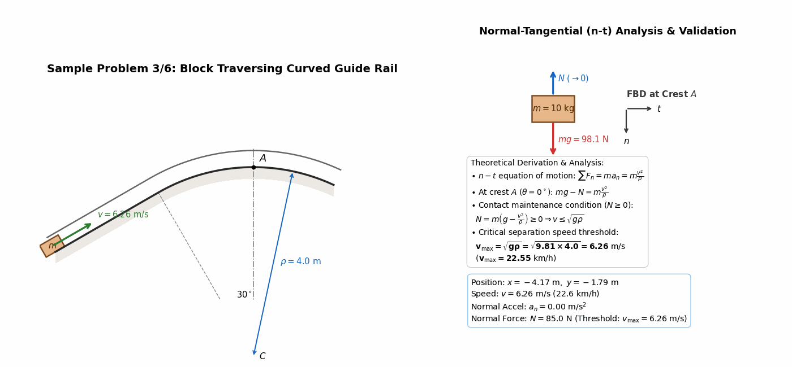
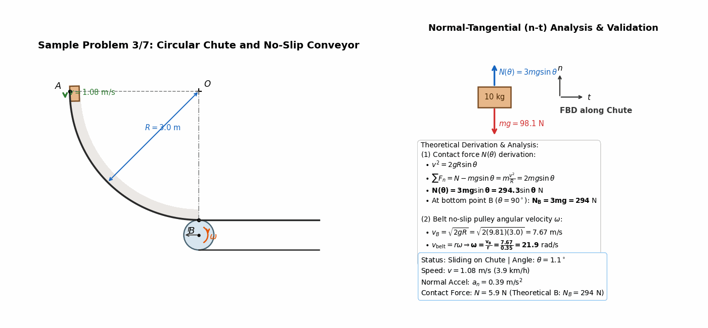
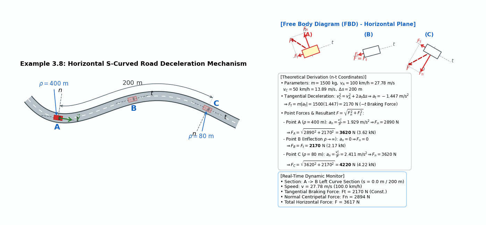
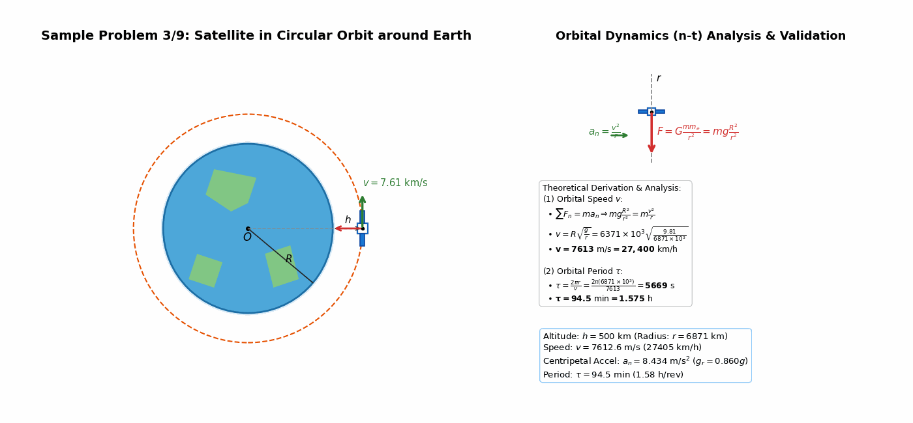
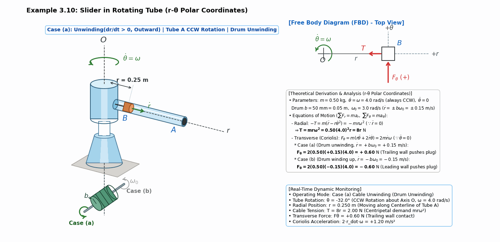
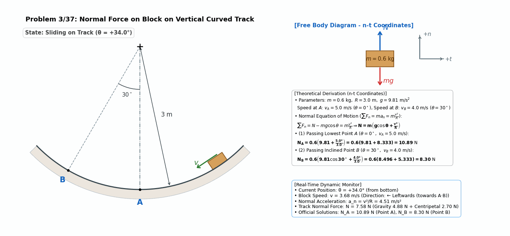
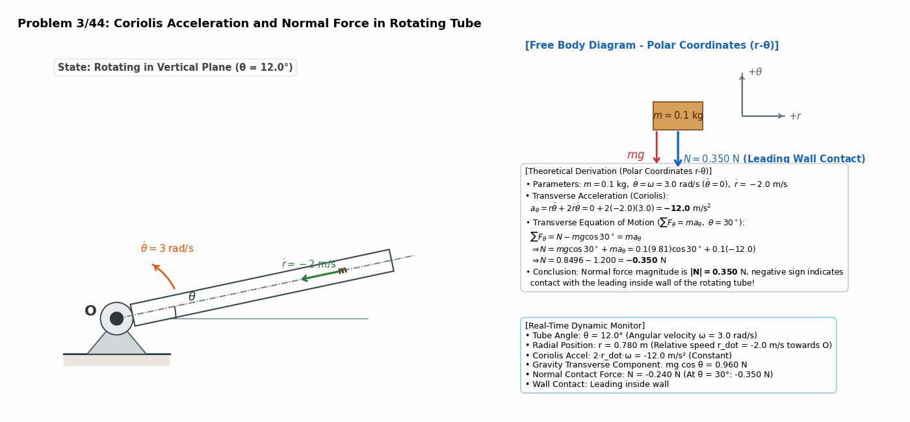
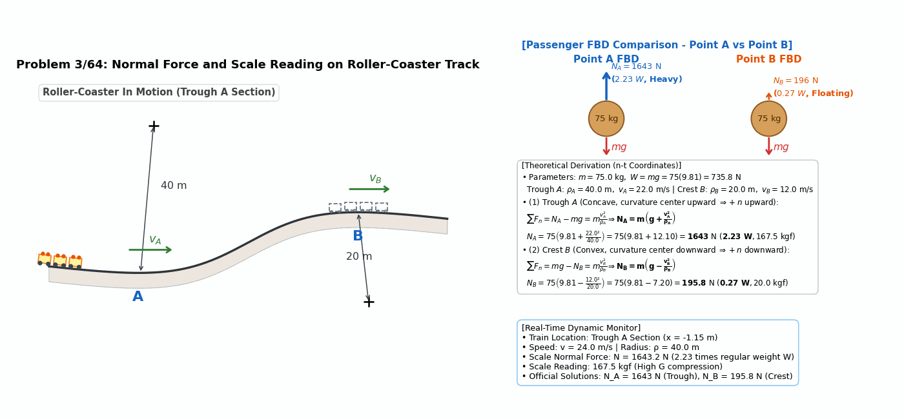
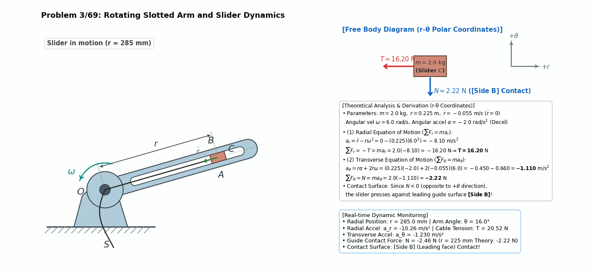

> **Author / Rights Holder:** 전북대학교 생물산업기계공학과 유동수 (ryudongsoo@jbnu.ac.kr)

# Week 6: Kinetics of Particles — Chapter 3: Curvilinear Motion (n-t and r-θ Coordinates)

## 📌 Lecture Overview and Learning Objectives

- **Chapter**: Meriam & Kraige Dynamics 9th Edition Chapter 3: Kinetics of Particles — Section 3.5: Curvilinear Motion
- **Learning Objectives**:
  - Normal-Tangential ($n-t$) Coordinates: $\sum F_t = m a_t = m \dot{v}$, $\sum F_n = m a_n = m \frac{v^2}{\rho}$
  - Polar ($r-\theta$) Coordinates: $\sum F_r = m(\ddot{r} - r\dot{\theta}^2)$, $\sum F_\theta = m(r\ddot{\theta} + 2\dot{r}\dot{\theta})$
  - Critical separation speed threshold ($v_{\max} = \sqrt{g\rho}$) on crests and troughs
  - Maximum and minimum safe operating speeds on banked curves with friction
  - Coriolis acceleration ($2\dot{r}\dot{\theta}$) and transverse contact reaction force modeling inside rotating mechanisms
  - Pure white background (#ffffff) textbook figure recreation and real-time quantitative validation

---

## 📋 Course Curriculum and Contents

| Type | No. | Problem Title | Governing Principle & Solution | Output Links |
|:---:|:---:|:---|:---|:---:|
| **Example** | 3.6 | Block on Curved Guide Rail | $\sum F_n = m\frac{v^2}{\rho} \Rightarrow v_{\max} = \sqrt{g\rho} = \mathbf{6.26\ m/s}$ ($22.6\ \mathrm{km/h}$) | [Code](./ex3_6_curved_track_block.py) \| [GIF](./ex3_6_curved_track_block.gif) |
| **Example** | 3.7 | Circular Chute and Conveyor | $N(\theta) = 3mg\sin\theta \Rightarrow N_B = \mathbf{294.3\ N},\ \omega = \frac{\sqrt{2gR}}{r} = \mathbf{21.9\ rad/s}$ | [Code](./ex3_7_chute_conveyor.py) \| [GIF](./ex3_7_chute_conveyor.gif) |
| **Example** | 3.8 | Car on Horizontal S-Curved Road | $a_t = -1.447\ \mathrm{m/s^2},\ F_t = 2170\ \mathrm{N} \Rightarrow F_A = \mathbf{3620\ N},\ F_B = \mathbf{2170\ N},\ F_C = \mathbf{4220\ N}$ | [Code](./ex3_8_car_curved_road.py) \| [GIF](./ex3_8_car_curved_road.gif) |
| **Example** | 3.9 | Satellite in Circular Orbit | $v = R\sqrt{\frac{g}{r}} = \mathbf{7613\ m/s}$ ($27,400\ \mathrm{km/h}$), $\tau = \mathbf{5669\ s}$ ($94.5\ \mathrm{min}$) | [Code](./ex3_9_satellite_orbit.py) \| [GIF](./ex3_9_satellite_orbit.gif) |
| **Example** | 3.10 | Slider inside Rotating Tube | $T = 8r\ \mathrm{N}$, (a) unwinding $F_\theta = \mathbf{+0.60\ N}$, (b) winding $F_\theta = \mathbf{-0.60\ N}$ | [Code](./ex3_10_rotating_tube_slider.py) \| [GIF](./ex3_10_rotating_tube_slider.gif) |
| **Intro** | 3/37 | Block in Vertical Circular Rail | (a) Point A($0^\circ$) $N_A = \mathbf{10.89\ N}$, (b) Point B($30^\circ$) $N_B = \mathbf{8.30\ N}$ | [Code](./prob3_37_curved_track_block.py) \| [GIF](./prob3_37_curved_track_block.gif) |
| **Intro** | 3/44 | Particle in Rotating Tube | $a_\theta = -12.0\ \mathrm{m/s^2} \Rightarrow N = \mathbf{-0.350\ N}$ ($|N| = 0.350\ \mathrm{N}$, Leading wall) | [Code](./prob3_44_rotating_tube_particle.py) \| [GIF](./prob3_44_rotating_tube_particle.gif) |
| **Advanced** | 3/64 | Roller Coaster Passenger Scale | (a) Trough A($\rho_A=40$) $N_A = \mathbf{1643\ N}$ ($2.23\ W$), (b) Crest B($\rho_B=20$) $N_B = \mathbf{195.8\ N}$ ($0.27\ W$) | [Code](./prob3_64_rollercoaster_scale.py) \| [GIF](./prob3_64_rollercoaster_scale.gif) |
| **Advanced** | 3/69 | Slider in Rotating Slotted Arm | $T = \mathbf{16.20\ N}$, $a_\theta = -1.110\ \mathrm{m/s^2} \Rightarrow N = \mathbf{-2.22\ N}$ (Contact on Side B) | [Code](./prob3_69_rotating_arm_slider.py) \| [GIF](./prob3_69_rotating_arm_slider.gif) |

---

## 1. Textbook Core Examples (Sample Problems 3/6 ~ 3/10)

### 1.1 Sample Problem 3/6: Block Traversing Curved Guide Rail

- **Problem Definition**: Determine maximum speed $v_{\max}$ for $10\ \mathrm{kg}$ block to traverse crest $A$ of vertical circular guide rail ($\rho = 4.0\ \mathrm{m}$) connected to $30^\circ$ incline while maintaining contact with bottom track.
- **Dynamic Analysis**:
  - Normal equation of motion: $\sum F_n = mg\cos\theta - N = m \frac{v^2}{\rho}$
  - At crest $A$ ($\theta = 0^\circ$): $mg - N = m \frac{v^2}{\rho} \implies N = m\left(g - \frac{v^2}{\rho}\right)$
  - Separation threshold condition ($N \geq 0$): $v \leq \sqrt{g\rho} \implies \mathbf{v_{\max} = \sqrt{9.81 \times 4.0} = 6.26\ \mathrm{m/s}\ (22.55\ \mathrm{km/h})}$

---

### 1.2 Sample Problem 3/7: Circular Chute and No-Slip Conveyor Transport

- **Problem Definition**: $10\ \mathrm{kg}$ particle released from rest at $A$ slides down smooth quarter-circle chute of radius $R = 3.0\ \mathrm{m}$ onto horizontal conveyor belt driven by pulley of radius $r = 0.35\ \mathrm{m}$. Determine contact force $N(\theta)$ and pulley angular velocity $\omega$ for no slip.
- **Dynamic Analysis**:
  - Energy integration: $v^2 = 2gR\sin\theta$
  - Normal equation of motion: $\sum F_n = N - mg\sin\theta = m \frac{v^2}{R} = 2mg\sin\theta \implies \mathbf{N(\theta) = 3mg\sin\theta = 294.3\sin\theta\ \mathrm{N}}$
  - At lowest point $B$ ($\theta = 90^\circ$): $\mathbf{N_B = 3mg = 294.3\ \mathrm{N}}$
  - No-slip pulley speed: $v_B = \sqrt{2gR} = 7.672\ \mathrm{m/s} \implies \mathbf{\omega = \frac{v_B}{r} = \frac{7.672}{0.35} = 21.9\ \mathrm{rad/s}\ (209\ \mathrm{RPM})}$

---

### 1.3 Sample Problem 3/8: Horizontal S-Curved Road Deceleration & Tire Restoring Force

- **Problem Definition**: A $1500\ \mathrm{kg}$ car enters a curved road section in the horizontal plane and slows down at a uniform rate from $100\ \mathrm{km/h}$ ($27.78\ \mathrm{m/s}$) at $A$ ($\rho_A = 400\ \mathrm{m}$) to $50\ \mathrm{km/h}$ ($13.89\ \mathrm{m/s}$) as it passes $C$ ($\rho_C = 80\ \mathrm{m}$). Over an arc distance $\Delta s = 200\ \mathrm{m}$, determine total horizontal force $F$ exerted by the road on tires at stations $A$, $B$ (inflection point), and $C$.
- **Dynamic Analysis**:
  - **Constant Tangential Deceleration ($a_t$) and Braking Force ($F_t$)**:
    $$v_C^2 = v_A^2 + 2a_t\Delta s \implies a_t = \frac{(50/3.6)^2 - (100/3.6)^2}{2(200)} = -1.447\ \mathrm{m/s^2}$$
    $$\mathbf{F_t = m|a_t| = 1500(1.447) = 2170\ \mathrm{N}}\quad (-t\text{ braking direction})$$
  - **Station Normal Forces and Total Resultants ($F = \sqrt{F_n^2 + F_t^2}$)**:
    - **Station $A$** ($\rho_A = 400\ \mathrm{m}$): $a_n = \frac{v_A^2}{\rho_A} = 1.929\ \mathrm{m/s^2} \implies F_n = 2890\ \mathrm{N}$
      $$\mathbf{F_A = \sqrt{2890^2 + 2170^2} = 3620\ \mathrm{N}\ (3.62\ \mathrm{kN})}$$
    - **Station $B$** (Inflection $\rho_B \to \infty$): $a_n = 0 \implies F_n = 0$
      $$\mathbf{F_B = F_t = 2170\ \mathrm{N}\ (2.17\ \mathrm{kN})}$$
    - **Station $C$** ($\rho_C = 80\ \mathrm{m}$): $a_n = \frac{v_C^2}{\rho_C} = 2.411\ \mathrm{m/s^2} \implies F_n = 3620\ \mathrm{N}$
      $$\mathbf{F_C = \sqrt{3620^2 + 2170^2} = 4220\ \mathrm{N}\ (4.22\ \mathrm{kN})}$$

---

### 1.4 Sample Problem 3/9: Satellite in Circular Orbit around Earth

- **Problem Definition**: Determine orbital speed $v$ and period $\tau$ for satellite in circular orbit at altitude $h = 500\ \mathrm{km}$ above Earth ($R = 6371\ \mathrm{km}$, orbit radius $r = 6871\ \mathrm{km}$).
- **Dynamic Analysis**:
  - Gravitational acceleration: $g_r = g \frac{R^2}{r^2}$
  - Normal equation of motion: $\sum F_n = mg\frac{R^2}{r^2} = m \frac{v^2}{r} \implies \mathbf{v = R\sqrt{\frac{g}{r}} = 7613\ \mathrm{m/s}\ (27,400\ \mathrm{km/h})}$
  - Orbital period: $\mathbf{\tau = \frac{2\pi r}{v} = \frac{2\pi(6871\times 10^3)}{7613} = 5669\ \mathrm{s} = 94.5\ \mathrm{min}\ (1.575\ \mathrm{h})}$

---

### 1.5 Sample Problem 3/10: Motion of Slider inside Rotating Tube

- **Problem Definition**: Horizontal tube $A$ rotates about vertical axis $O$ at constant $\omega = 4.0\ \mathrm{rad/s}$. Plug $B$ ($m = 0.50\ \mathrm{kg}$) is actuated by cord from central drum $b = 50\ \mathrm{mm}$ ($\omega_0 = 3.0\ \mathrm{rad/s}$, $\dot{r} = \pm 0.15\ \mathrm{m/s}$). Determine cord tension $T$ and transverse contact force $F_\theta$.
- **Dynamic Analysis**:
  - Radial equation of motion: $\sum F_r = -T = m(\ddot{r} - r\dot{\theta}^2) = -m r \omega^2 \implies \mathbf{T = 8r\ \mathrm{N}}$
  - Transverse equation of motion: $\sum F_\theta = F_\theta = m(r\ddot{\theta} + 2\dot{r}\dot{\theta}) = 2m\dot{r}\omega$
  - **(a) Unwinding ($\dot{r} = +0.15\ \mathrm{m/s}$)**: $\mathbf{F_\theta = 2(0.50)(+0.15)(4.0) = +0.60\ \mathrm{N}}$ (Trailing wall pushes)
  - **(b) Winding ($\dot{r} = -0.15\ \mathrm{m/s}$)**: $\mathbf{F_\theta = 2(0.50)(-0.15)(4.0) = -0.60\ \mathrm{N}}$ (Leading wall pushes)

---

## 2. Textbook Practice Problems

### 2.1 Problem 3/37: Normal Force on Block in Vertical Circular Rail

- **Problem Definition**: $0.6\ \mathrm{kg}$ block slides along vertical circular rail of radius $R = 3.0\ \mathrm{m}$. Compute normal force $N$ at lowest point $A$ ($v_A = 5.0\ \mathrm{m/s}$) and inclined point $B$ ($\theta = 30^\circ, v_B = 4.0\ \mathrm{m/s}$).
- **Dynamic Analysis**:
  - Point A: $N_A = m(g + v_A^2/R) = 0.6(9.81 + 25/3) = \mathbf{10.89\ \mathrm{N}}$
  - Point B: $N_B = m(g\cos 30^\circ + v_B^2/R) = 0.6(9.81\cos 30^\circ + 16/3) = \mathbf{8.30\ \mathrm{N}}$

---

### 2.2 Problem 3/44: Particle in Vertical Rotating Tube (Coriolis Acceleration)

- **Problem Definition**: Smooth tube rotates about pivot $O$ at constant $\omega = 3.0\ \mathrm{rad/s}$. Particle $m = 0.1\ \mathrm{kg}$ moves inward toward $O$ at $\dot{r} = -2.0\ \mathrm{m/s}$. Determine normal force $N$ at $\theta = 30^\circ$.
- **Dynamic Analysis**:
  - Coriolis acceleration: $a_\theta = r\ddot{\theta} + 2\dot{r}\dot{\theta} = 0 + 2(-2.0)(3.0) = \mathbf{-12.0\ \mathrm{m/s^2}}$
  - Transverse equation of motion: $N - mg\cos 30^\circ = m a_\theta \implies N = 0.1(9.81)\cos 30^\circ + 0.1(-12.0) = \mathbf{-0.350\ \mathrm{N}}$
  - Normal force magnitude: $\mathbf{|N| = 0.350\ \mathrm{N}}$ (Negative sign denotes contact with leading internal wall)

---

### 2.3 Problem 3/64: Scale Force Analysis on Roller Coaster Passenger

- **Problem Definition**: Passenger of mass $m = 75.0\ \mathrm{kg}$ rides roller coaster through bottom trough $A$ ($\rho_A = 40.0\ \mathrm{m}, v_A = 22.0\ \mathrm{m/s}$) and top crest $B$ ($\rho_B = 20.0\ \mathrm{m}, v_B = 12.0\ \mathrm{m/s}$). Compute normal scale force $N$.
- **Dynamic Analysis**:
  - Trough A: $N_A = m(g + v_A^2/\rho_A) = 75(9.81 + 12.10) = \mathbf{1643\ \mathrm{N}}$ ($\mathbf{2.23\ W}$, Scale reading $167.5\ \mathrm{kgf}$)
  - Crest B: $N_B = m(g - v_B^2/\rho_B) = 75(9.81 - 7.20) = \mathbf{195.8\ \mathrm{N}}$ ($\mathbf{0.27\ W}$, Scale reading $20.0\ \mathrm{kgf}$, Weightless feeling)

---

### 2.4 Problem 3/69: Motion Analysis of Slider in Rotating Slotted Arm

- **Problem Definition**: Slotted arm rotates in horizontal plane at $\omega = 6.0\ \mathrm{rad/s}, \alpha = -2.0\ \mathrm{rad/s^2}$. Slider $C$ ($m = 2.0\ \mathrm{kg}$) is pulled inward by cable at $\dot{r} = -55\ \mathrm{mm/s}$. Determine cable tension $T$ and contact force $N$ at $r = 0.225\ \mathrm{m}$.
- **Dynamic Analysis**:
  - Radial equation of motion: $\sum F_r = -T = m(\ddot{r} - r\omega^2) = 2.0(0 - 0.225 \times 6^2) = -16.20\ \mathrm{N} \implies \mathbf{T = 16.20\ \mathrm{N}}$
  - Transverse equation of motion: $a_\theta = r\alpha + 2\dot{r}\omega = 0.225(-2.0) + 2(-0.055)(6.0) = -1.110\ \mathrm{m/s^2}$
  - Contact force: $N = m a_\theta = 2.0(-1.110) = \mathbf{-2.22\ \mathrm{N}}$
  - Negative sign denotes contact with leading guide face $\mathbf{[Side\ B]}$!

---

## 📝 변경 이력 (Changelog)
- **2026-11-01 23:35:00** [[Dongsoo Ryu](mailto:ryudongsoo@jbnu.ac.kr)] feat: release Weeks 1–15 bilingual biomechanics simulation portfolio & supplementary concept animations
