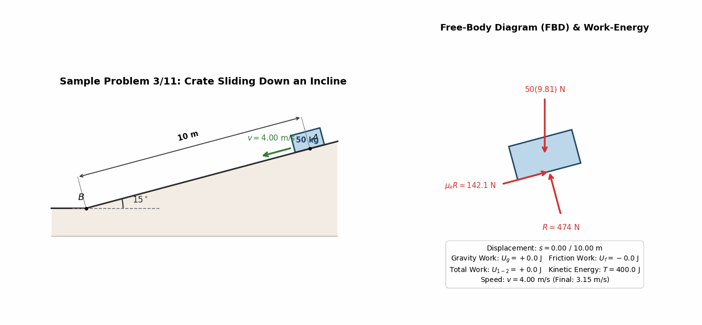
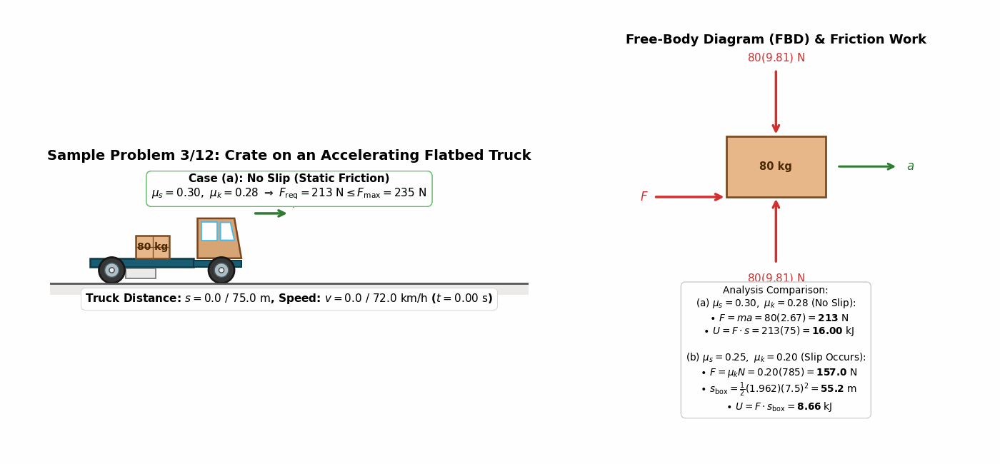
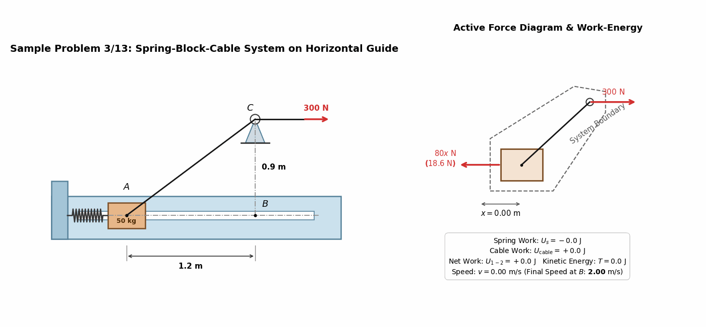
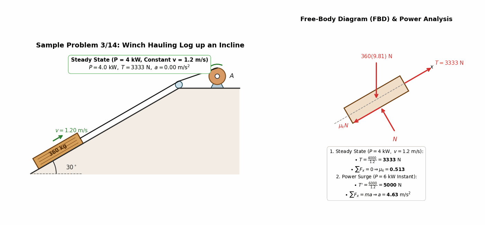
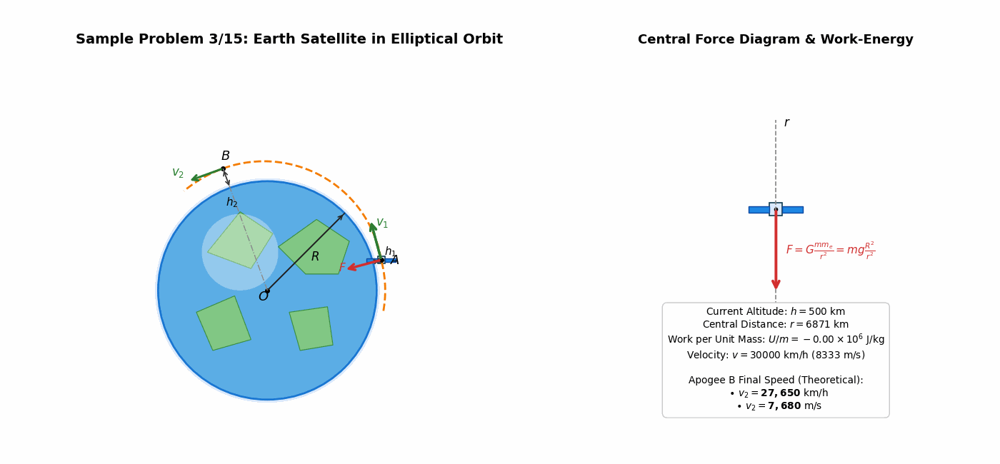
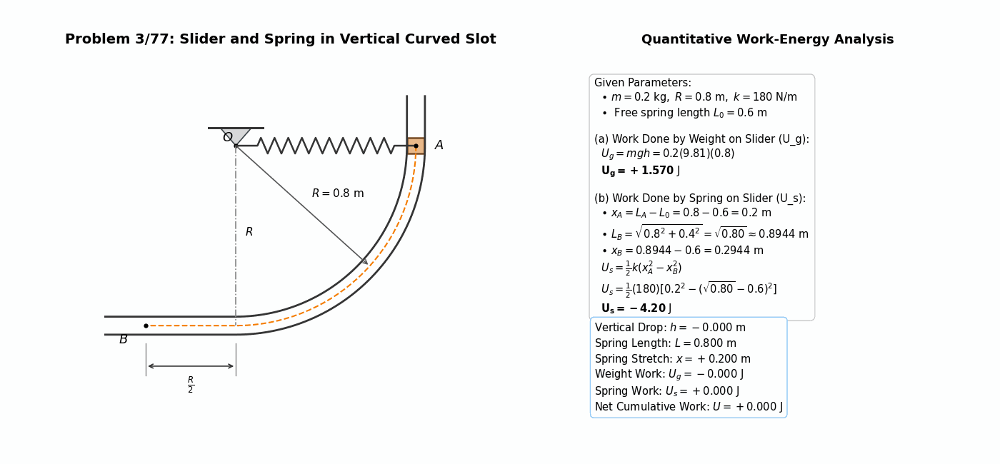
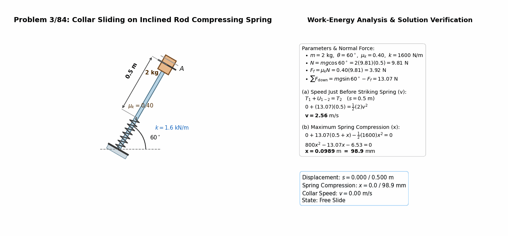
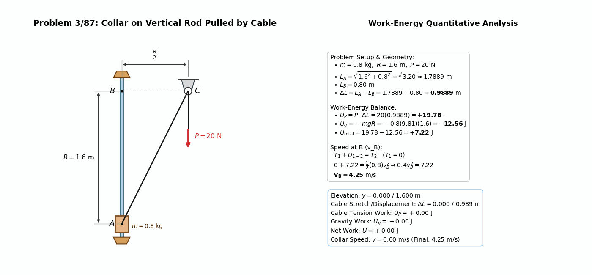
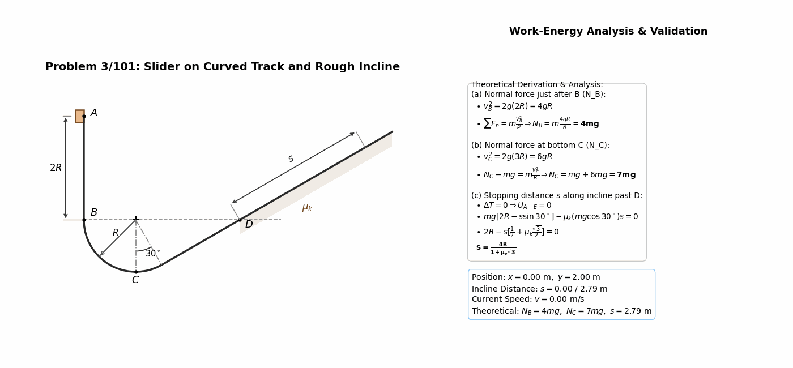

> **Author / Rights Holder:** 전북대학교 생물산업기계공학과 유동수 (ryudongsoo@jbnu.ac.kr, ryudongsoo@gmail.com)

# Week 7: Kinetics of Particles — Chapter 3 Part B: Work and Energy

## 📌 Lecture Overview and Learning Objectives

- **Chapter**: Meriam & Kraige Dynamics 9th Edition Chapter 3: Kinetics of Particles — Part B: Work and Energy
- **Objectives**:
  - Understand fundamental principles of work and kinetic energy, mastering the Work-Energy Equation ($T_1 + U_{1-2} = T_2$)
  - Apply sign conventions for gravity work ($U_g$), friction work ($U_f$), spring potential work ($U_s$), and external cable work
  - Investigate dynamic relationships between steady engine/winch power ($P = \vec{F} \cdot \vec{v}$) and instantaneous acceleration
  - Model orbital mechanics in variable gravitational fields ($F = mg \frac{R^2}{r^2}$) around Earth
  - Solve curvilinear kinematics and normal force dynamics ($N$) on circular and rough inclined tracks

---

## 📋 Course Curriculum and Contents

| Type | No. | Problem Title | Governing Principle & Solution | Output Links |
|:---:|:---:|:---|:---|:---:|
| **Example** | 3.11 | Crate Sliding Down Incline | $T_1 + U_g + U_f = T_2 \Rightarrow v_2 = 3.15\ \mathrm{m/s}$ | [Code](./ex3_11_incline_crate_work.py) \| [GIF](./ex3_11_incline_crate_work.gif) |
| **Example** | 3.12 | Crate on Accelerating Truck | (a) No slip $U = 16.00\ \mathrm{kJ}$, (b) Slip occurs $U = 8.66\ \mathrm{kJ}$ | [Code](./ex3_12_truck_box_work.py) \| [GIF](./ex3_12_truck_box_work.gif) |
| **Example** | 3.13 | Spring-Block-Cable Rail | $U_s = -80.0\ \mathrm{J},\ U_{\mathrm{cable}} = +180.0\ \mathrm{J} \Rightarrow v_B = 2.00\ \mathrm{m/s}$ | [Code](./ex3_13_spring_block_work.py) \| [GIF](./ex3_13_spring_block_work.gif) |
| **Example** | 3.14 | Winch Power & Hauled Log | Steady $\mu_k = 0.513$, 6 kW surge $a = 4.63\ \mathrm{m/s^2}$ | [Code](./ex3_14_log_winch_power.py) \| [GIF](./ex3_14_log_winch_power.gif) |
| **Example** | 3.15 | Satellite in Elliptical Orbit | Work per mass $U/m = -5.35\times 10^6\ \mathrm{J/kg} \Rightarrow v_2 = 27,650\ \mathrm{km/h}$ | [Code](./ex3_15_satellite_orbit_energy.py) \| [GIF](./ex3_15_satellite_orbit_energy.gif) |
| **Intro** | 3/77 | Slider in Vertical Groove | (a) $U_g = +1.570\ \mathrm{J}$, (b) $U_s = -4.20\ \mathrm{J}$ | [Code](./prob3_77_collar_spring_work.py) \| [GIF](./prob3_77_collar_spring_work.gif) |
| **Intro** | 3/84 | Collar Striking Inclined Spring | (a) Speed entering spring $v = 2.56\ \mathrm{m/s}$, (b) Max compression $x = 98.9\ \mathrm{mm}$ | [Code](./prob3_84_collar_incline_spring.py) \| [GIF](./prob3_84_collar_incline_spring.gif) |
| **Intro** | 3/87 | Vertical Collar Pulled by Cable | $\Delta L = 0.989\ \mathrm{m},\ U_{1-2} = +7.22\ \mathrm{J} \Rightarrow v_B = 4.25\ \mathrm{m/s}$ | [Code](./prob3_87_vertical_collar_cable.py) \| [GIF](./prob3_87_vertical_collar_cable.gif) |
| **Advanced** | 3/101 | Particle on Loop & Rough Incline | (a) $N_B = 4mg$, (b) $N_C = 7mg$, (c) $s = \frac{4R}{1 + \mu_k\sqrt{3}}$ | [Code](./prob3_101_slider_loop_incline.py) \| [GIF](./prob3_101_slider_loop_incline.gif) |

---

## 1. Textbook Core Examples (Sample Problems 3/11 ~ 3/15)

### 1.1 Sample Problem 3/11: Crate Sliding Down Incline

- **Problem Statement**: A $50\ \mathrm{kg}$ crate moves down a $15^\circ$ incline from $A$ with initial velocity $v_1 = 4\ \mathrm{m/s}$. Determine speed $v_2$ after sliding $s = 10\ \mathrm{m}$ to point $B$ ($\mu_k = 0.30$).
- **Dynamic Analysis**:
  - Normal force: $R = mg\cos 15^\circ = 50(9.81)\cos 15^\circ = 473.8\ \mathrm{N}$
  - Friction force: $F = \mu_k R = 0.30(473.8) = 142.1\ \mathrm{N}$
  - Gravity work: $U_g = mg(s\sin 15^\circ) = +1269.5\ \mathrm{J}$
  - Friction work: $U_f = -F \cdot s = -142.1(10) = -1421.4\ \mathrm{J}$
  - Total work: $U_{1-2} = 1269.5 - 1421.4 = -151.9\ \mathrm{J}$
  - Work-energy theorem: $T_1 + U_{1-2} = T_2 \Rightarrow \frac{1}{2}(50)(4^2) - 151.9 = \frac{1}{2}(50) v_2^2 \Rightarrow \mathbf{v_2 = 3.15\ \mathrm{m/s}}$

---

### 1.2 Sample Problem 3/12: Work of Friction on Crate Carried by Truck

- **Problem Statement**: Flatbed truck carrying $80\ \mathrm{kg}$ crate starts from rest and accelerates uniformly over $75\ \mathrm{m}$ to $72\ \mathrm{km/h}$ ($20\ \mathrm{m/s}$). Compute work of friction for (a) $\mu_s=0.30, \mu_k=0.28$ and (b) $\mu_s=0.25, \mu_k=0.20$.
  - Truck kinematics: $a = \frac{v^2}{2s} = \frac{20^2}{2(75)} = 2.667\ \mathrm{m/s^2}$, duration: $t = 7.5\ \mathrm{s}$
  - Normal force: $N = mg = 80(9.81) = 784.8\ \mathrm{N}$
  - Force required: $F_{\mathrm{req}} = ma = 80(2.667) = 213.3\ \mathrm{N}$
- **Case Evaluations**:
  - **(a) $\mu_s = 0.30, \mu_k = 0.28$**:
    - $F_{\max} = 0.30(784.8) = 235.4\ \mathrm{N} > 213.3\ \mathrm{N} \Rightarrow$ No slip occurs
    - Crate displacement: $s = 75\ \mathrm{m}$
    - Friction work: $U = F_{\mathrm{req}} \cdot s = 213.3 \times 75 = \mathbf{16.00\ \mathrm{kJ}}$
  - **(b) $\mu_s = 0.25, \mu_k = 0.20$**:
    - $F_{\max} = 0.25(784.8) = 196.2\ \mathrm{N} < 213.3\ \mathrm{N} \Rightarrow$ Crate slips backward
    - Kinetic friction: $F = 0.20(784.8) = 157.0\ \mathrm{N}$
    - Crate acceleration: $a_{\mathrm{box}} = \frac{157.0}{80} = 1.962\ \mathrm{m/s^2}$
    - Actual crate displacement: $s_{\mathrm{box}} = \frac{1}{2}(1.962)(7.5^2) = 55.18\ \mathrm{m}$
    - Friction work: $U = F \cdot s_{\mathrm{box}} = 157.0 \times 55.18 = \mathbf{8.66\ \mathrm{kJ}}$

---

### 1.3 Sample Problem 3/13: Spring-Block-Cable System along Rail

- **Problem Statement**: $50\ \mathrm{kg}$ block released from rest at $A$ ($x_1 = 0.233\ \mathrm{m}$) is pulled $1.2\ \mathrm{m}$ horizontally to $B$ by cable with tension $P = 300\ \mathrm{N}$ over pulley $C$ ($h = 0.9\ \mathrm{m}$). Find velocity $v_B$ ($k = 80\ \mathrm{N/m}$).
- **Dynamic Analysis**:
  - Spring stretch: $x_1 = 0.233\ \mathrm{m} \rightarrow x_2 = 1.433\ \mathrm{m}$
  - Spring work: $U_s = -\frac{1}{2} k (x_2^2 - x_1^2) = -\frac{1}{2}(80)(1.433^2 - 0.233^2) = -80.0\ \mathrm{J}$
  - Cable travel: $L_1 = \sqrt{1.2^2 + 0.9^2} = 1.50\ \mathrm{m},\ L_2 = 0.90\ \mathrm{m} \Rightarrow \Delta s_C = 0.60\ \mathrm{m}$
  - Cable work: $U_{\mathrm{cable}} = P \cdot \Delta s_C = 300(0.60) = +180.0\ \mathrm{J}$
  - Work-energy principle: $T_A + U_s + U_{\mathrm{cable}} = T_B \Rightarrow 0 - 80.0 + 180.0 = \frac{1}{2}(50) v_B^2 \Rightarrow \mathbf{v_B = 2.00\ \mathrm{m/s}}$

---

### 1.4 Sample Problem 3/14: Winch Power and Hauled Log

- **Problem Statement**: Winch at $A$ hauls $360\ \mathrm{kg}$ log up $30^\circ$ incline at constant $v = 1.2\ \mathrm{m/s}$ using $4\ \mathrm{kW}$ power. Determine $\mu_k$, and instantaneous acceleration $a$ if power surges suddenly to $6\ \mathrm{kW}$.
- **Dynamic Analysis**:
  - Normal force: $N = mg\cos 30^\circ = 360(9.81)\cos 30^\circ = 3058.4\ \mathrm{N} \approx 3060\ \mathrm{N}$
  - Gravity down incline: $mg\sin 30^\circ = 360(9.81)(0.5) = 1765.8\ \mathrm{N}$
  - **Steady state ($P = 4\ \mathrm{kW}$)**:
    - Tension: $T = \frac{P}{v} = \frac{4000}{1.2} = 3333.3\ \mathrm{N}$
    - Equilibrium: $T - mg\sin 30^\circ - \mu_k N = 0 \Rightarrow \mu_k N = 1567.5\ \mathrm{N} \Rightarrow \mathbf{\mu_k = 0.513}$
  - **Power surge ($P = 6\ \mathrm{kW}$)**:
    - Instantaneous tension: $T' = \frac{6000}{1.2} = 5000\ \mathrm{N}$
    - Equation of motion: $\sum F_x = T' - mg\sin 30^\circ - \mu_k N = 5000 - 1765.8 - 1567.5 = 1666.7\ \mathrm{N}$
    - Instantaneous acceleration: $a = \frac{1666.7}{360} = \mathbf{4.63\ \mathrm{m/s^2}}$

---

### 1.5 Sample Problem 3/15: Satellite in Elliptical Orbit Around Earth

- **Problem Statement**: Satellite of mass $m$ in elliptical orbit around Earth ($R = 6371\ \mathrm{km}$) has perigee at $A$ ($h_1 = 500\ \mathrm{km}$, $v_1 = 30,000\ \mathrm{km/h}$). Find speed $v_2$ at apogee $B$ ($h_2 = 1200\ \mathrm{km}$).
- **Dynamic Analysis**:
  - Radial distances: $r_1 = 6371 + 500 = 6871\ \mathrm{km},\ r_2 = 6371 + 1200 = 7571\ \mathrm{km}$
  - Initial speed: $v_1 = \frac{30000}{3.6} = 8333.3\ \mathrm{m/s}$
  - Gravitational work: $U_{1-2} = \int_{r_1}^{r_2} -F\, dr = mgR^2 \left(\frac{1}{r_2} - \frac{1}{r_1}\right)$
  - Work per unit mass: $\frac{U_{1-2}}{m} = (9.81)(6.371\times 10^6)^2 \left(\frac{1}{7.571\times 10^6} - \frac{1}{6.871\times 10^6}\right) = -5.353\times 10^6\ \mathrm{J/kg}$
  - Work-energy equation: $\frac{1}{2} v_1^2 + \frac{U_{1-2}}{m} = \frac{1}{2} v_2^2 \Rightarrow \mathbf{v_2 = 7680\ \mathrm{m/s} = 27,650\ \mathrm{km/h}}$

---

## 2. Practice Problems (3 Introductory + 1 Advanced)

### 2.1 Problem 3/77: Slider in Vertical Groove with Spring

- **Problem Statement**: $0.2\ \mathrm{kg}$ slider moves from $A(R, 0)$ to $B(-R/2, -R)$ along a circular vertical groove ($R = 0.8\ \mathrm{m}$). Determine (a) work of gravity and (b) work of spring ($k = 180\ \mathrm{N/m}$, free length $L_0 = 0.6\ \mathrm{m}$).
- **Calculations**:
  - **(a) Work of gravity**:
    $$U_g = mgh = 0.2(9.81)(0.8) = \mathbf{+1.570\ \mathrm{J}}$$
  - **(b) Work of spring**:
    - $x_A = L_A - L_0 = 0.8 - 0.6 = 0.2\ \mathrm{m}$
    - $L_B = \sqrt{0.8^2 + 0.4^2} = \sqrt{0.80} \approx 0.8944\ \mathrm{m} \Rightarrow x_B = 0.8944 - 0.6 = 0.2944\ \mathrm{m}$
    - $U_s = \frac{1}{2}k (x_A^2 - x_B^2) = \frac{1}{2}(180)[0.2^2 - 0.2944^2] = \mathbf{-4.20\ \mathrm{J}}$

---

### 2.2 Problem 3/84: Collar Sliding Down Inclined Rod into Spring

- **Problem Statement**: $2\ \mathrm{kg}$ collar starts from rest at top stop $A$, slides $s_0 = 0.5\ \mathrm{m}$ down a $60^\circ$ rod and strikes a spring ($k = 1.6\ \mathrm{kN/m}$). Find (a) velocity $v$ upon hitting spring and (b) maximum compression $x$ ($\mu_k = 0.40$).
- **Calculations**:
  - Equilibrium normal to rod: $N = mg\cos 60^\circ = 2(9.81)(0.5) = 9.81\ \mathrm{N} \Rightarrow F = \mu_k N = 3.924\ \mathrm{N}$
  - **(a) Velocity upon striking spring**:
    $$U_{1-2} = mg(s_0 \sin 60^\circ) - F \cdot s_0 = 8.496 - 1.962 = 6.534\ \mathrm{J} = \frac{1}{2}(2) v^2 \Rightarrow \mathbf{v = 2.56\ \mathrm{m/s}}$$
  - **(b) Maximum spring compression $x$**:
    $$U_{1-3} = \Delta T = 0 \Rightarrow (mg\sin 60^\circ - F)(0.5 + x) - \frac{1}{2}(1600) x^2 = 0$$
    $$800 x^2 - 13.07 x - 6.53 = 0 \Rightarrow \mathbf{x = 0.0989\ \mathrm{m}\ (98.9\ \mathrm{mm})}$$

---

### 2.3 Problem 3/87: Vertical Collar Motion Pulled by Cable

- **Problem Statement**: $0.8\ \mathrm{kg}$ collar moves up smooth vertical rod from $A$ to $B$ ($R = 1.6\ \mathrm{m}$) pulled by cable over pulley $C$ ($R/2 = 0.8\ \mathrm{m}$) with constant force $P = 20\ \mathrm{N}$. Compute velocity $v_B$.
- **Calculations**:
  - Cable displacement: $d = \sqrt{R^2 + (R/2)^2} - R/2 = \sqrt{1.6^2 + 0.8^2} - 0.8 = 0.9889\ \mathrm{m}$
  - Work by force $P$: $U_P = P \cdot d = 20(0.9889) = +19.78\ \mathrm{J}$
  - Work by gravity: $U_g = -mgR = -0.8(9.81)(1.6) = -12.56\ \mathrm{J}$
  - Net work: $U_{1-2} = 19.78 - 12.56 = +7.22\ \mathrm{J}$
  - Speed at $B$: $T_A + U_{1-2} = T_B \Rightarrow 0 + 7.22 = \frac{1}{2}(0.8) v_B^2 \Rightarrow 0.4 v_B^2 = 7.22 \Rightarrow \mathbf{v_B = 4.25\ \mathrm{m/s}}$

---

### 2.4 Problem 3/101: Particle on Loop Track and Rough Incline

- **Problem Statement**: Slider of mass $m$ is released from rest at $A$ down vertical drop $2R$, enters circular arc of radius $R$ through bottom $C$ and datum point $D$, then proceeds up rough $30^\circ$ incline ($\mu_k$). Find:
  - (a) Normal force $N_B$ just past point $B$
  - (b) Normal force $N_C$ at bottom point $C$
  - (c) Distance $s$ moved along incline before stopping
- **Calculations**:
  - **(a) Just past point $B$**:
    $$0 + 2mgR = \frac{1}{2} m v_B^2 \Rightarrow v_B^2 = 4gR$$
    $$\sum F_n = m a_n \Rightarrow \mathbf{N_B = m \frac{v_B^2}{R} = 4mg}$$
  - **(b) At bottom point $C$**:
    $$0 + 3mgR = \frac{1}{2} m v_C^2 \Rightarrow v_C^2 = 6gR$$
    $$\sum F_n = m a_n \Rightarrow N_C - mg = m \frac{6gR}{R} \Rightarrow \mathbf{N_C = 7mg}$$
  - **(c) Stopping distance $s$ up incline**:
    - Point $D$ is at the exact same elevation as point $B$ ($y_D = y_B$)
    - Incline normal force: $N = mg\cos 30^\circ = \frac{\sqrt{3}}{2}mg$, friction: $F = \mu_k \frac{\sqrt{3}}{2}mg$
    - $T_A + U_{A-E} = T_E \Rightarrow 0 + 2mgR - mg(s\sin 30^\circ) - \mu_k \frac{\sqrt{3}}{2}mgs = 0$
    - $2mgR = \frac{1}{2}mgs (1 + \mu_k\sqrt{3}) \Rightarrow \mathbf{s = \frac{4R}{1 + \mu_k\sqrt{3}}}$

---

## 📝 변경 이력 (Changelog)

- **2026-10-03 17:22:26** [[Dongsoo Ryu](mailto:ryudongsoo@jbnu.ac.kr)] feat(biomechanics): complete Week 7 Part B Work and Energy curriculum overhaul with 5 examples and 4 practice problems verified by solution manual
- **2026-10-02 23:28:18** [[Dongsoo Ryu](mailto:ryudongsoo@jbnu.ac.kr)] feat(patent): Leave applicant blank and set inventors to Yoo Dongsoo and Kim Sungmin for portable Brix meter patents (07, 08)
- **2026-10-02 23:22:53** [[Dongsoo Ryu](mailto:ryudongsoo@jbnu.ac.kr)] docs(patent): Complete comprehensive domestic and international prior art deep search and FTO analysis for 4 patent drafts
- **2026-10-02 23:17:31** [[Dongsoo Ryu](mailto:ryudongsoo@jbnu.ac.kr)] feat(patent): Add Kim Sungmin as co-inventor and establish 4-tier extra-large shell module for watermelon
- **2026-08-12 05:04:33** [[Dongsoo Ryu](mailto:ryudongsoo@jbnu.ac.kr)] docs: update assembly process and cost estimate for full SMT including ESP32-C6
