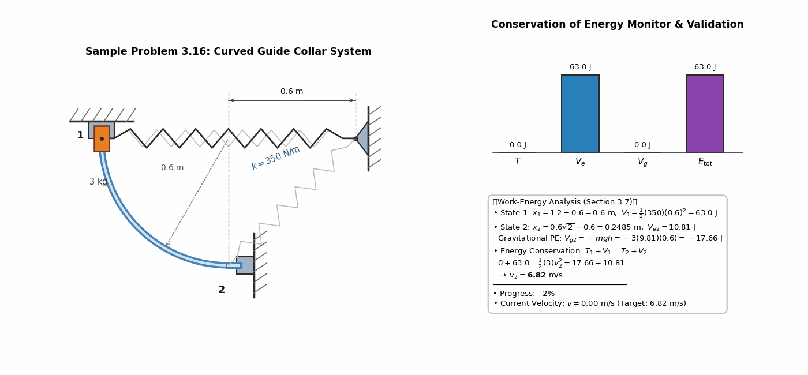
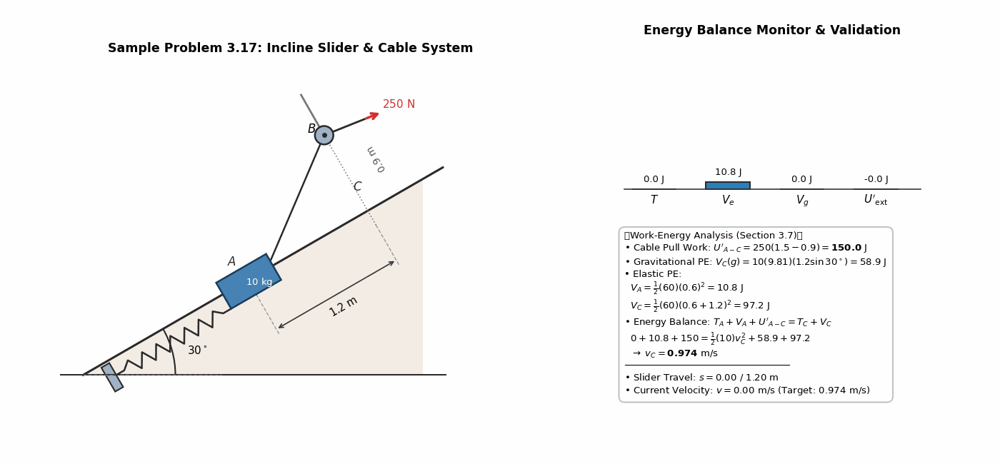
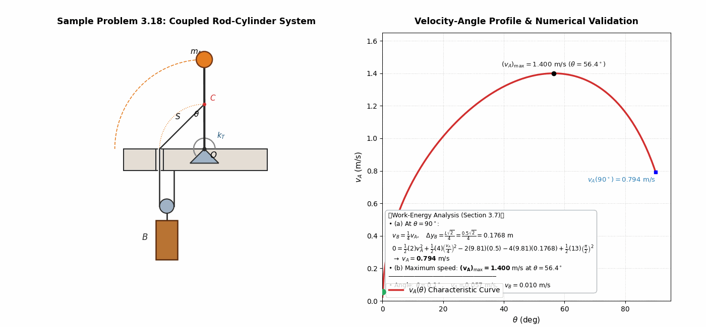
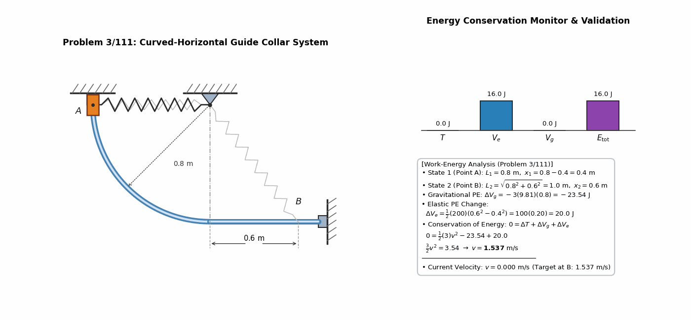
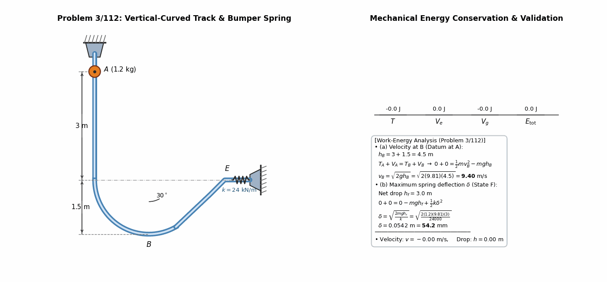
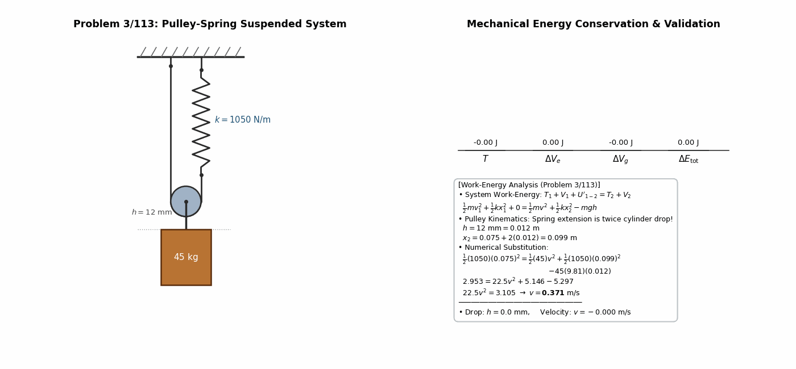
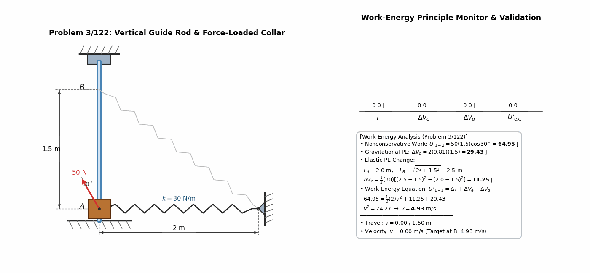

> **Author / Rights Holder:** 전북대학교 생물산업기계공학과 유동수 (ryudongsoo@jbnu.ac.kr, ryudongsoo@gmail.com)

# Week 9: Dynamics of Particles — Chapter 3 Part B: Potential Energy & Conservation of Energy

## 📌 Course Overview & Learning Objectives

- **Chapter**: Meriam & Kraige Engineering Dynamics (9th Ed.) Chapter 3 Kinetics of Particles — Part B: Work and Energy (Section 3.7 Potential Energy and Energy Conservation)
- **Objectives**:
  - Establish datum planes and sign conventions for gravitational potential energy ($V_g = mgy$).
  - Formulate elastic potential energy for linear springs ($V_e = \frac{1}{2}kx^2$) and torsional springs ($V_e = \frac{1}{2}k_T\theta^2$).
  - Apply the comprehensive work-energy balance with nonconservative forces ($T_1 + V_1 + U'_{1-2} = T_2 + V_2$).
  - Analyze coupled mechanical systems with kinematic constraints (cables, pulleys, revolving links) under energy conservation.

---

## 📋 Course Content Overview

| Type | No. | Problem Title | Key Concepts & Verified Formulas | Deliverables |
|:---:|:---:|:---|:---|:---:|
| **Sample** | 3.16 | Collar on Curved Guide with Spring | $T_1 + V_1 = T_2 + V_2 \Rightarrow v_2 = 6.82\ \mathrm{m/s}$ | [Code](./ex3_16_curved_rod_collar.py) \| [GIF](./ex3_16_curved_rod_collar.gif) |
| **Sample** | 3.17 | Incline Slider with Cable Force | $T_A + V_A + U'_{A-C} = T_C + V_C \Rightarrow v_C = 0.974\ \mathrm{m/s}$ | [Code](./ex3_17_incline_slider_spring.py) \| [GIF](./ex3_17_incline_slider_spring.gif) |
| **Sample** | 3.18 | Torsion Rod & Suspended Cylinder | $v_A(90^\circ) = 0.794\ \mathrm{m/s},\ (v_A)_{\max} = 1.400\ \mathrm{m/s}\ (56.4^\circ)$ | [Code](./ex3_18_torsion_rod_cylinder.py) \| [GIF](./ex3_18_torsion_rod_cylinder.gif) |
| **Practice 1** | 3/111 | Collar on Circular-Horizontal Guide | $0 = \Delta T + \Delta V_g + \Delta V_e \Rightarrow v_B = 1.537\ \mathrm{m/s}$ | [Code](./prob3_111_vertical_rod_collar.py) \| [GIF](./prob3_111_vertical_rod_collar.gif) |
| **Practice 2** | 3/112 | Track Slider with Spring Bumper | (a) $v_B = 9.40\ \mathrm{m/s}$, (b) $\delta = 54.2\ \mathrm{mm}$ | [Code](./prob3_112_curved_guide_bumper.py) \| [GIF](./prob3_112_curved_guide_bumper.gif) |
| **Practice 3** | 3/113 | Pulley-Spring Suspended Cylinder | $\Delta x = 2h,\ 0 = \Delta T + \Delta V_g + \Delta V_e \Rightarrow v = 0.371\ \mathrm{m/s}$ | [Code](./prob3_113_pulley_cylinder_spring.py) \| [GIF](./prob3_113_pulley_cylinder_spring.gif) |
| **Advanced 1** | 3/122 | Vertical Collar with Inclined Pull | $U'_{1-2} = \Delta T + \Delta V_g + \Delta V_e \Rightarrow v_B = 4.93\ \mathrm{m/s}$ | [Code](./prob3_122_incline_collar_spring.py) \| [GIF](./prob3_122_incline_collar_spring.gif) |

---

## 1. Core Textbook Sample Problems (Sample Problems 3/16 ~ 3/18)

### 1.1 Sample Problem 3.16: Collar on Curved Guide with Attached Spring

- **Problem Statement**: A $3\ \mathrm{kg}$ collar is released from rest at position 1 and slides down a frictionless curved rod in a vertical plane. Spring stiffness $k = 350\ \mathrm{N/m}$, unstretched length $L_0 = 0.6\ \mathrm{m}$. Determine the speed $v_2$ as the collar passes position 2.
- **Analysis**:
  - State 1: $L_1 = 1.2\ \mathrm{m} \Rightarrow x_1 = 1.2 - 0.6 = 0.6\ \mathrm{m}$
    $$V_1 = \frac{1}{2} k x_1^2 = \frac{1}{2}(350)(0.6)^2 = 63.0\ \mathrm{J},\quad V_{g1} = 0$$
  - State 2: $L_2 = \sqrt{0.6^2 + 0.6^2} = 0.8485\ \mathrm{m} \Rightarrow x_2 = 0.2485\ \mathrm{m}$
    $$V_{e2} = \frac{1}{2}(350)(0.2485)^2 = 10.81\ \mathrm{J},\quad V_{g2} = -mgh = -3(9.81)(0.6) = -17.66\ \mathrm{J}$$
  - Energy Conservation:
    $$T_1 + V_1 = T_2 + V_2 \Rightarrow 0 + 63.0 = \frac{1}{2}(3)v_2^2 - 17.66 + 10.81 \Rightarrow \mathbf{v_2 = 6.82\ \mathrm{m/s}}$$

---

### 1.2 Sample Problem 3.17: Incline Slider with Spring & Cable Pull

- **Problem Statement**: A $10\ \mathrm{kg}$ slider $A$ is released from rest with an initial spring stretch of $0.6\ \mathrm{m}$ ($k = 60\ \mathrm{N/m}$). A constant cable force $P = 250\ \mathrm{N}$ acts over pulley $B$. Calculate the speed $v_C$ as the slider passes position $C$ after traveling $1.2\ \mathrm{m}$ up the $30^\circ$ incline.
- **Analysis**:
  - Nonconservative Cable Work: $\Delta s_C = AB - BC = 1.5 - 0.9 = 0.6\ \mathrm{m} \Rightarrow U'_{A-C} = 250(0.6) = 150.0\ \mathrm{J}$
  - Potential Energy (Datum at $A$):
    $$V_{gC} = 10(9.81)(1.2\sin 30^\circ) = 58.9\ \mathrm{J}$$
    $$V_{eA} = \frac{1}{2}(60)(0.6)^2 = 10.8\ \mathrm{J},\quad V_{eC} = \frac{1}{2}(60)(1.8)^2 = 97.2\ \mathrm{J}$$
  - Work-Energy Balance:
    $$0 + 10.8 + 150.0 = \frac{1}{2}(10)v_C^2 + 58.9 + 97.2 \Rightarrow \mathbf{v_C = 0.974\ \mathrm{m/s}}$$

---

### 1.3 Sample Problem 3.18: Torsion Rod & Suspended Cylinder Coupled System

- **Problem Statement**: A slender rod $OA$ ($L = 0.5\ \mathrm{m}, m_A = 2\ \mathrm{kg}$) with torsional spring $k_T = 13\ \mathrm{N\cdot m/rad}$ is released from vertical. A cord attached at midpoint $C$ supports a suspended cylinder $B$ ($m_B = 4\ \mathrm{kg}$). Find (a) $v_A$ at $\theta = 90^\circ$ and (b) the maximum velocity $(v_A)_{\max}$.
- **Analysis**:
  - Kinematics: $v_B = \frac{1}{4} v_A \cos\left(\frac{90^\circ - \theta}{2}\right)$, $\Delta y_B(90^\circ) = \frac{L\sqrt{2}}{4} = 0.1768\ \mathrm{m}$
  - Energy Balance:
    $$0 = \frac{1}{2}(2)v_A^2 + \frac{1}{2}(4)\left(\frac{v_A}{4}\right)^2 - 2(9.81)(0.5) - 4(9.81)(0.1768) + \frac{1}{2}(13)\left(\frac{\pi}{2}\right)^2$$
    $$\mathbf{v_A(90^\circ) = 0.794\ \mathrm{m/s}}$$
  - Velocity profile across $0^\circ \le \theta \le 90^\circ$:
    $$\mathbf{(v_A)_{\max} = 1.400\ \mathrm{m/s}\quad (\theta = 56.4^\circ)}$$

---

## 2. Core Practice Problems (3 Fundamental + 1 Advanced)

### 2.1 Fundamental 1: Problem 3/111 — Collar on Circular-Horizontal Guide

- **Problem Statement**: A $3\ \mathrm{kg}$ collar attached to a spring ($L_0 = 0.4\ \mathrm{m}, k = 200\ \mathrm{N/m}$) starts from rest at $A$ and moves down a quarter-circular track ($R = 0.8\ \mathrm{m}$) then onto a horizontal track to $B$ ($0.6\ \mathrm{m}$). Find speed $v_B$.
- **Calculation**:
  - $\Delta V_g = -3(9.81)(0.8) = -23.54\ \mathrm{J}$
  - $\Delta V_e = \frac{1}{2}(200)[(1.0 - 0.4)^2 - (0.8 - 0.4)^2] = 20.0\ \mathrm{J}$
  - Energy Conservation:
    $$0 = \frac{3}{2} v^2 - 23.54 + 20.0 \Rightarrow \mathbf{v_B = 1.537\ \mathrm{m/s}}$$

---

### 2.2 Fundamental 2: Problem 3/112 — Track Slider with Spring Bumper

- **Problem Statement**: A $1.2\ \mathrm{kg}$ slider drops $3\ \mathrm{m}$ vertically, navigates a $1.5\ \mathrm{m}$ radius curve, ascends a $30^\circ$ ramp to $E$, and strikes a bumper spring ($k = 24\ \mathrm{kN/m}$). Determine (a) speed $v_B$ at lowest point and (b) maximum compression $\delta$.
- **Calculation**:
  - **(a) Lowest Point $B$ Speed** ($h_B = 3.0 + 1.5 = 4.5\ \mathrm{m}$):
    $$v_B = \sqrt{2gh_B} = \sqrt{2(9.81)(4.5)} = \mathbf{9.40\ \mathrm{m/s}}$$
  - **(b) Bumper Spring Deflection $\delta$** ($h_f = 3.0\ \mathrm{m}$):
    $$\delta = \sqrt{\frac{2mgh_f}{k}} = \sqrt{\frac{2(1.2)(9.81)(3.0)}{24000}} = \mathbf{54.2\ \mathrm{mm}}$$

---

### 2.3 Fundamental 3: Problem 3/113 — Pulley-Spring Suspended Cylinder

- **Problem Statement**: A $45\ \mathrm{kg}$ cylinder drops $h = 12\ \mathrm{mm}$ from rest against a suspension spring ($k = 1050\ \mathrm{N/m}$, initial stretch $75\ \mathrm{mm}$). Find its speed $v$.
- **Calculation**:
  - Kinematics: $\Delta x = 2h = 24\ \mathrm{mm} \Rightarrow x_2 = 0.075 + 0.024 = 0.099\ \mathrm{m}$
  - $\Delta V_g = -45(9.81)(0.012) = -5.297\ \mathrm{J}$
  - $\Delta V_e = \frac{1}{2}(1050)(0.099^2 - 0.075^2) = +2.192\ \mathrm{J}$
  - Conservation of Energy:
    $$\frac{1}{2}(45)v^2 = 5.297 - 2.192 = 3.105 \Rightarrow \mathbf{v = 0.371\ \mathrm{m/s}}$$

---

### 2.4 Advanced 1: Problem 3/122 — Vertical Collar with Inclined Pull

- **Problem Statement**: A $2\ \mathrm{kg}$ collar is pulled up a vertical rod from $A$ by an inclined force $P = 50\ \mathrm{N}$ at $30^\circ$. A spring ($k = 30\ \mathrm{N/m}, L_0 = 1.5\ \mathrm{m}$) is anchored $2.0\ \mathrm{m}$ horizontally. Find speed $v_B$ after $1.5\ \mathrm{m}$ elevation.
- **Calculation**:
  - Work: $U'_{1-2} = (50\cos 30^\circ) \times 1.5 = 64.95\ \mathrm{J}$
  - Gravitational PE: $\Delta V_g = 2(9.81)(1.5) = 29.43\ \mathrm{J}$
  - Elastic PE: $\Delta V_e = \frac{1}{2}(30)[2.5 - 1.5)^2 - (2.0 - 1.5)^2] = 11.25\ \mathrm{J}$
  - Work-Energy Balance:
    $$64.95 = v^2 + 29.43 + 11.25 \Rightarrow v^2 = 24.27 \Rightarrow \mathbf{v_B = 4.93\ \mathrm{m/s}}$$

---

## 📝 Changelog

- **2026-10-02 23:28:18** [[Dongsoo Ryu](mailto:ryudongsoo@jbnu.ac.kr)] feat(patent): Leave applicant blank and set inventors to Yoo Dongsoo and Kim Sungmin for portable Brix meter patents (07, 08)
- **2026-10-02 23:22:53** [[Dongsoo Ryu](mailto:ryudongsoo@jbnu.ac.kr)] docs(patent): Complete comprehensive domestic and international prior art deep search and FTO analysis for 4 patent drafts
- **2026-10-02 23:17:31** [[Dongsoo Ryu](mailto:ryudongsoo@jbnu.ac.kr)] feat(patent): Add Kim Sungmin as co-inventor and establish 4-tier extra-large shell module for watermelon
- **2026-08-12 05:04:33** [[Dongsoo Ryu](mailto:ryudongsoo@jbnu.ac.kr)] docs: update assembly process and cost estimate for full SMT including ESP32-C6
- **2026-08-12 04:58:47** [[Dongsoo Ryu](mailto:ryudongsoo@jbnu.ac.kr)] docs: update 3D rendering image with FDT SENSOR NODE silkscreen

---

## 📝 변경 이력 (Changelog)
- **2026-11-01 23:35:00** [[Dongsoo Ryu](mailto:ryudongsoo@jbnu.ac.kr)] feat: release Weeks 1–15 bilingual biomechanics simulation portfolio & supplementary concept animations
