> **Author / Rights Holder:** 전북대학교 생물산업기계공학과 유동수 (ryudongsoo@jbnu.ac.kr)

# 10주차: 질점의 운동역학 — 제3장 C편: 선형 및 각 충격량과 운동량 (Impulse and Momentum)

## 📌 강의 개요 및 학습 목표

- **단원**: 동역학 9판 제3장 질점의 운동역학 — C편: 충격량과 운동량 (Section 3.8~3.9 선형충격량과 선형운동량 & Section 3.10 각충격량과 각운동량)
- **학습 목표**:
  - 뉴턴 제2법칙의 시간 적분을 통한 **선형충격량-선형운동량 원리**($\mathbf{G}_1 + \int_{t_1}^{t_2} \Sigma\mathbf{F} dt = \mathbf{G}_2$)의 완벽한 물리적 정립
  - 질점의 시간 가변 운동량 $\mathbf{G}(t)$로부터 시간 미분을 통한 외력 벡터 $\mathbf{F}(t) = \dot{\mathbf{G}} - \mathbf{W}$의 역산 메커니즘 확립
  - 힘-시간($F$-$t$) 선도 면적 적분을 통한 직교 성분별 충격량 계산 및 평면 2차원 궤적 해석
  - 외력의 합이 $0$인 고립계에서의 **선형운동량 보존 법칙**($\Sigma \mathbf{G}_1 = \Sigma \mathbf{G}_2$)과 완전 비탄성 충돌 시 운동에너지 소실 메커니즘 규명
  - 원점 $O$에 대한 선형운동량의 모멘트인 **각운동량($\mathbf{H}_O = \mathbf{r} \times m\mathbf{v}$)**과 **모멘트-각운동량 변화율 관계($\Sigma\mathbf{M}_O = \dot{\mathbf{H}}_O$)** 확립
  - **각충격량-각운동량 원리**($\mathbf{H}_{O1} + \int_{t_1}^{t_2} \Sigma\mathbf{M}_O dt = \mathbf{H}_{O2}$) 및 중심력장·무마찰 회전축 시스템에서의 **각운동량 보존 법칙**($\Delta\mathbf{H}_O = \mathbf{0}$) 습득
  - 반구형 그릇 및 원호 깔때기 내부 3차원 나선 활주 등 **각운동량 보존과 일-에너지 정리의 연립 해석** 역량 완성

---

## 📋 주차별 학습 콘텐츠 구성 (전체 21종 시뮬레이션)

### Part 1: 선형충격량과 선형운동량 (Section 3.8 ~ 3.9, 개념 2종 + 예제·문제 9종)

| 구분 | 번호 | 예제/문제명 | 핵심 역학 개념 및 검증 공식 | 산출물 링크 |
|:---:|:---:|:---|:---|:---:|
| **보충 개념** | 개념 1 | 힘-시간 그래프 넓이와 정적분 원리 | $m\mathbf{v}_1 + \int_{t_1}^{t_2} F(t)\,dt = m\mathbf{v}_2$ ($F$-$t$ 아래 넓이 = 운동량 변화량) | [코드](./concept_ft_area_impulse.py) \| [GIF](./concept_ft_area_impulse.gif) |
| **보충 개념** | 개념 2 | 충돌 시 내부 힘 상쇄와 운동량 보존 | $\int_{t_1}^{t_2}(+\mathbf{F})\,dt + \int_{t_1}^{t_2}(-\mathbf{F})\,dt = \mathbf{0} \Rightarrow \Sigma\mathbf{G}_1 = \Sigma\mathbf{G}_2$ | [코드](./concept_internal_force_cancel.py) \| [GIF](./concept_internal_force_cancel.gif) |
| **예제** | 3.19 | 테니스 라켓 임팩트 충격력 | $\mathbf{G}_1 + \int_{t_1}^{t_2} \mathbf{R}\,dt + \mathbf{W}\Delta t = \mathbf{G}_2 \Rightarrow R = 107.2\ \mathrm{N},\ \beta = 9.07^\circ$ | [코드](./ex3_19_tennis_ball_impulse.py) \| [GIF](./ex3_19_tennis_ball_impulse.gif) |
| **예제** | 3.20 | 시간 가변 선형운동량과 작용력 구하기 | $\mathbf{F} = \dot{\mathbf{G}} - \mathbf{W} \Rightarrow \mathbf{F}(2\mathrm{s}) = 6\mathbf{j} - 6.04\mathbf{k}\ \mathrm{N}\ (F = 8.51\ \mathrm{N})$ | [코드](./ex3_20_momentum_force_derivative.py) \| [GIF](./ex3_20_momentum_force_derivative.gif) |
| **예제** | 3.21 | 2차원 평면 가변력과 충격량 적분 | $m\mathbf{v}_1 + \int_0^3 \mathbf{F}\,dt = m\mathbf{v}_2 \Rightarrow \mathbf{v}_2 = -6\mathbf{i} + 8\mathbf{j}\ \mathrm{m/s}\ (v_2 = 10\ \mathrm{m/s},\ \theta_x = 126.9^\circ)$ | [코드](./ex3_21_variable_force_plane_impulse.py) \| [GIF](./ex3_21_variable_force_plane_impulse.gif) |
| **예제** | 3.22 | 경사면 탄차와 램프 케이블 견인력 | $m v_1 + \int_0^t (2P - W_x)dt = m v \Rightarrow t' = 6.46\ \mathrm{s},\ v(8\mathrm{s}) = 4.76\ \mathrm{m/s}$ | [코드](./ex3_22_incline_skip_impulse.py) \| [GIF](./ex3_22_incline_skip_impulse.gif) |
| **예제** | 3.23 | 2차원 탄환 충돌 및 운동량 보존 | $\Sigma \mathbf{G}_1 = (m_1 + m_2)\mathbf{v}_f \Rightarrow v_f = 16.83\ \mathrm{m/s},\ \theta = 52.4^\circ$ | [코드](./ex3_23_bullet_block_momentum.py) \| [GIF](./ex3_23_bullet_block_momentum.gif) |
| **기초 1** | 3/140 | 10% 경사로 자동차 가속 견인력 | $m v_1 + (F - mg\sin\theta)\Delta t = m v_2 \Rightarrow F = 3030\ \mathrm{N}\ (3.03\ \mathrm{kN})$ | [코드](./prob3_140_car_incline_impulse.py) \| [GIF](./prob3_140_car_incline_impulse.gif) |
| **기초 2** | 3/142 | 탄알-카트 비탄성 충돌과 에너지 소실 | $m v = (M+m)v_f \Rightarrow v_f = 0.899\ \mathrm{m/s},\ \|\Delta E\| = 13,480\ \mathrm{J}\ (99.9\%)$ | [코드](./prob3_142_bullet_cart_impact.py) \| [GIF](./prob3_142_bullet_cart_impact.gif) |
| **기초 3** | 3/143 | 총알 목재 블록 관통과 마찰 활주 | $m v_1 = m v_2 + M v_b \Rightarrow v_b = 4.0\ \mathrm{m/s},\ \mu_k = 0.302$ | [코드](./prob3_143_bullet_wood_block.py) \| [GIF](./prob3_143_bullet_wood_block.gif) |
| **심화 1** | 3/152 | 교차로 2차원 차량 충돌 일체화 | $M\mathbf{v}_f = m_A \mathbf{v}_A + m_B \mathbf{v}_B \Rightarrow v = 28.5\ \mathrm{km/h},\ \theta = 54.6^\circ\ \mathrm{W\ of\ N}$ | [코드](./prob3_152_intersection_car_collision.py) \| [GIF](./prob3_152_intersection_car_collision.gif) |

### Part 2: 각충격량과 각운동량 (Section 3.10, 개념 2종 + 예제·문제 8종)

| 구분 | 번호 | 예제/문제명 | 핵심 역학 개념 및 검증 공식 | 산출물 링크 |
|:---:|:---:|:---|:---|:---:|
| **보충 개념** | 개념 3 | 직선 운동과 수직 모멘트 팔 불변성 | $H_O = m v d = m r v\sin\theta = m r v_\theta$ (직선 경로 이동 중 $d = r\sin\theta$ 일정) | [코드](./concept_angular_momentum_arm.py) \| [GIF](./concept_angular_momentum_arm.gif) |
| **보충 개념** | 개념 4 | 중심력 운동과 각운동량 보존 원리 | $\Sigma\mathbf{M}_O = \mathbf{r}\times\mathbf{F} = \mathbf{0} \Rightarrow r_1 v_{\theta 1} = r_2 v_{\theta 2}$ (반경 수축 가속 및 에너지 비교) | [코드](./concept_central_force_orbit.py) \| [GIF](./concept_central_force_orbit.gif) |
| **예제** | 3.24 | 3차원 공간 구의 각운동량과 시간 미계수 | $\mathbf{H}_O = \mathbf{r}\times m\mathbf{v} = -40\mathbf{i} + 30\mathbf{k}\ \mathrm{N\cdot m\cdot s},\ \dot{\mathbf{H}}_O = \mathbf{r}\times\mathbf{F} = 60\mathbf{i} - 30\mathbf{j}\ \mathrm{N\cdot m}$ | [코드](./ex3_24_cord_table_particle.py) \| [GIF](./ex3_24_cord_table_particle.gif) |
| **예제** | 3.25 | 장타원 궤도 혜성의 각운동량 보존 | $(H_O)_A = (H_O)_B \Rightarrow m r_A v_A = m r_B v_B \Rightarrow v_B = 59,200\ \mathrm{m/s}$ | [코드](./ex3_25_comet_elliptical_orbit.py) \| [GIF](./ex3_25_comet_elliptical_orbit.gif) |
| **예제** | 3.26 | 봉-질량 조립체와 가루뭉치 충돌 | $m v_1 l = 3m(l\dot{\theta}_2)l + 4m(2l\dot{\theta}_2)(2l) \Rightarrow \dot{\theta}_2 = \frac{v_1}{19l}\ \mathrm{CW}$ | [코드](./ex3_26_rotating_T_bar_spheres.py) \| [GIF](./ex3_26_rotating_T_bar_spheres.gif) |
| **예제** | 3.27 | 반구형 그릇 내부 질점의 3D 활주 | $m v_0 r_0 = m v r\cos\theta,\ v = \sqrt{v_0^2+2gh} \Rightarrow \theta = \cos^{-1}\frac{1}{\sqrt{1+2gh/v_0^2}\sqrt{1-h^2/r_0^2}}$ | [코드](./ex3_27_hemispherical_bowl_particle.py) \| [GIF](./ex3_27_hemispherical_bowl_particle.gif) |
| **기초 4** | 3/173 | 평면 운동 구의 각운동량 2가지 해법 | (a) $\mathbf{H}_O = \mathbf{r}\times m\mathbf{v} = +128.7\mathbf{k}\ \mathrm{kg\cdot m^2/s}$, (b) $d = 9.20\ \mathrm{m} \Rightarrow H_O = 128.7\ \mathrm{kg\cdot m^2/s}$ | [코드](./prob3_173_satellite_angular_momentum.py) \| [GIF](./prob3_173_satellite_angular_momentum.gif) |
| **기초 5** | 3/175 | 3 kg 구의 선운동량·각운동량·운동에너지 | $\mathbf{G} = -12.99\mathbf{i} - 7.50\mathbf{j}\ \mathrm{kg\cdot m/s},\ \mathbf{H}_O = -21.2\mathbf{k}\ \mathrm{kg\cdot m^2/s},\ T = 37.5\ \mathrm{J}$ | [코드](./prob3_175_particle_angular_impulse.py) \| [GIF](./prob3_175_particle_angular_impulse.gif) |
| **심화 2** | 3/184 | 회전 봉 위 두 구의 반경 확장과 손실 분율 | $2mr^2\omega_0 = 8mr^2\omega \Rightarrow \omega = \omega_0/4,\ n = \Delta T / T_1 = 3/4\ (75\%)$ | [코드](./prob3_184_pendulum_peg_impulse.py) \| [GIF](./prob3_184_pendulum_peg_impulse.gif) |
| **심화 3** | 3/192 | 깔때기 곡면을 활주하는 질점의 속도·경사각 | $v_2 = \sqrt{v_0^2+2gr\cos 30^\circ} = 3.95\ \mathrm{m/s},\ m v_0(0.65r) = m v_2\cos\theta(0.15r) \Rightarrow \theta = 52.9^\circ$ | [코드](./prob3_192_slotted_disk_slider.py) \| [GIF](./prob3_192_slotted_disk_slider.gif) |

---

## 1. 선형충격량과 선형운동량 핵심 예제 (Sample Problems 3/19 ~ 3/23)

### 1.1 예제 3.19: 테니스 라켓 임팩트 충격력 및 선형운동량 원리

- **문제 정의**: 질량 $m = 60\ \mathrm{g} = 0.060\ \mathrm{kg}$인 테니스공이 코트 바닥에서 바운드되어 정점에서 수평 왼쪽으로 $v_1 = 15\ \mathrm{m/s}$의 속도로 날아오다가 라켓에 맞고 수평 대비 $15^\circ$ 상향 우측으로 $v_2 = 21\ \mathrm{m/s}$로 반발한다. 충돌 접촉 시간 $\Delta t = 0.02\ \mathrm{s}$일 때, 라켓이 볼에 가한 평균 충격력 $\mathbf{R}$의 크기와 각도 $\beta$를 구하라.
- **역학 해석**:
  - 초기 및 최종 운동량:
    $$\mathbf{G}_1 = -0.060(15)\mathbf{i} = -0.900\mathbf{i}\ \mathrm{N\cdot s}$$
    $$\mathbf{G}_2 = 0.060(21)(\cos 15^\circ\mathbf{i} + \sin 15^\circ\mathbf{j}) = 1.217\mathbf{i} + 0.326\mathbf{j}\ \mathrm{N\cdot s}$$
  - 선형충격량-선형운동량 원리 ($\mathbf{G}_1 + \int \Sigma\mathbf{F} dt = \mathbf{G}_2$):
    - $x$방향: $-0.900 + R_x(0.02) = 1.217 \Rightarrow R_x(0.02) = 2.117 \Rightarrow \mathbf{R_x = 105.9\ \mathrm{N}}$
    - $y$방향: $0 + (R_y - mg)(0.02) = 0.326 \Rightarrow R_y(0.02) = 0.326 + 0.060(9.81)(0.02) = 0.3378 \Rightarrow \mathbf{R_y = 16.89\ \mathrm{N}}$
  - 합성 평균 충격력:
    $$R = \sqrt{105.9^2 + 16.89^2} = \mathbf{107.2\ \mathrm{N}},\quad \beta = \tan^{-1}\left(\frac{16.89}{105.9}\right) = \mathbf{9.07^\circ}$$

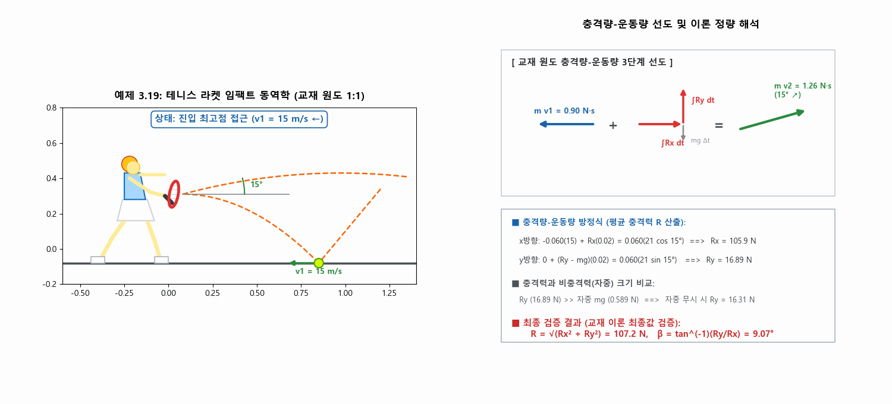

---

### 1.2 예제 3.20: 시간 가변 선형운동량과 외력 벡터 역산

- **문제 정의**: 질량 $m = 0.2\ \mathrm{kg}$인 질점이 연직 $y$-$z$ 평면에서 운동하고 있으며, 선형운동량이 시간에 따라 $\mathbf{G} = 1.5(t^2 + 3)\mathbf{j} - \frac{2}{3}(t^3 - 4)\mathbf{k}\ \mathrm{N\cdot s}$로 변화한다. $t = 2\ \mathrm{s}$일 때 질점에 작용하는 힘 $\mathbf{F}$를 구하라 (단, 중력가속도 $g = 9.81\ \mathrm{m/s^2}$, 중력 $\mathbf{W} = -mg\mathbf{k} = -1.962\mathbf{k}\ \mathrm{N}$).
- **역학 해석**:
  - 뉴턴 제2법칙의 운동량 형태:
    $$\Sigma\mathbf{F} = \frac{d\mathbf{G}}{dt} = \dot{\mathbf{G}} \implies \mathbf{F} + \mathbf{W} = \dot{\mathbf{G}} \implies \mathbf{F} = \dot{\mathbf{G}} - \mathbf{W}$$
  - 운동량의 시간 미분:
    $$\dot{\mathbf{G}} = \frac{d}{dt}\left[1.5(t^2 + 3)\mathbf{j} - \frac{2}{3}(t^3 - 4)\mathbf{k}\right] = 3t\mathbf{j} - 2t^2\mathbf{k}\ \mathrm{N}$$
  - $t = 2\ \mathrm{s}$ 시점 대입:
    $$\mathbf{F}(2) = 3(2)\mathbf{j} + [1.962 - 2(4)]\mathbf{k} = \mathbf{6\mathbf{j} - 6.04\mathbf{k}\ \mathrm{N}},\quad F = \sqrt{6^2 + (-6.038)^2} = \mathbf{8.51\ \mathrm{N}}$$

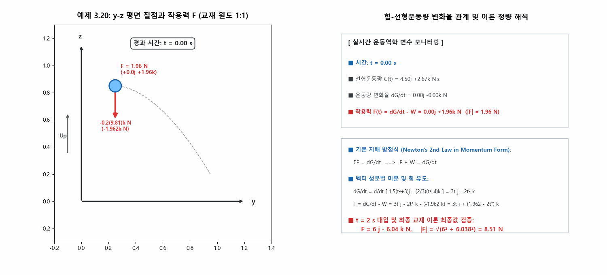

---

### 1.3 예제 3.21: 2차원 평면 가변력과 충격량 적분

- **문제 정의**: 수평 $x$-$y$ 평면에서 마찰 없이 운동하는 질량 $m = 0.5\ \mathrm{kg}$인 질점이 $t = 0$에서 초기 속도 $\mathbf{v}_1 = 10\mathbf{i}\ \mathrm{m/s}$로 운동한다. $t = 0$부터 $t = 3\ \mathrm{s}$까지 시간 가변력 $F_1(t)$($-x$ 방향)과 $F_2(t)$($+y$ 방향)이 작용할 때, $t = 3\ \mathrm{s}$에서의 최종 속도 $\mathbf{v}_2$의 크기와 방향각 $\theta_x$를 구하라.
- **역학 해석**:
  - $x$방향 선형충격량-선형운동량 식:
    $$\int_0^3 F_1 dt = 4(1) + 2(2) = 8\ \mathrm{N\cdot s} \implies 0.5(10) - 8 = -3 = 0.5(v_2)_x \implies \mathbf{(v_2)_x = -6\ \mathrm{m/s}}$$
  - $y$방향 선형충격량-선형운동량 식:
    $$\int_0^3 F_2 dt = 1(2) + \frac{1+3}{2}(1) = 4\ \mathrm{N\cdot s} \implies 0 + 4 = 0.5(v_2)_y \implies \mathbf{(v_2)_y = +8\ \mathrm{m/s}}$$
  - 최종 속도 벡터 및 크기/방향:
    $$\mathbf{v}_2 = -6\mathbf{i} + 8\mathbf{j}\ \mathrm{m/s},\quad v_2 = \sqrt{(-6)^2 + 8^2} = \mathbf{10\ \mathrm{m/s}},\quad \theta_x = 180^\circ - \tan^{-1}\left(\frac{8}{6}\right) = \mathbf{126.9^\circ}$$

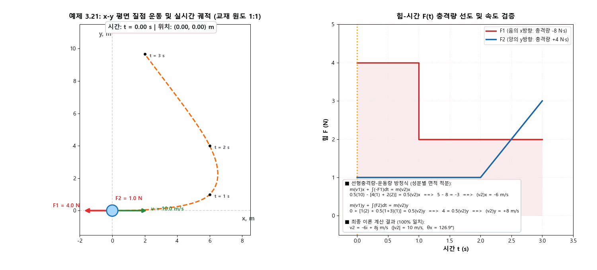

---

### 1.4 예제 3.22: 경사면 탄차와 램프 케이블 견인력 $P(t)$의 선형충격량 해석

- **문제 정의**: $30^\circ$ 경사면에 놓인 질량 $m = 150\ \mathrm{kg}$ 광차(Skip cart)가 2:1 동도르래를 통해 케이블 견인력 $P(t)$를 받는다. $P(t)$는 $0 \le t \le 4\ \mathrm{s}$ 동안 $0$에서 $600\ \mathrm{N}$으로 선형 증가($P = 150t$)한 후 $600\ \mathrm{N}$으로 유지된다. 초기 하향 속도 $v_1 = -4.0\ \mathrm{m/s}$일 때, (a) 탄차가 정지하는 시각 $t'$, (b) $t = 8\ \mathrm{s}$에서의 속도 $v_2$를 구하라.
- **역학 해석**:
  - 탄차에 작용하는 경사면 상향 순 견인력은 $2P(t)$, 중력 분력은 $W_x = 150(9.81)\sin 30^\circ = 735.75\ \mathrm{N}$ (하향).
  - (a) 탄차 정지 시점 ($v(t') = 0$):
    $$150(-4) + \left[\frac{1}{2}(4)(2 \times 600)\right] + 2(600)(t' - 4) - 735.75 t' = 0 \Rightarrow 464.25 t' = 3000 \Rightarrow \mathbf{t' = 6.46\ \mathrm{s}}$$
  - (b) $t = 8\ \mathrm{s}$ 시점 속도:
    $$-600 + 2400 + 4800 - 5886 = 714 = 150 v_2 \Rightarrow \mathbf{v_2 = +4.76\ \mathrm{m/s}\ (\text{경사면 상향})}$$

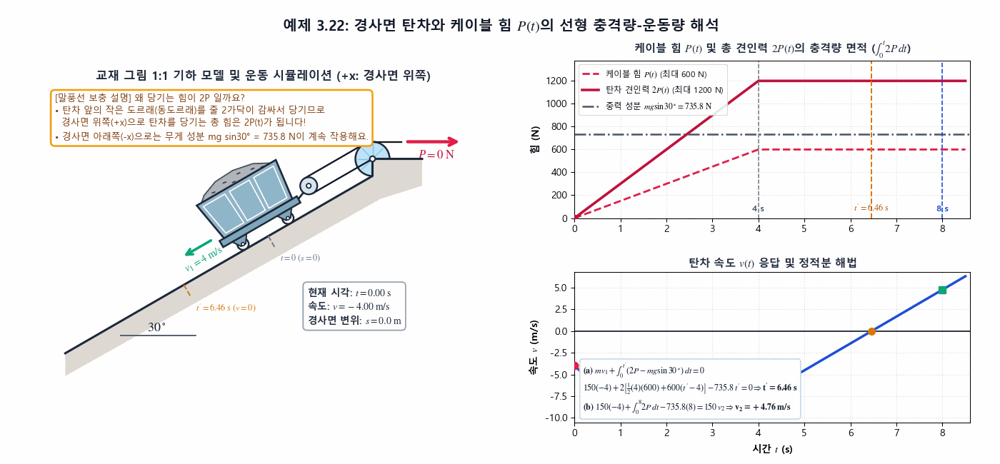

---

### 1.5 예제 3.23: 2차원 탄환 충돌 및 선형운동량 보존

- **문제 정의**: 마찰 없는 수평면 위에서 $m_1 = 50\ \mathrm{g} = 0.050\ \mathrm{kg}$ 탄알이 $+y$ 방향으로 $v_1 = 600\ \mathrm{m/s}$로 비행하고, $m_2 = 4.0\ \mathrm{kg}$ 목재 블록이 $x$축과 $30^\circ$를 이루며 $v_2 = 12\ \mathrm{m/s}$로 이동하다가 충돌하여 일체화된다. 합체 질량 $M = 4.050\ \mathrm{kg}$의 최종 속도 크기 $v$와 진행 각도 $\theta$를 구하라.
- **역학 해석**:
  - 수평면 상에서 외력의 합은 $0$이므로 계의 선형운동량 보존 ($\mathbf{G}_1 + \mathbf{G}_2 = \mathbf{G}_{\text{total}}$):
    $$G_x = 4(12\cos 30^\circ) = 41.57\ \mathrm{kg\cdot m/s},\quad G_y = 0.050(600) + 4(12\sin 30^\circ) = 54.00\ \mathrm{kg\cdot m/s}$$
    $$v_x = \frac{41.57}{4.050} = 10.26\ \mathrm{m/s},\quad v_y = \frac{54.00}{4.050} = 13.33\ \mathrm{m/s}$$
    $$v = \sqrt{10.26^2 + 13.33^2} = \mathbf{16.83\ \mathrm{m/s}},\quad \theta = \tan^{-1}\left(\frac{13.33}{10.26}\right) = \mathbf{52.4^\circ}$$

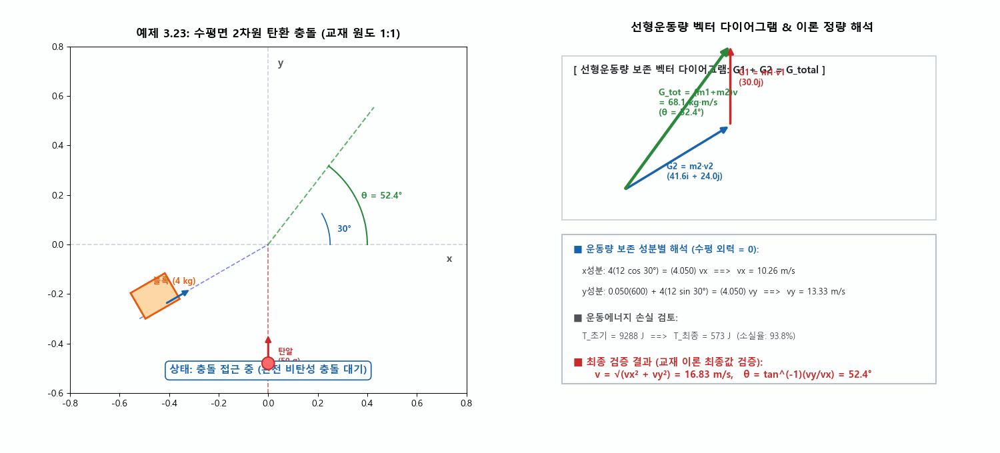

---

## 2. 각충격량과 각운동량 핵심 예제 (Sample Problems 3/24 ~ 3/27)

### 2.1 예제 3.24: 3차원 공간 질점의 각운동량 $\mathbf{H}_O$와 시간 변화율 $\dot{\mathbf{H}}_O$

- **문제 정의**: 질량 $m = 2\ \mathrm{kg}$인 작은 구가 순간 위치 $\mathbf{r} = 3\mathbf{i} + 6\mathbf{j} + 4\mathbf{k}\ \mathrm{m}$를 속도 $\mathbf{v} = 5\mathbf{j}\ \mathrm{m/s}$로 지나며, 힘 $\mathbf{F} = 10\mathbf{k}\ \mathrm{N}$이 작용하고 있다. 점 $O$에 관한 각운동량 $\mathbf{H}_O$와 시간에 관한 미계수 $\dot{\mathbf{H}}_O$를 구하라.
- **역학 해석**:
  - 각운동량 정의 ($\mathbf{H}_O = \mathbf{r} \times m\mathbf{v}$):
    $$\mathbf{H}_O = (3\mathbf{i} + 6\mathbf{j} + 4\mathbf{k}) \times 2(5\mathbf{j}) = \mathbf{-40\mathbf{i} + 30\mathbf{k}\ \mathrm{N\cdot m\cdot s}}\quad (|\mathbf{H}_O| = 50.0\ \mathrm{N\cdot m\cdot s})$$
  - 모멘트-각운동량 변화율 관계 ($\dot{\mathbf{H}}_O = \mathbf{M}_O = \mathbf{r} \times \mathbf{F}$):
    $$\dot{\mathbf{H}}_O = (3\mathbf{i} + 6\mathbf{j} + 4\mathbf{k}) \times 10\mathbf{k} = \mathbf{60\mathbf{i} - 30\mathbf{j}\ \mathrm{N\cdot m}}\quad (|\dot{\mathbf{H}}_O| = 67.1\ \mathrm{N\cdot m})$$

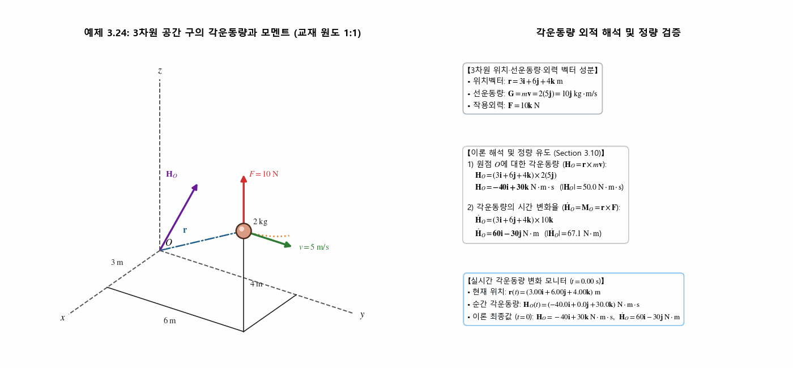

---

### 2.2 예제 3.25: 장타원 궤도 혜성의 각운동량 보존

- **문제 정의**: 태양($O$) 주위 장타원 궤도를 공전하는 혜성이 태양계의 가장 외곽 지점인 원일점 $A$ ($r_A = 6000 \times 10^6\ \mathrm{km}$)에서 속도 $v_A = 740\ \mathrm{m/s}$로 운동한다. 태양에 가장 가까이 접근하는 근일점 $B$ ($r_B = 75 \times 10^6\ \mathrm{km}$)에서의 속도 $v_B$를 구하라.
- **역학 해석**:
  - 혜성에 작용하는 유일한 힘은 태양의 만유인력이며 항상 태양 중심점 $O$를 향하므로($\Sigma M_O = 0$), 점 $O$에 관한 각운동량이 보존된다:
    $$(H_O)_A = (H_O)_B \implies m r_A v_A = m r_B v_B$$
    $$v_B = \frac{r_A v_A}{r_B} = \frac{6000(10^6)(740)}{75(10^6)} = 80 \times 740 = \mathbf{59,200\ \mathrm{m/s}\ (59.2\ \mathrm{km/s})}$$

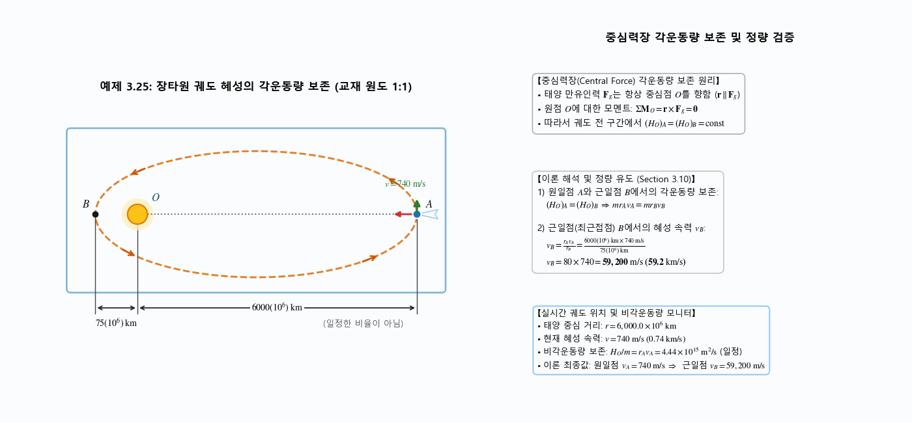

---

### 2.3 예제 3.26: 가벼운 봉-질량 조립체와 가루뭉치 충돌 각운동량 보존

- **문제 정의**: 마찰 없는 피벗 $O$로 지지된 가벼운 수평 봉의 좌측 끝(거리 $2l$)에 질량 $4m$, 우측 끝(거리 $l$)에 질량 $2m$이 부착되어 정지해 있다. 질량 $m$인 가루뭉치가 속도 $v_1$으로 연직 낙하하여 우측 끝 질량 $2m$ 위에 들러붙어 함께 운동할 때, 충돌 직후 조합체의 각속도 $\dot{\theta}_2$를 구하라.
- **역학 해석**:
  - 충돌 과정에서 자중과 관련된 미소 각충격량을 무시하면 피벗 점 $O$에 관한 시스템의 각운동량이 보존된다 (시계방향 CW $+$ 기준):
    $$(H_O)_1 = (H_O)_2 \implies m v_1 l = (m + 2m)(l\dot{\theta}_2)l + 4m(2l\dot{\theta}_2)(2l)$$
    $$m v_1 l = (3 + 16) m l^2 \dot{\theta}_2 = 19 m l^2 \dot{\theta}_2 \implies \mathbf{\dot{\theta}_2 = \frac{v_1}{19l}\ \mathrm{CW}}$$

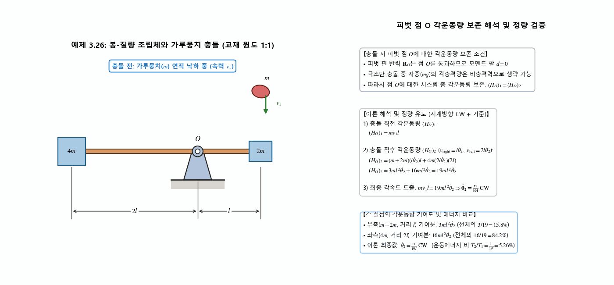

---

### 2.4 예제 3.27: 매끄러운 반구형 그릇 내부 질점의 3차원 나사선 활주

- **문제 정의**: 매끄러운 반구형 그릇의 수직 중심축 $O$-$O$로부터 반지름 $r_0$만큼 떨어진 수평 가장자리 점 $A$에서 질량 $m$인 질점이 접선 방향 초기 수평 속도 $v_0$로 출발한다. 점 $A$로부터 $h$만큼 아래쪽에 위치하고 중심축으로부터 반지름 $r$만큼 떨어진 점 $B$를 통과할 때, 속도 벡터 $\mathbf{v}$가 수평 접선과 이루는 각도 $\theta$를 구하라.
- **역학 해석**:
  - 자중 $mg$는 $O$-$O$축과 평행하고, 매끄러운 반구면의 수직 반력 $N$은 구 중심을 향해 $O$-$O$축과 교차하므로 축 모멘트 $\Sigma M_{O\text{-}O} = 0$ (각운동량 보존):
    $$(H_O)_1 = (H_O)_2 \implies m v_0 r_0 = m v r \cos\theta$$
  - 역학적 에너지 보존 ($T_1 + V_1 = T_2 + V_2$):
    $$\frac{1}{2}m v_0^2 + mgh = \frac{1}{2}m v^2 \implies v = \sqrt{v_0^2 + 2gh}$$
  - $r = \sqrt{r_0^2 - h^2}$ 과 $v$를 대입하여 소거하면:
    $$v_0 r_0 = \sqrt{v_0^2 + 2gh}\sqrt{r_0^2 - h^2}\cos\theta \implies \mathbf{\theta = \cos^{-1}\frac{1}{\sqrt{1 + \dfrac{2gh}{v_0^2}}\sqrt{1 - \dfrac{h^2}{r_0^2}}}}$$

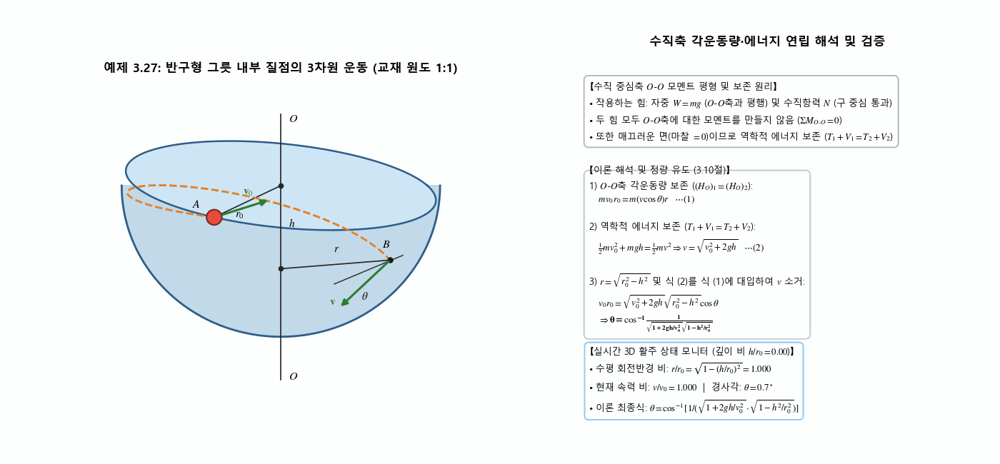

---

## 3. 선형충격량·선형운동량 핵심 연습문제 (3/140, 3/142, 3/143, 3/152)

### 3.1 문제 3/140 — 10% 경사로 자동차 등가속 견인력 산출

- **문제 정의**: 질량 $m = 1500\ \mathrm{kg}$인 자동차가 $10\%$ 경사로($\theta = \tan^{-1}0.10 = 5.71^\circ$)를 올라가며 $\Delta t = 8\ \mathrm{s}$ 동안 $v_1 = 30\ \mathrm{km/h}\ (8.333\ \mathrm{m/s})$에서 $v_2 = 60\ \mathrm{km/h}\ (16.667\ \mathrm{m/s})$로 등가속 주행할 때, 구동 바퀴에 작용하는 일정 견인 구동력 $F$를 계산하라.
- **역학 계산**:
  - 중력 경사 분력: $W_x = 1500(9.81)\sin 5.71^\circ = 1464.2\ \mathrm{N}$
  - 경사면 방향 선형충격량-선형운동량 원리:
    $$m v_1 + (F - W_x)\Delta t = m v_2 \Rightarrow [F - 1464.2] \times 8 = 1500(16.667 - 8.333) = 12,500\ \mathrm{N\cdot s}$$
    $$F - 1464.2 = 1562.5 \Rightarrow \mathbf{F = 3026.7\ \mathrm{N} \approx 3030\ \mathrm{N}\ (3.03\ \mathrm{kN})}$$

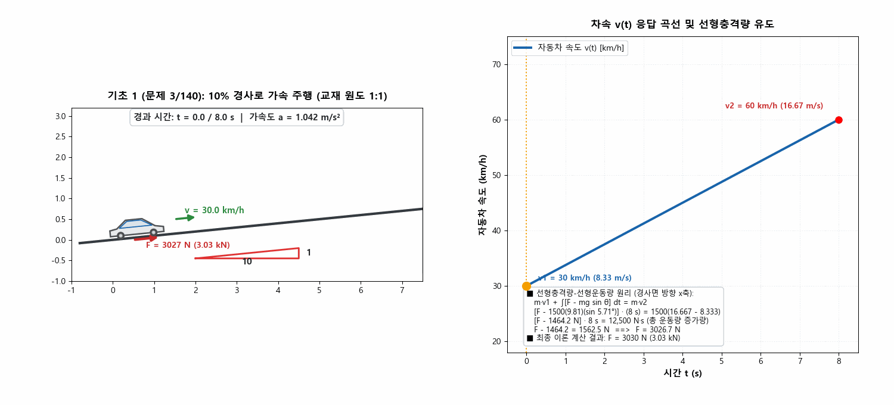

---

### 3.2 문제 3/142 — 탄알과 차륜 카트의 완전 비탄성 충돌 및 에너지 손실

- **문제 정의**: 수평 레일 위에서 정지해 있는 질량 $M = 50\ \mathrm{kg}$인 카트에 질량 $m = 75\ \mathrm{g} = 0.075\ \mathrm{kg}$인 탄알이 수평 속도 $v = 600\ \mathrm{m/s}$로 날아와 완전히 박혔다. 카트의 최종 반동 속도 $v_f$와 충돌로 인해 손실된 역학적 에너지 $|\Delta E|$ 및 손실률을 구하라.
- **역학 계산**:
  - 수평 외력이 없으므로 선형운동량 보존:
    $$m v = (M + m) v_f \Rightarrow 0.075(600) = (50.075) v_f \Rightarrow \mathbf{v_f = \frac{45.0}{50.075} = 0.899\ \mathrm{m/s}}$$
  - 역학적 에너지 변화:
    $$T_1 = \frac{1}{2}(0.075)(600^2) = 13,500\ \mathrm{J},\quad T_2 = \frac{1}{2}(50.075)(0.89865^2) = 20.2\ \mathrm{J}$$
    $$|\Delta E| = 13,500 - 20.2 = \mathbf{13,480\ \mathrm{J}\ (13.48\ \mathrm{kJ})},\quad \text{손실률} = \mathbf{99.9\%}$$

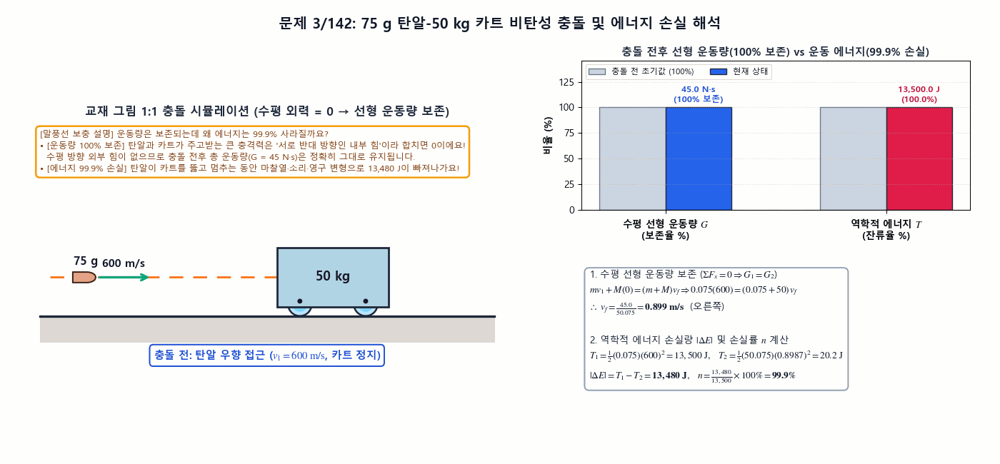

---

### 3.3 문제 3/143 — 총알 목재 블록 관통 충격량 및 바닥면 동마찰계수 역산

- **문제 정의**: 거친 수평 바닥 위에 정지해 있던 질량 $M = 3.0\ \mathrm{kg}$ 목재 블록을 질량 $m = 60\ \mathrm{g} = 0.060\ \mathrm{kg}$ 총알이 좌향 $v_1 = 600\ \mathrm{m/s}$로 진입하여 좌향 $v_2 = 400\ \mathrm{m/s}$로 관통 출사하였다. 피격된 블록이 수평면을 좌향으로 $s = 2.70\ \mathrm{m}$ 미끄러져 정지했을 때, (a) 블록의 초기 발출 속도 $v_b$, (b) 바닥면의 동마찰계수 $\mu_k$를 구하라.
- **역학 계산**:
  - 1단계 (관통 충돌 시 선형운동량 보존):
    $$m v_1 = m v_2 + M v_b \Rightarrow 0.060(600) = 0.060(400) + 3 v_b \Rightarrow \mathbf{v_b = 4.0\ \mathrm{m/s}}$$
  - 2단계 (활주 구간 일-에너지 원리):
    $$U'_{1-2} = -\mu_k M g s = 0 - \frac{1}{2} M v_b^2 \Rightarrow \mu_k(9.81)(2.70) = 8.0 \Rightarrow \mathbf{\mu_k = 0.302}$$

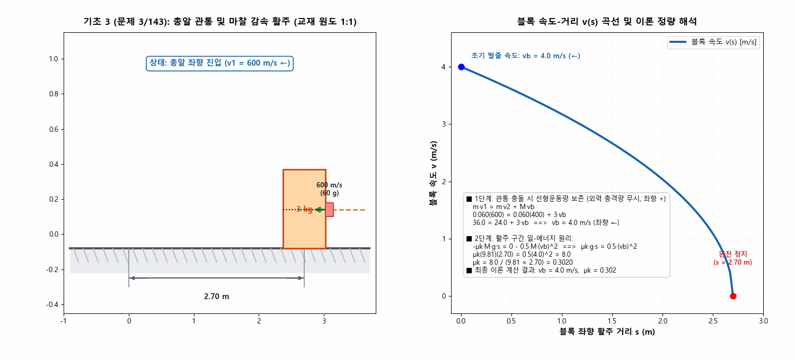

---

### 3.4 문제 3/152 — 교차로 2차원 차량 충돌 일체화 및 사고 조사 동역학

- **문제 정의**: 십자 교차로에서 북향($+y$)으로 $v_A = 32\ \mathrm{km/h}$로 주행하던 질량 $m_A = 1600\ \mathrm{kg}$ 차량 A와, 서향($-x$)으로 $v_B = 48\ \mathrm{km/h}$로 주행하던 질량 $m_B = 1500\ \mathrm{kg}$ 차량 B가 충돌하여 한 덩어리로 활주하였다. 충돌 직후 잔해의 속도 $v$와 진행 방향 $\theta$를 구하라.
- **역학 계산**:
  - 2차원 선형운동량 보존 ($M = 3100\ \mathrm{kg}$):
    $$-1500(48) = 3100 v_x \Rightarrow v_x = -23.23\ \mathrm{km/h},\quad 1600(32) = 3100 v_y \Rightarrow v_y = +16.52\ \mathrm{km/h}$$
    $$v = \sqrt{23.23^2 + 16.52^2} = \mathbf{28.5\ \mathrm{km/h}\ (7.92\ \mathrm{m/s})},\quad \theta = \tan^{-1}\left(\frac{23.23}{16.52}\right) = \mathbf{54.6^\circ\ \text{West of North}}$$

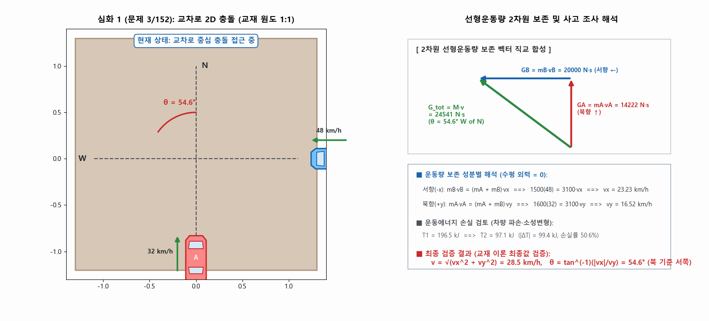

---

## 4. 각충격량·각운동량 핵심 연습문제 (3/173, 3/175, 3/184, 3/192)

### 4.1 문제 3/173 — $x$-$y$ 평면 구의 각운동량 크기 $H_O$ (벡터 외적 vs 스칼라 모멘트 팔)

- **문제 정의**: $x$-$y$ 평면 내 위치 $(-6, 8)\ \mathrm{m}$에 놓여 있는 질량 $m = 2\ \mathrm{kg}$인 구가 수직선 기준 좌하향 $30^\circ$ 방향으로 속력 $v = 7\ \mathrm{m/s}$로 운동하고 있다. 원점 $O$에 대한 구의 각운동량 크기 $H_O$를 (a) 각운동량의 벡터 정의($\mathbf{H}_O = \mathbf{r}\times m\mathbf{v}$)와 (b) 등가의 스칼라 모멘트 팔 접근법을 이용하여 각각 계산하라.
- **역학 계산**:
  - **(a) 벡터 외적 정의 이용**:
    $$\mathbf{r} = -6\mathbf{i} + 8\mathbf{j}\ \mathrm{m},\quad \mathbf{v} = 7(-\sin 30^\circ\mathbf{i} - \cos 30^\circ\mathbf{j})\ \mathrm{m/s}$$
    $$\mathbf{H}_O = \mathbf{r} \times m\mathbf{v} = (-6\mathbf{i} + 8\mathbf{j}) \times 2(7)(-\sin 30^\circ\mathbf{i} - \cos 30^\circ\mathbf{j}) = \mathbf{+128.7\mathbf{k}\ \mathrm{kg\cdot m^2/s}} \implies \mathbf{H_O = 128.7\ \mathrm{kg\cdot m^2/s}}$$
  - **(b) 스칼라 모멘트 팔 접근법**:
    $$d_1 = 6\tan 30^\circ = 3.46\ \mathrm{m},\quad d_2 = 8 - d_1 = 4.54\ \mathrm{m}$$
    $$d = \frac{6}{\cos 30^\circ} + 4.54\sin 30^\circ = 6.93 + 2.27 = 9.20\ \mathrm{m}$$
    $$H_O = m v d = 2(7)(9.20) = \mathbf{128.7\ \mathrm{kg\cdot m^2/s}\ (\text{반시계방향 CCW})}$$

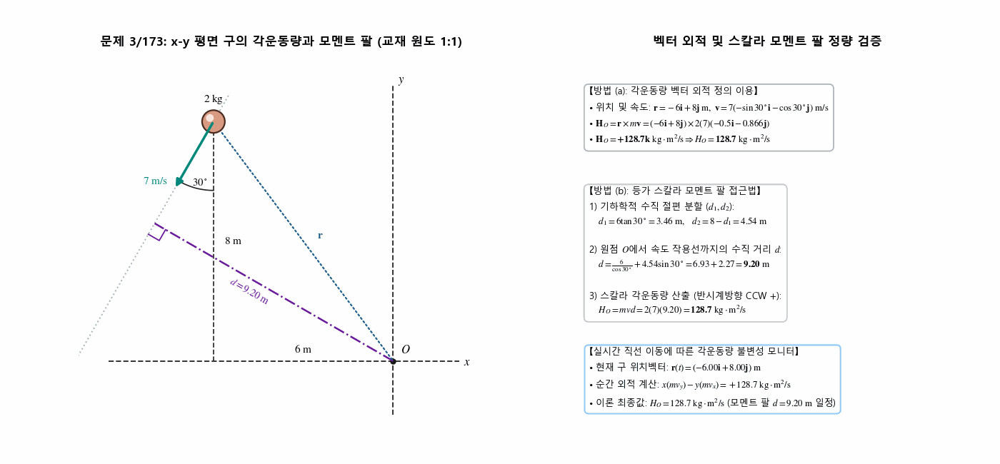

---

### 4.2 문제 3/175 — 평면 운동 $3\ \mathrm{kg}$ 구의 선형운동량, 각운동량 및 운동에너지

- **문제 정의**: 질량 $m = 3\ \mathrm{kg}$인 구가 $x$-$y$ 평면에서 원점 $O$로부터 $r = 2\ \mathrm{m}$ ($+x$축 아래 $15^\circ$) 위치를 속력 $v = 5\ \mathrm{m/s}$ (반경선 기준 $45^\circ$ 각도)로 통과한다. 이 순간 구의 (a) 선형운동량 $\mathbf{G}$, (b) 원점 $O$에 대한 각운동량 $\mathbf{H}_O$, (c) 운동에너지 $T$를 구하라.
- **역학 계산**:
  - **(a) 선형운동량 $\mathbf{G}$** (속도 벡터는 $-x$축 아래 $45^\circ - 15^\circ = 30^\circ$ 방향):
    $$\mathbf{G} = m\mathbf{v} = 3(5)(-\cos 30^\circ\mathbf{i} - \sin 30^\circ\mathbf{j}) = \mathbf{-12.99\mathbf{i} - 7.50\mathbf{j}\ \mathrm{kg\cdot m/s}}$$
  - **(b) 원점 $O$에 대한 각운동량 $\mathbf{H}_O$**:
    $$\mathbf{H}_O = \mathbf{r} \times \mathbf{G} = 2(\cos 15^\circ\mathbf{i} - \sin 15^\circ\mathbf{j}) \times (-12.99\mathbf{i} - 7.50\mathbf{j}) = \mathbf{-21.2\mathbf{k}\ \mathrm{kg\cdot m^2/s}}$$
  - **(c) 운동에너지 $T$**:
    $$T = \frac{1}{2}m v^2 = \frac{1}{2}(3)(5)^2 = \mathbf{37.5\ \mathrm{J}}$$

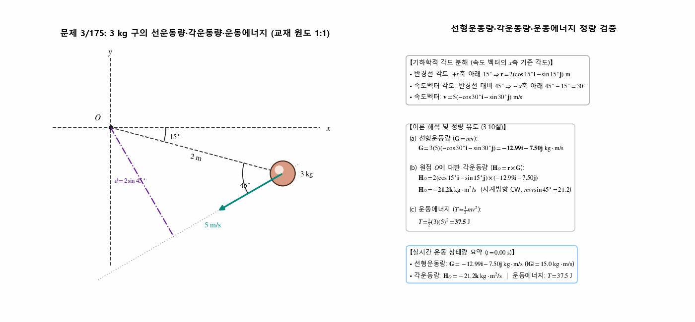

---

### 4.3 문제 3/184 — 회전 수평 봉 위 두 구의 반경 확장($r \to 2r$)과 에너지 손실 분율

- **문제 정의**: 같은 질량 $m$을 갖는 두 개의 구가 회전하는 수평 봉을 따라 미끄럼 운동을 할 수 있다. 초기에 회전축으로부터 거리 $r$에 고정되어 각속도 $\omega_0$로 회전하던 두 구가 풀려나서 거리 $2r$의 봉 끝단 스토퍼에 도달할 때, (a) 새로운 각속도 $\omega$와 (b) 시스템 손실 에너지의 초기 운동에너지에 대한 분수 $n = \Delta T / T_1$을 구하라.
- **역학 계산**:
  - **(a) 수직 회전축에 대한 각운동량 보존 ($\Delta H = 0$)**:
    $$2m(r\omega_0)r - 2m(2r\omega)(2r) = 0 \implies \mathbf{\omega = \frac{\omega_0}{4}}$$
  - **(b) 운동에너지 손실 분율 $n = \Delta T / T_1$**:
    $$\Delta T = 2\left(\frac{1}{2}m[r\omega_0]^2\right) - 2\left(\frac{1}{2}m\left[2r\frac{\omega_0}{4}\right]^2\right) = m r^2 \omega_0^2 \left(\frac{3}{4}\right)$$
    $$n = \frac{\Delta T}{T_1} = \frac{\frac{3}{4}m r^2 \omega_0^2}{m r^2 \omega_0^2} = \mathbf{\frac{3}{4}\ (75\%)}$$

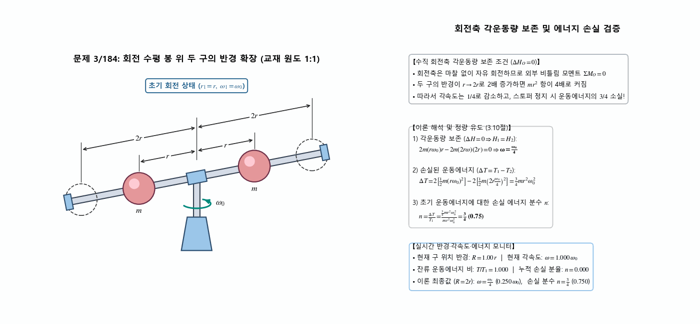

---

### 4.4 문제 3/192 — 깔때기 형상 곡면을 마찰 없이 활주하는 질점의 속도 및 경사각

- **문제 정의**: 단면 곡률반경이 $r = 0.9\ \mathrm{m}$인 깔때기(Funnel) 형상 표면의 $30^\circ$ 위치(상태 1)에서 질점이 수평 접선 속도 $v_0 = 0.55\ \mathrm{m/s}$로 출발하여 마찰 없이 미끄러져 내려간다. 질점이 높이 $O$-$O$ 레벨(상태 2, 목 반경 $0.15r$)을 지날 때 속도벡터와 수평선 사이의 각도 $\theta$를 구하라.
- **역학 계산**:
  - **수직 중심축에 대한 각운동량 보존 ($H_1 = H_2$)**:
    $$m v_0 \big[0.15r + (r - r\sin 30^\circ)\big] = m v_2 \cos\theta \big[0.15r\big] \implies 0.65\,v_0 = 0.15\,v_2\cos\theta \quad \cdots (1)$$
  - **일-에너지 정리 ($T_1 + U_{1-2} = T_2$)**:
    $$\frac{1}{2}m v_0^2 + m g r\cos 30^\circ = \frac{1}{2}m v_2^2 \implies v_2 = \sqrt{0.55^2 + 2(9.81)(0.9\cos 30^\circ)} = \mathbf{3.95\ \mathrm{m/s}} \quad \cdots (2)$$
  - **식 (1), (2) 연립**:
    $$\cos\theta = \frac{0.65(0.55)}{0.15(3.949)} = 0.6035 \implies \mathbf{\theta = 52.9^\circ}$$

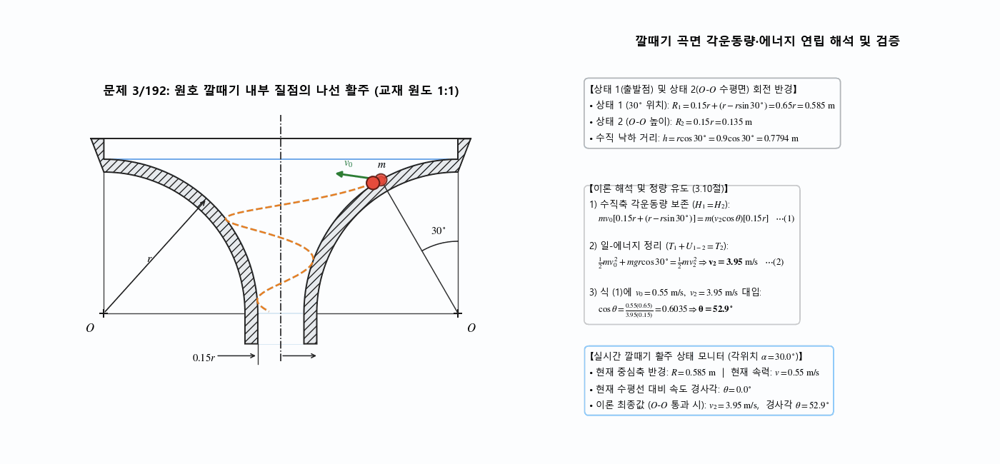

---

## 📝 변경 이력 (Changelog)
- **2026-11-01 23:35:00** [[Dongsoo Ryu](mailto:ryudongsoo@jbnu.ac.kr)] feat: 1~15주차 생물역학 한·영 시뮬레이션 포트폴리오 및 보충 개념 애니메이션 통합 배포

- **2026-11-01** [[ryu-dongsoo](mailto:ryudongsoo@jbnu.ac.kr)] feat(biomechanics): 11주차(Section 3.10 각충격량과 각운동량) 보충 개념 애니메이션 2종(`concept_angular_momentum_arm`, `concept_central_force_orbit`) 추가 및 예제·연습문제 8종 수식 렌더링 고도화 (총 21종 완비)
- **2026-10-15** [[ryu-dongsoo](mailto:ryudongsoo@jbnu.ac.kr)] feat(biomechanics): 10주차 Ch.3 Section C 전 범위(3.8~3.9 선운동량 9종 + 3.10 각운동량 8종 = 총 17종) 시뮬레이션 및 이론 유도 완비 (예제 3.24~3.27 및 연습문제 3/173, 3/175, 3/184, 3/192 추가)
- **2026-10-04** [[ryu-dongsoo](mailto:ryudongsoo@jbnu.ac.kr)] feat: 10주차 선운동량 예제 5종(3.19~3.23) 및 연습문제 4제(3/140, 3/142, 3/143, 3/152) 교재 원도 1:1 반영 완료
