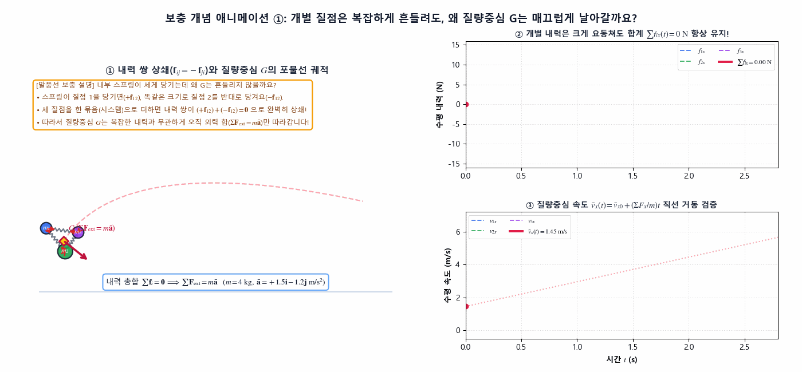
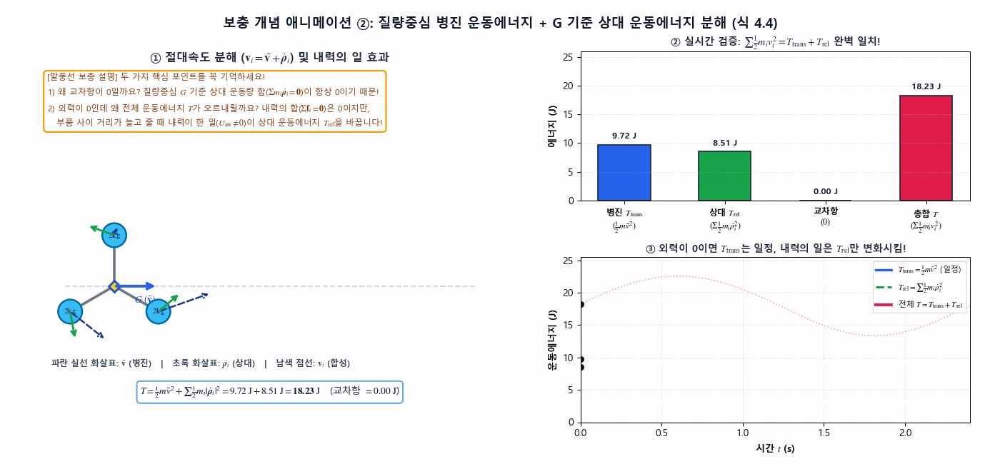
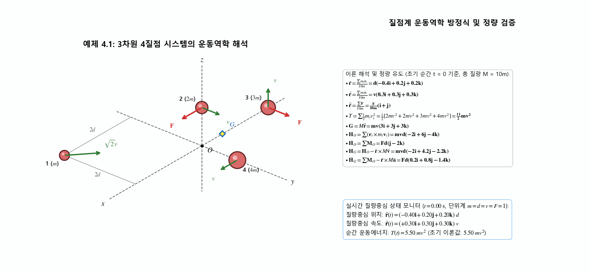
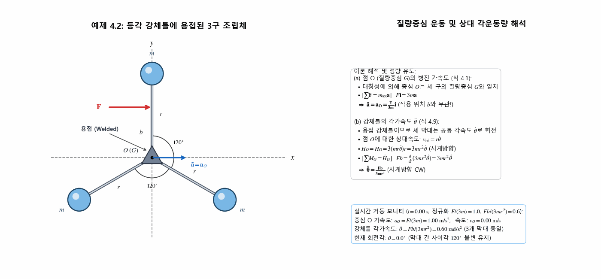
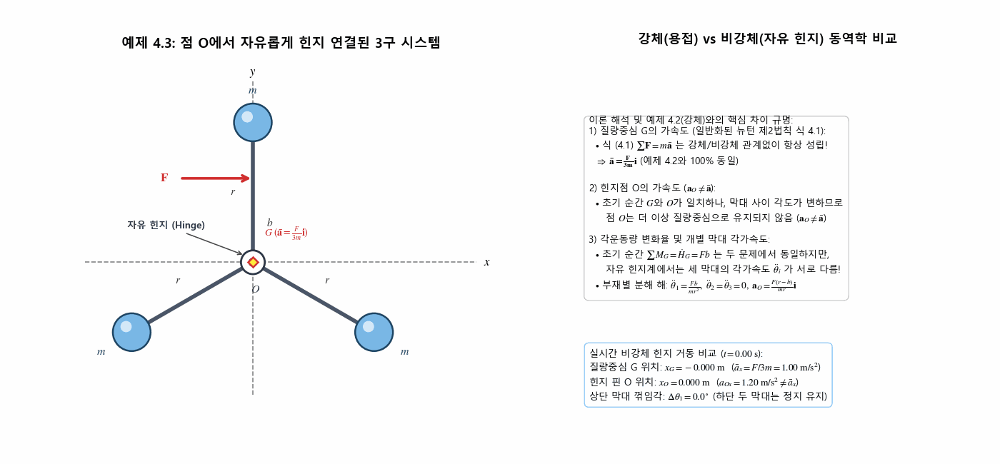
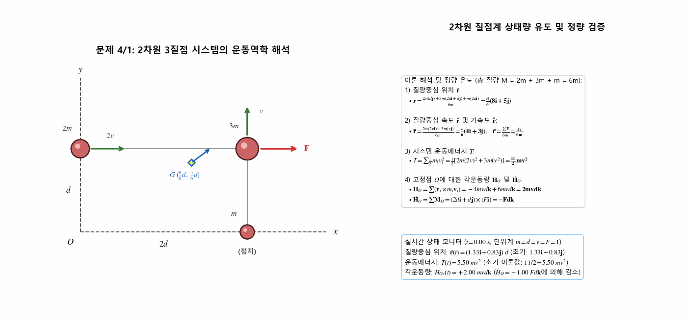
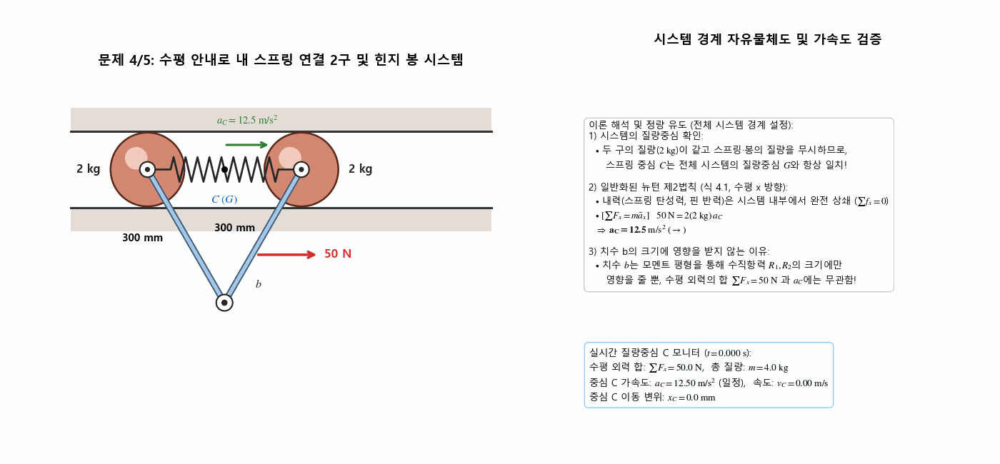
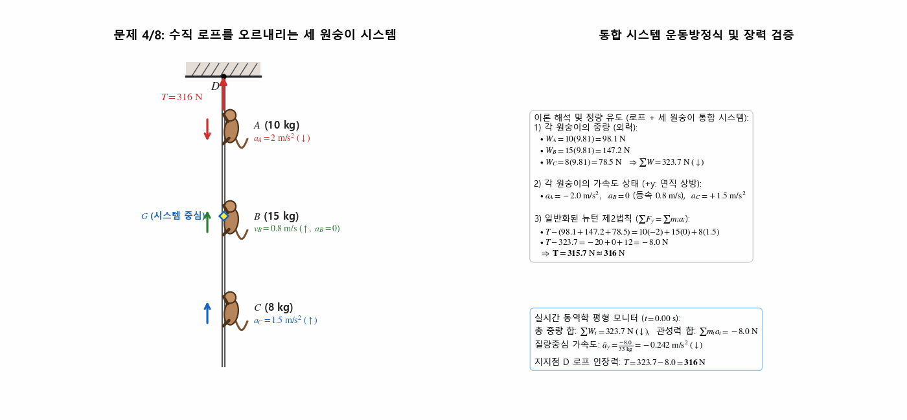
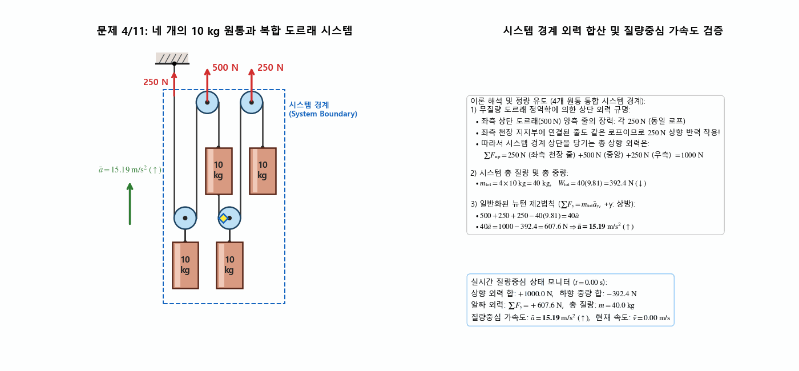

> **Author / Rights Holder:** 전북대학교 생물산업기계공학과 유동수 (ryudongsoo@jbnu.ac.kr)

# 11주차: 질점계의 운동역학 I — 일반화된 뉴턴 제2법칙, 일-에너지, 선운동량 및 각운동량 (Ch.4: 4.1 ~ 4.4)

## 📌 강의 개요 및 학습 목표

- **단원**: 동역학 9판 제4장 질점계의 운동역학 (Kinetics of Systems of Particles) — 4.1 ~ 4.4절
- **학습 목표**:
  - 단일 질점에서 일반 질점계(강체 및 비강체)로의 운동역학 확장 원리 및 내력의 상쇄($\Sigma\mathbf{f}_i = \mathbf{0}$) 이해
  - 질량중심 $G$의 위치($\bar{\mathbf{r}}$), 속도($\bar{\mathbf{v}}$), 가속도($\bar{\mathbf{a}}$) 정의 및 **일반화된 뉴턴의 제2법칙($\Sigma\mathbf{F} = m\bar{\mathbf{a}}$)** 적용 역량 확보
  - 질점계의 일-에너지 관계($T_1 + U_{1-2} = T_2$)와 운동에너지 분해 정리($T = \frac{1}{2}m\bar{v}^2 + \Sigma\frac{1}{2}m_i\dot{\rho}_i^2$) 습득
  - 선운동량($\mathbf{G} = m\bar{\mathbf{v}}, \Sigma\mathbf{F} = \dot{\mathbf{G}}$) 및 고정점 $O$, 질량중심 $G$, 임의의 기준점 $P$에 대한 각운동량($\mathbf{H}_O, \mathbf{H}_G, \mathbf{H}_P$)과 모멘트 방정식($\Sigma\mathbf{M}_O = \dot{\mathbf{H}}_O, \Sigma\mathbf{M}_G = \dot{\mathbf{H}}_G, \Sigma\mathbf{M}_P = \dot{\mathbf{H}}_G + \bar{\boldsymbol{\rho}}\times m\bar{\mathbf{a}}$) 정립

---

## 📋 주차별 학습 콘텐츠 구성

| 구분 | 번호 | 예제/문제명 | 핵심 개념 및 검증 공식 | 산출물 링크 |
|:---:|:---:|:---|:---|:---:|
| **개념** | 보충 ① | 내력 쌍 상쇄와 질량중심 궤적 | $\mathbf{f}_{ij} = -\mathbf{f}_{ji} \Rightarrow \Sigma\mathbf{f}_i = \mathbf{0},\quad \Sigma\mathbf{F}_{\mathrm{ext}} = m\bar{\mathbf{a}}$ | [코드](./concept_cm_internal_cancel.py) \| [GIF](./concept_cm_internal_cancel.gif) |
| **개념** | 보충 ② | 운동에너지 분해와 내력의 일 | $T = \frac{1}{2}m\bar{v}^2 + \Sigma\frac{1}{2}m_i\dot{\rho}_i^2$ (식 4.4), $U_{1-2,\mathrm{int}} \ne 0$ | [코드](./concept_ke_decomposition.py) \| [GIF](./concept_ke_decomposition.gif) |
| **예제** | 4.1 | 3차원 4질점 시스템 | $\bar{\mathbf{r}} = d(-0.4\mathbf{i}+0.2\mathbf{j}+0.2\mathbf{k}),\ T = \frac{11}{2}mv^2,\ \mathbf{H}_G = mvd(-2\mathbf{i}+4.2\mathbf{j}-2.2\mathbf{k})$ | [코드](./ex4_1_four_particles_system.py) \| [GIF](./ex4_1_four_particles_system.gif) |
| **예제** | 4.2 | 등각 용접 강체틀과 3구 | (a) $\bar{\mathbf{a}} = \mathbf{a}_O = \frac{F}{3m}\mathbf{i}$, (b) $\ddot{\theta} = \frac{Fb}{3mr^2}$ (CW) | [코드](./ex4_2_rigid_frame_spheres.py) \| [GIF](./ex4_2_rigid_frame_spheres.gif) |
| **예제** | 4.3 | 자유 힌지 연결된 3막대-구 | $\bar{\mathbf{a}} = \frac{F}{3m}\mathbf{i}$ (예제 4.2와 동일), 단 $\mathbf{a}_O \ne \bar{\mathbf{a}}$ 및 막대별 $\ddot{\theta}_i$ 상이 | [코드](./ex4_3_hinged_bars_spheres.py) \| [GIF](./ex4_3_hinged_bars_spheres.gif) |
| **기초** | 4/1 | 2차원 3질점 시스템 | $\bar{\mathbf{r}} = \frac{d}{6}(8\mathbf{i}+5\mathbf{j}),\ T = \frac{11}{2}mv^2,\ \mathbf{H}_O = 2mvd\mathbf{k},\ \dot{\mathbf{H}}_O = -Fd\mathbf{k}$ | [코드](./prob4_1_three_particles_2d.py) \| [GIF](./prob4_1_three_particles_2d.gif) |
| **기초** | 4/5 | 스프링 연결 2구와 힌지 봉 | $\Sigma F_x = m\bar{a}_x \Rightarrow 50 = 4 a_C \Rightarrow a_C = 12.5\ \mathrm{m/s^2}$ ($b$와 무관) | [코드](./prob4_5_spring_linked_spheres.py) \| [GIF](./prob4_5_spring_linked_spheres.gif) |
| **기초** | 4/8 | 로프를 타는 세 원숭이 | $\Sigma F_y = \Sigma m_i a_i \Rightarrow T - 323.7 = -8 \Rightarrow T = 316\ \mathrm{N}$ | [코드](./prob4_8_three_monkeys_rope.py) \| [GIF](./prob4_8_three_monkeys_rope.gif) |
| **심화** | 4/11 | 4개 원통과 복합 도르래 | $\Sigma F_y = m\bar{a}_y \Rightarrow 1000 - 392.4 = 40\bar{a} \Rightarrow \bar{a} = 15.19\ \mathrm{m/s^2}\ (\uparrow)$ | [코드](./prob4_11_four_cylinders_pulley.py) \| [GIF](./prob4_11_four_cylinders_pulley.gif) |

---

## 0. 보충 개념 애니메이션 (Supplementary Concept Animations)

### 0.1 보충 개념 ①: 내력 쌍 상쇄($\Sigma\mathbf{f}_i = \mathbf{0}$)와 질량중심 $G$의 매끄러운 궤적

- **핵심 원리**: 스프링으로 연결된 3질점계에서 개별 질점들은 강한 내력($\mathbf{f}_{ij} = -\mathbf{f}_{ji}$)에 의해 복잡하게 진동하지만, 시스템 전체로 합산하면 내력 쌍이 완벽히 상쇄($\Sigma\mathbf{f}_i = \mathbf{0}$)되어 질량중심 $G$는 오직 외력 합($\Sigma\mathbf{F}_{\mathrm{ext}} = m\bar{\mathbf{a}}$, 식 4.1)에 따른 매끄러운 포물선 궤적을 그림

---

### 0.2 보충 개념 ②: 질점계 운동에너지 분해(식 4.4)와 내력이 일을 하는 원리

- **핵심 원리**: 질량중심 $G$ 기준 상대속도($\mathbf{v}_i = \bar{\mathbf{v}} + \dot{\boldsymbol{\rho}}_i$)를 이용하면 교차항($2\bar{\mathbf{v}}\cdot\Sigma m_i\dot{\boldsymbol{\rho}}_i = 0$)이 소거되어 전체 운동에너지가 $T = \frac{1}{2}m\bar{v}^2 + \Sigma\frac{1}{2}m_i\dot{\rho}_i^2$ (식 4.4)로 분해되며, 외력이 $\mathbf{0}$이어도 부품 간 상대 거리가 변할 때 내력이 한 일($U_{1-2,\mathrm{int}} \ne 0$)이 상대 운동에너지 $T_{\mathrm{rel}}$을 변화시킴을 정량 검증

---

## 1. 교재 핵심 예제 (Sample Problems 4/1 ~ 4/3)

### 1.1 예제 4.1: 3차원 4질점 시스템의 운동역학 상태량 도출

- **문제 정의**: 3차원 공간 내 4개의 질점($m_1=m, m_2=2m, m_3=3m, m_4=4m$, 총 질량 $M = \Sigma m_i = 10m$)의 위치, 속도 및 외력이 주어졌을 때 $\bar{\mathbf{r}}, \dot{\bar{\mathbf{r}}}, \ddot{\bar{\mathbf{r}}}, T, \mathbf{G}, \mathbf{H}_O, \dot{\mathbf{H}}_O, \mathbf{H}_G, \dot{\mathbf{H}}_G$ 결정
- **역학 해석**:
  - **질량중심 위치·속도·가속도**:
    $$\bar{\mathbf{r}} = \frac{\Sigma m_i\mathbf{r}_i}{\Sigma m_i} = \frac{m(2d\mathbf{i}-2d\mathbf{j}) + 2m(d\mathbf{k}) + 3m(-2d\mathbf{i}) + 4m(d\mathbf{j})}{10m} = \mathbf{d(-0.4\mathbf{i} + 0.2\mathbf{j} + 0.2\mathbf{k})}$$
    $$\dot{\bar{\mathbf{r}}} = \frac{\Sigma m_i\dot{\mathbf{r}}_i}{\Sigma m_i} = \frac{m(-v\mathbf{i}+v\mathbf{j}) + 2m(v\mathbf{j}) + 3m(v\mathbf{k}) + 4m(v\mathbf{i})}{10m} = \mathbf{v(0.3\mathbf{i} + 0.3\mathbf{j} + 0.3\mathbf{k})}$$
    $$\ddot{\bar{\mathbf{r}}} = \frac{\Sigma\mathbf{F}}{\Sigma m_i} = \frac{F\mathbf{i} + F\mathbf{j}}{10m} = \mathbf{\frac{F}{10m}(\mathbf{i} + \mathbf{j})}$$
  - **운동에너지 및 선운동량**:
    $$T = \sum \frac{1}{2}m_i v_i^2 = \frac{1}{2}\left[m(\sqrt{2}v)^2 + 2m(v^2) + 3m(v^2) + 4m(v^2)\right] = \mathbf{\frac{11}{2}mv^2}$$
    $$\mathbf{G} = (\Sigma m_i)\dot{\bar{\mathbf{r}}} = 10m \cdot v(0.3\mathbf{i} + 0.3\mathbf{j} + 0.3\mathbf{k}) = \mathbf{mv(3\mathbf{i} + 3\mathbf{j} + 3\mathbf{k})}$$
  - **고정점 $O$ 및 질량중심 $G$에 대한 각운동량과 시간 변화율**:
    $$\mathbf{H}_O = \sum(\mathbf{r}_i \times m_i\dot{\mathbf{r}}_i) = \mathbf{0} - 2mvd\mathbf{i} + 3mv(2d)\mathbf{j} - 4mvd\mathbf{k} = \mathbf{mvd(-2\mathbf{i} + 6\mathbf{j} - 4\mathbf{k})}$$
    $$\dot{\mathbf{H}}_O = \Sigma\mathbf{M}_O = -2dF\mathbf{k} + Fd\mathbf{j} = \mathbf{Fd(\mathbf{j} - 2\mathbf{k})}$$
    $$\mathbf{H}_G = \mathbf{H}_O - \bar{\mathbf{r}} \times M\bar{\mathbf{v}} = mvd(-2\mathbf{i} + 6\mathbf{j} - 4\mathbf{k}) - d(-0.4\mathbf{i} + 0.2\mathbf{j} + 0.2\mathbf{k}) \times 10mv(0.3\mathbf{i} + 0.3\mathbf{j} + 0.3\mathbf{k}) = \mathbf{mvd(-2\mathbf{i} + 4.2\mathbf{j} - 2.2\mathbf{k})}$$
    $$\dot{\mathbf{H}}_G = \Sigma\mathbf{M}_O - \bar{\mathbf{r}} \times M\bar{\mathbf{a}} = Fd(\mathbf{j} - 2\mathbf{k}) - d(-0.4\mathbf{i} + 0.2\mathbf{j} + 0.2\mathbf{k}) \times F(\mathbf{i} + \mathbf{j}) = \mathbf{Fd(0.2\mathbf{i} + 0.8\mathbf{j} - 1.4\mathbf{k})}$$

---

### 1.2 예제 4.2: 등각 강체틀에 용접된 세 개의 구 조립체

- **문제 정의**: 각각의 질량이 $m$인 세 개의 구가 무게를 무시할 수 있는 $120^\circ$ 등각 강체틀(막대 길이 $r$)에 용접되어 매끄러운 수평면 위에 놓여 있을 때, 한 막대의 중심 $O$로부터 거리 $b$ 위치에 수평 외력 $F\mathbf{i}$가 작용하는 순간의 (a) 점 $O$의 가속도 및 (b) 틀의 각가속도 $\ddot{\theta}$ 계산
- **역학 해석**:
  - **(a) 점 $O$(질량중심 $G$)의 가속도 (식 4.1)**:
    $$\Sigma\mathbf{F} = m_{\mathrm{tot}}\bar{\mathbf{a}} \implies F\mathbf{i} = 3m\bar{\mathbf{a}} \implies \mathbf{\bar{\mathbf{a}} = \mathbf{a}_O = \frac{F}{3m}\mathbf{i}}$$
  - **(b) 강체틀의 각가속도 $\ddot{\theta}$ (식 4.9)**:
    - 용접된 강체틀의 공통 각속도를 $\dot{\theta}$라 하면 각 구의 $O$에 대한 상대속도는 $r\dot{\theta}$:
      $$H_O = H_G = 3(mr\dot{\theta})r = 3mr^2\dot{\theta}$$
      $$\Sigma M_G = \dot{H}_G \implies Fb = \frac{d}{dt}(3mr^2\dot{\theta}) = 3mr^2\ddot{\theta} \implies \mathbf{\ddot{\theta} = \frac{Fb}{3mr^2}} \ (\text{CW})$$

---

### 1.3 예제 4.3: 점 $O$에서 자유롭게 힌지 연결된 세 막대와 구 시스템

- **문제 정의**: 예제 4.2와 모든 조건이 동일하나 세 막대가 점 $O$에서 용접되지 않고 자유롭게 힌지(Freely Hinged)되어 있을 때 두 문제의 차이점 규명
- **역학 해석**:
  - **질량중심 $G$의 가속도**: 일반화된 뉴턴의 제2법칙 $\Sigma\mathbf{F} = m\bar{\mathbf{a}}$ 는 강체/비강체 여부에 관계없이 항상 성립하므로 질량중심 가속도는 예제 4.2와 정확히 동일함:
    $$\mathbf{\bar{\mathbf{a}} = \frac{F}{3m}\mathbf{i}}$$
  - **힌지 $O$의 운동 및 각가속도의 차이**:
    - 이 순간 질량중심 $G$는 점 $O$와 일치하나, 막대 사이의 각도가 변함에 따라 점 $O$는 더 이상 질량중심이 되지 않으므로 힌지 $O$의 가속도는 $G$의 가속도와 같지 않음 ($\mathbf{a}_O \ne \bar{\mathbf{a}}$)
    - 또한 이 순간 $\Sigma M_G$와 $\dot{H}_G$는 예제 4.2와 같은 값을 가지지만, 세 막대의 각운동($\ddot{\theta}_i$)이 서로 달라 단일 각가속도로 결정되지 않음 (부재별 분해 시 상단 구만 가속되고 하단 두 구는 정지 상태를 유지함)

---

## 2. 연습문제 (기초문제 3선 + 심화문제 1선)

### 2.1 기초문제 1: 문제 4/1 — 2차원 3질점 시스템의 운동역학 해석

- **문제 정의**: $x$-$y$ 평면 내 세 질점 $m_1 = 2m\ [\mathbf{r}_1 = d\mathbf{j},\ \mathbf{v}_1 = 2v\mathbf{i}]$, $m_2 = 3m\ [\mathbf{r}_2 = 2d\mathbf{i}+d\mathbf{j},\ \mathbf{v}_2 = v\mathbf{j},\ \mathbf{F}_2 = F\mathbf{i}]$, $m_3 = m\ [\mathbf{r}_3 = 2d\mathbf{i},\ \mathbf{v}_3 = \mathbf{0}]$ 으로 구성된 시스템에 대해 $\bar{\mathbf{r}}, \dot{\bar{\mathbf{r}}}, \ddot{\bar{\mathbf{r}}}, T, \mathbf{H}_O, \dot{\mathbf{H}}_O$ 계산
- **역학 계산**:
  - 총 질량: $\Sigma m_i = 2m + 3m + m = 6m$
  - 질량중심 위치: $\bar{\mathbf{r}} = \frac{2m(d\mathbf{j}) + 3m(2d\mathbf{i}+d\mathbf{j}) + m(2d\mathbf{i})}{6m} = \mathbf{\frac{d}{6}(8\mathbf{i} + 5\mathbf{j})}$
  - 질량중심 속도 및 가속도: $\dot{\bar{\mathbf{r}}} = \frac{2m(2v\mathbf{i}) + 3m(v\mathbf{j})}{6m} = \mathbf{\frac{v}{6}(4\mathbf{i} + 3\mathbf{j})}$, $\ddot{\bar{\mathbf{r}}} = \frac{\Sigma\mathbf{F}}{\Sigma m_i} = \mathbf{\frac{F\mathbf{i}}{6m}}$
  - 운동에너지: $T = \Sigma\frac{1}{2}m_i v_i^2 = \frac{1}{2}\left[2m(2v)^2 + 3m(v^2)\right] = \mathbf{\frac{11}{2}mv^2}$
  - 점 $O$에 대한 각운동량 및 시간 변화율:
    $$\mathbf{H}_O = \Sigma(\mathbf{r}_i \times m_i\mathbf{v}_i) = -4mvd\mathbf{k} + 6mvd\mathbf{k} = \mathbf{2mvd\mathbf{k}}$$
    $$\dot{\mathbf{H}}_O = \Sigma\mathbf{M}_O = (2d\mathbf{i} + d\mathbf{j}) \times (F\mathbf{i}) = \mathbf{-Fd\mathbf{k}}$$

---

### 2.2 기초문제 2: 문제 4/5 — 수평 안내로 내 스프링 연결 두 구와 힌지 봉 시스템

- **문제 정의**: 각각 질량이 $2\ \mathrm{kg}$인 매끄러운 두 구가 가벼운 스프링으로 연결되어 수평 안내로를 따라 미끄러지며, 두 구에 힌지 체결된 두 경량 봉($300\ \mathrm{mm}$) 중 우측 봉에 수평력 $F = 50\ \mathrm{N}$을 가할 때 스프링 중심 $C$의 가속도 $a_C$ 산출 및 치수 $b$에 무관한 이유 설명
- **역학 계산**:
  - 두 구의 질량이 $2\ \mathrm{kg}$으로 동일하고 스프링 및 봉의 질량을 무시하므로 스프링 중심 $C$는 전체 시스템($m_{\mathrm{tot}} = 4\ \mathrm{kg}$)의 질량중심 $G$와 일치함
  - 수평 방향 일반화된 뉴턴 제2법칙:
    $$\Sigma F_x = m_{\mathrm{tot}}\bar{a}_x \implies 50 = 2(2) a_C \implies \mathbf{a_C = 12.5\ \mathrm{m/s^2}}$$
  - 치수 $b$는 수직항력 $R_1, R_2$에는 영향을 주지만 수평 외력의 합 $\Sigma F_x$와 중심 가속도 $a_C$에는 영향을 주지 않음

---

### 2.3 기초문제 3: 문제 4/8 — 수직 로프를 오르내리는 세 원숭이와 지지점 장력

- **문제 정의**: 질량이 각각 $10, 15, 8\ \mathrm{kg}$인 세 원숭이 $A, B, C$가 $D$에 매달린 로프를 타고 이동 중일 때 ($A$: 하방 가속도 $2\ \mathrm{m/s^2}$, $B$: 상방 등속력 $0.8\ \mathrm{m/s}$, $C$: 상방 가속도 $1.5\ \mathrm{m/s^2}$), 상단 $D$에서 로프에 작용하는 인장력 $T$ 계산
- **역학 계산**:
  - 각 원숭이 중량: $W_A = 10(9.81) = 98.1\ \mathrm{N}$, $W_B = 15(9.81) = 147.2\ \mathrm{N}$, $W_C = 8(9.81) = 78.5\ \mathrm{N}$ ($\Sigma W = 323.7\ \mathrm{N}$)
  - 로프와 세 원숭이 전체 시스템에 대한 연직 운동방정식 ($\Sigma F_y = \Sigma m_i a_i$, 상방 $+y$):
    $$T - (98.1 + 147.2 + 78.5) = 10(-2) + 15(0) + 8(1.5)$$
    $$T - 323.7 = -8 \implies \mathbf{T = 316\ \mathrm{N}}$$

---

### 2.4 심화문제 1: 문제 4/11 — 네 개의 10 kg 원통과 도르래 시스템의 질량중심 가속도

- **문제 정의**: 네 개의 $10\ \mathrm{kg}$ 원통과 마찰 및 질량을 무시할 수 있는 도르래·줄로 구성된 시스템에 상단 외력 $500\ \mathrm{N}$ 및 $250\ \mathrm{N}$이 작용할 때 시스템의 질량중심 가속도 $\bar{a}$ 계산
- **역학 계산**:
  - 무질량 도르래의 정역학적 힘 평형에 의해 4개의 원통을 감싸는 시스템 경계면 상단에 작용하는 연직 상방 장력은 좌측 줄 $250\ \mathrm{N}$, 중앙 $500\ \mathrm{N}$, 우측 $250\ \mathrm{N}$ (총 $+1000\ \mathrm{N}$)
  - 일반화된 뉴턴 제2법칙 ($\Sigma F_y = m\bar{a}_y$, 총 질량 $m = 40\ \mathrm{kg}$):
    $$500 + 250 + 250 - 40(9.81) = 40\bar{a}$$
    $$40\bar{a} = 1000 - 392.4 = 607.6\ \mathrm{N} \implies \mathbf{\bar{a} = 15.19\ \mathrm{m/s^2}\ (\uparrow)}$$

---

## 📝 변경 이력 (Changelog)
- **2026-11-01 23:35:00** [[Dongsoo Ryu](mailto:ryudongsoo@jbnu.ac.kr)] feat: 1~15주차 생물역학 한·영 시뮬레이션 포트폴리오 및 보충 개념 애니메이션 통합 배포

- **2026-11-01 21:20:00** [[Dongsoo Ryu](mailto:ryudongsoo@jbnu.ac.kr)] feat(biomechanics): add 2 supplementary Ch.4 concept animations (`concept_cm_internal_cancel`, `concept_ke_decomposition`), apply STIX math rendering, and refine `prob4_11` ceiling support geometry with full ko/en parity
- **2026-10-15 00:15:00** [[Dongsoo Ryu](mailto:ryudongsoo@jbnu.ac.kr)] feat(biomechanics): complete Week 11 Chapter 4 (4.1~4.4) Kinetics of Systems of Particles curriculum with 3 sample problems and 4 practice problems
- **2026-10-03 17:22:26** [[Dongsoo Ryu](mailto:ryudongsoo@jbnu.ac.kr)] feat(biomechanics): complete Week 7 Part B Work and Energy curriculum overhaul with 5 examples and 4 practice problems
