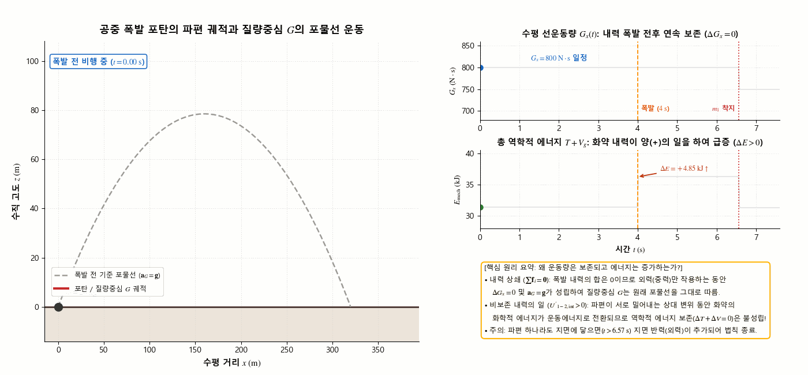
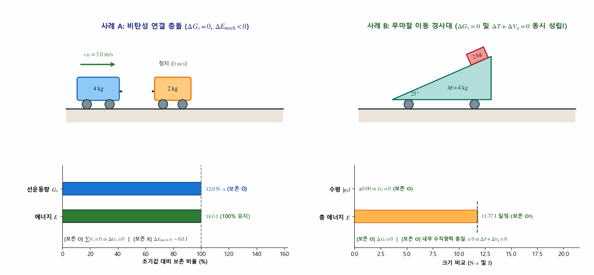
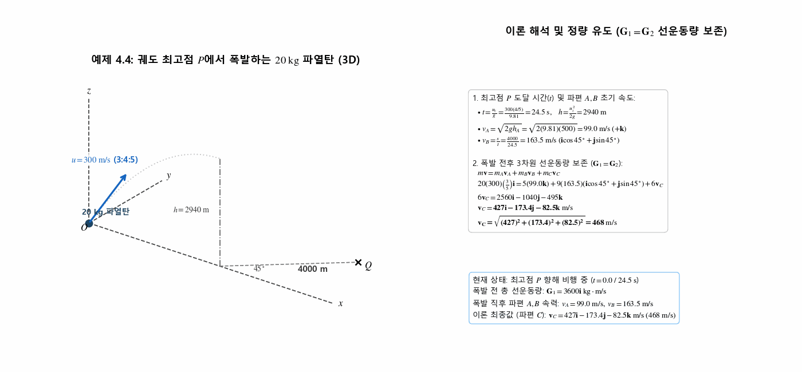
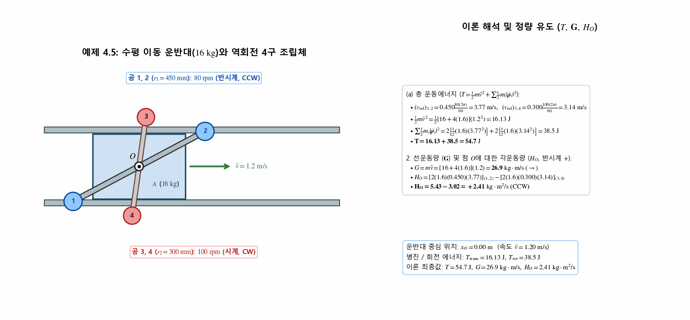
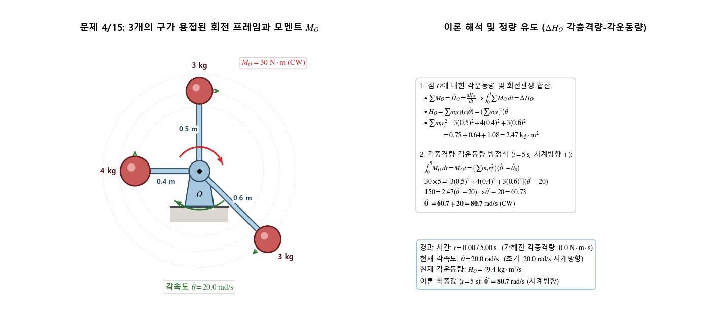
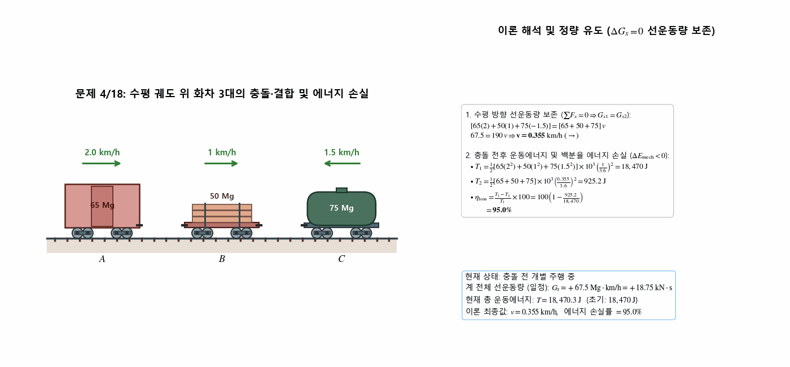
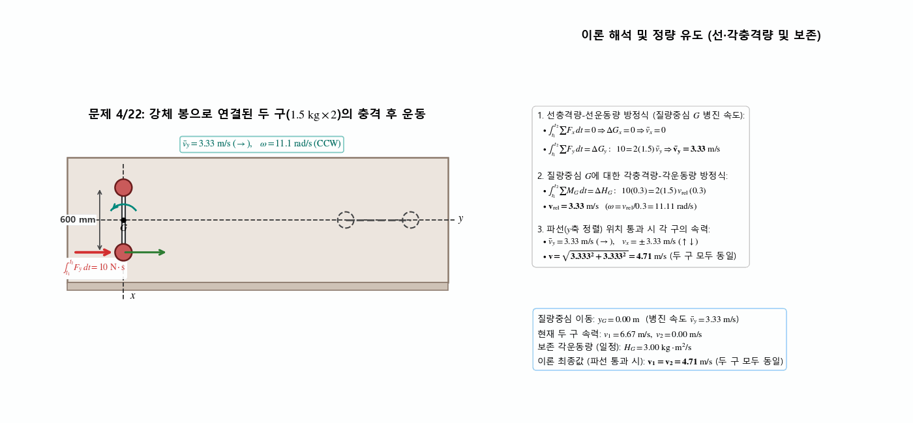
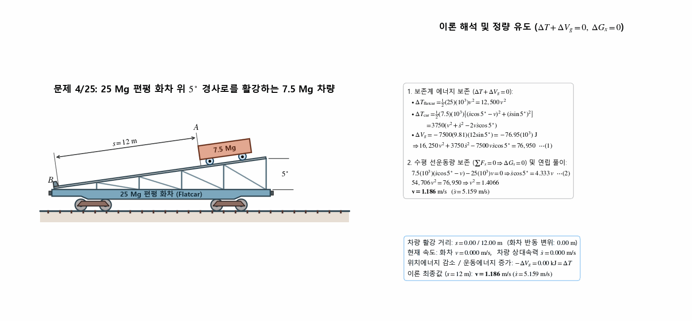

> **Author / Rights Holder:** 전북대학교 생물산업기계공학과 유동수 (ryudongsoo@jbnu.ac.kr, ryudongsoo@gmail.com)

# 12주차: 질점계의 운동역학 II — 제4장 4.5절: 에너지·운동량 보존 및 다체계 응용

## 📌 강의 개요 및 학습 목표

- **단원**: 동역학 9판 제4장 질점계의 운동역학 — 4.5절: 에너지와 운동량 보존 (Conservation of Energy and Momentum)
- **학습 목표**:
  - 보존 질점계에서의 동적 에너지 보존법칙($\Delta T + \Delta V = 0,\ V = V_g + V_e$) 및 내부 탄성 부재의 위치에너지 변환 원리 습득
  - 외력 합력이 0인 질점계의 선운동량 보존 원리($\Delta \mathbf{G} = \mathbf{0} \Rightarrow \bar{\mathbf{v}} = \text{const}$)와 내부 폭발 전후 질량중심 궤적 불변성 규명
  - 고정점 $O$ 및 질량중심 $G$에 대한 각운동량 보존 원리($\Delta \mathbf{H}_O = \mathbf{0},\ \Delta \mathbf{H}_G = \mathbf{0}$)와 각충격량-각운동량 적분 방정식 적용
  - 병진운동과 회전운동이 결합된 다체계에서 총 운동에너지($T = \frac{1}{2}m\bar{v}^2 + \sum \frac{1}{2}m_i|\dot{\boldsymbol{\rho}}_i|^2$), 선운동량($\mathbf{G} = m\bar{\mathbf{v}}$), 각운동량($\mathbf{H}_O$)의 정량 분해 해석
  - 다중 화차 비탄성 충돌, 자유 평면 아령형 강체 충격, 무마찰 이동 경사로 위 활강 차량 등 복합 다체계의 연립 보존 해법 체득

---

## 📋 주차별 학습 콘텐츠 구성

| 구분 | 번호 | 예제/문제명 | 핵심 개념 및 검증 공식 | 산출물 링크 |
|:---:|:---:|:---|:---|:---:|
| **보충개념** | C1 | 공중 폭발 포탄의 질량중심 포물선 vs 에너지 급증 | $\sum \mathbf{f}_i = \mathbf{0} \Rightarrow \Delta G_x = 0,\ \mathbf{a}_G = \mathbf{g}$ (체공 중) vs $\Delta E_{\mathrm{mech}} > 0$ | [코드](./concept_explosion_cm_parabola.py) \| [GIF](./concept_explosion_cm_parabola.gif) |
| **보충개념** | C2 | 다체계 보존 법칙 판별 (비탄성 충돌 vs 무마찰 경사대) | 사례 A: $\Delta G_x = 0,\ \Delta E < 0$ / 사례 B: $\Delta G_x = 0,\ \Delta T + \Delta V_g = 0$ 동시 성립 | [코드](./concept_conservation_checklist.py) \| [GIF](./concept_conservation_checklist.gif) |
| **예제** | 4.4 | 궤도 최고점 폭발 20 kg 파열탄 (3D) | $\mathbf{G}_1 = \mathbf{G}_2 \Rightarrow \mathbf{v}_C = 427\mathbf{i} - 173.4\mathbf{j} - 82.5\mathbf{k}\ \mathrm{m/s}\ (468\ \mathrm{m/s})$ | [코드](./ex4_4_shell_explosion_3d.py) \| [GIF](./ex4_4_shell_explosion_3d.gif) |
| **예제** | 4.5 | 수평 이동 운반대와 역회전 4구 조립체 | (a) $T = 54.7\ \mathrm{J}$, (b) $G = 26.9\ \mathrm{kg\cdot m/s}$, (c) $H_O = 2.41\ \mathrm{kg\cdot m^2/s}$ | [코드](./ex4_5_carriage_rotating_balls.py) \| [GIF](./ex4_5_carriage_rotating_balls.gif) |
| **기초** | 4/15 | 3구 용접 강체 회전 프레임과 모멘트 | $\int_0^5 M_O\,dt = \left(\sum m_i r_i^2\right)\Delta\dot{\theta} \Rightarrow 150 = 2.47(\dot{\theta}' - 20) \Rightarrow \dot{\theta}' = 80.7\ \mathrm{rad/s}$ | [코드](./prob4_15_rotating_frame_spheres.py) \| [GIF](./prob4_15_rotating_frame_spheres.gif) |
| **기초** | 4/18 | 수평 궤도 위 화차 3대의 충돌·결합 | $G_1 = G_2 \Rightarrow v = 0.355\ \mathrm{km/h}\ (\rightarrow)$, 에너지 손실률 $n = 95.0\%$ | [코드](./prob4_18_three_freight_cars.py) \| [GIF](./prob4_18_three_freight_cars.gif) |
| **기초** | 4/22 | 강체 봉 연결 2구 조립체의 편심 충격 | $v_y = 3.33\ \mathrm{m/s},\ v_x = 3.33\ \mathrm{m/s} \Rightarrow v = 3.33\sqrt{2} = 4.71\ \mathrm{m/s}$ | [코드](./prob4_22_rigid_rod_two_spheres.py) \| [GIF](./prob4_22_rigid_rod_two_spheres.gif) |
| **심화** | 4/25 | 25 Mg 편평 화차 위 5° 경사로 활강 차량 | $\Delta T + \Delta V_g = 0,\ \Delta G_x = 0 \Rightarrow v = 1.186\ \mathrm{m/s}\ (\dot{s} = 5.159\ \mathrm{m/s})$ | [코드](./prob4_25_flatcar_incline_car.py) \| [GIF](./prob4_25_flatcar_incline_car.gif) |

---

## 0. 보충 개념 시뮬레이션 (Supplementary Concept Animations)

### 0.1 공중 폭발 포탄의 질량중심($G$) 포물선 궤적 유지와 에너지 급증 비교

- **핵심 원리**:
  - 폭발 화약력은 계 내부의 내력이므로 쌍으로 상쇄되어($\sum \mathbf{f}_i = \mathbf{0}$) 모든 파편이 공중에 떠 있는 동안 외력은 중력뿐이며, 수평 선운동량 보존($\Delta G_x = 0$)과 질량중심의 원래 포물선 궤적($\mathbf{a}_G = \mathbf{g}$)이 그대로 유지됨
  - 반면 폭발 내력이 파편들의 상대 변위에 대해 양($+$)의 비보존 일을 수행하므로($U'_{1-2,\mathrm{int}} > 0$) 계의 총 역학적 에너지는 불연속적으로 급증함($\Delta E_{\mathrm{mech}} > 0$)
  - 단, 어느 한 파편이라도 지면에 먼저 충돌하는 순간($t > t_{\mathrm{hit}}$) 지면 반력(외력)이 계에 작용하므로 자유비행 포물선 법칙이 종료됨

---

### 0.2 다체계 보존 법칙 판별: 비탄성 결합 충돌 vs 무마찰 이동 경사대

- **핵심 원리**:
  - **사례 A (수평 비탄성 연결 충돌)**: 수평 외력이 없으므로 $\Delta G_x = 0$ 성립, 결합기 소성 변형에 의한 내부 에너지 손실($U'_{1-2,\mathrm{int}} < 0$)로 역학적 에너지 보존 불성립($\Delta E_{\mathrm{mech}} < 0$)
  - **사례 B (무마찰 이동 경사대 + 활강 블록)**: 수평 외력이 없어 $\Delta G_x = 0$이 성립함과 동시에, 경사대와 블록 사이의 내부 수직항력 쌍($\mathbf{N},\ -\mathbf{N}$)이 하는 총 일이 $0$이므로 역학적 에너지 보존($\Delta T + \Delta V_g = 0$)까지 동시 성립

---

## 1. 교재 핵심 예제 (Sample Problems 4/4 ~ 4/5)

### 1.1 예제 4.4: 궤도 최고점에서 폭발하는 20 kg 파열탄의 3차원 선운동량 보존

- **문제 정의**: 수직 $x$-$z$ 평면 내에서 경사비 $3:4:5$로 $u = 300\ \mathrm{m/s}$ 속도로 점 $O$에서 발사된 질량 $20\ \mathrm{kg}$ 파열탄이 궤도 최고점 $P$에서 폭발하여 세 파편 $A(5\ \mathrm{kg}),\ B(9\ \mathrm{kg}),\ C(6\ \mathrm{kg})$로 분리될 때, 폭발 직후 파편 $C$의 속도 계산
  - 파편 $A$: 점 $P$ 위 수직으로 $h_A = 500\ \mathrm{m}$ 상승
  - 파편 $B$: 점 $P$에서 수평속도 $\mathbf{v}_B$로 출발하여 지면 점 $Q$($45^\circ$ 방향 수평거리 $s = 4000\ \mathrm{m}$)에 낙하
- **역학 해석**:
  - 최고점 $P$ 도달 시간 및 고도:
    $$t = \frac{u_z}{g} = \frac{300(4/5)}{9.81} = 24.5\ \mathrm{s}, \qquad h = \frac{u_z^2}{2g} = \frac{[300(4/5)]^2}{2(9.81)} = 2940\ \mathrm{m}$$
  - 파편 $A$와 $B$의 폭발 직후 속력:
    $$v_A = \sqrt{2gh_A} = \sqrt{2(9.81)(500)} = 99.0\ \mathrm{m/s} \quad (\mathbf{v}_A = 99.0\mathbf{k}\ \mathrm{m/s})$$
    $$v_B = \frac{s}{t} = \frac{4000}{24.5} = 163.5\ \mathrm{m/s} \quad (\mathbf{v}_B = 163.5(\mathbf{i}\cos 45^\circ + \mathbf{j}\sin 45^\circ)\ \mathrm{m/s})$$
  - 폭발 전후 3차원 선운동량 보존 ($\mathbf{G}_1 = \mathbf{G}_2 \Rightarrow m\mathbf{v} = m_A\mathbf{v}_A + m_B\mathbf{v}_B + m_C\mathbf{v}_C$):
    $$20(300)\left(\frac{3}{5}\right)\mathbf{i} = 5(99.0\mathbf{k}) + 9(163.5)(\mathbf{i}\cos 45^\circ + \mathbf{j}\sin 45^\circ) + 6\mathbf{v}_C$$
    $$6\mathbf{v}_C = 2560\mathbf{i} - 1040\mathbf{j} - 495\mathbf{k} \implies \mathbf{\mathbf{v}_C = 427\mathbf{i} - 173.4\mathbf{j} - 82.5\mathbf{k}\ \mathrm{m/s}}$$
    $$\mathbf{v_C = \sqrt{(427)^2 + (173.4)^2 + (82.5)^2} = 468\ \mathrm{m/s}}$$

---

### 1.2 예제 4.5: 수평 이동 운반대와 역회전하는 4구 조립체의 운동에너지·운동량

- **문제 정의**: $16\ \mathrm{kg}$ 운반대 $A$가 수평 가이드를 따라 $v = 1.2\ \mathrm{m/s}$로 이동하며, 점 $O$를 중심으로 각각 $1.6\ \mathrm{kg}$인 공 4개로 구성된 두 부속품이 회전할 때(앞면 공 1, 2: 반지름 $450\ \mathrm{mm}$, 반시계방향 $80\ \mathrm{rev/min}$; 뒷면 공 3, 4: 반지름 $300\ \mathrm{mm}$, 시계방향 $100\ \mathrm{rev/min}$), 전체 시스템의 (a) 운동에너지 $T$, (b) 선운동량 $\mathbf{G}$, (c) 점 $O$에 대한 각운동량 $\mathbf{H}_O$ 계산
- **역학 해석**:
  - **(a) 운동에너지 ($T$)**:
    - 점 $O$에 대한 상대속력:
      $$(v_{\mathrm{rel}})_{1,2} = 0.450 \frac{80(2\pi)}{60} = 3.77\ \mathrm{m/s}, \qquad (v_{\mathrm{rel}})_{3,4} = 0.300 \frac{100(2\pi)}{60} = 3.14\ \mathrm{m/s}$$
    - 병진 운동에너지: $\frac{1}{2}m\bar{v}^2 = \frac{1}{2}[16 + 4(1.6)](1.2^2) = 16.13\ \mathrm{J}$
    - 상대 회전 운동에너지: $\sum \frac{1}{2}m_i|\dot{\boldsymbol{\rho}}_i|^2 = 2\left[\frac{1}{2}(1.6)(3.77^2)\right]_{(1,2)} + 2\left[\frac{1}{2}(1.6)(3.14^2)\right]_{(3,4)} = 22.7 + 15.79 = 38.5\ \mathrm{J}$
    - 전체 운동에너지: $\mathbf{T = 16.13 + 38.5 = 54.7\ \mathrm{J}}$
  - **(b) 선운동량 ($\mathbf{G}$)**:
    $$\mathbf{G = m\bar{v} = [16 + 4(1.6)](1.2) = 26.9\ \mathrm{kg\cdot m/s}\ (\rightarrow)}$$
  - **(c) 점 $O$에 대한 각운동량 ($\mathbf{H}_O$, 반시계방향 양 $+$)**:
    $$H_O = \sum |\mathbf{r}_i \times m_i\mathbf{v}_i| = [2(1.6)(0.450)(3.77)]_{(1,2)} - [2(1.6)(0.300)(3.14)]_{(3,4)} = 5.43 - 3.02 = \mathbf{+2.41\ \mathrm{kg\cdot m^2/s}\ (\mathrm{CCW})}$$

---

## 2. 연습문제 (기초문제 3선 + 심화문제 1선)

### 2.1 기초문제 1: 문제 4/15 — 3개의 구가 용접된 가벼운 강체 회전 프레임

- **문제 정의**: 세 개의 작은 구($3\ \mathrm{kg}$ @ $0.5\ \mathrm{m}$, $4\ \mathrm{kg}$ @ $0.4\ \mathrm{m}$, $3\ \mathrm{kg}$ @ $0.6\ \mathrm{m}$)가 용접된 가벼운 강체 프레임이 수직축 $O$를 중심으로 수평면 안에서 초기 각속도 $\dot{\theta} = 20\ \mathrm{rad/s}$로 회전할 때, 일정한 짝힘 모멘트 $M_O = 30\ \mathrm{N\cdot m}$가 $5\ \mathrm{s}$ 동안 가해진 후의 새 각속도 $\dot{\theta}'$ 계산
- **역학 계산**:
  - 각운동량-각충격량 관계식 ($\sum M_O = \dot{H}_O = \frac{dH_O}{dt} \Rightarrow \int_0^5 \sum M_O\, dt = \Delta H_O$, 시계방향 양 $+$):
    $$M_O t = \Delta \left|\sum m_i r_i (r_i \dot{\theta})\right| = \left(\sum m_i r_i^2\right) \Delta\dot{\theta}$$
    $$30 \times 5 = \left[3(0.5)^2 + 4(0.4)^2 + 3(0.6)^2\right] (\dot{\theta}' - 20)$$
    $$150 = 2.47(\dot{\theta}' - 20) \implies \mathbf{\dot{\theta}' = 60.7 + 20 = 80.7\ \mathrm{rad/s}}$$

---

### 2.2 기초문제 2: 문제 4/18 — 수평 궤도 위 화차 3대의 충돌·결합 및 에너지 손실

- **문제 정의**: 화물을 적재한 화차 3대 $A(65\ \mathrm{Mg},\ 2\ \mathrm{km/h}\rightarrow)$, $B(50\ \mathrm{Mg},\ 1\ \mathrm{km/h}\rightarrow)$, $C(75\ \mathrm{Mg},\ 1.5\ \mathrm{km/h}\leftarrow)$가 수평 궤도에서 충돌 후 하나로 연결되어 함께 움직일 때, 공통 속도 $v$ 및 연결 후 시스템 에너지의 백분율 손실 계산
- **역학 계산**:
  - 수평 방향 선운동량 보존 ($\sum F_x = 0 \Rightarrow G_1 = G_2$):
    $$[65(2) + 50(1) + 75(-1.5)] = [65 + 50 + 75]\,v \implies 67.5 = 190\,v \implies \mathbf{v = 0.355\ \mathrm{km/h}\ (\rightarrow)}$$
  - 백분율 에너지 손실 ($\frac{T_1 - T_2}{T_1}\times 100$):
    $$\text{Loss }\% = 100\left(1 - \frac{\frac{1}{2}[65+50+75]\times 10^3 [0.355/3.6]^2}{\frac{1}{2}[65(2^2) + 50(1^2) + 75(1.5^2)]\times 10^3 (1/3.6)^2}\right) = 100\left(1 - \frac{925.2}{18,470}\right) = \mathbf{95.0\%}$$

---

### 2.3 기초문제 3: 문제 4/22 — 강체 봉으로 연결된 2구 조립체의 편심 충격

- **문제 정의**: 질량을 무시할 수 있는 길이 $600\ \mathrm{mm}$ 봉으로 강하게 연결된 두 개의 구($1.5\ \mathrm{kg}\times 2$)가 매끄러운 수평면 위에 정지해 있다가 한 구에 $y$방향 힘으로 극히 짧은 시간에 $10\ \mathrm{N\cdot s}$의 충격량이 부과될 때, 두 구가 파선($y$축) 위치를 지날 때 각 구의 속도 계산
- **역학 계산**:
  - 선충격량-선운동량 방정식:
    $$\int_{t_1}^{t_2} \sum F_x\, dt = 0 \implies \Delta G_x = 0, \qquad \int_{t_1}^{t_2} \sum F_y\, dt = \Delta G_y:\ \ 10 = 2(1.5)\,v_y \implies v_y = 3.33\ \mathrm{m/s}$$
  - 질량중심 $G$에 대한 각충격량-각운동량 방정식:
    $$\int_{t_1}^{t_2} \sum M_G\, dt = \Delta H_G:\ \ 10(0.3) = 2(1.5)\,v_x\,(0.3) \implies v_x = 3.33\ \mathrm{m/s}$$
  - 파선 위치 통과 시 각 구의 합성 속력:
    $$\mathbf{v = 3.33\sqrt{2} = 4.71\ \mathrm{m/s}\ (\mathrm{두\ 구\ 모두\ 동일})}$$

---

### 2.4 심화문제 1: 문제 4/25 — 25 Mg 편평 화차 위 5° 경사로를 굴러 내려오는 7.5 Mg 차량

- **문제 정의**: $25\ \mathrm{Mg}$ 편평 화차 위에 설치된 $5^\circ$ 경사로에 실린 $7.5\ \mathrm{Mg}$ 차량이 정지상태에서 출발하여 경사로를 따라 상대거리 $s = 12\ \mathrm{m}$ 굴러 내려와 정지장치 $B$에 부딪치기 직전 화차의 속도 $v$ 계산 (마찰 무시)
- **역학 계산**:
  - 보존계 역학적 에너지 보존 ($\Delta T + \Delta V_g = 0$):
    - 화차: $\Delta T_{\mathrm{flatcar}} = \frac{1}{2}(25)(10^3)v^2 = 12,500\,v^2,\quad \Delta V_g = 0$
    - 차량: $\Delta T_{\mathrm{car}} = \frac{1}{2}(7.5)(10^3)\left[(\dot{s}\cos 5^\circ - v)^2 + (\dot{s}\sin 5^\circ)^2\right] = 3750(v^2 + \dot{s}^2 - 2v\dot{s}\cos 5^\circ)$
    - 차량 위치에너지 감소: $\Delta V_g = -mg\Delta h = -7500(9.81)(12\sin 5^\circ) = -76.95(10^3)\ \mathrm{J}$
    - 합산식 (1): $12,500\,v^2 + 3750\,v^2 + 3750\,\dot{s}^2 - 7500\,v\dot{s}\cos 5^\circ - 76.95(10^3) = 0$
  - 수평 방향 선운동량 보존 ($\sum F_x = 0 \Rightarrow \Delta G_x = 0$):
    $$7.5(10^3)(\dot{s}\cos 5^\circ - v) - 25(10^3)v = 0 \implies \dot{s}\cos 5^\circ = 4.333\,v \quad \cdots \text{식 (2)}$$
  - 식 (1)과 식 (2)의 연립 풀이:
    $$16,250\,v^2 + 3750\left[\frac{4.333\,v}{\cos 5^\circ}\right]^2 - 7500(4.333\,v^2) = 76,950 \implies 54,706\,v^2 = 76,950 \implies v^2 = 1.4066$$
    $$\mathbf{v = 1.186\ \mathrm{m/s}} \quad (\dot{s} = 5.159\ \mathrm{m/s})$$

---

## 📝 변경 이력 (Changelog)
- **2026-11-01 23:35:00** [[Dongsoo Ryu](mailto:ryudongsoo@jbnu.ac.kr)] feat: 1~15주차 생물역학 한·영 시뮬레이션 포트폴리오 및 보충 개념 애니메이션 통합 배포

- **2026-11-01 21:20:00** [[Dongsoo Ryu](mailto:ryudongsoo@jbnu.ac.kr)] feat(biomechanics): add 2 supplementary Ch.4.5 concept animations, enforce STIX math & explicit integral limits across all 8 GIFs (ko/en 1:1 parity)
- **2026-10-15 00:15:00** [[Dongsoo Ryu](mailto:ryudongsoo@jbnu.ac.kr)] feat(biomechanics): complete Week 12 Ch.4.5 Conservation of Energy and Momentum curriculum, slides, and 6 simulation GIFs (ko/en 1:1 parity)
