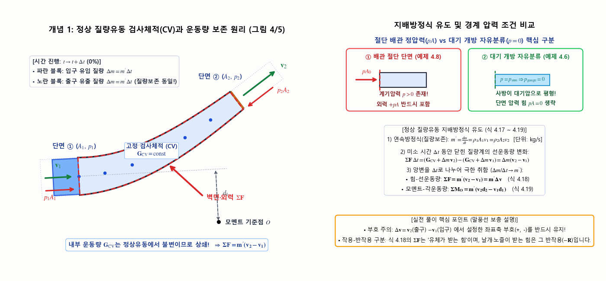
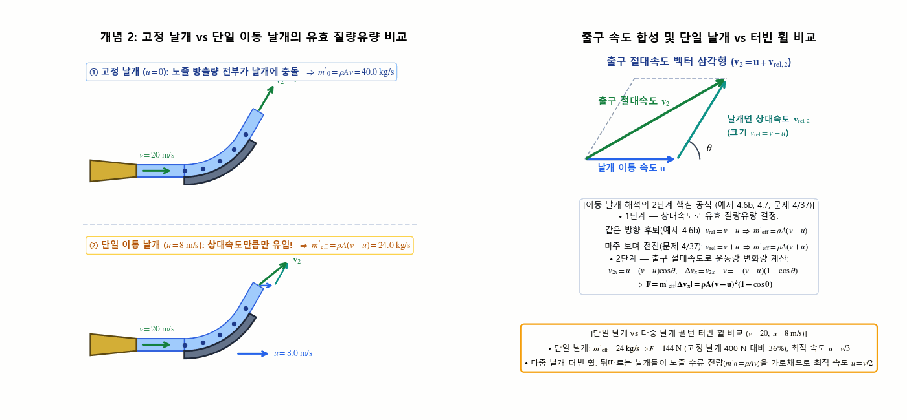
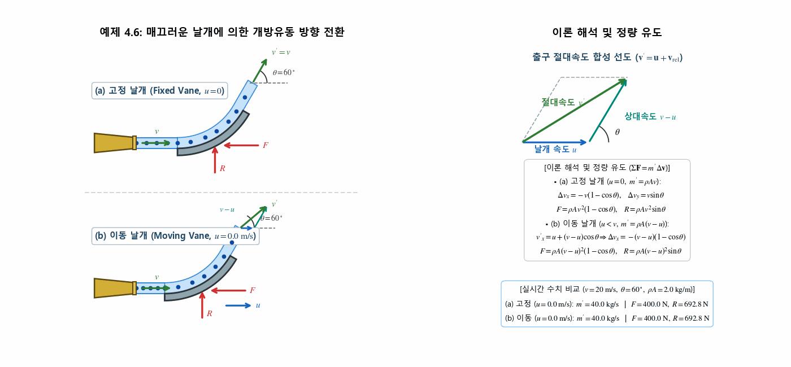
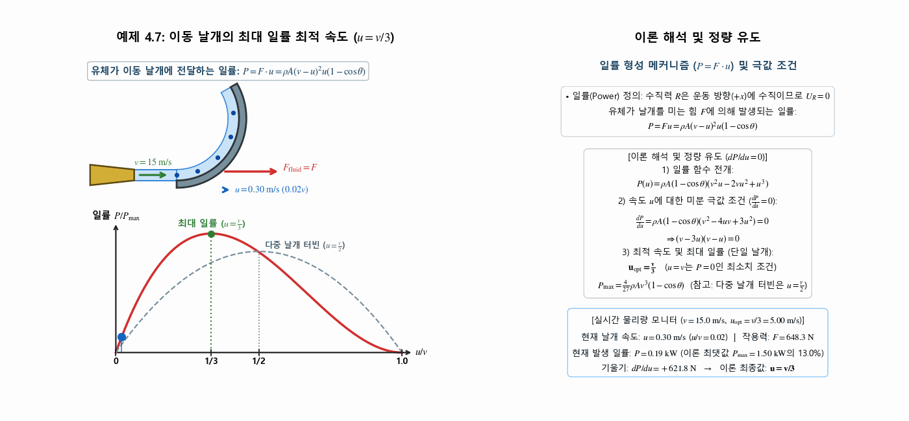
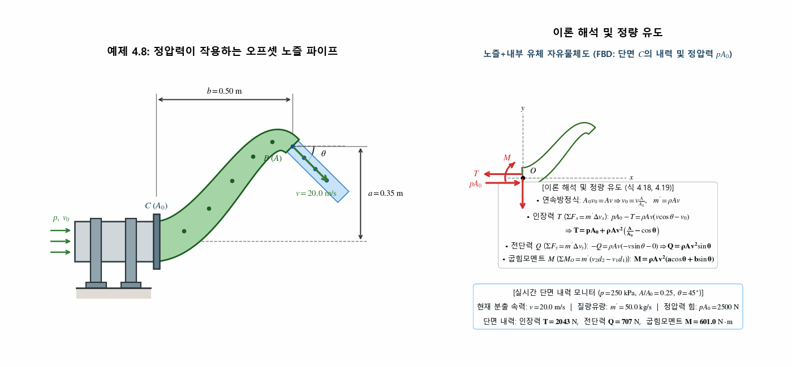
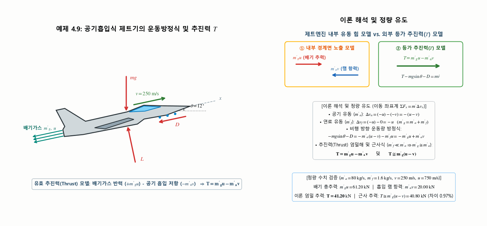
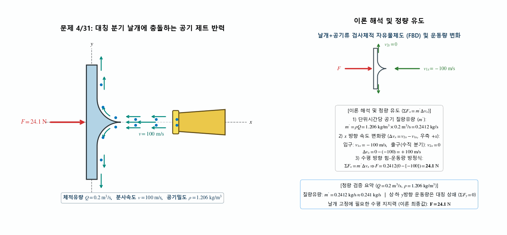
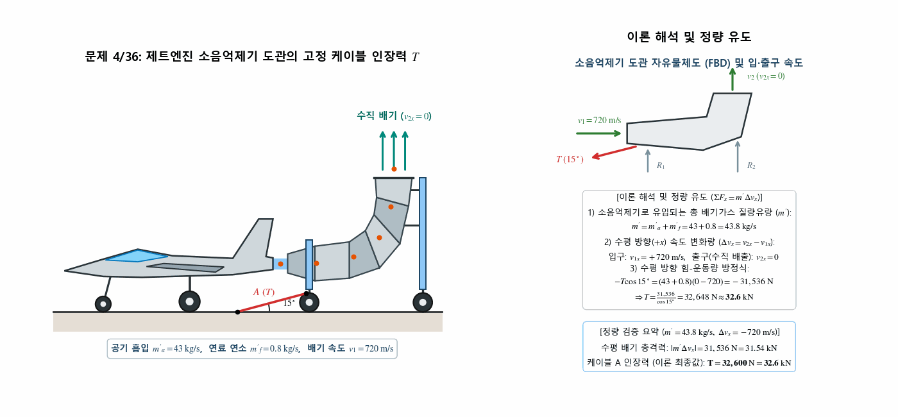
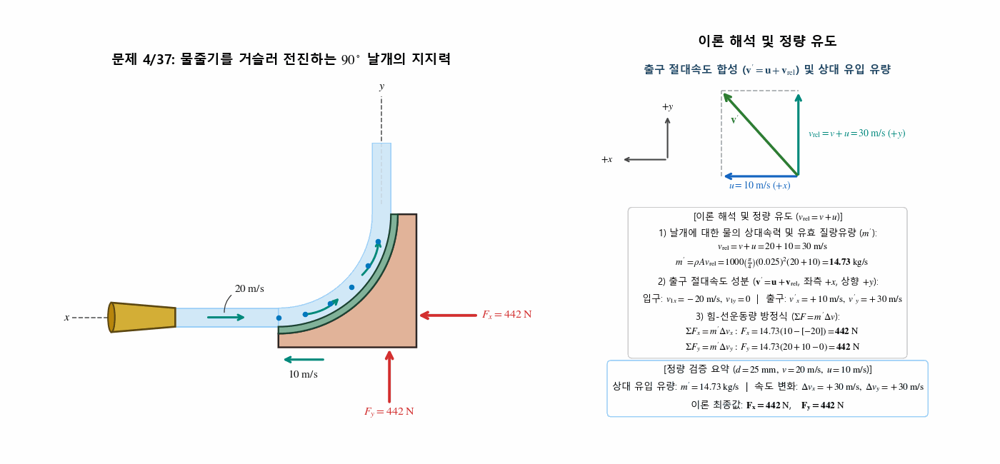
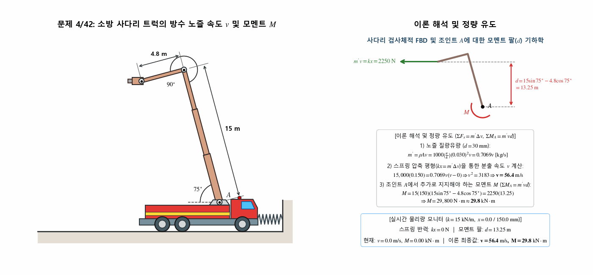

> **Author / Rights Holder:** 전북대학교 생물산업기계공학과 유동수 (ryudongsoo@jbnu.ac.kr)

# 13주차: 질점계의 운동역학 III — 제4장 4.6절: 정상 질량유동 (Steady Mass Flow)

## 📌 강의 개요 및 학습 목표

- **단원**: 동역학 9판 제4장 질점계의 운동역학 — 4.6절: 정상 질량유동 (Steady Mass Flow)
- **학습 목표**:
  - 검사체적(Control Volume) 개념과 정상유동 연속방정식($m' = \rho_1 A_1 v_1 = \rho_2 A_2 v_2$) 습득
  - 증분해석(Incremental Analysis)을 통한 정상유동 힘-선운동량 방정식($\Sigma\mathbf{F} = m'\Delta\mathbf{v} = m'(\mathbf{v}_2 - \mathbf{v}_1)$) 유도 및 적용
  - 구조물 반력, 입·출구 정압력 힘($pA$), 자중을 포함한 유체+용기 통합 자유물체도(FBD) 작도 역량 확보
  - 정상유동계의 모멘트-각운동량 방정식($\Sigma M_O = m'(v_2 d_2 - v_1 d_1)$)을 활용한 파이프·사다리 구조물 모멘트 해석
  - 이동 날개(Moving Vane), 터빈 블레이드, 공기흡입식 제트엔진(Jet Aircraft)의 상대속도 합성 및 추력($T$) 정량 해석

---

## 📋 주차별 학습 콘텐츠 구성

| 구분 | 번호 | 예제/문제명 | 핵심 개념 및 검증 공식 | 산출물 링크 |
|:---:|:---:|:---|:---|:---:|
| **개념** | 4.6-1 | 검사체적(CV) 정상유동 및 압력 외력 | $\Delta m = m'\Delta t,\ \Sigma\mathbf{F} = m'(\mathbf{v}_2 - \mathbf{v}_1)$, 절단 배관 $pA$ vs 자유분류 $p=0$ | [코드](./concept_steady_flow_cv.py) \| [GIF](./concept_steady_flow_cv.gif) |
| **개념** | 4.6-2 | 고정 vs 이동 날개 유효 질량유량 | 단일 이동 날개 $m'_{\mathrm{eff}} = \rho A(v-u)$ vs 다중 날개 터빈 $m'_0 = \rho A v$, $\mathbf{v}_2 = \mathbf{u} + \mathbf{v}_{\mathrm{rel},2}$ | [코드](./concept_moving_vane_rel_vel.py) \| [GIF](./concept_moving_vane_rel_vel.gif) |
| **예제** | 4.6 | 매끄러운 날개 유동 전환 | (a) 고정 $F = \rho Av^2(1-\cos\theta)$, (b) 이동 $F = \rho A(v-u)^2(1-\cos\theta)$ | [코드](./ex4_6_fluid_vane_deflection.py) \| [GIF](./ex4_6_fluid_vane_deflection.gif) |
| **예제** | 4.7 | 이동 날개 최대 일률 속도 | $P = Fu = \rho A(v-u)^2 u(1-\cos\theta),\ \frac{dP}{du}=0 \Rightarrow \mathbf{u = \frac{v}{3}}$ | [코드](./ex4_7_moving_vane_max_power.py) \| [GIF](./ex4_7_moving_vane_max_power.gif) |
| **예제** | 4.8 | 오프셋 노즐 파이프 내력 | $T = pA_0 + \rho Av^2(\frac{A}{A_0}-\cos\theta),\ Q = \rho Av^2\sin\theta,\ M = \rho Av^2(a\cos\theta+b\sin\theta)$ | [코드](./ex4_8_offset_nozzle_pipe.py) \| [GIF](./ex4_8_offset_nozzle_pipe.gif) |
| **예제** | 4.9 | 공기흡입식 제트기 추력 | $m'_g u - m'_a v = mg\sin\theta + D \Rightarrow \mathbf{T = m'_g u - m'_a v \cong m'_g(u-v)}$ | [코드](./ex4_9_jet_aircraft_thrust.py) \| [GIF](./ex4_9_jet_aircraft_thrust.gif) |
| **기초** | 4/31 | 공기 제트 분기 날개 지지력 | $m' = \rho Q = 0.241\ \mathrm{kg/s},\ \Sigma F_x = m'\Delta v_x \Rightarrow \mathbf{F = 24.1\ \mathrm{N}}$ | [코드](./prob4_31_air_jet_vane.py) \| [GIF](./prob4_31_air_jet_vane.gif) |
| **기초** | 4/36 | 제트엔진 소음억제기 장력 | $m' = 43 + 0.8 = 43.8\ \mathrm{kg/s},\ -T\cos 15^\circ = m'(0-720) \Rightarrow \mathbf{T = 32.6\ \mathrm{kN}}$ | [코드](./prob4_36_jet_noise_suppressor.py) \| [GIF](./prob4_36_jet_noise_suppressor.gif) |
| **기초** | 4/37 | $90^\circ$ 이동 날개 지지력 | $v_{\mathrm{rel}} = 30\ \mathrm{m/s},\ m' = 14.73\ \mathrm{kg/s} \Rightarrow \mathbf{F_x = 442\ \mathrm{N},\ F_y = 442\ \mathrm{N}}$ | [코드](./prob4_37_moving_90deg_vane.py) \| [GIF](./prob4_37_moving_90deg_vane.gif) |
| **심화** | 4/42 | 소방 사다리 트럭 방수 노즐 | $kx = m'v \Rightarrow \mathbf{v = 56.4\ \mathrm{m/s}},\ \Sigma M_A = m'vd \Rightarrow \mathbf{M = 29.8\ \mathrm{kN\cdot m}}$ | [코드](./prob4_42_fire_truck_nozzle.py) \| [GIF](./prob4_42_fire_truck_nozzle.gif) |

---

## 0. 핵심 원리 보충 개념 애니메이션 (Supplementary Concept Animations)

### 0.1 개념 1: 검사체적(Control Volume) 정상 질량유동 원리와 경계 압력 조건 비교

- **핵심 원리**:
  - 미소 시간 $\Delta t$ 동안 고정된 검사체적(CV)의 입구 단면 ①로 들어오는 유체 질량 $\Delta m = m'\Delta t$와 출구 단면 ②로 빠져나가는 질량 $\Delta m = m'\Delta t$가 동일하며($m' = \rho_1 A_1 v_1 = \rho_2 A_2 v_2$), 정상유동에서는 CV 내부 유체의 선운동량 $\mathbf{G}_{\mathrm{CV}}$가 일정하므로 상쇄되어 $\Sigma\mathbf{F} = m'(\mathbf{v}_2 - \mathbf{v}_1)$이 성립함
  - **경계 압력 외력 구분**: 배관을 절단한 단면(예제 4.8)에는 계기 정압력에 의한 외력 $+pA$를 반드시 포함하고, 대기 중에 개방된 자유분류(예제 4.6, 문제 4/31, 4/37)에서는 $p_{\mathrm{gauge}} = 0$이므로 압력 외력이 소거됨

---

### 0.2 개념 2: 고정 날개($u=0$) vs 단일 이동 날개($u>0$) 유효 질량유량 및 출구 속도 합성

- **핵심 원리**:
  - 고정 날개($u=0$)는 노즐에서 분출된 전체 질량유량 $m'_0 = \rho A v$를 모두 꺾지만, 속도 $u$로 후퇴하는 **단일 이동 날개**는 미소 시간 동안 $u\Delta t$만큼 도망가므로 실제로 날개에 도달해 꺾이는 유효 질량유량은 $m'_{\mathrm{eff}} = \rho A(v - u)$로 감소함 (반면 연속된 날개들이 돌아가며 수류 전량을 가로채는 다중 날개 펠턴 터빈 휠은 $m'_0 = \rho A v$ 적용)
  - 출구에서의 유체 절대속도는 날개 속도 벡터와 날개면 접선 상대속도의 벡터합($\mathbf{v}_2 = \mathbf{u} + \mathbf{v}_{\mathrm{rel},2}$)으로 결정됨

---

## 1. 교재 핵심 예제 (Sample Problems 4/6 ~ 4/9)

### 1.1 예제 4.6: 매끄러운 날개에 의한 개방유동 방향 전환 (고정 및 이동 날개)

- **문제 정의**: 단면적 $A$, 밀도 $\rho$, 속도 $v$인 대기 개방유동이 매끄러운 곡면 날개(Vane)에 의해 각도 $\theta$만큼 방향 전환될 때, (a) 고정 날개($u=0$)를 유지하는 힘 $F, R$ 및 (b) 날개가 $v$와 같은 방향으로 일정 속도 $u$ ($u < v$)로 이동할 때의 힘 $F, R$ 산출
- **역학 해석**:
  - **(a) 고정 날개 ($u = 0$)**:
    - 출구 속력 $v' = v$, 질량유량 $m' = \rho A v$
    - 속도 변화량: $\Delta v_x = v\cos\theta - v = -v(1 - \cos\theta),\ \Delta v_y = v\sin\theta - 0 = v\sin\theta$
    - 작용 반력: $-F = m'\Delta v_x \Rightarrow \mathbf{F = \rho A v^2(1 - \cos\theta)},\quad R = m'\Delta v_y \Rightarrow \mathbf{R = \rho A v^2\sin\theta}$
  - **(b) 이동 날개 ($u < v$)**:
    - 날개 위로 유입되는 유효 질량유량: $m' = \rho A(v - u)$
    - 출구 절대속도 합성($\mathbf{v}' = \mathbf{u} + \mathbf{v}_{\mathrm{rel}}$): $v'_x = u + (v - u)\cos\theta,\ v'_y = (v - u)\sin\theta$
    - 속도 변화량: $\Delta v_x = v'_x - v = -(v - u)(1 - \cos\theta),\ \Delta v_y = (v - u)\sin\theta$
    - 작용 반력: $\mathbf{F = \rho A(v - u)^2(1 - \cos\theta)},\quad \mathbf{R = \rho A(v - u)^2\sin\theta}$

---

### 1.2 예제 4.7: 이동 날개에 의해 발생하는 최대 일률 최적 속도

- **문제 정의**: 예제 4.6의 움직이는 단일 날개에 대하여, 유체가 날개에 가하는 힘을 이용해 최대 일률(Maximum Power)을 얻을 수 있는 최적 속도 $u$ 도출
- **역학 해석**:
  - 수직력 $R$은 이동 방향($+x$)과 수직이므로 일을 하지 못함 ($U_R = 0$)
  - 유체가 이동 날개에 전달하는 양(+)의 일률:
    $$P = F u = \rho A(v - u)^2 u (1 - \cos\theta)$$
  - 극값 조건 ($\frac{dP}{du} = 0$):
    $$\frac{dP}{du} = \rho A(1 - \cos\theta)(v^2 - 4uv + 3u^2) = \rho A(1 - \cos\theta)(v - 3u)(v - u) = 0$$
  - 최적 날개 속도 및 최대 일률:
    $$\mathbf{u = \frac{v}{3}} \implies P_{\max} = \frac{4}{27}\rho A v^3(1 - \cos\theta)$$
    *(참고: 다중 블레이드 터빈 원판에서는 노즐 방출 유량 전체가 작용하여 $m' = \rho A v$가 되므로 최적 속도는 $u = \frac{v}{2}$)*

---

### 1.3 예제 4.8: 정압력이 작용하는 오프셋 노즐 파이프의 단면 내력 해석

- **문제 정의**: 흡입구 $C$(단면적 $A_0$, 정적 게이지 압력 $p$)를 통해 유입된 밀도 $\rho$의 액체가 오프셋 노즐 출구 $B$(단면적 $A$, 수직 오프셋 $a$, 수평 거리 $b$)에서 각도 $\theta$, 속력 $v$로 대기 중에 분출될 때, 단면 $C$에 걸리는 인장력 $T$, 전단력 $Q$, 굽힘모멘트 $M$ 산출
- **역학 해석**:
  - 비압축성 연속방정식: $A_0 v_0 = A v \Rightarrow v_0 = v\frac{A}{A_0},\quad m' = \rho A v$
  - **$x$ 방향 (인장력 $T$)**: 상류 정압력 힘 $pA_0$가 $+x$ 방향으로 작용하므로,
    $$\Sigma F_x = m'\Delta v_x \implies p A_0 - T = \rho A v(v\cos\theta - v_0) \implies \mathbf{T = p A_0 + \rho A v^2\left(\frac{A}{A_0} - \cos\theta\right)}$$
  - **$y$ 방향 (전단력 $Q$)**:
    $$\Sigma F_y = m'\Delta v_y \implies -Q = \rho A v(-v\sin\theta - 0) \implies \mathbf{Q = \rho A v^2\sin\theta}$$
  - **단면 중심 $O$에 대한 모멘트 (굽힘모멘트 $M$, 시계방향 양+)**:
    $$\Sigma M_O = m'(v_2 d_2 - v_1 d_1) \implies M = \rho A v(v\cos\theta\cdot a + v\sin\theta\cdot b - 0) \implies \mathbf{M = \rho A v^2(a\cos\theta + b\sin\theta)}$$

---

### 1.4 예제 4.9: 공기흡입식 제트기의 운동방정식 및 추진력 $T$

- **문제 정의**: 질량 $m$인 제트기가 앙각 $\theta$, 일정 속력 $v$로 비행하며 공기 흡입률 $m'_a$, 연료 소모율 $m'_f$로 작동하여 상대속도 $u$로 배기가스($m'_g = m'_a + m'_f$)를 분출할 때, 비행기 운동방정식 및 추진력(Thrust) $T$ 도출
- **역학 해석**:
  - 비행기에 고정된 등속 이동 좌표계($+x$ 전방) 기준 속도 변화량:
    - 공기 유동 ($m'_a$): $\Delta v_a = -u - (-v) = -(u - v)$
    - 연료 유동 ($m'_f$): $\Delta v_f = -u - 0 = -u$
  - 비행 방향 힘-운동량 방정식:
    $$\Sigma F_x = m'\Delta v_x \implies -mg\sin\theta - D = -m'_a(u - v) - m'_f u = -(m'_a + m'_f)u + m'_a v = -m'_g u + m'_a v$$
    $$\implies m'_g u - m'_a v = mg\sin\theta + D$$
  - **유효 추진력(Thrust) $T$ 및 근사식 ($m'_f \ll m'_a \Rightarrow m'_g \cong m'_a$)**:
    $$\mathbf{T = m'_g u - m'_a v} \qquad \text{및} \qquad \mathbf{T \cong m'_g(u - v)}$$

---

## 2. 연습문제 (기초문제 3선 + 심화문제 1선)

### 2.1 기초문제 1: 문제 4/31 — 수직 대칭 분기 날개에 충돌하는 공기 제트 반력

- **문제 정의**: 노즐로부터 체적유량 $Q = 0.2\ \mathrm{m^3/s}$의 공기 제트가 왼쪽($-x$ 방향)으로 속력 $v = 100\ \mathrm{m/s}$로 분사되어 수직 분기 날개에 충돌 후 상·하($\pm y$)로 나뉘어 배출될 때, 날개를 고정 위치에 유지하는 힘 $F$ 계산 ($\rho = 1.206\ \mathrm{kg/m^3}$)
- **역학 계산**:
  - 공기 질량유량:
    $$m' = \rho Q = 1.206(0.2) = 0.2412\ \mathrm{kg/s} \approx 0.241\ \mathrm{kg/s}$$
  - 수평 방향($+x$ 우향) 힘-운동량 방정식:
    $$\Sigma F_x = m'\Delta v_x \implies F = 0.2412(0 - [-100]) = \mathbf{24.1\ \mathrm{N}}$$

---

### 2.2 기초문제 2: 문제 4/36 — 제트엔진 소음억제기 도관의 케이블 인장력

- **문제 정의**: 지상 시험 중인 제트엔진이 공기 $m'_a = 43\ \mathrm{kg/s}$를 흡입하고 연료 $m'_f = 0.8\ \mathrm{kg/s}$를 연소시켜 수평 배기속도 $v_1 = 720\ \mathrm{m/s}$로 분출할 때, 이를 수직 상향으로 전환해 배출하는 이동식 소음억제기 도관의 $15^\circ$ 고정 케이블 $A$에 걸리는 인장력 $T$ 계산
- **역학 계산**:
  - 소음억제기 유입 총 배기가스 질량유량:
    $$m' = m'_a + m'_f = 43 + 0.8 = 43.8\ \mathrm{kg/s}$$
  - 도관의 수평 방향($+x$ 우향) 힘-운동량 방정식 ($v_{1x} = +720\ \mathrm{m/s},\ v_{2x} = 0$):
    $$\Sigma F_x = m'\Delta v_x \implies -T\cos 15^\circ = (43 + 0.8)(0 - 720) = -31,536\ \mathrm{N}$$
    $$\implies T = \frac{31,536}{\cos 15^\circ} = 32,648\ \mathrm{N} \approx \mathbf{32.6\ \mathrm{kN}\ (32,600\ \mathrm{N})}$$

---

### 2.3 기초문제 3: 문제 4/37 — 물줄기를 거슬러 운동하는 $90^\circ$ 날개의 지지력

- **문제 정의**: 지름 $d = 25\ \mathrm{mm}$ 노즐에서 물줄기($\rho = 1000\ \mathrm{kg/m^3}$)가 오른쪽으로 $v = 20\ \mathrm{m/s}$로 발사될 때, 물줄기를 거슬러 왼쪽($+x$ 방향)으로 $u = 10\ \mathrm{m/s}$로 운동하는 $90^\circ$ 날개의 운동을 유지하기 위해 필요한 힘 $F_x, F_y$ 계산
- **역학 계산**:
  - 날개에 대한 물의 상대속력 및 유효 질량유량:
    $$v_{\mathrm{rel}} = v + u = 20 + 10 = 30\ \mathrm{m/s}$$
    $$m' = \rho A v_{\mathrm{rel}} = 1000\left(\frac{\pi}{4}\right)(0.025)^2(20 + 10) = \mathbf{14.73\ \mathrm{kg/s}}$$
  - 출구에서 전환된 물의 절대속도 ($\mathbf{v}' = \mathbf{u} + \mathbf{v}_{\mathrm{rel}}$, 좌측 $+x$, 상향 $+y$):
    $$v'_{x} = +10\ \mathrm{m/s},\quad v'_{y} = +30\ \mathrm{m/s} \qquad (\text{입구: } v_{1x} = -20\ \mathrm{m/s},\ v_{1y} = 0)$$
  - 힘-선운동량 방정식:
    $$\Sigma F_x = m'\Delta v_x \implies F_x = 14.73(10 - [-20]) = \mathbf{442\ \mathrm{N}}$$
    $$\Sigma F_y = m'\Delta v_y \implies F_y = 14.73(20 + 10 - 0) = \mathbf{442\ \mathrm{N}}$$

---

### 2.4 심화문제 1: 문제 4/42 — 소방 사다리 트럭의 방수 노즐 속도 및 조인트 모멘트

- **문제 정의**: 자유롭게 굴러갈 수 있는 소방 사다리 트럭에서 펌프를 작동해 노즐(출구 지름 $d = 30\ \mathrm{mm}$)로부터 수평 좌측으로 물줄기를 분출할 때, 트럭이 우측 스프링($k = 15\ \mathrm{kN/m}$)을 $x = 150\ \mathrm{mm}$ 압축시켜 정지한다. (1) 노즐 분출 속도 $v$ 및 (2) 사다리 기저부 조인트 $A$에서 추가로 지지해야 하는 모멘트 $M$ 결정 (주 사다리 길이 $15\ \mathrm{m}$, 경사 $75^\circ$, 상단 보조 붐 길이 $4.8\ \mathrm{m}$, 사다리와 $90^\circ$ 직각)
- **역학 계산**:
  - **(1) 노즐 수류 분출 속도 $v$**:
    - 노즐 질량유량: $m' = \rho A v = 1000\left(\frac{\pi}{4}\right)(0.030)^2 v = 0.7069 v\ [\mathrm{kg/s}]$
    - 수평 방향 힘-운동량 평형 ($kx = m'\Delta v$):
      $$15,000(0.150) = 0.7069 v(v - 0) \implies v^2 = 3183 \implies \mathbf{v = 56.4\ \mathrm{m/s}}$$
  - **(2) 조인트 $A$의 추가 지지 모멘트 $M$**:
    - 조인트 $A$로부터 수평 노즐 분출선까지의 수직 모멘트 팔 길이 $d$:
      $$d = 15\sin 75^\circ - 4.8\cos 75^\circ = 14.489 - 1.242 = 13.25\ \mathrm{m}$$
    - 각운동량 방정식 ($\Sigma M_A = m' v d$):
      $$M = (15 \times 150)(15\sin 75^\circ - 4.8\cos 75^\circ) = 2250(13.25) = 29,800\ \mathrm{N\cdot m} \approx \mathbf{29.8\ \mathrm{kN\cdot m}}$$

---

## 📝 변경 이력 (Changelog)
- **2026-11-01 23:35:00** [[Dongsoo Ryu](mailto:ryudongsoo@jbnu.ac.kr)] feat: 1~15주차 생물역학 한·영 시뮬레이션 포트폴리오 및 보충 개념 애니메이션 통합 배포

- **2026-11-01 21:20:00** [[Dongsoo Ryu](mailto:ryudongsoo@jbnu.ac.kr)] feat(biomechanics): add 2 supplementary concept animations (CV steady flow & moving vane relative flow) and enforce STIX math rendering across all 10 Week 13 scripts
- **2026-10-15 00:25:00** [[Dongsoo Ryu](mailto:ryudongsoo@jbnu.ac.kr)] feat(biomechanics): complete Week 13 Ch.4.6 Steady Mass Flow curriculum with 4 sample problems and 4 practice problems verified quantitatively
- **2026-10-03 17:22:26** [[Dongsoo Ryu](mailto:ryudongsoo@jbnu.ac.kr)] feat(biomechanics): complete Week 7 Part B Work and Energy curriculum overhaul with 5 examples and 4 practice problems verified quantitatively
- **2026-10-02 23:28:18** [[Dongsoo Ryu](mailto:ryudongsoo@jbnu.ac.kr)] feat(patent): Leave applicant blank and set inventors to Yoo Dongsoo and Kim Sungmin for portable Brix meter patents (07, 08)
