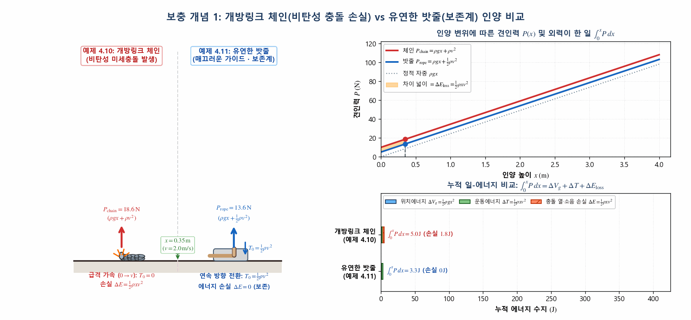
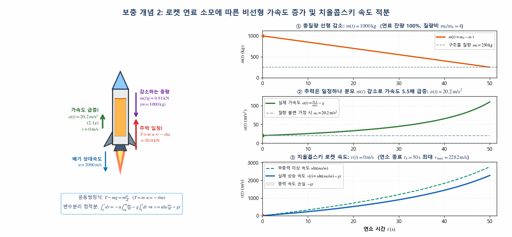
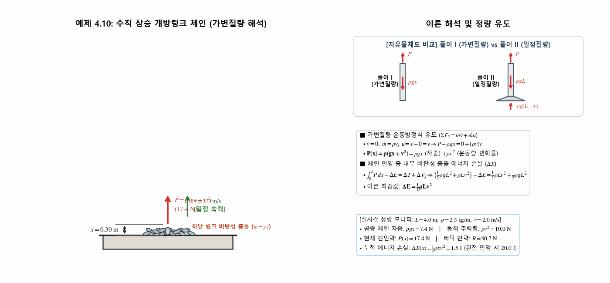
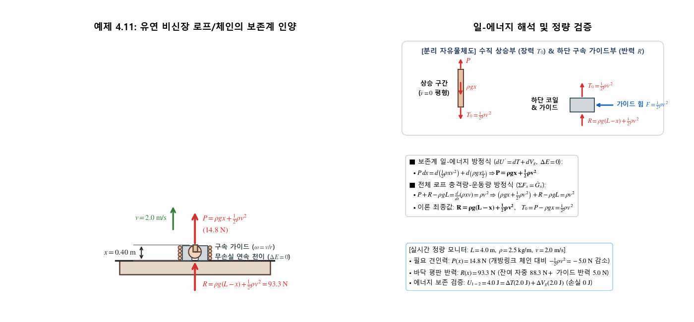
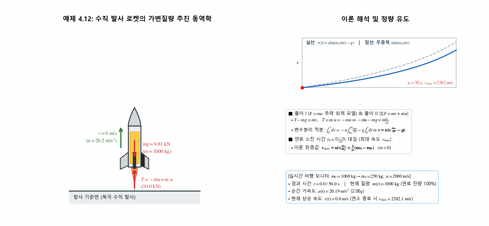
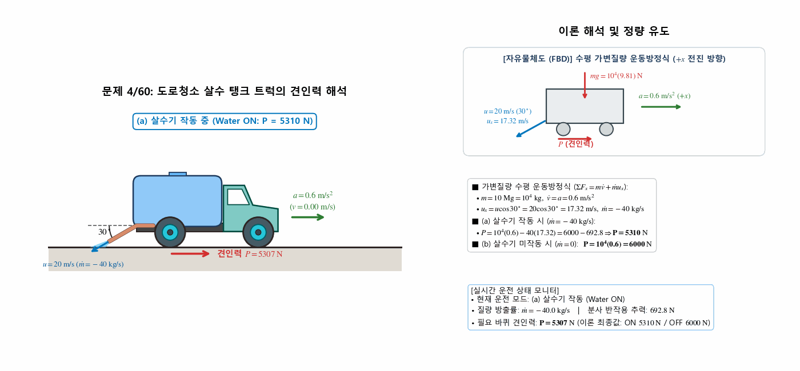
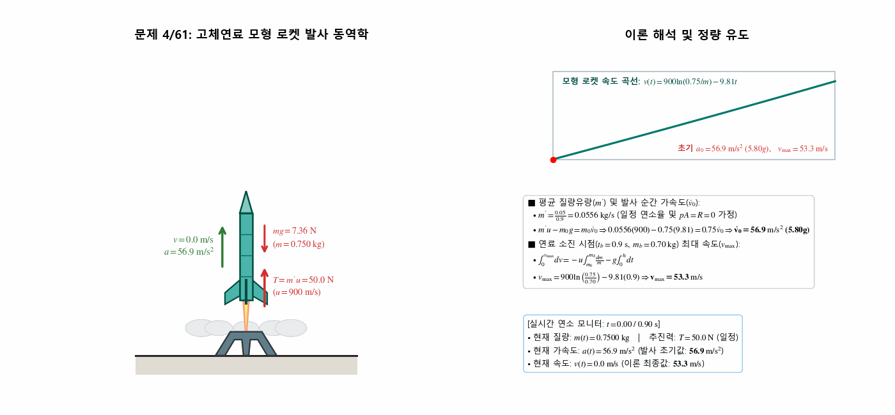
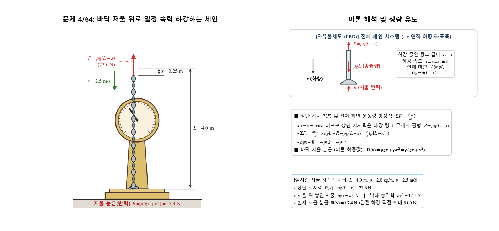
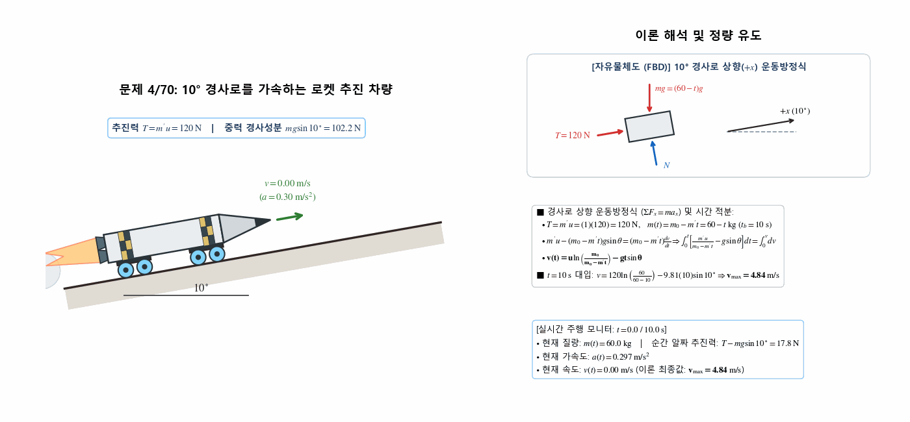

> **Author / Rights Holder:** 전북대학교 생물산업기계공학과 유동수 (ryudongsoo@jbnu.ac.kr, ryudongsoo@gmail.com)

# 14주차: 질점계의 운동역학 IV — 가변질량 동역학 및 제1부(Ch.1~4) 총괄 정리

## 📌 강의 개요 및 학습 목표

- **단원**: 동역학 9판 제4장 질점계의 운동역학 — 4.7 가변질량 (Variable Mass) 및 4.8 장 복습 (Chapter Review)
- **학습 목표**:
  - 시간에 따라 질량을 흡수($\dot{m} > 0$)하거나 방출($\dot{m} < 0$)하는 가변질량 시스템의 일반 운동방정식($\Sigma F = m\dot{v} + \dot{m}u$) 유도 및 상대속도 $u = v - v_0$의 부호 체계 확립
  - 선운동량 직접 미분식 $\Sigma F = \frac{d}{dt}(mv)$가 성립하는 특수 조건(정지 질량의 흡수 또는 절대 정지 상태로의 방출, $v_0 = 0$) 판별
  - 수직 인양되는 개방링크 체인(예제 4.10)의 내부 비탄성 충돌 에너지 손실($\Delta E = \frac{1}{2}\rho Lv^2$)과 비신장 유연 로프(예제 4.11)의 보존계 일-에너지 해석($\Delta E = 0$) 완벽 대조
  - 로켓 추진 동역학 방정식($m'u + pA - mg - R = m\dot{v}$) 및 찌올코프스키(Tsiolkovsky) 로켓 속도 적분식 도출
  - 생물역학 제1부(Ch.1 ~ Ch.4) 질점 및 질점계 운동학·운동역학 전 범위 해법 체계 종합 정리

---

## 📋 주차별 학습 콘텐츠 구성

| 구분 | 번호 | 예제/문제명 | 핵심 개념 및 검증 공식 | 산출물 링크 |
|:---:|:---:|:---|:---|:---:|
| **보충개념** | 개념 1 | 개방링크 체인 vs 유연 밧줄 인양 비교 | $P_{\mathrm{chain}} = \rho(gx+v^2)$ ($\Delta E = \frac{1}{2}\rho Lv^2$) vs $P_{\mathrm{rope}} = \rho gx + \frac{1}{2}\rho v^2$ ($\Delta E = 0$) | [코드](./concept_chain_vs_rope_energy.py) \| [GIF](./concept_chain_vs_rope_energy.gif) |
| **보충개념** | 개념 2 | 로켓 추진 및 치올콥스키 속도 적분 | $m(t) = m_0 - m't,\ a(t) = \frac{m'u}{m(t)} - g,\ v(t) = u\ln\frac{m_0}{m(t)} - gt$ | [코드](./concept_rocket_tsiolkovsky_thrust.py) \| [GIF](./concept_rocket_tsiolkovsky_thrust.gif) |
| **예제** | 4.10 | 수직 인양 개방링크 체인 | $P = \rho(gx + v^2),\ \Delta E = \frac{1}{2}\rho Lv^2$ (비탄성 충돌 손실) | [코드](./ex4_10_open_link_chain_lift.py) \| [GIF](./ex4_10_open_link_chain_lift.gif) |
| **예제** | 4.11 | 비신장 유연 로프/자전거 체인 | $P = \rho gx + \frac{1}{2}\rho v^2,\ R = \rho g(L-x) + \frac{1}{2}\rho v^2\ (\Delta E = 0)$ | [코드](./ex4_11_inextensible_rope_lift.py) \| [GIF](./ex4_11_inextensible_rope_lift.gif) |
| **예제** | 4.12 | 수직 상승 로켓 최대 속도 | $v_{\max} = u\ln\left(\frac{m_0}{m_b}\right) + \frac{g}{\dot{m}}(m_0 - m_b)$ (치올콥스키 식) | [코드](./ex4_12_rocket_vertical_ascent.py) \| [GIF](./ex4_12_rocket_vertical_ascent.gif) |
| **기초** | 4/60 | 도로청소 살수 탱크 트럭 | (a) 살수 작동 $P = 5310\ \mathrm{N}$, (b) 미작동 $P = 6000\ \mathrm{N}$ | [코드](./prob4_60_street_washer_truck.py) \| [GIF](./prob4_60_street_washer_truck.gif) |
| **기초** | 4/61 | 고체연료 모형 로켓 발사 | 초기 가속도 $\dot{v}_0 = 56.9\ \mathrm{m/s^2}\ (5.80g),\ v_{\max} = 53.3\ \mathrm{m/s}$ | [코드](./prob4_61_model_rocket_launch.py) \| [GIF](./prob4_61_model_rocket_launch.gif) |
| **기초** | 4/64 | 저울 위로 하강하는 체인 | $P = \rho g(L-x),\ \Sigma F_x = \dot{G}_x \Rightarrow R = \rho(gx + v^2)$ | [코드](./prob4_64_chain_lowering_scale.py) \| [GIF](./prob4_64_chain_lowering_scale.gif) |
| **심화** | 4/70 | $10^\circ$ 경사로 로켓 추진 썰매 | $v = u\ln\left(\frac{m_0}{m_0 - m't}\right) - gt\sin\theta \Rightarrow v_{\max} = 4.84\ \mathrm{m/s}$ | [코드](./prob4_70_rocket_incline_sled.py) \| [GIF](./prob4_70_rocket_incline_sled.gif) |

---

## 0. 보충 개념 애니메이션 (Supplementary Concept Animations)

### 0.1 보충 개념 1: 개방링크 체인(예제 4.10) vs 유연한 밧줄(예제 4.11) 인양 및 에너지 손실 비교

- **핵심 원리**:
  - **개방링크 체인 ($T_0 = 0$)**: 바닥에 정지해 있던 체인 고리가 인양부 하단에서 순간적으로 $0 \to v$로 급격히 끌려 올라가며 비탄성 미세충돌 발생 $\Rightarrow$ 견인력 $P_{\mathrm{chain}} = \rho gx + \rho v^2$, 누적 열·소음 에너지 손실 $\Delta E = \frac{1}{2}\rho x v^2$
  - **유연한 밧줄 ($T_0 = \frac{1}{2}\rho v^2$)**: 매끄러운 하단 구속 가이드를 따라 연속적으로 방향을 전환하므로 내부 충돌 손실 없음($\Delta E = 0$) $\Rightarrow$ 보존계 미분 일-에너지 원리에 의해 $P_{\mathrm{rope}} = \rho gx + \frac{1}{2}\rho v^2$

### 0.2 보충 개념 2: 로켓 추진 동역학 및 치올콥스키(Tsiolkovsky) 속도 적분

- **핵심 원리**:
  - 일정 연소율 $m' = -\dot{m} > 0$ 및 일정 상대 배기속도 $u$에서 추진력 $T = m'u = -\dot{m}u$는 일정하지만, 로켓의 총질량 $m(t) = m_0 - m't$가 선형 감소함에 따라 순간 가속도 $a(t) = \frac{m'u}{m(t)} - g$가 비선형적으로 급증함
  - 변수분리 정적분 $\int_0^v dv = -u\int_{m_0}^m \frac{dm}{m} - g\int_0^t dt$를 통해 치올콥스키 로켓 속도식 $v(t) = u\ln\left(\frac{m_0}{m(t)}\right) - gt$ 도출

---

## 1. 교재 핵심 예제 (Sample Problems 4/10 ~ 4/12)

### 1.1 예제 4.10: 수직으로 끌어올리는 개방링크 체인 및 에너지 손실

- **문제 정의**: 길이 $L$, 단위길이당 질량 $\rho$인 개방링크 체인(Open-link chain)이 평판 위에 놓여 있을 때, 체인 끝단을 일정 수직 속도 $v$로 끌어올리는 데 필요한 힘 $P(x)$ 및 체인을 완전히 들어 올리는 동안 손실된 에너지 $\Delta E$ 산출
- **역학 해석**:
  - **풀이 I (가변질량 방정식 적용)**:
    - 공중에 들어 올려진 길이 $x$ 체인만 분리: $m = \rho x,\ \dot{m} = \rho\dot{x} = \rho v,\ \dot{v} = 0$
    - 정지($v_0 = 0$)해 있던 바닥 링크가 합류할 때의 상대속도: $u = v - 0 = v$
    - $\Sigma F_x = m\dot{v} + \dot{m}u \Rightarrow P - \rho gx = 0 + (\rho v)v \Rightarrow \mathbf{P(x) = \rho(gx + v^2)}$
  - **풀이 II (전체 일정질량 운동량 원리 적용)**:
    - 체인 전체(질량 $\rho L$) 설정: 바닥 반력 $N = \rho g(L - x)$, 전체 운동량 $G_x = \rho xv$
    - $\Sigma F_x = \frac{dG_x}{dt} \Rightarrow P + \rho g(L - x) - \rho gL = \frac{d}{dt}(\rho xv) = \rho v^2 \Rightarrow \mathbf{P(x) = \rho(gx + v^2)}$
  - **비탄성 충돌 에너지 손실 ($\Delta E$)**:
    - 외력이 한 일: $\int_0^L P\,dx = \int_0^L (\rho gx + \rho v^2)\,dx = \frac{1}{2}\rho gL^2 + \rho Lv^2$
    - 역학적 에너지 증가량: $\Delta T = \frac{1}{2}\rho Lv^2,\ \Delta V_g = \rho gL\left(\frac{L}{2}\right) = \frac{1}{2}\rho gL^2$
    - 일-에너지 수지: $U'_{1-2} = \int_0^L P\,dx - \Delta E = \Delta T + \Delta V_g \Rightarrow \mathbf{\Delta E = \frac{1}{2}\rho Lv^2}$

---

### 1.2 예제 4.11: 신장성 없는 유연한 밧줄/자전거 체인의 보존계 인양

- **문제 정의**: 예제 4.10의 개방링크 체인을 유연하지만 길이가 변하지 않는(inextensible) 밧줄 또는 자전거 체인으로 대치하여, 끝단을 일정 속도 $v$로 끌어올릴 때 필요한 힘 $P(x)$ 및 바닥 평판과 코일 사이에 작용하는 반력 $R(x)$ 산출
- **역학 해석**:
  - **구속 가이드 및 에너지 보존 모델 ($\Delta E = 0$)**:
    - 신장성 없는 연속 로프가 에너지 소실 없이 1차원 수직 운동을 하려면 하단에서 회전 가이드($\omega = v/r$)에 의해 정지 상태로부터 수직 속도 $v$로 매끄러운 천이 운동 수행 필수
  - **보존계 미분 일-에너지 방정식 ($dU' = dT + dV_g$)**:
    $$P\,dx = d\left(\frac{1}{2}\rho xv^2\right) + d\left(\rho gx\frac{x}{2}\right) = \frac{1}{2}\rho v^2\,dx + \rho gx\,dx \Rightarrow \mathbf{P(x) = \rho gx + \frac{1}{2}\rho v^2}$$
  - **바닥 반력 $R$ 및 하단 천이 장력 $T_0$**:
    - 전체 로프에 대한 충격량-운동량 방정식 ($\Sigma F_x = \dot{G}_x$):
      $$P + R - \rho gL = \frac{d}{dt}(\rho xv) = \rho v^2 \Rightarrow \left(\rho gx + \frac{1}{2}\rho v^2\right) + R - \rho gL = \rho v^2 \Rightarrow \mathbf{R(x) = \rho g(L - x) + \frac{1}{2}\rho v^2}$$
    - 수직 상승 구간 하단 장력: $T_0 = P - \rho gx = \frac{1}{2}\rho v^2$ (나머지 운동량 변화율 $\frac{1}{2}\rho v^2$은 구속 가이드 반력 $F = \frac{1}{2}\rho v^2$이 공급하여 바닥 반력 $R$ 증가)

---

### 1.3 예제 4.12: 수직 발사 로켓의 가변질량 추진 및 연료 소진 최대 속도

- **문제 정의**: 초기 총질량 $m_0$인 로켓이 북극에서 수직 발사되어 일정 연소율 $m' = -\dot{m}$로 연료가 모두 소진될 때까지 가속될 때, 배기가스 노즐 상대속도가 $u$이고 연료 소진 후 잔여 구조물 질량이 $m_b$인 로켓의 최대 속도 $v_{\max}$ 산출 (대기압 분사 $p = 0$, 공기저항 $R = 0$, $g$ 일정 가정)
- **역학 해석**:
  - **추진력 외력 모델 ($F = ma$ 형태) 및 가변질량 방정식**:
    - 로켓 추진력: $T = m'u = -\dot{m}u$ ($\dot{m} = dm/dt < 0$)
    - 운동방정식: $T - mg = m\dot{v} \Rightarrow -\dot{m}u - mg = m\frac{dv}{dt}$
  - **변수분리 및 찌올코프스키(Tsiolkovsky) 방정식 적분**:
    $$dv = -u\frac{dm}{m} - g\,dt \implies \int_0^v dv = -u\int_{m_0}^m \frac{dm}{m} - g\int_0^t dt \implies \mathbf{v(t) = u\ln\left(\frac{m_0}{m}\right) - gt}$$
  - **연료 소진 시점($t_b = \frac{m_b - m_0}{\dot{m}} = \frac{m_0 - m_b}{-\dot{m}}$)에서의 최대 속도 $v_{\max}$**:
    $$\mathbf{v_{\max} = u\ln\left(\frac{m_0}{m_b}\right) + \frac{g}{\dot{m}}(m_0 - m_b) = u\ln\left(\frac{m_0}{m_b}\right) - \frac{g}{m'}(m_0 - m_b)}$$

---

## 2. 연습문제 (기초문제 3선 + 심화문제 1선 — 과제 #13)

### 2.1 기초문제 1: 문제 4/60 — 도로청소 살수 탱크 트럭의 필요 견인력

- **문제 정의**: 만재 시 총질량 $10\ \mathrm{Mg}$ ($10^4\ \mathrm{kg}$)인 도로청소 살수 트럭이 수평 대비 $30^\circ$ 후방 하향 각도로 트럭 상대속도 $u = 20\ \mathrm{m/s}$, 유량 $40\ \mathrm{kg/s}$의 물을 살포한다. 평탄한 도로에서 가속도 $a = 0.6\ \mathrm{m/s^2}$으로 출발할 때 (a) 살수기를 작동시키는 경우와 (b) 작동시키지 않는 경우 바퀴와 도로 사이에 필요한 견인력 $P$ 산출
- **역학 계산**:
  - 분사 물줄기의 후방 수평 상대속도 성분: $u_x = u\cos 30^\circ = 20\cos 30^\circ = 17.32\ \mathrm{m/s}$
  - 질량 변화율: $\dot{m} = -40\ \mathrm{kg/s}$
  - 수평 가변질량 운동방정식: $\Sigma F_x = m\dot{v} + \dot{m}u_x \Rightarrow P = ma + \dot{m}u_x$
  - **(a) 살수기 작동 시 (Water ON)**:
    $$P = 10^4(0.6) - 40(17.32) = 6000 - 692.8 = \mathbf{5310\ \mathrm{N}}$$
  - **(b) 살수기 미작동 시 (Water OFF, $\dot{m} = 0$)**:
    $$P = 10^4(0.6) = \mathbf{6000\ \mathrm{N}}$$

---

### 2.2 기초문제 2: 문제 4/61 — 고체연료 모형 로켓의 발사 가속도 및 연료 소진 속도

- **문제 정의**: 수직 발사 직전 질량이 $m_0 = 0.75\ \mathrm{kg}$인 모형 로켓이 $0.05\ \mathrm{kg}$의 고체연료를 $0.9\ \mathrm{s}$ 동안 연소시켜 $u = 900\ \mathrm{m/s}$의 상대속도로 분출할 때, 발사 순간 가속도 $\dot{v}_0$ 및 연료 소진 시 최대 속도 $v_{\max}$ 산출 (공기저항 및 노즐 배압 무시, 일정 연소율 가정)
- **역학 계산**:
  - 평균 질량유량: $m' = -\dot{m} = \frac{0.05\ \mathrm{kg}}{0.9\ \mathrm{s}} = 0.05556\ \mathrm{kg/s}$
  - **발사 순간 초기 가속도 ($\dot{v}_0$)**:
    $$m'u - m_0 g = m_0\dot{v}_0 \implies 0.05556(900) - 0.75(9.81) = 0.75\dot{v}_0 \implies \mathbf{\dot{v}_0 = 56.9\ \mathrm{m/s^2}\ (5.80g)}$$
  - **연료 소진 시점($m_b = 0.70\ \mathrm{kg}$) 최대 속도 ($v_{\max}$)**:
    $$v_{\max} = u\ln\left(\frac{m_0}{m_b}\right) + \frac{g}{\dot{m}}(m_0 - m_b) = 900\ln\left(\frac{0.75}{0.70}\right) + \frac{9.81}{-0.05556}(0.05) = 62.09 - 8.83 = \mathbf{53.3\ \mathrm{m/s}}$$

---

### 2.3 기초문제 3: 문제 4/64 — 바닥 저울 위로 일정 속력으로 내려지는 개방링크 체인

- **문제 정의**: 단위길이당 질량 $\rho$, 전체 길이 $L$인 개방링크 체인의 상단이 힘 $P$에 의해 일정 속력 $v$로 바닥 저울 위로 내려질 때, 상단 하강 변위(바닥에 쌓인 길이) $x$의 함수로 저울 눈금 $R(x)$ 도출
- **역학 계산**:
  - 등속 하강($\dot{x} = v = \mathrm{const}$) 조건에서 상단 지지력 $P$는 공중에서 하강 중인 링크(길이 $L - x$)의 무게와 평형:
    $$P = \rho g(L - x)$$
  - 연직 하향($+x$) 방향 전체 체인(질량 $\rho L$)의 충격량-운동량 방정식 ($\Sigma F_x = \frac{dG_x}{dt}$):
    $$\rho gL - R - P = \frac{d}{dt}\big[\rho(L - x)v\big] \implies \rho gL - R - \rho g(L - x) = -\rho\dot{x}v = -\rho v^2$$
    $$\rho gx - R = -\rho v^2 \implies \mathbf{R(x) = \rho gx + \rho v^2 = \rho(gx + v^2)}$$

---

### 2.4 심화문제 1: 문제 4/70 — $10^\circ$ 경사로를 가속하는 로켓 추진 소형 차량

- **문제 정의**: $10\ \mathrm{kg}$의 연료를 포함하여 초기 총질량이 $m_0 = 60\ \mathrm{kg}$인 로켓 추진 소형 차량이 $m' = 1\ \mathrm{kg/s}$의 연소율과 노즐 상대속도 $u = 120\ \mathrm{m/s}$로 가스를 배출한다. $\theta = 10^\circ$ 경사로에서 정지 상태로 점화와 동시에 출발할 때 도달하는 최대 속도 $v_{\max}$ 산출 (마찰 무시)
- **역학 계산**:
  - 일정 로켓 추진력: $T = m'u = (1)(120) = 120\ \mathrm{N}$
  - 시간 $t$에서의 차량 질량: $m(t) = m_0 - m't = 60 - t\ \mathrm{kg}$ (연소 시간 $t_b = \frac{10}{1} = 10\ \mathrm{s}$)
  - 경사 상향($+x$) 운동방정식 및 변수분리 적분:
    $$\Sigma F_x = ma_x \implies m'u - (m_0 - m't)g\sin\theta = (m_0 - m't)\frac{dv}{dt}$$
    $$\int_0^t \left[\frac{m'u}{m_0 - m't} - g\sin\theta\right]dt = \int_0^v dv \implies v(t) = u\ln\left(\frac{m_0}{m_0 - m't}\right) - gt\sin\theta$$
  - 연료 소진 시점 ($t = 10\ \mathrm{s}$) 최대 속도:
    $$v_{\max} = 120\ln\left(\frac{60}{60 - 10}\right) - 9.81(10)\sin 10^\circ = 21.879 - 17.035 = \mathbf{4.84\ \mathrm{m/s}}$$

---

## 📝 변경 이력 (Changelog)
- **2026-11-01 23:35:00** [[Dongsoo Ryu](mailto:ryudongsoo@jbnu.ac.kr)] feat: 1~15주차 생물역학 한·영 시뮬레이션 포트폴리오 및 보충 개념 애니메이션 통합 배포

- **2026-11-01 21:20:00** [[Dongsoo Ryu](mailto:ryudongsoo@jbnu.ac.kr)] feat(biomechanics): add 2 variable-mass concept animations (chain vs rope energy, rocket Tsiolkovsky thrust) and refine STIX math typography across Week 14
- **2026-10-15 00:18:00** [[Dongsoo Ryu](mailto:ryudongsoo@jbnu.ac.kr)] feat(biomechanics): complete Week 14 Ch.4 Variable Mass Dynamics and Part I synthesis with 3 sample problems and 4 practice problems
- **2026-10-03 17:22:26** [[Dongsoo Ryu](mailto:ryudongsoo@jbnu.ac.kr)] feat(biomechanics): complete Week 7 Part B Work and Energy curriculum overhaul with 5 examples and 4 practice problems
- **2026-10-02 23:28:18** [[Dongsoo Ryu](mailto:ryudongsoo@jbnu.ac.kr)] feat(patent): Leave applicant blank and set inventors to Yoo Dongsoo and Kim Sungmin for portable Brix meter patents (07, 08)
- **2026-10-02 23:22:53** [[Dongsoo Ryu](mailto:ryudongsoo@jbnu.ac.kr)] docs(patent): Complete comprehensive domestic and international prior art deep search and FTO analysis for 4 patent drafts
- **2026-10-02 23:17:31** [[Dongsoo Ryu](mailto:ryudongsoo@jbnu.ac.kr)] feat(patent): Add Kim Sungmin as co-inventor and establish 4-tier extra-large shell module for watermelon
- **2026-08-12 05:04:33** [[Dongsoo Ryu](mailto:ryudongsoo@jbnu.ac.kr)] docs: update assembly process and cost estimate for full SMT including ESP32-C6
