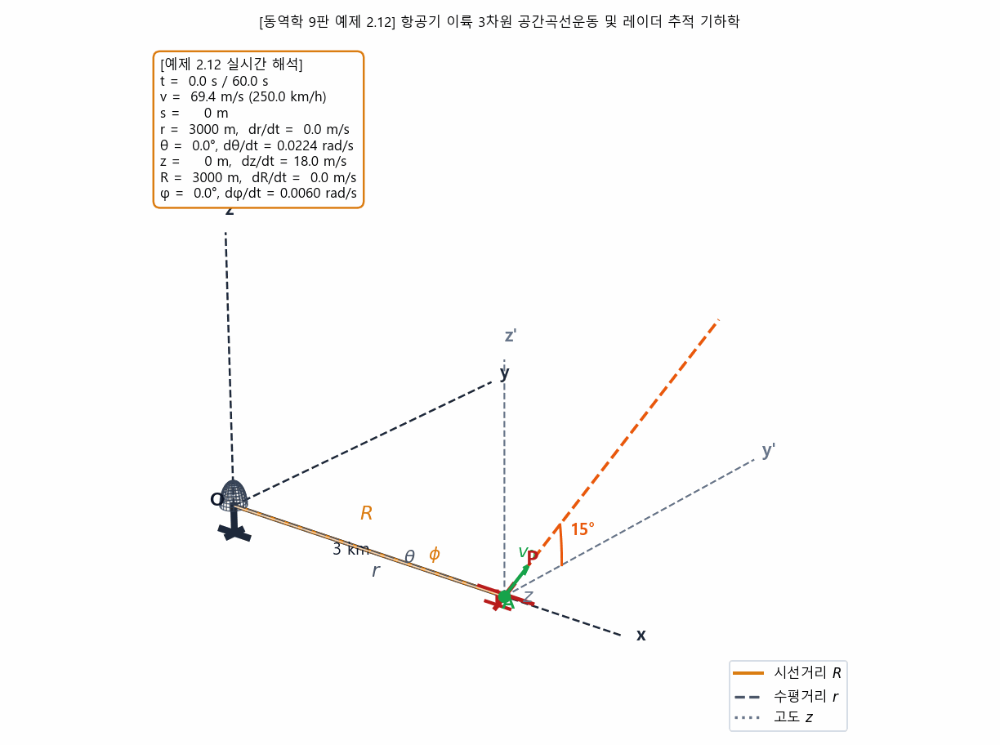
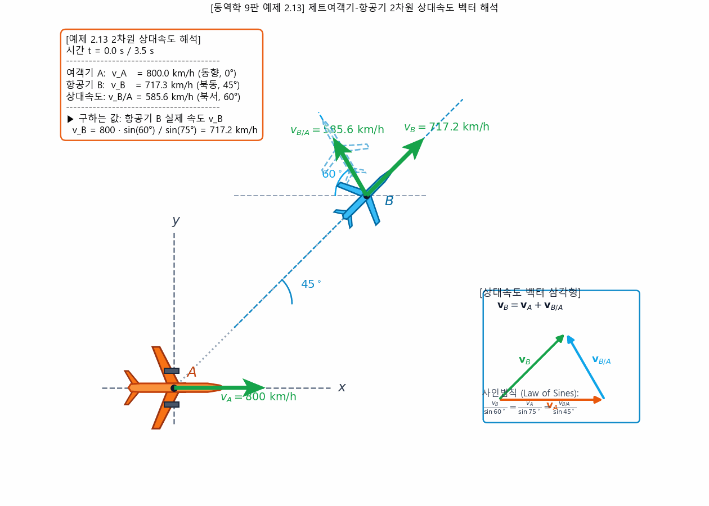
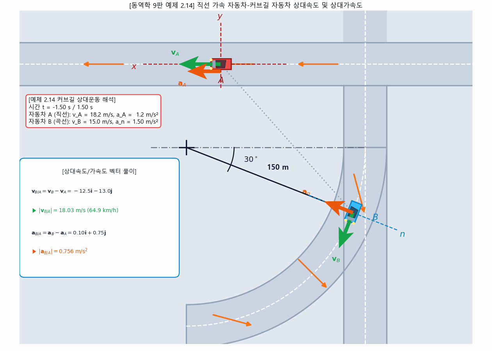
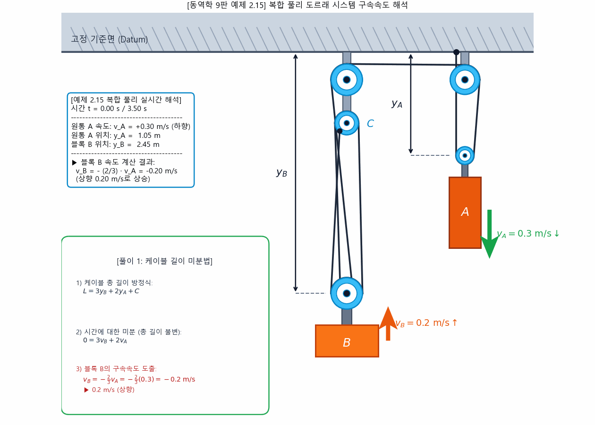
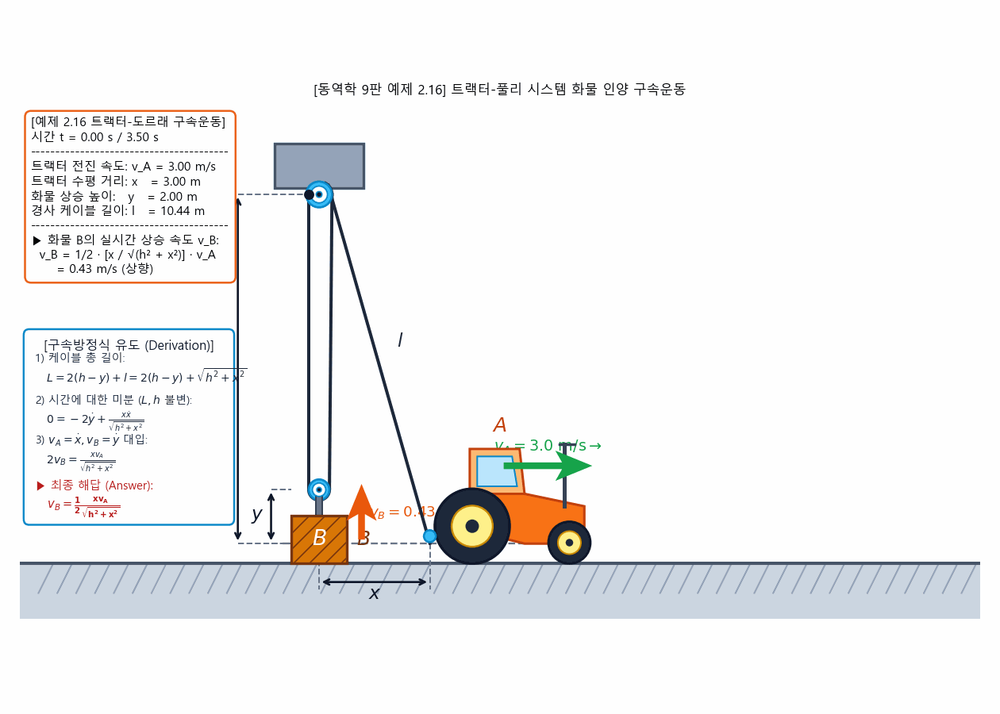
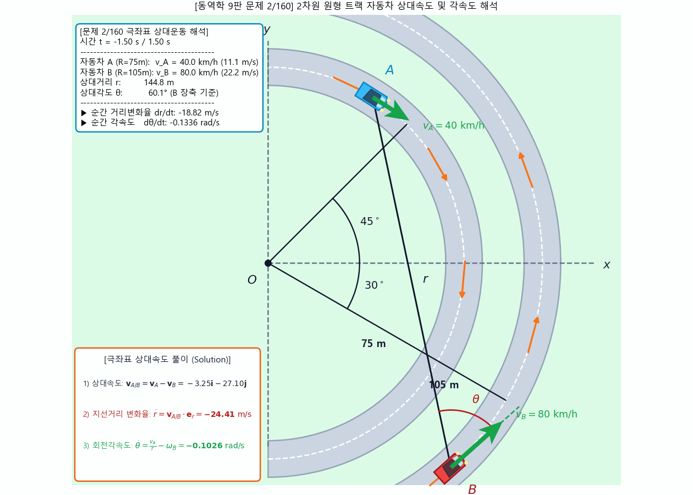
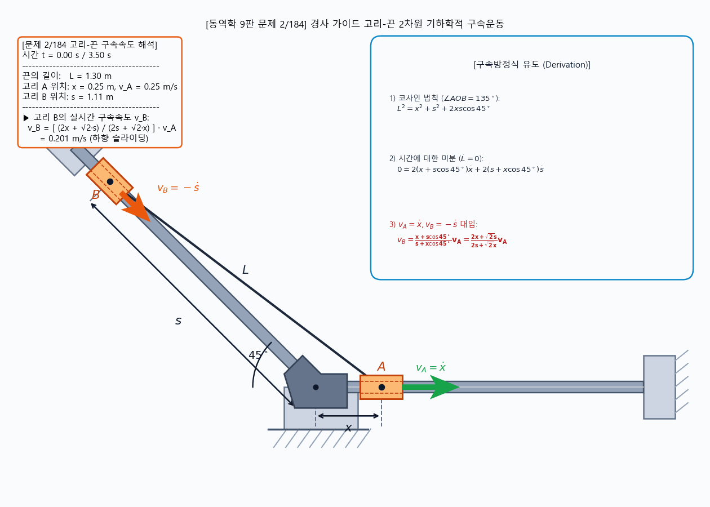
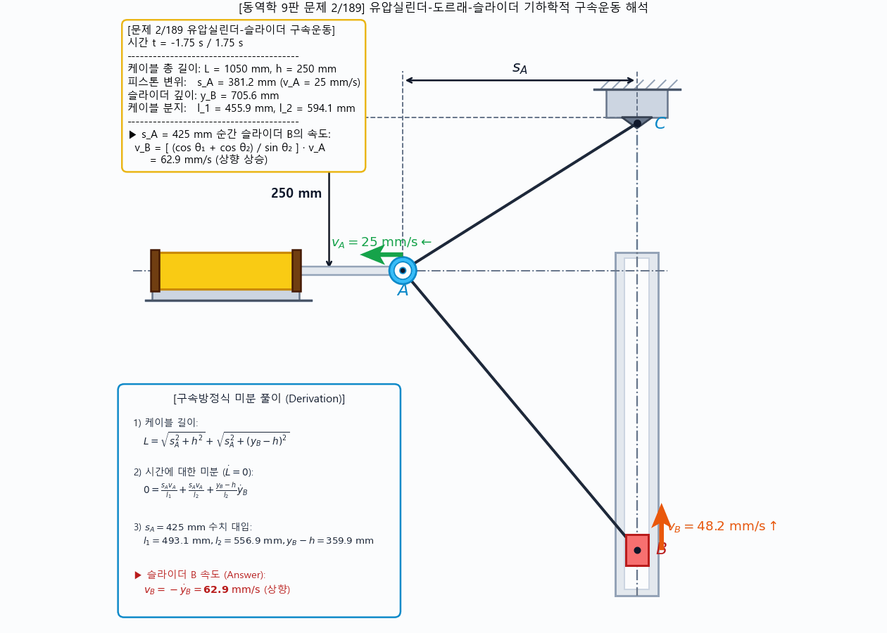
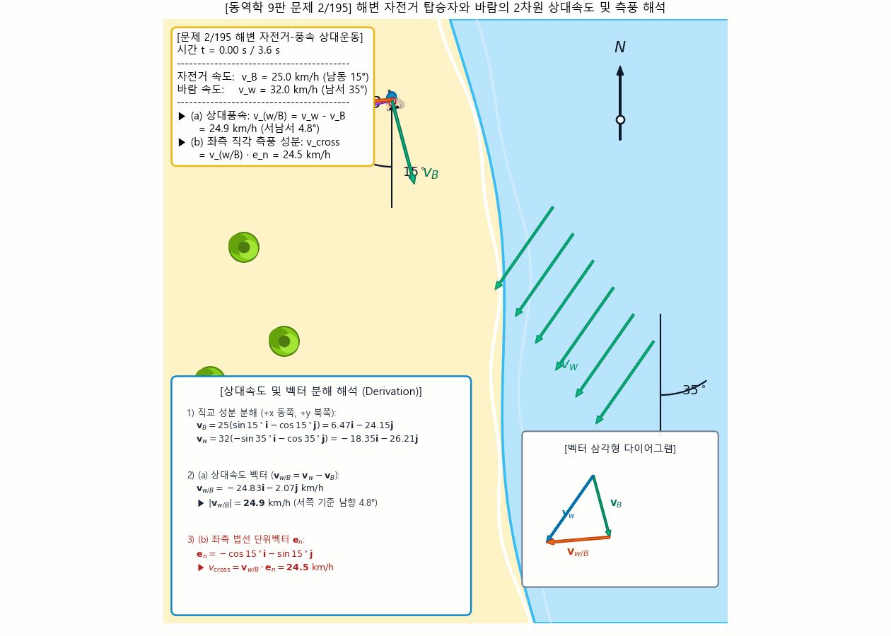

# 제4주차: 상대운동 및 구속운동 동역학 실습 (Relative & Constrained Motion)

> **Author / Rights Holder:** 전북대학교 생물산업기계공학과 유동수 (ryudongsoo@jbnu.ac.kr, ryudongsoo@gmail.com)

---

## 1. 개요 및 학습 목표
- **과목명**: 생물역학 (Biomechanics)
- **학습 범위**: 동역학 (Meriam & Kraige, 9판) 제2장 질점의 운동학 (Kinematics of Particles)
  - 제2.7절 3차원 공간곡선운동 (Space Curvilinear Motion)
  - 제2.8절 상대운동 (축의 병진이동, Relative Motion)
  - 제2.9절 연결된 질점의 구속운동 (Constrained Motion of Connected Particles)
- **목표**:
  - 교재 동역학 9판의 공식 본문 예제(Examples 2.12~2.16) 및 중급 연습문제(Problems)의 수식화 및 시뮬레이션
  - Python 기반 30 FPS 동적 시뮬레이션 애니메이션 구현

---

## 2. 교재 공식 예제 (Examples 2.12 ~ 2.16)

### 📌 [예제 2.12] 항공기 이륙 3차원 공간곡선운동 (원통/구면좌표계)
- **교재 원전**: 동역학 9판 제2장 2.7절 예제 2.12 (p.57)
- **문제 조건**: $v_0 = 250\text{ km/h}$, $15^\circ$ 상승각, $a = 0.8\text{ m/s}^2$, $t = 60\text{ s}$
- **수치해석 스크립트**: [`ex2_12_airplane_climb.py`](ex2_12_airplane_climb.py)
- **시뮬레이션 애니메이션**:



---

### 📌 [예제 2.13] 제트여객기-항공기 2차원 상대속도 벡터 해석
- **교재 원전**: 동역학 9판 제2장 2.8절 예제 2.13 (p.64)
- **문제 조건**: 여객기 A ($800\text{ km/h}$, 동향), 항공기 B 실제방향 $45^\circ$, 관측 상대방향 $60^\circ$ $\implies v_B = 717.7\text{ km/h}, v_{B/A} = 585.6\text{ km/h}$
- **수치해석 스크립트**: [`ex2_13_plane_crosswind.py`](ex2_13_plane_crosswind.py)
- **시뮬레이션 애니메이션**:



---

### 📌 [예제 2.14] 직선 가속 자동차-커브길 자동차 상대속도 및 상대가속도
- **교재 원전**: 동역학 9판 제2장 2.8절 예제 2.14 (p.65)
- **문제 조건**: 자동차 A ($72\text{ km/h}, a_A = 1.2\text{ m/s}^2$), 자동차 B ($54\text{ km/h}, R = 150\text{ m}$) $\implies |v_{B/A}| = 18.23\text{ m/s}, |a_{B/A}| = 2.05\text{ m/s}^2$
- **수치해석 스크립트**: [`ex2_14_car_curve.py`](ex2_14_car_curve.py)
- **시뮬레이션 애니메이션**:



---

### 📌 [예제 2.15] 복합 풀리 도르래 시스템 구속속도
- **교재 원전**: 동역학 9판 제2장 2.9절 예제 2.15 (p.73)
- **문제 조건**: $L = 3y_B + 2y_A + C \implies 3\dot{y}_B + 2\dot{y}_A = 0$, $v_A = +0.3\text{ m/s} \implies v_B = -0.2\text{ m/s}$ (상향)
- **수치해석 스크립트**: [`ex2_15_pulley_2d.py`](ex2_15_pulley_2d.py)
- **시뮬레이션 애니메이션**:



---

### 📌 [예제 2.16] 트랙터-도르래 2차원 기하학적 구속운동
- **교재 원전**: 동역학 9판 제2장 2.9절 예제 2.16 (p.73)
- **문제 조건**: $L = 2(h - y) + \sqrt{h^2 + x^2} \implies v_B = \dot{y} = \frac{1}{2} \frac{x v_A}{\sqrt{h^2 + x^2}}$
- **수치해석 스크립트**: [`ex2_16_tractor_pulley.py`](ex2_16_tractor_pulley.py)
- **시뮬레이션 애니메이션**:



---

## 3. 선발 교재 연습문제 (Selected Problems)

### 📌 [문제 2/160] 2차원 동심원 트랙 자동차의 극좌표 상대속도 및 각속도
- **교재 원전**: 동역학 9판 제2장 2.8절 연습문제 2/160 (p.67)
- **문제 조건**: $R_A = 75\text{ m}$ ($45^\circ$, $v_A = 40\text{ km/h}$ 시계방향), $R_B = 105\text{ m}$ ($-30^\circ$, $v_B = 80\text{ km/h}$ 반시계방향)
- **해석 결과**: $\dot{r} = -24.41\text{ m/s}$ (거리 감소율), $\dot{\theta} = -0.1026\text{ rad/s}$ (차량 B 장축 기준 상대각속도)
- **수치해석 스크립트**: [`prob2_160_cars_intersection.py`](prob2_160_cars_intersection.py)
- **시뮬레이션 애니메이션**:



---

### 📌 [문제 2/184] 경사 가이드 고리-끈 2차원 구속운동
- **교재 원전**: 동역학 9판 제2장 2.9절 연습문제 2/184 (p.76)
- **문제 조건**: $L^2 = x^2 + s^2 + 2xs\cos 45^\circ \implies v_B = -\dot{s} = \frac{x + s\cos 45^\circ}{s + x\cos 45^\circ} v_A = \frac{2x + \sqrt{2}s}{2s + \sqrt{2}x} v_A$
- **수치해석 스크립트**: [`prob2_184_sliders_cable.py`](prob2_184_sliders_cable.py)
- **시뮬레이션 애니메이션**:



---

### 📌 [문제 2/189] 유압실린더-도르래-슬라이더 기하학적 구속운동
- **교재 원전**: 동역학 9판 제2장 2.9절 연습문제 2/189 (p.77)
- **문제 조건**: $L = \sqrt{s_A^2 + h^2} + \sqrt{s_A^2 + (y_B - h)^2} = 1050\text{ mm}$, $h = 250\text{ mm}$, $v_A = 25\text{ mm/s}$ (좌향 이동)
- **해석 결과**: $s_A = 425\text{ mm}$ 순간 $l_1 = 493.1\text{ mm}$, $l_2 = 556.9\text{ mm}$, $y_B - h = 359.9\text{ mm} \implies v_B = -\dot{y}_B = \mathbf{62.9\text{ mm/s}}$ (상향 상승)
- **수치해석 스크립트**: [`prob2_189_cylinder_slider.py`](prob2_189_cylinder_slider.py)
- **시뮬레이션 애니메이션**:



---

### 📌 [문제 2/195] 해변 자전거와 바람의 2차원 상대속도 및 측풍
- **교재 원전**: 동역학 9판 제2장 복습 연습문제 2/195 (p.80)
- **문제 조건**: 자전거 $v_B = 25\text{ km/h}$ (남동 $15^\circ$), 바람 $v_w = 32\text{ km/h}$ (남서 $35^\circ$)
- **해석 결과**: 
  - (a) 상대풍속: $\mathbf{v}_{w/B} = \mathbf{v}_w - \mathbf{v}_B = -24.83\mathbf{i} - 2.07\mathbf{j}\text{ km/h} \implies |\mathbf{v}_{w/B}| = \mathbf{24.9\text{ km/h}}$ (서쪽 기준 남향 $4.8^\circ$)
  - (b) 좌측 직각 측풍: $v_{\text{cross}} = \mathbf{v}_{w/B} \cdot \mathbf{e}_n = \mathbf{24.5\text{ km/h}}$
- **수치해석 스크립트**: [`prob2_195_beach_cyclist.py`](prob2_195_beach_cyclist.py)
- **시뮬레이션 애니메이션**:



---

## 4. 실습 파일 구조
```
biomechanics/ko/week4/
├── ex2_12_airplane_climb.py          # 교재 예제 2.12 파이썬 코드
├── ex2_12_airplane_climb.gif         # 교재 예제 2.12 시뮬레이션 GIF
├── ex2_13_plane_crosswind.py         # 교재 예제 2.13 파이썬 코드
├── ex2_13_plane_crosswind.gif        # 교재 예제 2.13 시뮬레이션 GIF
├── ex2_14_car_curve.py               # 교재 예제 2.14 파이썬 코드
├── ex2_14_car_curve.gif              # 교재 예제 2.14 시뮬레이션 GIF
├── ex2_15_pulley_2d.py               # 교재 예제 2.15 파이썬 코드
├── ex2_15_pulley_2d.gif              # 교재 예제 2.15 시뮬레이션 GIF
├── ex2_16_tractor_pulley.py          # 교재 예제 2.16 파이썬 코드
├── ex2_16_tractor_pulley.gif         # 교재 예제 2.16 시뮬레이션 GIF
├── prob2_160_cars_intersection.py    # 교재 문제 2/160 파이썬 코드
├── prob2_160_cars_intersection.gif   # 교재 문제 2/160 시뮬레이션 GIF
├── prob2_184_sliders_cable.py        # 교재 문제 2/184 파이썬 코드
├── prob2_184_sliders_cable.gif       # 교재 문제 2/184 시뮬레이션 GIF
├── prob2_189_cylinder_slider.py      # 교재 문제 2/189 파이썬 코드
├── prob2_189_cylinder_slider.gif     # 교재 문제 2/189 시뮬레이션 GIF
├── prob2_195_beach_cyclist.py        # 교재 문제 2/195 파이썬 코드
├── prob2_195_beach_cyclist.gif       # 교재 문제 2/195 시뮬레이션 GIF
└── README.md                         # 4주차 종합 실습 가이드
```

---

## 📝 변경 이력 (Changelog)
- **2026-11-01 23:35:00** [[Dongsoo Ryu](mailto:ryudongsoo@jbnu.ac.kr)] feat: 1~15주차 생물역학 한·영 시뮬레이션 포트폴리오 및 보충 개념 애니메이션 통합 배포
