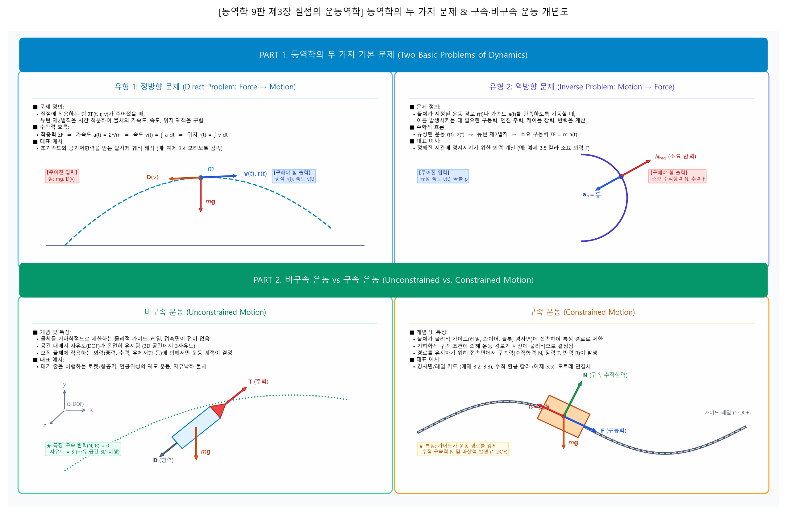
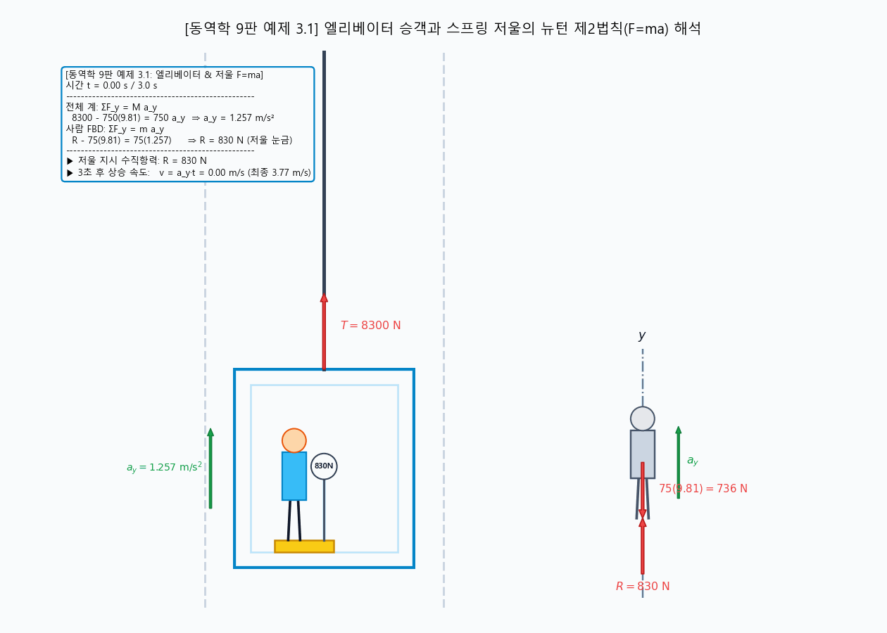
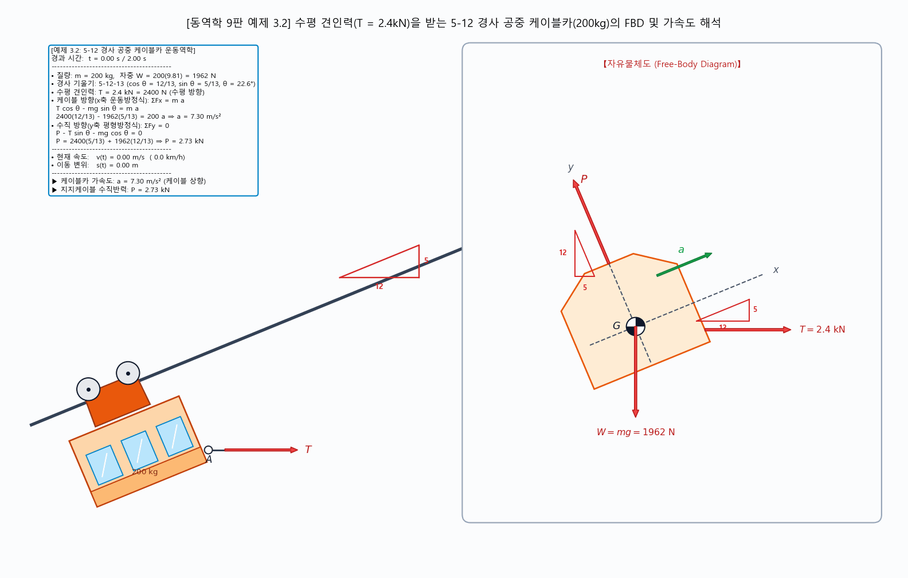
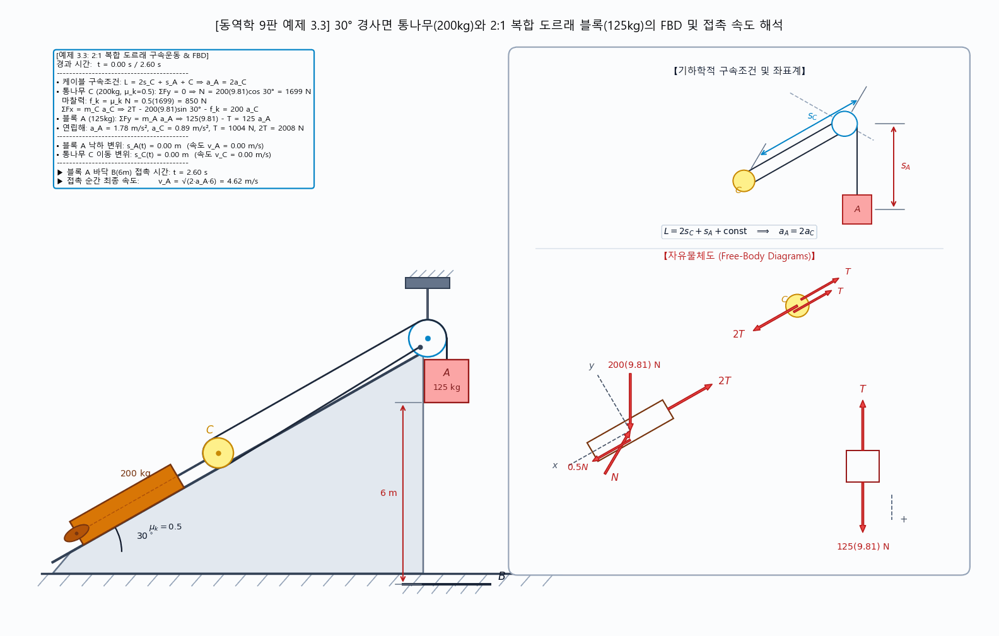
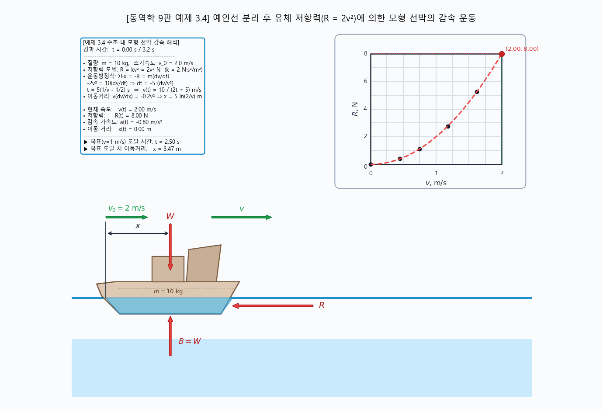
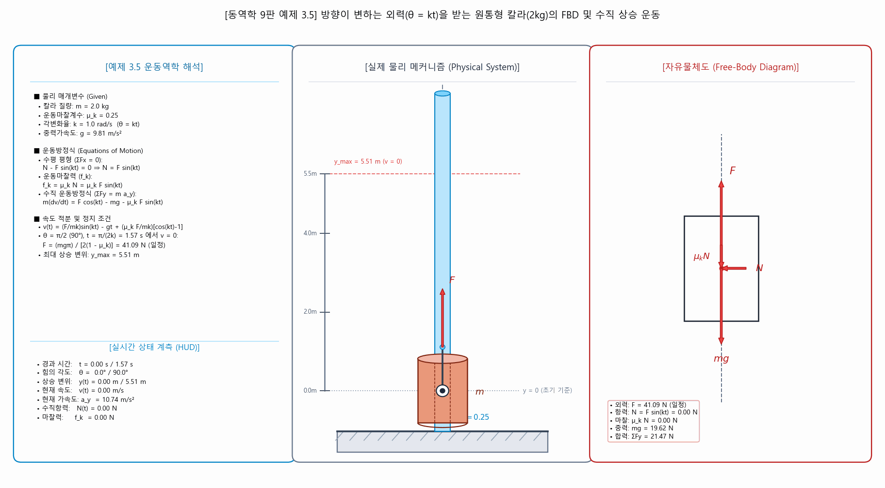
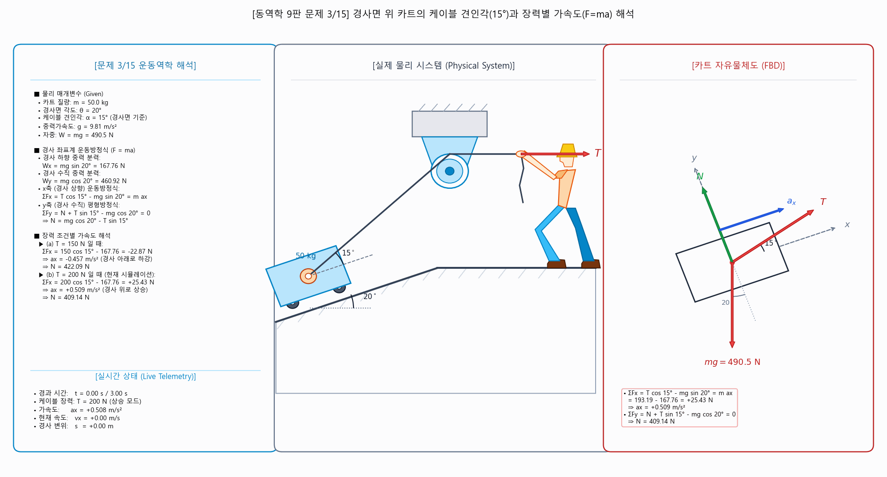
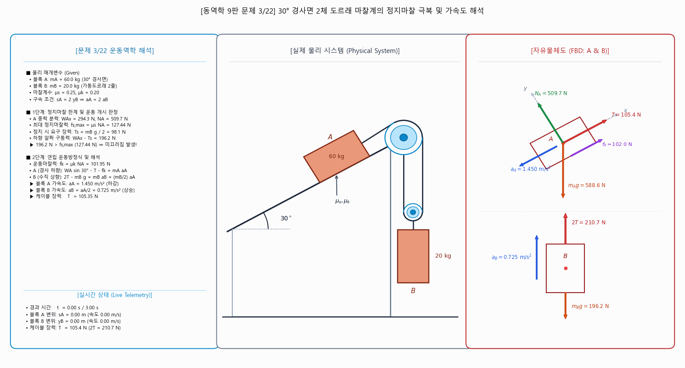
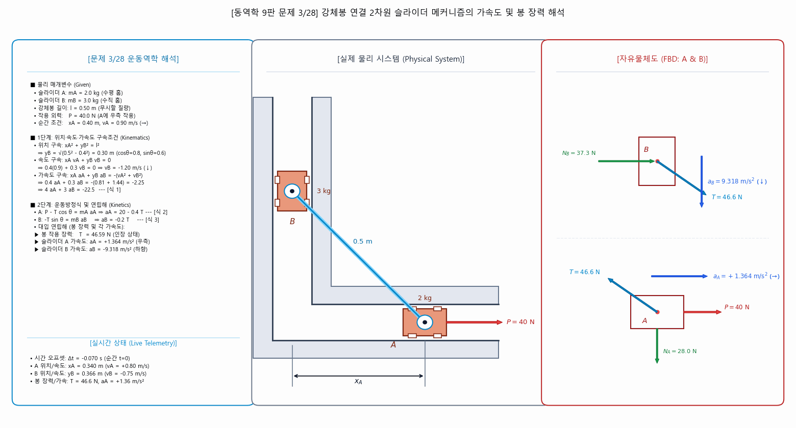
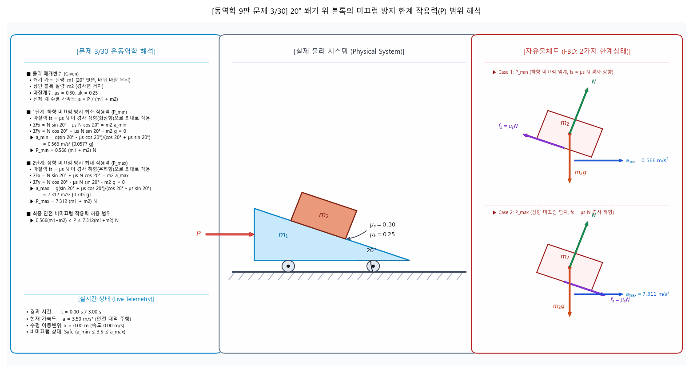

# 제5주차: 질점의 운동역학 (직선운동 F=ma 직교좌표계 실습)

> **Author / Rights Holder:** 전북대학교 생물산업기계공학과 유동수 (ryudongsoo@jbnu.ac.kr, ryudongsoo@gmail.com)

---

## 1. 개요 및 학습 목표
- **과목명**: 생물역학 (Biomechanics)
- **학습 범위**: 동역학 (Meriam & Kraige, 9판) 제3장 질점의 운동역학 (Kinetics of Particles)
  - 제3.1절~3.3절: 뉴턴의 제2법칙 및 자유물체도(FBD), 관성좌표계
  - 제3.4절: 직선운동 및 직교좌표계 운동방정식 ($\Sigma F_x = ma_x, \Sigma F_y = ma_y$)
- **학습 목표**:
  - 마찰력, 장력, 경사면 중력 분력, 다체 구속계의 FBD 모델링 및 가속도 해석
  - 비선형 유체 저항력($R=kv^2$)에 대한 미분방정식 변수분리 적분 해석
  - Python 수치 시뮬레이션 및 30 FPS 동적 GIF 렌더링을 통한 시각화 검증

---

## 2. 동역학의 기본 원리 및 핵심 개념

### 📌 [개념도] 동역학의 두 가지 문제 & 구속·비구속 운동


#### 1) 동역학의 두 가지 기본 문제 (Two Basic Problems of Dynamics)
- **유형 1: 정방향 문제 (Direct Problem: Force $\to$ Motion)**
  - **정의**: 질점에 작용하는 힘 $\Sigma\mathbf{F}(t, \mathbf{r}, \mathbf{v})$가 주어졌을 때, 뉴턴의 제2법칙을 시간 적분하여 물체의 **가속도 $\mathbf{a}(t)$, 속도 $\mathbf{v}(t)$, 위치 궤적 $\mathbf{r}(t)$**를 구하는 문제
  - **수학적 흐름**: $\Sigma\mathbf{F} \implies \mathbf{a} = \frac{\Sigma\mathbf{F}}{m} \implies \mathbf{v}(t) = \int\mathbf{a}\,dt \implies \mathbf{r}(t) = \int\mathbf{v}\,dt$
  - **대표 예시**: 공기저항을 받는 포물선 발사체, 비선형 유체 저항을 받는 모터보트 감속 ([예제 3.4](ex3_4_boat_resistance.py))
- **유형 2: 역방향 문제 (Inverse Problem: Motion $\to$ Force)**
  - **정의**: 물체의 규정된 운동 경로 $\mathbf{r}(t)$나 가속도 $\mathbf{a}(t)$가 주어졌을 때, 이를 발생시키는 데 필요한 **소요 구동력, 엔진 추력, 케이블 장력, 접촉 반력**을 구하는 문제
  - **수학적 흐름**: 규정된 운동 $\mathbf{r}(t), \mathbf{a}(t) \implies \Sigma\mathbf{F}_{\text{req}} = m\mathbf{a}(t)$
  - **대표 예시**: 정해진 각도/시간에서 정지시키기 위한 요구 구동력 산출 ([예제 3.5](ex3_5_collar_rod_force.py)), 롤러코스터 루프 상의 소요 수직항력 $N_{\text{req}}$

#### 2) 비구속 운동과 구속 운동 (Unconstrained vs. Constrained Motion)
- **비구속 운동 (Unconstrained Motion)**
  - **특징**: 물리적 가이드, 레일, 슬롯, 접촉면 등의 기하학적 제약 없이 3차원 자유 공간을 이동 (3-DOF 유지)
  - **지배 요인**: 물체에 작용하는 외력(중력, 엔진 추력, 공기역학적 항력/양력)에 의해서만 운동 궤적이 결정됨 (구속 반력 $N = 0$)
  - **대표 예시**: 대기 중 비행하는 로켓/항공기, 인공위성의 궤도 운동, 자유낙하 물체
- **구속 운동 (Constrained Motion)**
  - **특징**: 물체가 물리적 가이드(레일, 와이어, 슬롯, 경사면)에 접촉하여 특정 1차원/2차원 경로로만 이동이 제한됨 (자유도 감소)
  - **구속력 발생**: 운동 경로를 강제하기 위해 접촉면에서 자동으로 **구속 수직항력($N$), 접촉 마찰력($f_k$), 케이블 장력($T$)**이 발생
  - **대표 예시**: 경사면/케이블 카트 ([예제 3.2](ex3_2_cable_car.py), [문제 3/15](prob3_15_cart_incline.py)), 복합 도르래 연동계 ([예제 3.3](ex3_3_cart_incline_blocks.py)), 수직 가이드 봉 칼라 ([예제 3.5](ex3_5_collar_rod_force.py))

---

## 3. 교재 공식 대표 예제 (Sample Problems)

### 📌 [예제 3.1] 케이블로 인양되는 엘리베이터와 저울 위 탑승자 수직력 해석
- **교재 원전**: 동역학 9판 제3장 3.4절 Sample Problem 3/1
- **문제 조건**:
  - 체중 $m_p = 75\text{ kg}$인 사람 ($W_p = 75 \times 9.81 = 736\text{ N}$)
  - 엘리베이터, 저울 및 사람의 총 질량 $M = 750\text{ kg}$ ($W_{tot} = 750 \times 9.81 = 7360\text{ N}$)
  - 케이블 견인력 $T = 8300\text{ N}$
  - 운행 시간: $t = 3.0\text{ s}$
- **이론 수치 해석**:
  - 전체 계의 운동방정식: $\Sigma F_y = T - W_{tot} = M a_y \implies 8300 - 7360 = 750 a_y \implies a_y = 1.257\text{ m/s}^2$ (상향 가속)
  - 탑승자 FBD 및 저울 눈금 $R$: $\Sigma F_y = R - W_p = m_p a_y \implies R - 736 = 75(1.257) \implies R = 830\text{ N}$
  - 3초 후 엘리베이터 상승 속도: $v = a_y t = 1.257 \times 3.0 = 3.77\text{ m/s}$
- **수치해석 스크립트**: [`ex3_1_elevator_scale.py`](ex3_1_elevator_scale.py)
- **시뮬레이션 애니메이션**:



---

### 📌 [예제 3.2] 경사 케이블로 견인되는 화물 운반차의 가속도 및 수직 반력
- **교재 원전**: 동역학 9판 제3장 3.4절 Sample Problem 3/2
- **문제 조건**:
  - 질량 $m = 200\text{ kg}$ 케이블카 ($W = 200 \times 9.81 = 1962\text{ N}$)
  - 케이블 장력 $T = 2.4\text{ kN} = 2400\text{ N}$ (5-12-13 경사 삼각형 작용: $\cos\theta = 12/13, \sin\theta = 5/13$)
  - 마찰 무시
- **이론 수치 해석**:
  - 케이블 방향($x$축) 운동방정식: $\Sigma F_x = T\cos\theta - mg\sin\theta = m a \implies 2400(12/13) - 1962(5/13) = 200 a \implies a = 7.30\text{ m/s}^2$
  - 수직 방향($y$축) 평형: $\Sigma F_y = P - mg\cos\theta - T\sin\theta = 0 \implies P = 1962(12/13) + 2400(5/13) = 2734\text{ N} = 2.73\text{ kN}$
- **수치해석 스크립트**: [`ex3_2_cable_car.py`](ex3_2_cable_car.py)
- **시뮬레이션 애니메이션**:



---

### 📌 [예제 3.3] 30° 경사면 통나무와 2:1 복합 도르래 블록의 접촉 속도 해석
- **교재 원전**: 동역학 9판 제3장 3.4절 Sample Problem 3/3
- **문제 조건**:
  - 콘크리트 블록 A: $m_A = 125\text{ kg}$, 낙하 높이 $h = 6.0\text{ m}$
  - 경사면 통나무 C: $m_C = 200\text{ kg}$, 경사각 $30^\circ$, 운동마찰계수 $\mu_k = 0.5$
  - 케이블 구속조건: $L = 2 s_C + s_A + C \implies a_A = 2 a_C$
- **이론 수치 해석**:
  - 통나무 C FBD: $2T - m_C g \sin 30^\circ - \mu_k m_C g \cos 30^\circ = m_C a_C \implies 2T - 200(9.81)\sin 30^\circ - 0.5(200)(9.81)\cos 30^\circ = 100 a_A$
  - 블록 A FBD: $m_A g - T = m_A a_A \implies 125(9.81) - T = 125 a_A$
  - 연립해: $a_A = 1.777\text{ m/s}^2$, $a_C = 0.888\text{ m/s}^2$, $T = 1004\text{ N}$
  - 바닥 B 접촉 시 속도: $v_A = \sqrt{2 a_A s_A} = \sqrt{2 \times 1.777 \times 6.0} = 4.62\text{ m/s}$
- **수치해석 스크립트**: [`ex3_3_cart_incline_blocks.py`](ex3_3_cart_incline_blocks.py)
- **시뮬레이션 애니메이션**:



---

### 📌 [예제 3.4] 비선형 유체 저항력($R=2v^2$)을 받는 모터보트의 감속 정지 해석
- **교재 원전**: 동역학 9판 제3장 3.4절 Sample Problem 3/4
- **문제 조건**:
  - 질량 $m = 10\text{ kg}$ (축소모형/물체), 초기속도 $v_0 = 2\text{ m/s}$
  - 비선형 유체 항력: $R = 2 v^2\text{ N}$ ($F = -2v^2$)
  - 감속 목표 속도: $v_1 = 1.0\text{ m/s}$ ($v_0$의 $50\%$)
- **이론 수치 해석**:
  - 운동방정식: $m \frac{dv}{dt} = -2v^2 \implies \frac{dv}{v^2} = -\frac{2}{10} dt = -0.2 dt$
  - 속도 적분식: $\int_{2}^{v} v^{-2} dv = -0.2 t \implies v(t) = \frac{10}{5 + 2t}$
  - $v = 1.0\text{ m/s}$ 도달 시간: $1.0 = \frac{10}{5+2t} \implies t = 2.5\text{ s}$
  - 이동 거리 적분: $x(t) = \int_{0}^{t} \frac{10}{5+2\tau} d\tau = 5 \ln\left(\frac{5+2t}{5}\right)$
  - $t = 2.5\text{ s}$ 시점 이동거리: $x(2.5) = 5\ln(2) = 3.47\text{ m}$
- **수치해석 스크립트**: [`ex3_4_boat_resistance.py`](ex3_4_boat_resistance.py)
- **시뮬레이션 애니메이션**:



---

### 📌 [예제 3.5] 가변 방향 외력($\theta = kt$)을 받는 수직 봉 칼라의 FBD 및 수직 상승 운동
- **교재 원전**: 동역학 9판 제3장 3.4절 Sample Problem 3/5
- **문제 조건**:
  - 수직 고정 가이드 봉을 따라 움직이는 질량 $m = 2.0\text{ kg}$ 원통형 칼라
  - 접촉면 운동마찰계수 $\mu_k = 0.25$, 각변화율 $k = 1.0\text{ rad/s}$ ($\theta = kt$)
  - 외력 $F$의 작용각 $\theta = 0^\circ$에서 수직 상향으로 시작하여 $\theta = 90^\circ$까지 회전
- **이론 수치 해석**:
  - 수평 방향 평형 ($\Sigma F_x = 0$): $N = F\sin(kt)$
  - 운동마찰력: $f_k = \mu_k N = \mu_k F \sin(kt)$
  - 수직 방향 운동방정식 ($\Sigma F_y = m \frac{dv}{dt}$):
    $$m\frac{dv}{dt} = F\cos(kt) - mg - \mu_k F\sin(kt)$$
  - 속도 적분식:
    $$m v(t) = \frac{F}{k}\sin(kt) - mgt + \frac{\mu_k F}{k}[\cos(kt) - 1]$$
  - $\theta = 90^\circ\ (\frac{\pi}{2}\text{ rad}),\ t = 1.57\text{ s}$에서 정지($v = 0$) 조건:
    $$F = \frac{mg\pi}{2(1-\mu_k)} = \frac{2.0 \times 9.81 \times \pi}{2 \times 0.75} = \mathbf{41.09\text{ N}}\ \text{(일정)}$$
  - 최대 상승 스트로크 변위: $y_{\max} = \mathbf{5.51\text{ m}}$
- **수치해석 스크립트**: [`ex3_5_collar_rod_force.py`](ex3_5_collar_rod_force.py)
- **시뮬레이션 애니메이션**:



---

## 4. 선발 교재 연습문제 목록 및 시뮬레이션

### 📌 [문제 3/15] 20° 경사면 위 카트의 케이블 견인각(15°)과 장력별 가속도(F=ma) 해석
- **교재 원전**: 동역학 9판 제3장 3.4절 연습문제 3/15
- **문제 조건**:
  - $20^\circ$ 경사면 위에 놓인 질량 $50\text{ kg}$ 카트
  - 케이블 견인 각도: 경사면 기준 $\alpha = 15^\circ$ 상향 각도
  - 경사 하향 중력 분력: $W_x = mg\sin 20^\circ = 167.76\text{ N}$
  - (a) 케이블 장력 $T = 150\text{ N}$ 일 때:
    - $\Sigma F_x = 150\cos 15^\circ - 167.76 = 144.89 - 167.76 = -22.87\text{ N} \implies a = -0.457\text{ m/s}^2$ (경사면 아래로 하강 가속)
  - (b) 케이블 장력 $T = 200\text{ N}$ 일 때:
    - $\Sigma F_x = 200\cos 15^\circ - 167.76 = 193.19 - 167.76 = +25.43\text{ N} \implies a = +0.509\text{ m/s}^2$ (경사면 위로 상승 가속)
- **수치해석 스크립트**: [`prob3_15_cart_incline.py`](prob3_15_cart_incline.py)
- **시뮬레이션 애니메이션**:



---

### 📌 [문제 3/22] 30° 경사면 2체 도르래 마찰계의 정지마찰 극복 및 가속도 해석
- **교재 원전**: 동역학 9판 제3장 3.4절 연습문제 3/22
- **문제 조건**:
  - 블록 A ($60\text{ kg}$, $30^\circ$ 경사면, $\mu_s = 0.25, \mu_k = 0.20$), 2줄 가동 도르래 매달린 블록 B ($20\text{ kg}$)
  - 구속조건: $s_A = 2 y_B \implies a_A = 2 a_B$
  - 블록 A 중력 분력: $W_{Ax} = 60(9.81)\sin 30^\circ = 294.3\text{ N}$, 수직항력 $N_A = 509.74\text{ N}$
  - 최대 정지마찰력: $f_{s,max} = \mu_s N_A = 0.25 \times 509.74 = 127.44\text{ N}$
  - 정지 상태 요구 장력: $T_s = m_B g / 2 = 98.1\text{ N}$
  - 하향 알짜 구동력: $W_{Ax} - T_s = 294.3 - 98.1 = 196.2\text{ N} > f_{s,max} (127.44\text{ N}) \implies$ **미끄러짐 발생! (하향 가속)**
  - 운동마찰력: $f_k = 0.20 \times 509.74 = 101.95\text{ N}$
  - 연립 운동방정식 해:
    - 블록 A 가속도: $a_A = \frac{294.3 - 101.95 - 98.1}{60 + 5} = 1.450\text{ m/s}^2$ (경사면 아래로 하강 가속)
    - 블록 B 가속도: $a_B = a_A / 2 = 0.725\text{ m/s}^2$ (상향 상승 가속)
    - 케이블 장력: $T = 105.4\text{ N}$
- **수치해석 스크립트**: [`prob3_22_pulley_incline.py`](prob3_22_pulley_incline.py)
- **시뮬레이션 애니메이션**:



---

### 📌 [문제 3/28] 강체봉 연결 2차원 슬라이더 메커니즘의 가속도 및 봉 장력 해석
- **교재 원전**: 동역학 9판 제3장 3.4절 연습문제 3/28
- **문제 조건**:
  - 수평 슬라이더 A ($m_A = 2\text{ kg}$), 수직 슬라이더 B ($m_B = 3\text{ kg}$), 가벼운 강체봉 길이 $l = 0.5\text{ m}$
  - 순간 위치 $x_A = 0.4\text{ m} \implies y_B = \sqrt{0.5^2 - 0.4^2} = 0.3\text{ m}$, 속도 $v_A = 0.9\text{ m/s}$ (우측)
  - 외력 $P = 40\text{ N}$ 작용 (수평면 내 마찰 무시 홈)
- **이론 수치 해석**:
  - 속도 구속식: $x_A v_A + y_B v_B = 0 \implies 0.4(0.9) + 0.3 v_B = 0 \implies v_B = -1.20\text{ m/s}$ (하향)
  - 가속도 구속식: $x_A a_A + y_B a_B = -(v_A^2 + v_B^2) \implies 4 a_A + 3 a_B = -22.5$
  - 운동방정식 (봉 장력 $T$):
    - 슬라이더 A: $P - T\cos\theta = m_A a_A \implies 40 - 0.8 T = 2 a_A$
    - 슬라이더 B: $-T\sin\theta = m_B a_B \implies -0.6 T = 3 a_B \implies a_B = -0.2 T$
  - 연립해:
    - 슬라이더 A 가속도: $a_A = +1.364\text{ m/s}^2$ (우측 방향)
    - 슬라이더 B 가속도: $a_B = -9.318\text{ m/s}^2$ (하향 방향)
    - 강체봉 작용력: $T = 46.6\text{ N}$ (인장력)
- **수치해석 스크립트**: [`prob3_28_rigid_rod_sliders.py`](prob3_28_rigid_rod_sliders.py)
- **시뮬레이션 애니메이션**:



---

### 📌 [문제 3/30] 20° 쐐기 위 블록의 미끄럼 방지 한계 작용력(P) 범위 해석
- **교재 원전**: 동역학 9판 제3장 3.4절 연습문제 3/30
- **문제 조건**:
  - $20^\circ$ 쐐기 $m_1$ 위에 놓인 블록 $m_2$ ($\mu_s = 0.30, \mu_k = 0.25$, 바퀴 마찰 무시)
  - 전체 계 가속도 $a = \frac{P}{m_1 + m_2}$
- **이론 수치 해석**:
  - (1) 하향 미끄럼 한계 (마찰력 $f = +\mu_s N$ 상향 작용):
    - $a_{min} = g\frac{\sin 20^\circ - \mu_s\cos 20^\circ}{\cos 20^\circ + \mu_s\sin 20^\circ} = 9.81 \times \frac{0.3420 - 0.2819}{0.9397 + 0.1026} = 0.566\text{ m/s}^2$
    - 최소 작용력: $P_{min} = (m_1 + m_2) a_{min} = 0.566(m_1 + m_2)\text{ N} \quad [0.0577(m_1 + m_2)g]$
  - (2) 상향 미끄럼 한계 (마찰력 $f = -\mu_s N$ 하향 작용):
    - $a_{max} = g\frac{\sin 20^\circ + \mu_s\cos 20^\circ}{\cos 20^\circ - \mu_s\sin 20^\circ} = 9.81 \times \frac{0.3420 + 0.2819}{0.9397 - 0.1026} = 7.311\text{ m/s}^2$
    - 최대 작용력: $P_{max} = (m_1 + m_2) a_{max} = 7.311(m_1 + m_2)\text{ N} \quad [0.745(m_1 + m_2)g]$
  - 미끄러지지 않는 안전 작용력 허용 범위:
    $$0.566(m_1+m_2) \le P \le 7.311(m_1+m_2)\text{ N}$$
- **수치해석 스크립트**: [`prob3_30_wedge_blocks.py`](prob3_30_wedge_blocks.py)
- **시뮬레이션 애니메이션**:



---

## 5. 실습 파일 구조
```
biomechanics/ko/week5/
├── concept_dynamics_problems_and_constraints.py   # 동역학 두 가지 문제 & 구속/비구속 개념도 생성 코드
├── concept_dynamics_problems_and_constraints.png  # 동역학 두 가지 문제 & 구속/비구속 개념도 인포그래픽
├── ex3_1_elevator_scale.py                        # 교재 예제 3.1 파이썬 코드
├── ex3_1_elevator_scale.gif                       # 교재 예제 3.1 시뮬레이션 GIF
├── ex3_2_cable_car.py                             # 교재 예제 3.2 파이썬 코드
├── ex3_2_cable_car.gif                            # 교재 예제 3.2 시뮬레이션 GIF
├── ex3_3_cart_incline_blocks.py                   # 교재 예제 3.3 파이썬 코드
├── ex3_3_cart_incline_blocks.gif                  # 교재 예제 3.3 시뮬레이션 GIF
├── ex3_4_boat_resistance.py                       # 교재 예제 3.4 파이썬 코드
├── ex3_4_boat_resistance.gif                      # 교재 예제 3.4 시뮬레이션 GIF
├── ex3_5_collar_rod_force.py                      # 교재 예제 3.5 파이썬 코드
├── ex3_5_collar_rod_force.gif                     # 교재 예제 3.5 시뮬레이션 GIF
├── prob3_15_cart_incline.py                       # 교재 문제 3/15 파이썬 코드
├── prob3_15_cart_incline.gif                      # 교재 문제 3/15 시뮬레이션 GIF
├── prob3_22_pulley_incline.py                     # 교재 문제 3/22 파이썬 코드
├── prob3_22_pulley_incline.gif                    # 교재 문제 3/22 시뮬레이션 GIF
├── prob3_28_rigid_rod_sliders.py                  # 교재 문제 3/28 파이썬 코드
├── prob3_28_rigid_rod_sliders.gif                 # 교재 문제 3/28 시뮬레이션 GIF
├── prob3_30_wedge_blocks.py                       # 교재 문제 3/30 파이썬 코드
├── prob3_30_wedge_blocks.gif                      # 교재 문제 3/30 시뮬레이션 GIF
└── README.md                                      # 5주차 실습 가이드라인
```

---

## 📝 변경 이력 (Changelog)
- **2026-11-01 23:35:00** [[Dongsoo Ryu](mailto:ryudongsoo@jbnu.ac.kr)] feat: 1~15주차 생물역학 한·영 시뮬레이션 포트폴리오 및 보충 개념 애니메이션 통합 배포
