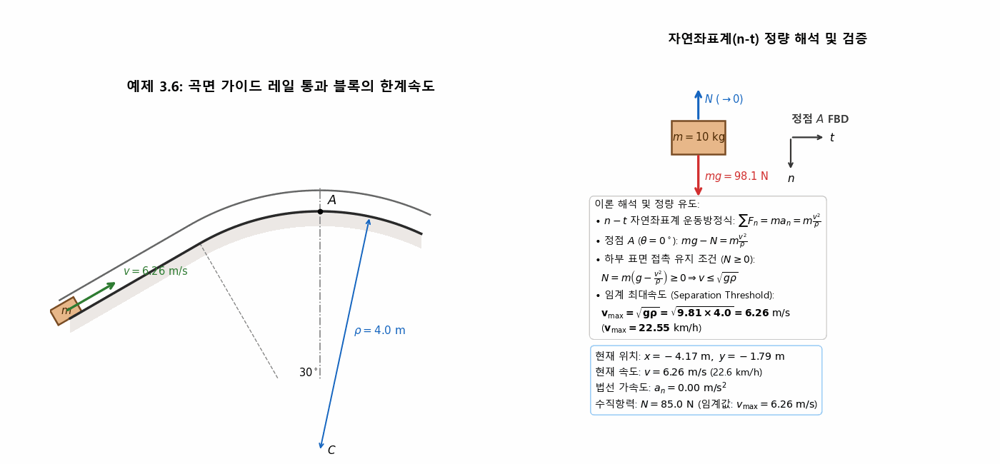
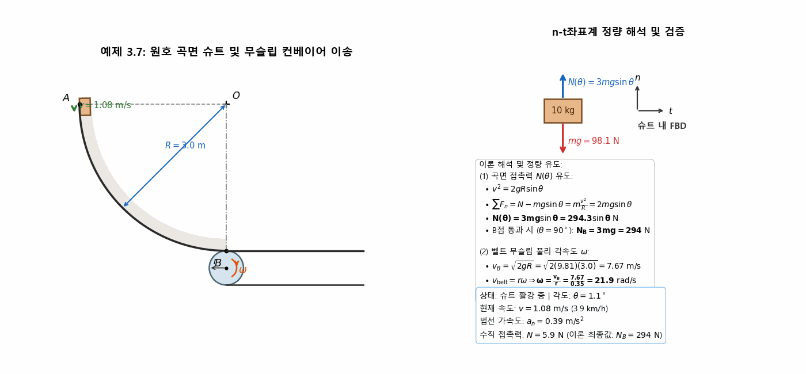
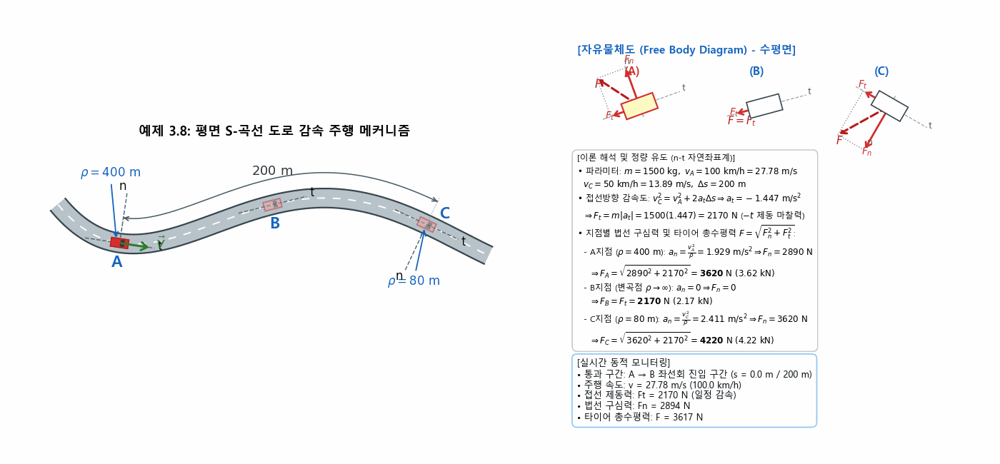
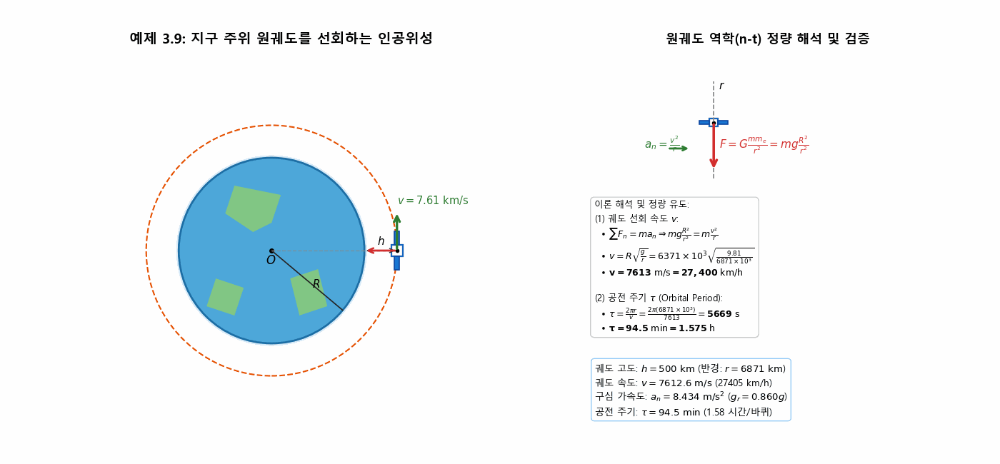
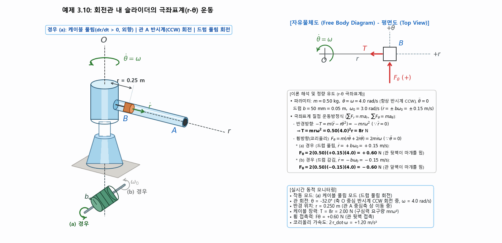
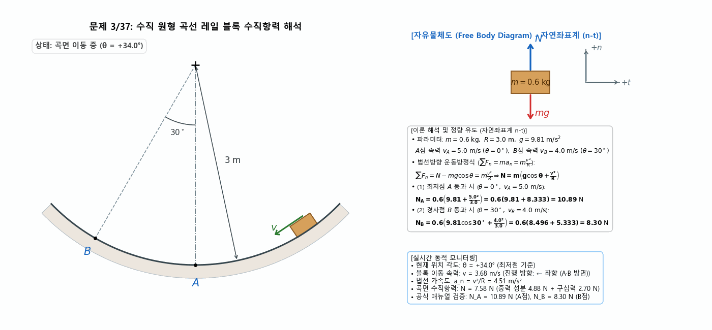
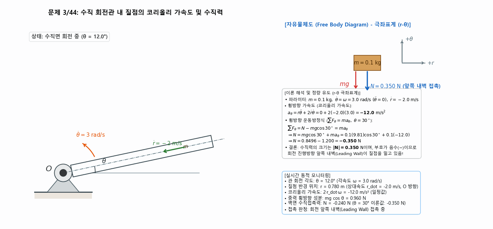
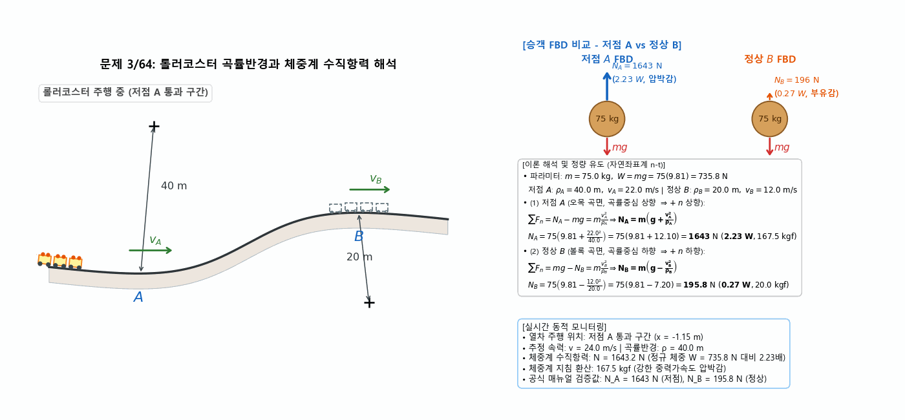
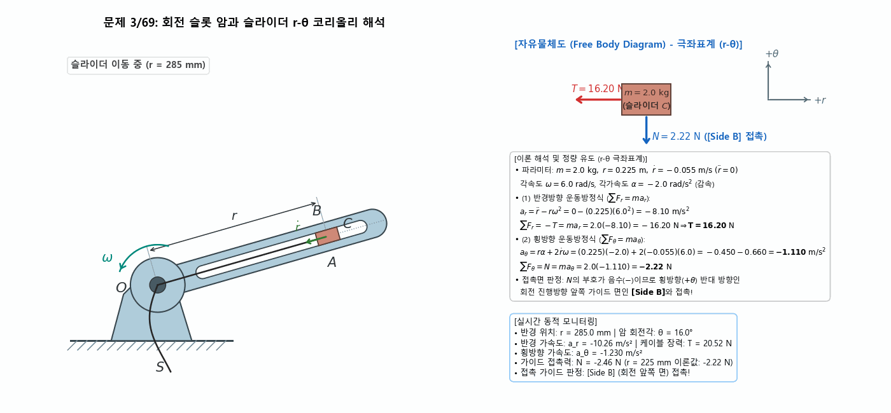

> **Author / Rights Holder:** 전북대학교 생물산업기계공학과 유동수 (ryudongsoo@jbnu.ac.kr, ryudongsoo@gmail.com)

# 6주차: 질점의 운동역학 — 제3장: 곡선운동 (n-t 자연좌표계 및 r-θ 극좌표계)

## 📌 강의 개요 및 학습 목표

- **단원**: 동역학 9판 제3장 질점의 운동역학 — 제3.5절: 곡선운동 (Curvilinear Motion)
- **학습 목표**:
  - 접선-법선 자연좌표계($n-t$): $\sum F_t = m a_t = m \dot{v}$, $\sum F_n = m a_n = m \frac{v^2}{\rho}$
  - 극좌표계($r-\theta$): $\sum F_r = m(\ddot{r} - r\dot{\theta}^2)$, $\sum F_\theta = m(r\ddot{\theta} + 2\dot{r}\dot{\theta})$
  - 곡률반경에 따른 구심가속도 및 표면 접촉 수직항력 $N$의 분리 한계속도($v_{\max} = \sqrt{g\rho}$) 해석
  - 뱅킹 각도 도로 및 원추형 회전면에서의 무미끄럼 한계 속도 해석
  - 회전 가이드 내 반경 방향 이동 질점의 코리올리 가속도($2\dot{r}\dot{\theta}$) 및 구동력/접촉력 FBD 모델링
  - 순수 흰바탕(#ffffff) 교재 동일 원도 시각화 및 실시간 정량 검증

---

## 📋 주차별 학습 콘텐츠 구성

| 구분 | 번호 | 예제/문제명 | 핵심 개념 및 검증 공식 | 산출물 링크 |
|:---:|:---:|:---|:---|:---:|
| **예제** | 3.6 | 곡면 가이드 레일 통과 블록 | $\sum F_n = m\frac{v^2}{\rho} \Rightarrow v_{\max} = \sqrt{g\rho} = \mathbf{6.26\ m/s}$ ($22.6\ \mathrm{km/h}$) | [코드](./ex3_6_curved_track_block.py) \| [GIF](./ex3_6_curved_track_block.gif) |
| **예제** | 3.7 | 원호 곡면 슈트 및 컨베이어 | $N(\theta) = 3mg\sin\theta \Rightarrow N_B = \mathbf{294.3\ N},\ \omega = \frac{\sqrt{2gR}}{r} = \mathbf{21.9\ rad/s}$ | [코드](./ex3_7_chute_conveyor.py) \| [GIF](./ex3_7_chute_conveyor.gif) |
| **예제** | 3.8 | 평면 S-곡선 도로 감속 주행 | $a_t = -1.447\ \mathrm{m/s^2},\ F_t = 2170\ \mathrm{N} \Rightarrow F_A = \mathbf{3620\ N},\ F_B = \mathbf{2170\ N},\ F_C = \mathbf{4220\ N}$ | [코드](./ex3_8_car_curved_road.py) \| [GIF](./ex3_8_car_curved_road.gif) |
| **예제** | 3.9 | 지구 선회 원궤도 인공위성 | $v = R\sqrt{\frac{g}{r}} = \mathbf{7613\ m/s}$ ($27,400\ \mathrm{km/h}$), $\tau = \mathbf{5669\ s}$ ($94.5\ \mathrm{min}$) | [코드](./ex3_9_satellite_orbit.py) \| [GIF](./ex3_9_satellite_orbit.gif) |
| **예제** | 3.10 | 회전관 내 슬라이더 마개 | $T = 8r\ \mathrm{N}$, (a) 언와인딩 $F_\theta = \mathbf{+0.60\ N}$, (b) 와인딩 $F_\theta = \mathbf{-0.60\ N}$ | [코드](./ex3_10_rotating_tube_slider.py) \| [GIF](./ex3_10_rotating_tube_slider.gif) |
| **기초** | 3/37 | 수직 원형 레일 블록 | (a) A점($0^\circ$) $N_A = \mathbf{10.89\ N}$, (b) B점($30^\circ$) $N_B = \mathbf{8.30\ N}$ | [코드](./prob3_37_curved_track_block.py) \| [GIF](./prob3_37_curved_track_block.gif) |
| **기초** | 3/44 | 수직 회전관 내 질점 | $a_\theta = -12.0\ \mathrm{m/s^2} \Rightarrow N = \mathbf{-0.350\ N}$ ($|N| = 0.350\ \mathrm{N}$, 앞쪽 내벽) | [코드](./prob3_44_rotating_tube_particle.py) \| [GIF](./prob3_44_rotating_tube_particle.gif) |
| **심화** | 3/64 | 롤러코스터 체중계 수직항력 | (a) 저점 A($\rho_A=40$) $N_A = \mathbf{1643\ N}$ ($2.23\ W$), (b) 정상 B($\rho_B=20$) $N_B = \mathbf{195.8\ N}$ ($0.27\ W$) | [코드](./prob3_64_rollercoaster_scale.py) \| [GIF](./prob3_64_rollercoaster_scale.gif) |
| **심화** | 3/69 | 회전 슬롯 암과 슬라이더 | $T = \mathbf{16.20\ N}$, $a_\theta = -1.110\ \mathrm{m/s^2} \Rightarrow N = \mathbf{-2.22\ N}$ (Side B 접촉) | [코드](./prob3_69_rotating_arm_slider.py) \| [GIF](./prob3_69_rotating_arm_slider.gif) |

---

## 1. 교재 핵심 예제 (Sample Problems 3/6 ~ 3/10)

### 1.1 예제 3.6: 곡면 가이드 레일을 통과하는 블록의 하부 접촉 유지 한계속도 해석

- **문제 정의**: $m = 10\ \mathrm{kg}$ 블록이 $30^\circ$ 경사로를 지나 곡률반경 $\rho = 4.0\ \mathrm{m}$인 원호 곡면 가이드 레일 정점 $A$를 통과할 때 하부 표면 접촉을 유지할 수 있는 임계 최대속도 $v_{\max}$ 산출
- **역학 해석**:
  - 법선방향 운동방정식: $\sum F_n = mg\cos\theta - N = m \frac{v^2}{\rho}$
  - 정점 $A$ ($\theta = 0^\circ$): $mg - N = m \frac{v^2}{\rho} \implies N = m\left(g - \frac{v^2}{\rho}\right)$
  - 접촉 유지 조건 ($N \geq 0$): $v \leq \sqrt{g\rho} \implies \mathbf{v_{\max} = \sqrt{9.81 \times 4.0} = 6.26\ \mathrm{m/s}\ (22.55\ \mathrm{km/h})}$

---

### 1.2 예제 3.7: 원호 곡면 슈트와 컨베이어 벨트의 무슬립 이송 운동역학 해석

- **문제 정의**: 정지상태 $A$에서 반지름 $R = 3.0\ \mathrm{m}$인 원호 슈트를 따라 미끄러져 내려와 최하점 $B$에서 반지름 $r = 0.35\ \mathrm{m}$인 컨베이어 벨트로 옮겨지는 $10\ \mathrm{kg}$ 질점의 접촉력 $N(\theta)$ 및 벨트 무슬립 구동 풀리 각속도 $\omega$ 산출
- **역학 해석**:
  - 에너지 적분 속도: $v^2 = 2gR\sin\theta$
  - 법선방향 운동방정식: $\sum F_n = N - mg\sin\theta = m \frac{v^2}{R} = 2mg\sin\theta \implies \mathbf{N(\theta) = 3mg\sin\theta = 294.3\sin\theta\ \mathrm{N}}$
  - 최하점 $B$ ($\theta = 90^\circ$): $\mathbf{N_B = 3mg = 294.3\ \mathrm{N}}$
  - 무슬립 풀리 회전 각속도: $v_B = \sqrt{2gR} = 7.672\ \mathrm{m/s} \implies \mathbf{\omega = \frac{v_B}{r} = \frac{7.672}{0.35} = 21.9\ \mathrm{rad/s}\ (209\ \mathrm{RPM})}$

---

### 1.3 예제 3.8: 평면 S-곡선 도로에서 감속 주행하는 자동차의 타이어 수평 구속력 해석

- **문제 정의**: $m = 1500\ \mathrm{kg}$ 자동차가 평면상의 S-곡선 도로에 진입하여 $A$지점($\rho_A = 400\ \mathrm{m}$)을 $100\ \mathrm{km/h}$ ($27.78\ \mathrm{m/s}$)로 통과한 후, 일정 비율로 감속하여 $C$지점($\rho_C = 80\ \mathrm{m}$)을 $50\ \mathrm{km/h}$ ($13.89\ \mathrm{m/s}$)로 통과할 때, 곡선 경로 거리 $\Delta s = 200\ \mathrm{m}$ 상의 $A, B$(변곡점), $C$ 지점에서 타이어에 작용하는 총수평력 $F$ 산출
- **역학 해석**:
  - **접선방향 등감속도 ($a_t$) 및 제동력 ($F_t$)**:
    $$v_C^2 = v_A^2 + 2a_t\Delta s \implies a_t = \frac{(50/3.6)^2 - (100/3.6)^2}{2(200)} = -1.447\ \mathrm{m/s^2}$$
    $$\mathbf{F_t = m|a_t| = 1500(1.447) = 2170\ \mathrm{N}}\quad (-t\text{ 제동 방향})$$
  - **지점별 법선 구심가속도 및 타이어 총수평력 ($F = \sqrt{F_n^2 + F_t^2}$)**:
    - **$A$지점** ($\rho_A = 400\ \mathrm{m}$): $a_n = \frac{v_A^2}{\rho_A} = 1.929\ \mathrm{m/s^2} \implies F_n = 2890\ \mathrm{N}$
      $$\mathbf{F_A = \sqrt{2890^2 + 2170^2} = 3620\ \mathrm{N}\ (3.62\ \mathrm{kN})}$$
    - **$B$지점** (변곡점 $\rho_B \to \infty$): $a_n = 0 \implies F_n = 0$
      $$\mathbf{F_B = F_t = 2170\ \mathrm{N}\ (2.17\ \mathrm{kN})}$$
    - **$C$지점** ($\rho_C = 80\ \mathrm{m}$): $a_n = \frac{v_C^2}{\rho_C} = 2.411\ \mathrm{m/s^2} \implies F_n = 3620\ \mathrm{N}$
      $$\mathbf{F_C = \sqrt{3620^2 + 2170^2} = 4220\ \mathrm{N}\ (4.22\ \mathrm{kN})}$$

---

### 1.4 예제 3.9: 지구 주위 원궤도를 선회하는 인공위성의 속도 및 공전주기 해석

- **문제 정의**: 지구 반경 $R = 6371\ \mathrm{km}$ 상공 고도 $h = 500\ \mathrm{km}$ ($r = 6871\ \mathrm{km}$) 원궤도를 도는 인공위성의 선회속도 $v$ 및 공전주기 $\tau$ 산출
- **역학 해석**:
  - 중심 중력가속도: $g_r = g \frac{R^2}{r^2}$
  - 법선방향 운동방정식: $\sum F_n = mg\frac{R^2}{r^2} = m \frac{v^2}{r} \implies \mathbf{v = R\sqrt{\frac{g}{r}} = 7613\ \mathrm{m/s}\ (27,400\ \mathrm{km/h})}$
  - 공전주기: $\mathbf{\tau = \frac{2\pi r}{v} = \frac{2\pi(6871\times 10^3)}{7613} = 5669\ \mathrm{s} = 94.5\ \mathrm{min}\ (1.575\ \mathrm{h})}$

---

### 1.5 예제 3.10: 회전관 내 슬라이더의 극좌표계(r-θ) 운동방정식 해석

- **문제 정의**: 수직축 $O$ 주위로 $\omega = 4.0\ \mathrm{rad/s}$ 일정 각속도로 회전하는 수평관 $A$ 내 마개 $B$ ($m = 0.50\ \mathrm{kg}$)가 반경 $b = 50\ \mathrm{mm}$ 드럼($\omega_0 = 3.0\ \mathrm{rad/s}$)에 의해 $\dot{r} = \pm 0.15\ \mathrm{m/s}$로 이동할 때의 장력 $T$ 및 접촉력 $F_\theta$ 해석
- **역학 해석**:
  - 반경방향 운동방정식: $\sum F_r = -T = m(\ddot{r} - r\dot{\theta}^2) = -m r \omega^2 \implies \mathbf{T = 8r\ \mathrm{N}}$
  - 횡방향 운동방정식: $\sum F_\theta = F_\theta = m(r\ddot{\theta} + 2\dot{r}\dot{\theta}) = 2m\dot{r}\omega$
  - **(a) 언와인딩 ($\dot{r} = +0.15\ \mathrm{m/s}$)**: $\mathbf{F_\theta = 2(0.50)(+0.15)(4.0) = +0.60\ \mathrm{N}}$ (관 뒷벽이 밈)
  - **(b) 와인딩 ($\dot{r} = -0.15\ \mathrm{m/s}$)**: $\mathbf{F_\theta = 2(0.50)(-0.15)(4.0) = -0.60\ \mathrm{N}}$ (관 앞벽이 밈)

---

## 2. 교재 연습문제 (Practice Problems)

### 2.1 기초문제 1: 문제 3/37 — 수직 원형 곡선 레일 블록 수직항력 해석

- **문제 정의**: $m = 0.6\ \mathrm{kg}$ 블록이 반경 $R = 3.0\ \mathrm{m}$ 수직 원형 레일을 통과할 때 최저점 $A$ ($v_A = 5.0\ \mathrm{m/s}$) 및 경사점 $B$ ($\theta = 30^\circ, v_B = 4.0\ \mathrm{m/s}$)에서의 수직항력 $N$ 계산
- **역학 해석**:
  - A점: $N_A = m(g + v_A^2/R) = 0.6(9.81 + 25/3) = \mathbf{10.89\ \mathrm{N}}$
  - B점: $N_B = m(g\cos 30^\circ + v_B^2/R) = 0.6(9.81\cos 30^\circ + 16/3) = \mathbf{8.30\ \mathrm{N}}$

---

### 2.2 기초문제 2: 문제 3/44 — 수직 회전관 내 질점의 극좌표계 코리올리 가속도 및 수직접촉력 해석

- **문제 정의**: 수직면 내에서 피벗 $O$ 주위로 $\omega = 3.0\ \mathrm{rad/s}$ 일정 속도로 회전하는 매끄러운 관 내에서 질점 $m = 0.1\ \mathrm{kg}$이 피벗 $O$를 향해 $\dot{r} = -2.0\ \mathrm{m/s}$로 이동할 때 $\theta = 30^\circ$에서의 수직접촉력 $N$ 계산
- **역학 해석**:
  - 코리올리 가속도: $a_\theta = r\ddot{\theta} + 2\dot{r}\dot{\theta} = 0 + 2(-2.0)(3.0) = \mathbf{-12.0\ \mathrm{m/s^2}}$
  - 횡방향 운동방정식: $N - mg\cos 30^\circ = m a_\theta \implies N = 0.1(9.81)\cos 30^\circ + 0.1(-12.0) = \mathbf{-0.350\ \mathrm{N}}$
  - 수직력 크기: $\mathbf{|N| = 0.350\ \mathrm{N}}$ (음수 부호는 회전 진행방향 앞쪽 내벽과 접촉함을 의미)

---

### 2.3 심화문제 1: 문제 3/64 — 롤러코스터 곡률반경과 체중계 수직항력 F=ma 해석

- **문제 정의**: $m = 75.0\ \mathrm{kg}$ 승객이 탑승한 롤러코스터가 오목 저점 $A$ ($\rho_A = 40.0\ \mathrm{m}, v_A = 22.0\ \mathrm{m/s}$) 및 볼록 정상 $B$ ($\rho_B = 20.0\ \mathrm{m}, v_B = 12.0\ \mathrm{m/s}$)를 통과할 때 체중계가 가리키는 수직항력 $N$ 계산
- **역학 해석**:
  - 저점 A: $N_A = m(g + v_A^2/\rho_A) = 75(9.81 + 12.10) = \mathbf{1643\ \mathrm{N}}$ ($\mathbf{2.23\ W}$, 체중계 $167.5\ \mathrm{kgf}$)
  - 정상 B: $N_B = m(g - v_B^2/\rho_B) = 75(9.81 - 7.20) = \mathbf{195.8\ \mathrm{N}}$ ($\mathbf{0.27\ W}$, 체중계 $20.0\ \mathrm{kgf}$, 부유감)

---

### 2.4 심화문제 2: 문제 3/69 — 회전 슬롯 암과 슬라이더 r-θ 코리올리 가속도 및 장력 해석

- **문제 정의**: 수평면 내에서 $\omega = 6.0\ \mathrm{rad/s}, \alpha = -2.0\ \mathrm{rad/s^2}$로 회전하는 슬롯 암을 따라 슬라이더 $C$ ($m = 2.0\ \mathrm{kg}$)가 케이블에 의해 $\dot{r} = -55\ \mathrm{mm/s}$ ($-0.055\ \mathrm{m/s}$)로 당겨질 때 $r = 0.225\ \mathrm{m}$에서의 케이블 장력 $T$ 및 접촉력 $N$과 접촉면 판정
- **역학 해석**:
  - 반경방향 운동방정식: $\sum F_r = -T = m(\ddot{r} - r\omega^2) = 2.0(0 - 0.225 \times 6^2) = -16.20\ \mathrm{N} \implies \mathbf{T = 16.20\ \mathrm{N}}$
  - 횡방향 운동방정식: $a_\theta = r\alpha + 2\dot{r}\omega = 0.225(-2.0) + 2(-0.055)(6.0) = -1.110\ \mathrm{m/s^2}$
  - 접촉력: $N = m a_\theta = 2.0(-1.110) = \mathbf{-2.22\ \mathrm{N}}$
  - 부호가 음수($-$)이므로 회전 진행방향 앞쪽 가이드 레일인 $\mathbf{[Side\ B]}$와 접촉!

---

## 📝 변경 이력 (Changelog)
- **2026-11-01 23:35:00** [[Dongsoo Ryu](mailto:ryudongsoo@jbnu.ac.kr)] feat: 1~15주차 생물역학 한·영 시뮬레이션 포트폴리오 및 보충 개념 애니메이션 통합 배포
