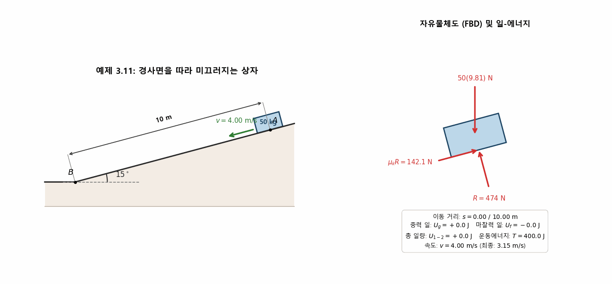
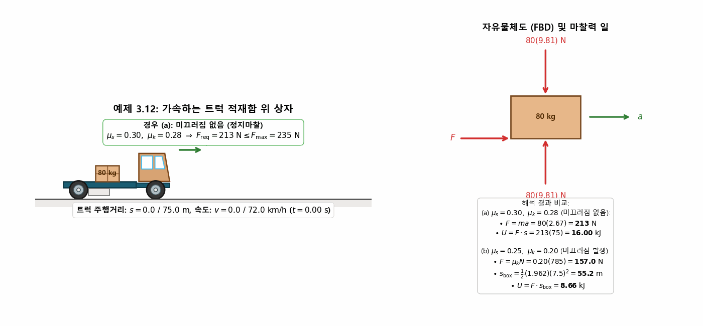
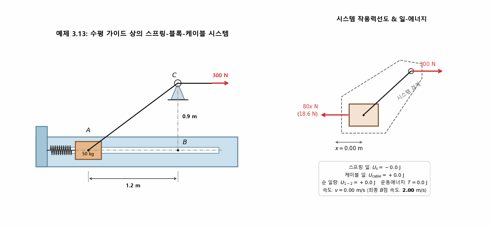
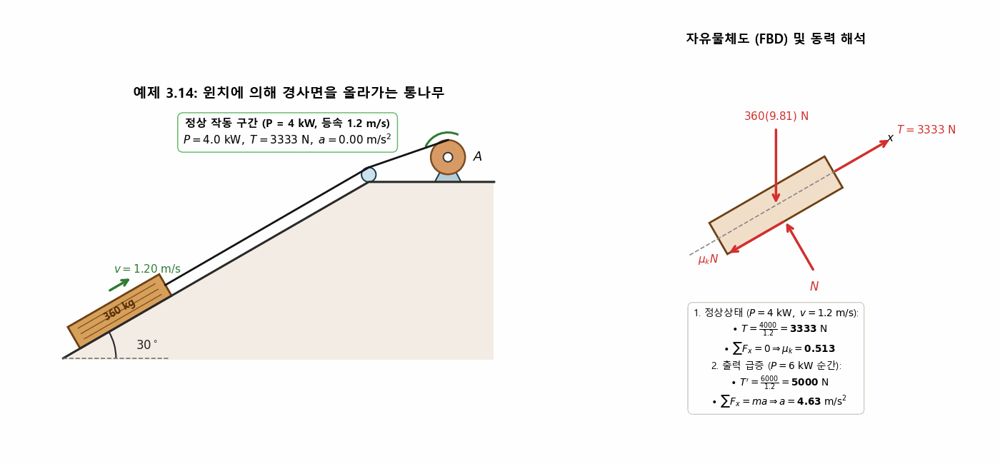
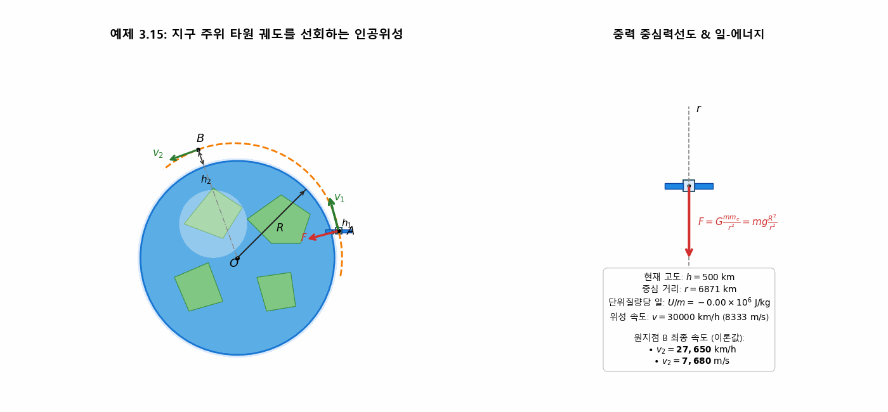
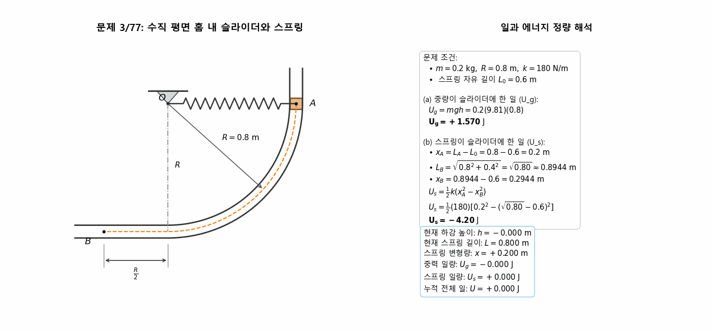
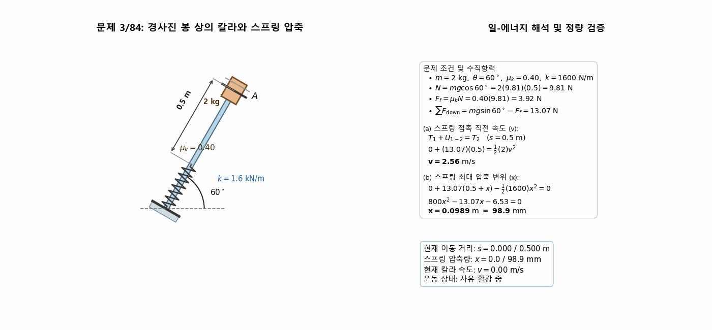
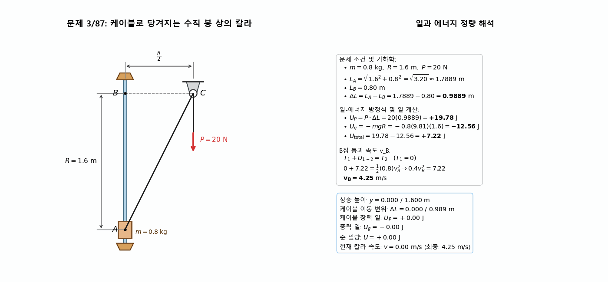
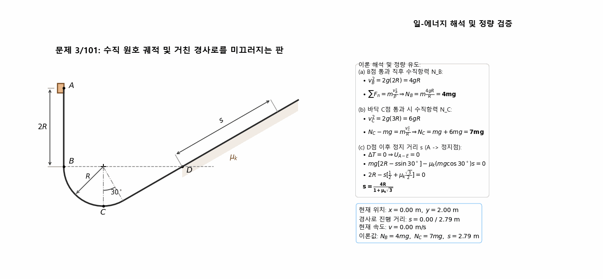

> **Author / Rights Holder:** 전북대학교 생물산업기계공학과 유동수 (ryudongsoo@jbnu.ac.kr, ryudongsoo@gmail.com)

# 7주차: 질점의 운동역학 — 제3장 B편: 일과 에너지 (Work and Energy)

## 📌 강의 개요 및 학습 목표

- **단원**: 동역학 9판 제3장 질점의 운동역학 — B편: 일과 에너지 (Work and Energy)
- **학습 목표**:
  - 일(Work)과 운동에너지(Kinetic Energy)의 기본 원리 및 일-에너지 방정식($T_1 + U_{1-2} = T_2$) 습득
  - 중력 일($U_g$), 마찰력 일($U_f$), 스프링 탄성력 일($U_s$), 외력 및 케이블 장력 일의 정확한 부호 체계 정립
  - 일정한 동력(Power, $P = \vec{F} \cdot \vec{v}$) 및 순간 가속도 사이의 동역학적 상관관계 분석
  - 거리 변화에 따른 가변 중력장($F = mg \frac{R^2}{r^2}$)에서의 위성 궤도 에너지 보존 해석
  - 수직 원호 및 경사면 복합 궤도에서의 법선 가속도와 수직항력($N$), 마찰 감속 거리($s$) 해석 역량 확보

---

## 📋 주차별 학습 콘텐츠 구성

| 구분 | 번호 | 예제/문제명 | 핵심 개념 및 검증 공식 | 산출물 링크 |
|:---:|:---:|:---|:---|:---:|
| **예제** | 3.11 | 경사면 미끄럼 상자 | $T_1 + U_g + U_f = T_2 \Rightarrow v_2 = 3.15\ \mathrm{m/s}$ | [코드](./ex3_11_incline_crate_work.py) \| [GIF](./ex3_11_incline_crate_work.gif) |
| **예제** | 3.12 | 가속 평판 트럭 위 상자 | (a) 정지 마찰 $U = 16.00\ \mathrm{kJ}$, (b) 미끄러짐 $U = 8.66\ \mathrm{kJ}$ | [코드](./ex3_12_truck_box_work.py) \| [GIF](./ex3_12_truck_box_work.gif) |
| **예제** | 3.13 | 수평 가이드 스프링-케이블 | $U_s = -80.0\ \mathrm{J},\ U_{\mathrm{cable}} = +180.0\ \mathrm{J} \Rightarrow v_B = 2.00\ \mathrm{m/s}$ | [코드](./ex3_13_spring_block_work.py) \| [GIF](./ex3_13_spring_block_work.gif) |
| **예제** | 3.14 | 윈치 동력 및 통나무 견인 | 정상 $\mu_k = 0.513$, 6 kW 급증 시 $a = 4.63\ \mathrm{m/s^2}$ | [코드](./ex3_14_log_winch_power.py) \| [GIF](./ex3_14_log_winch_power.gif) |
| **예제** | 3.15 | 타원 궤도 선회 인공위성 | 가변 중력 일 $U/m = -5.35\times 10^6\ \mathrm{J/kg} \Rightarrow v_2 = 27,650\ \mathrm{km/h}$ | [코드](./ex3_15_satellite_orbit_energy.py) \| [GIF](./ex3_15_satellite_orbit_energy.gif) |
| **기초** | 3/77 | 수직 원호 홈 내 슬라이더 | (a) $U_g = +1.570\ \mathrm{J}$, (b) $U_s = -4.20\ \mathrm{J}$ | [코드](./prob3_77_collar_spring_work.py) \| [GIF](./prob3_77_collar_spring_work.gif) |
| **기초** | 3/84 | 경사 봉 칼라와 스프링 충돌 | (a) 접촉 직전 $v = 2.56\ \mathrm{m/s}$, (b) 최대 압축 $x = 98.9\ \mathrm{mm}$ | [코드](./prob3_84_collar_incline_spring.py) \| [GIF](./prob3_84_collar_incline_spring.gif) |
| **기초** | 3/87 | 케이블 견인 수직 봉 칼라 | $\Delta L = 0.989\ \mathrm{m},\ U_{1-2} = +7.22\ \mathrm{J} \Rightarrow v_B = 4.25\ \mathrm{m/s}$ | [코드](./prob3_87_vertical_collar_cable.py) \| [GIF](./prob3_87_vertical_collar_cable.gif) |
| **심화** | 3/101 | 루프 및 거친 경사로 질점 | (a) $N_B = 4mg$, (b) $N_C = 7mg$, (c) $s = \frac{4R}{1 + \mu_k\sqrt{3}}$ | [코드](./prob3_101_slider_loop_incline.py) \| [GIF](./prob3_101_slider_loop_incline.gif) |

---

## 1. 교재 핵심 예제 (Sample Problems 3/11 ~ 3/15)

### 1.1 예제 3.11: 경사면을 미끄러져 내려가는 상자의 일-에너지 해석

- **문제 정의**: $50\ \mathrm{kg}$ 상자가 $15^\circ$ 경사면 상의 $A$점에서 $v_1 = 4\ \mathrm{m/s}$로 출발, $s = 10\ \mathrm{m}$ 미끄러져 $B$점에 도달할 때의 속도 $v_2$ 계산 ($\mu_k = 0.30$)
- **역학 해석**:
  - 수직항력: $R = mg\cos 15^\circ = 50(9.81)\cos 15^\circ = 473.8\ \mathrm{N}$
  - 운동마찰력: $F = \mu_k R = 0.30(473.8) = 142.1\ \mathrm{N}$
  - 중력 일: $U_g = mg(s\sin 15^\circ) = +1269.5\ \mathrm{J}$
  - 마찰력 일: $U_f = -F \cdot s = -142.1(10) = -1421.4\ \mathrm{J}$
  - 순 일량: $U_{1-2} = 1269.5 - 1421.4 = -151.9\ \mathrm{J}$
  - 에너지 방정식: $T_1 + U_{1-2} = T_2 \Rightarrow \frac{1}{2}(50)(4^2) - 151.9 = \frac{1}{2}(50) v_2^2 \Rightarrow \mathbf{v_2 = 3.15\ \mathrm{m/s}}$

---

### 1.2 예제 3.12: 가속 평판 트럭 위 상자의 마찰력 일

- **문제 정의**: 정지상태에서 출발하여 $75\ \mathrm{m}$ 거리를 등가속도로 주행해 $72\ \mathrm{km/h}$ ($20\ \mathrm{m/s}$)에 도달하는 트럭 위 $80\ \mathrm{kg}$ 상자의 마찰력 일 계산
  - 트럭 가속도: $a = \frac{v^2}{2s} = \frac{20^2}{2(75)} = 2.667\ \mathrm{m/s^2}$, 주행 시간: $t = 7.5\ \mathrm{s}$
  - 수직항력: $N = mg = 80(9.81) = 784.8\ \mathrm{N}$
  - 필요 마찰력: $F_{\mathrm{req}} = ma = 80(2.667) = 213.3\ \mathrm{N}$
- **케이스별 해석**:
  - **(a) $\mu_s = 0.30, \mu_k = 0.28$**:
    - $F_{\max} = 0.30(784.8) = 235.4\ \mathrm{N} > 213.3\ \mathrm{N} \Rightarrow$ 미끄러짐 없음 (일체 거동)
    - 상자 이동거리: $s = 75\ \mathrm{m}$
    - 마찰력 일: $U = F_{\mathrm{req}} \cdot s = 213.3 \times 75 = \mathbf{16.00\ \mathrm{kJ}}$
  - **(b) $\mu_s = 0.25, \mu_k = 0.20$**:
    - $F_{\max} = 0.25(784.8) = 196.2\ \mathrm{N} < 213.3\ \mathrm{N} \Rightarrow$ 미끄러짐 발생!
    - 작용 운동마찰력: $F = 0.20(784.8) = 157.0\ \mathrm{N}$
    - 상자 가속도: $a_{\mathrm{box}} = \frac{157.0}{80} = 1.962\ \mathrm{m/s^2}$
    - 상자 실제 이동거리: $s_{\mathrm{box}} = \frac{1}{2}(1.962)(7.5^2) = 55.18\ \mathrm{m}$
    - 마찰력 일: $U = F \cdot s_{\mathrm{box}} = 157.0 \times 55.18 = \mathbf{8.66\ \mathrm{kJ}}$

---

### 1.3 예제 3.13: 수평 가이드 상의 스프링-블록-케이블 시스템

- **문제 정의**: $50\ \mathrm{kg}$ 블록이 정지상태 $A$ ($x_1 = 0.233\ \mathrm{m}$)에서 출발, 케이블 장력 $P = 300\ \mathrm{N}$에 의해 $1.2\ \mathrm{m}$ 떨어진 $B$점으로 이동 시 속도 $v_B$ 계산 ($k = 80\ \mathrm{N/m}$, 풀리 높이 $h = 0.9\ \mathrm{m}$)
- **역학 해석**:
  - 스프링 늘어남 변화: $x_1 = 0.233\ \mathrm{m} \rightarrow x_2 = 1.433\ \mathrm{m}$
  - 스프링 탄성 일: $U_s = -\frac{1}{2} k (x_2^2 - x_1^2) = -\frac{1}{2}(80)(1.433^2 - 0.233^2) = -80.0\ \mathrm{J}$
  - 케이블 이동거리: $L_1 = \sqrt{1.2^2 + 0.9^2} = 1.50\ \mathrm{m},\ L_2 = 0.90\ \mathrm{m} \Rightarrow \Delta s_C = 0.60\ \mathrm{m}$
  - 케이블 외력 일: $U_{\mathrm{cable}} = P \cdot \Delta s_C = 300(0.60) = +180.0\ \mathrm{J}$
  - 일-에너지 방정식: $T_A + U_s + U_{\mathrm{cable}} = T_B \Rightarrow 0 - 80.0 + 180.0 = \frac{1}{2}(50) v_B^2 \Rightarrow \mathbf{v_B = 2.00\ \mathrm{m/s}}$

---

### 1.4 예제 3.14: 윈치 동력에 의한 통나무 견인 및 순간 가속도

- **문제 정의**: $360\ \mathrm{kg}$ 통나무를 $30^\circ$ 경사면 위로 $v = 1.2\ \mathrm{m/s}$ 일정 속도로 끌어올릴 때 출력 $4\ \mathrm{kW}$인 윈치의 $\mu_k$ 계산 및 출력 $6\ \mathrm{kW}$ 급증 시 순간 가속도 $a$ 계산
- **역학 해석**:
  - 수직항력: $N = mg\cos 30^\circ = 360(9.81)\cos 30^\circ = 3058.4\ \mathrm{N} \approx 3060\ \mathrm{N}$
  - 경사 하향 중력분력: $mg\sin 30^\circ = 360(9.81)(0.5) = 1765.8\ \mathrm{N}$
  - **정상 작동 ($P = 4\ \mathrm{kW}$)**:
    - 케이블 장력: $T = \frac{P}{v} = \frac{4000}{1.2} = 3333.3\ \mathrm{N}$
    - 힘 평형: $T - mg\sin 30^\circ - \mu_k N = 0 \Rightarrow \mu_k N = 1567.5\ \mathrm{N} \Rightarrow \mathbf{\mu_k = 0.513}$
  - **출력 급증 ($P = 6\ \mathrm{kW}$)**:
    - 순간 장력: $T' = \frac{6000}{1.2} = 5000\ \mathrm{N}$
    - 뉴턴 운동방정식: $\sum F_x = T' - mg\sin 30^\circ - \mu_k N = 5000 - 1765.8 - 1567.5 = 1666.7\ \mathrm{N}$
    - 순간 가속도: $a = \frac{1666.7}{360} = \mathbf{4.63\ \mathrm{m/s^2}}$

---

### 1.5 예제 3.15: 타원 궤도를 선회하는 인공위성의 에너지 해석

- **문제 정의**: 지구($R = 6371\ \mathrm{km}$) 주위 타원 궤도를 도는 질량 $m$ 인공위성이 근지점 $A$($h_1 = 500\ \mathrm{km}$, $v_1 = 30,000\ \mathrm{km/h}$)에서 원지점 $B$($h_2 = 1200\ \mathrm{km}$)로 이동할 때의 속도 $v_2$ 계산
- **역학 해석**:
  - 중심거리: $r_1 = 6371 + 500 = 6871\ \mathrm{km},\ r_2 = 6371 + 1200 = 7571\ \mathrm{km}$
  - 초기 속도: $v_1 = \frac{30000}{3.6} = 8333.3\ \mathrm{m/s}$
  - 가변 중력 일: $U_{1-2} = \int_{r_1}^{r_2} -F\, dr = mgR^2 \left(\frac{1}{r_2} - \frac{1}{r_1}\right)$
  - 단위질량당 일: $\frac{U_{1-2}}{m} = (9.81)(6.371\times 10^6)^2 \left(\frac{1}{7.571\times 10^6} - \frac{1}{6.871\times 10^6}\right) = -5.353\times 10^6\ \mathrm{J/kg}$
  - 일-에너지 방정식: $\frac{1}{2} v_1^2 + \frac{U_{1-2}}{m} = \frac{1}{2} v_2^2 \Rightarrow \mathbf{v_2 = 7680\ \mathrm{m/s} = 27,650\ \mathrm{km/h}}$

---

## 2. 연습문제 (기초문제 3선 + 심화문제 1선)

### 2.1 기초문제 1: 문제 3/77 — 수직 평면 홈 내 슬라이더와 스프링

- **문제 정의**: $0.2\ \mathrm{kg}$ 슬라이더가 $R = 0.8\ \mathrm{m}$ 인 수직 평면 원호 홈을 따라 $A(R, 0)$에서 $B(-R/2, -R)$로 이동 시 (a) 중량이 한 일 및 (b) 스프링이 한 일 계산 ($k = 180\ \mathrm{N/m}$, 자유길이 $L_0 = 0.6\ \mathrm{m}$)
- **역학 계산**:
  - **(a) 중량 일량**:
    $$U_g = mgh = 0.2(9.81)(0.8) = \mathbf{+1.570\ \mathrm{J}}$$
  - **(b) 스프링 일량**:
    - $x_A = L_A - L_0 = 0.8 - 0.6 = 0.2\ \mathrm{m}$
    - $L_B = \sqrt{0.8^2 + 0.4^2} = \sqrt{0.80} \approx 0.8944\ \mathrm{m} \Rightarrow x_B = 0.8944 - 0.6 = 0.2944\ \mathrm{m}$
    - $U_s = \frac{1}{2}k (x_A^2 - x_B^2) = \frac{1}{2}(180)[0.2^2 - 0.2944^2] = \mathbf{-4.20\ \mathrm{J}}$

---

### 2.2 기초문제 2: 문제 3/84 — 경사 봉을 미끄러지는 칼라와 스프링 충돌

- **문제 정의**: $2\ \mathrm{kg}$ 칼라가 정점 $A$에서 정지상태로 출발하여 $60^\circ$ 경사진 막대를 따라 $s_0 = 0.5\ \mathrm{m}$ 미끄러져 스프링($k = 1.6\ \mathrm{kN/m}$)에 충돌할 때, (a) 스프링 접촉 직전 속도 $v$ 및 (b) 최대 압축량 $x$ 계산 ($\mu_k = 0.40$)
- **역학 계산**:
  - 법선 평형: $N = mg\cos 60^\circ = 2(9.81)(0.5) = 9.81\ \mathrm{N} \Rightarrow F = \mu_k N = 3.924\ \mathrm{N}$
  - **(a) 충돌 직전 속도**:
    $$U_{1-2} = mg(s_0 \sin 60^\circ) - F \cdot s_0 = 8.496 - 1.962 = 6.534\ \mathrm{J} = \frac{1}{2}(2) v^2 \Rightarrow \mathbf{v = 2.56\ \mathrm{m/s}}$$
  - **(b) 스프링 최대 압축량 $x$**:
    $$U_{1-3} = \Delta T = 0 \Rightarrow (mg\sin 60^\circ - F)(0.5 + x) - \frac{1}{2}(1600) x^2 = 0$$
    $$800 x^2 - 13.07 x - 6.53 = 0 \Rightarrow \mathbf{x = 0.0989\ \mathrm{m}\ (98.9\ \mathrm{mm})}$$

---

### 2.3 기초문제 3: 문제 3/87 — 케이블 견인에 의한 수직 봉 칼라 운동

- **문제 정의**: $0.8\ \mathrm{kg}$ 칼라가 수직 매끄러운 봉 상의 $A$에서 출발하여 $R = 1.6\ \mathrm{m}$ 높이의 $B$를 통과할 때, 도르래 $C$(수평거리 $R/2 = 0.8\ \mathrm{m}$)를 지나는 케이블을 $P = 20\ \mathrm{N}$ 일정 힘으로 당길 때 $v_B$ 계산
- **역학 계산**:
  - 케이블 당김 변위: $d = \sqrt{R^2 + (R/2)^2} - R/2 = \sqrt{1.6^2 + 0.8^2} - 0.8 = 0.9889\ \mathrm{m}$
  - 케이블 외력 일: $U_P = P \cdot d = 20(0.9889) = +19.78\ \mathrm{J}$
  - 중력 일: $U_g = -mgR = -0.8(9.81)(1.6) = -12.56\ \mathrm{J}$
  - 순 일량: $U_{1-2} = 19.78 - 12.56 = +7.22\ \mathrm{J}$
  - 에너지 방정식: $T_A + U_{1-2} = T_B \Rightarrow 0 + 7.22 = \frac{1}{2}(0.8) v_B^2 \Rightarrow 0.4 v_B^2 = 7.22 \Rightarrow \mathbf{v_B = 4.25\ \mathrm{m/s}}$

---

### 2.4 심화문제 1: 문제 3/101 — 원호 궤적 및 거친 경사로를 미끄러지는 질점 $m$

- **문제 정의**: 질량 $m$ 슬라이더가 $A$에서 정지상태로 이완되어 수직 낙하($2R$) 후 반지름 $R$ 원호를 지나 바닥 $C$ 및 수평 기준선 상의 $D$를 거쳐 $30^\circ$ 거친 경사로($\mu_k$)로 진입할 때:
  - (a) $B$ 통과 직후 수직항력 $N_B$
  - (b) 바닥 $C$ 통과 시 수직항력 $N_C$
  - (c) $D$ 이후 경사로를 따라 미끄러져 정지할 때까지의 이동거리 $s$
- **역학 계산**:
  - **(a) $B$ 통과 직후**:
    $$0 + 2mgR = \frac{1}{2} m v_B^2 \Rightarrow v_B^2 = 4gR$$
    $$\sum F_n = m a_n \Rightarrow \mathbf{N_B = m \frac{v_B^2}{R} = 4mg}$$
  - **(b) 바닥 $C$ 통과 시**:
    $$0 + 3mgR = \frac{1}{2} m v_C^2 \Rightarrow v_C^2 = 6gR$$
    $$\sum F_n = m a_n \Rightarrow N_C - mg = m \frac{6gR}{R} \Rightarrow \mathbf{N_C = 7mg}$$
  - **(c) 정지점 $E$까지 이동거리 $s$**:
    - 점 $D$는 기준선 $B$와 동일 높이($y_D = y_B$)에 위치
    - 경사로 수직항력: $N = mg\cos 30^\circ = \frac{\sqrt{3}}{2}mg$, 마찰력: $F = \mu_k \frac{\sqrt{3}}{2}mg$
    - $T_A + U_{A-E} = T_E \Rightarrow 0 + 2mgR - mg(s\sin 30^\circ) - \mu_k \frac{\sqrt{3}}{2}mgs = 0$
    - $2mgR = \frac{1}{2}mgs (1 + \mu_k\sqrt{3}) \Rightarrow \mathbf{s = \frac{4R}{1 + \mu_k\sqrt{3}}}$

---

## 📝 변경 이력 (Changelog)

- **2026-10-03 17:22:26** [[Dongsoo Ryu](mailto:ryudongsoo@jbnu.ac.kr)] feat(biomechanics): complete Week 7 Part B Work and Energy curriculum overhaul with 5 examples and 4 practice problems verified by solution manual
- **2026-10-02 23:28:18** [[Dongsoo Ryu](mailto:ryudongsoo@jbnu.ac.kr)] feat(patent): Leave applicant blank and set inventors to Yoo Dongsoo and Kim Sungmin for portable Brix meter patents (07, 08)
- **2026-10-02 23:22:53** [[Dongsoo Ryu](mailto:ryudongsoo@jbnu.ac.kr)] docs(patent): Complete comprehensive domestic and international prior art deep search and FTO analysis for 4 patent drafts
- **2026-10-02 23:17:31** [[Dongsoo Ryu](mailto:ryudongsoo@jbnu.ac.kr)] feat(patent): Add Kim Sungmin as co-inventor and establish 4-tier extra-large shell module for watermelon
- **2026-08-12 05:04:33** [[Dongsoo Ryu](mailto:ryudongsoo@jbnu.ac.kr)] docs: update assembly process and cost estimate for full SMT including ESP32-C6
