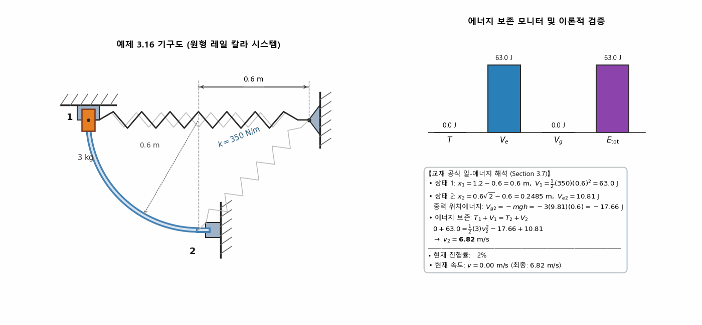
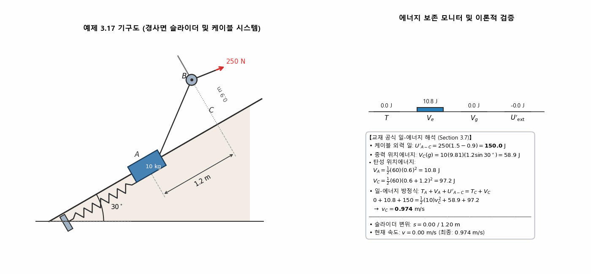
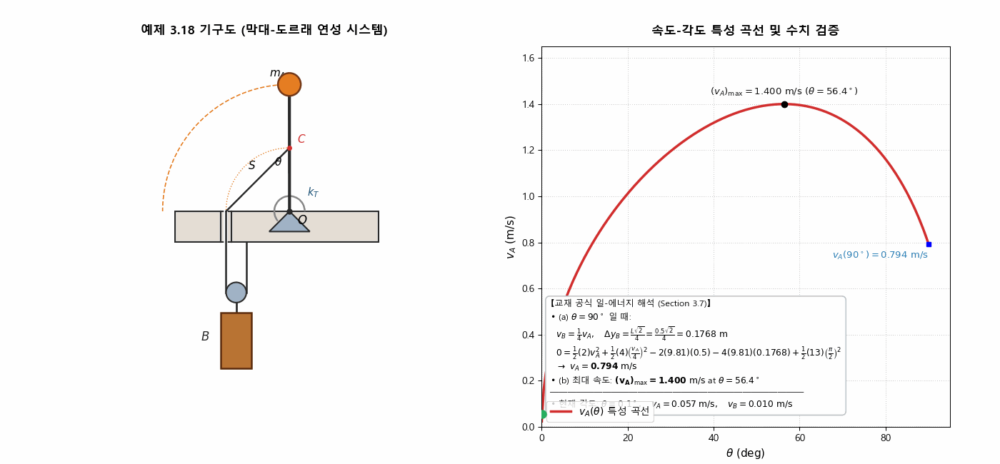
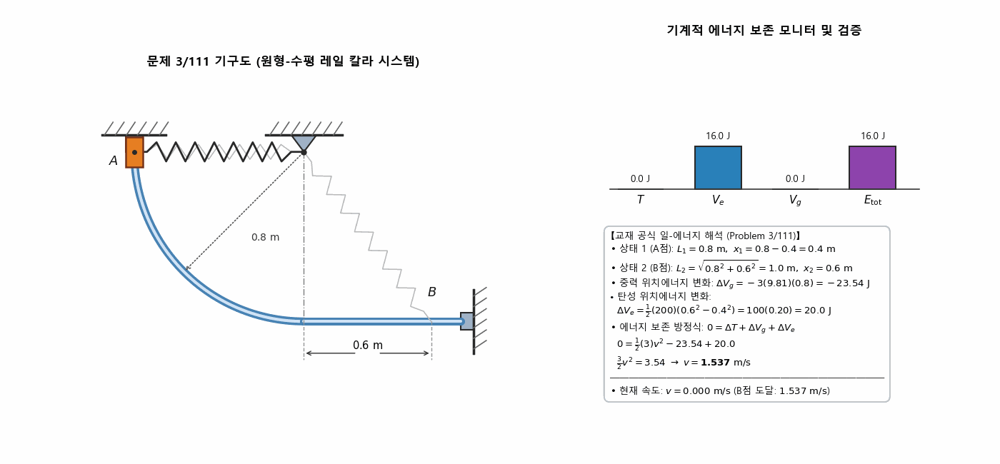
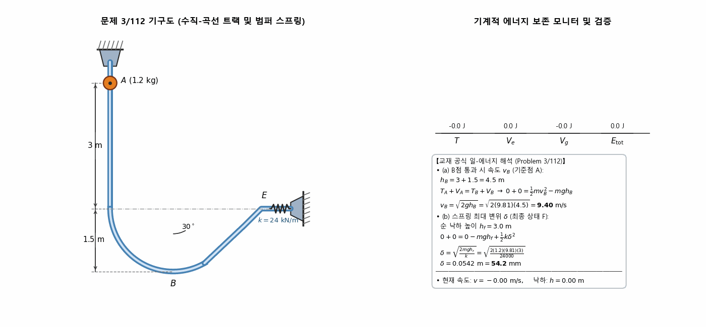
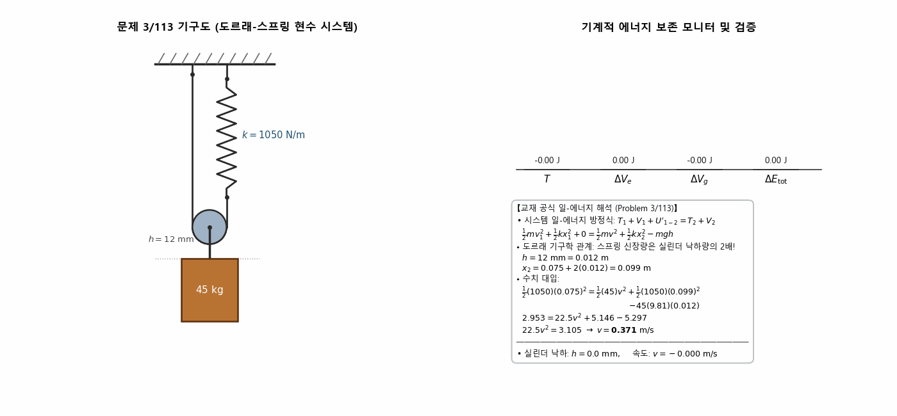
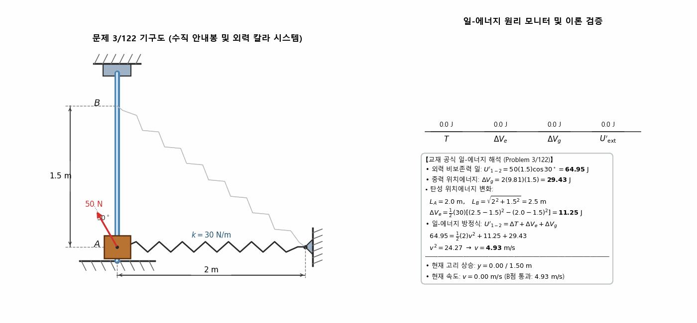

> **Author / Rights Holder:** 전북대학교 생물산업기계공학과 유동수 (ryudongsoo@jbnu.ac.kr, ryudongsoo@gmail.com)

# 9주차: 질점의 운동역학 — 제3장 B편: 위치에너지 및 기계적 에너지 보존 (Potential Energy and Conservation of Energy)

## 📌 강의 개요 및 학습 목표

- **단원**: 동역학 9판 제3장 질점의 운동역학 — B편: 일과 에너지 (Section 3.7 위치에너지 및 에너지 보존)
- **학습 목표**:
  - 중력 위치에너지($V_g = mgy$)의 기준면(Datum) 설정 및 부호 규칙 습득
  - 선형 인장/압축 스프링($V_e = \frac{1}{2}kx^2$)과 비틀림 스프링($V_e = \frac{1}{2}k_T\theta^2$)의 탄성 위치에너지 정립
  - 비보존력 외력 일($U'_{1-2}$)을 포함한 종합 일-에너지 방정식($T_1 + V_1 + U'_{1-2} = T_2 + V_2$)의 완전한 해석 능력 확보
  - 복합 연성 기구(연결된 케이블, 도르래, 비틀림 링크)의 기구학적 구속 조건과 에너지 보존의 연계 해석

---

## 📋 주차별 학습 콘텐츠 구성

| 구분 | 번호 | 예제/문제명 | 핵심 역학 개념 및 검증 공식 | 산출물 링크 |
|:---:|:---:|:---|:---|:---:|
| **예제** | 3.16 | 곡선 안내봉과 스프링 칼라 | $T_1 + V_1 = T_2 + V_2 \Rightarrow v_2 = 6.82\ \mathrm{m/s}$ | [코드](./ex3_16_curved_rod_collar.py) \| [GIF](./ex3_16_curved_rod_collar.gif) |
| **예제** | 3.17 | 경사면 슬라이더와 케이블 외력 | $T_A + V_A + U'_{A-C} = T_C + V_C \Rightarrow v_C = 0.974\ \mathrm{m/s}$ | [코드](./ex3_17_incline_slider_spring.py) \| [GIF](./ex3_17_incline_slider_spring.gif) |
| **예제** | 3.18 | 비틀림 봉과 연성 실린더 | $v_A(90^\circ) = 0.794\ \mathrm{m/s},\ (v_A)_{\max} = 1.400\ \mathrm{m/s}\ (56.4^\circ)$ | [코드](./ex3_18_torsion_rod_cylinder.py) \| [GIF](./ex3_18_torsion_rod_cylinder.gif) |
| **기초 1** | 3/111 | 원호-수평 복합 가이드 칼라 | $0 = \Delta T + \Delta V_g + \Delta V_e \Rightarrow v_B = 1.537\ \mathrm{m/s}$ | [코드](./prob3_111_vertical_rod_collar.py) \| [GIF](./prob3_111_vertical_rod_collar.gif) |
| **기초 2** | 3/112 | 수직-곡선 트랙과 완충 스프링 | (a) $v_B = 9.40\ \mathrm{m/s}$, (b) $\delta = 54.2\ \mathrm{mm}$ | [코드](./prob3_112_curved_guide_bumper.py) \| [GIF](./prob3_112_curved_guide_bumper.gif) |
| **기초 3** | 3/113 | 도르래-스프링 현수 실린더 | $\Delta x = 2h,\ 0 = \Delta T + \Delta V_g + \Delta V_e \Rightarrow v = 0.371\ \mathrm{m/s}$ | [코드](./prob3_113_pulley_cylinder_spring.py) \| [GIF](./prob3_113_pulley_cylinder_spring.gif) |
| **심화 1** | 3/122 | 경사 외력을 받는 수직 칼라 | $U'_{1-2} = \Delta T + \Delta V_g + \Delta V_e \Rightarrow v_B = 4.93\ \mathrm{m/s}$ | [코드](./prob3_122_incline_collar_spring.py) \| [GIF](./prob3_122_incline_collar_spring.gif) |

---

## 1. 교재 핵심 예제 (Sample Problems 3/16 ~ 3/18)

### 1.1 예제 3.16: 곡선 형태의 막대를 따라 미끄러지는 고리와 스프링 시스템

- **문제 정의**: 질량 $m = 3\ \mathrm{kg}$인 미끄럼고리가 1번 위치에서 정지상태로부터 마찰 없는 수직 곡선 봉을 따라 하강한다. 스프링 강성 $k = 350\ \mathrm{N/m}$, 자유길이 $L_0 = 0.6\ \mathrm{m}$일 때 2번 위치에서의 속도 $v_2$를 구하라.
- **역학 해석**:
  - 초기 상태 1: $L_1 = 1.2\ \mathrm{m} \Rightarrow x_1 = 1.2 - 0.6 = 0.6\ \mathrm{m}$
    $$V_1 = \frac{1}{2} k x_1^2 = \frac{1}{2}(350)(0.6)^2 = 63.0\ \mathrm{J},\quad V_{g1} = 0$$
  - 최종 상태 2: $L_2 = \sqrt{0.6^2 + 0.6^2} = 0.6\sqrt{2} = 0.8485\ \mathrm{m} \Rightarrow x_2 = 0.8485 - 0.6 = 0.2485\ \mathrm{m}$
    $$V_{e2} = \frac{1}{2}(350)(0.2485)^2 = 10.81\ \mathrm{J}$$
    $$V_{g2} = -mgh = -3(9.81)(0.6) = -17.66\ \mathrm{J}$$
  - 기계적 에너지 보존:
    $$T_1 + V_1 = T_2 + V_2 \Rightarrow 0 + 63.0 = \frac{1}{2}(3)v_2^2 - 17.66 + 10.81$$
    $$\frac{3}{2} v_2^2 = 69.85 \Rightarrow \mathbf{v_2 = 6.82\ \mathrm{m/s}}$$

---

### 1.2 예제 3.17: 경사면을 따라 당겨지는 슬라이더와 스프링 시스템

- **문제 정의**: 질량 $10\ \mathrm{kg}$ 슬라이더가 $30^\circ$ 경사면 상의 $A$점에서 정지상태로부터 출발하여 케이블 장력 $P = 250\ \mathrm{N}$에 의해 당겨지며 $1.2\ \mathrm{m}$ 상향 이동하여 $C$점을 지날 때의 속도 $v_C$ 계산 ($k = 60\ \mathrm{N/m}$, 초기 인장 $x_A = 0.6\ \mathrm{m}$)
- **역학 해석**:
  - 유일한 비보존력인 케이블 장력의 작용점 이동: $\Delta s_C = AB - BC = 1.5 - 0.9 = 0.6\ \mathrm{m}$
    $$U'_{A-C} = 250(0.6) = 150.0\ \mathrm{J}$$
  - 위치에너지 변화 (기준: $A$점):
    $$V_{gC} = mg(s\sin 30^\circ) = 10(9.81)(1.2\sin 30^\circ) = 58.9\ \mathrm{J}$$
    $$V_{eA} = \frac{1}{2}(60)(0.6)^2 = 10.8\ \mathrm{J},\quad V_{eC} = \frac{1}{2}(60)(0.6 + 1.2)^2 = 97.2\ \mathrm{J}$$
  - 종합 일-에너지 방정식:
    $$T_A + V_A + U'_{A-C} = T_C + V_C \Rightarrow 0 + 10.8 + 150.0 = \frac{1}{2}(10)v_C^2 + 58.9 + 97.2$$
    $$5 v_C^2 = 4.74 \Rightarrow \mathbf{v_C = 0.974\ \mathrm{m/s}}$$

---

### 1.3 예제 3.18: 비틀림 스프링 막대와 연성 실린더 시스템

- **문제 정의**: 가볍고 가느다란 봉 $OA$ ($L = 0.5\ \mathrm{m}$, 질점 $m_A = 2\ \mathrm{kg}$)가 비틀림 스프링($k_T = 13\ \mathrm{N\cdot m/rad}$)을 장착하고 수직 상태에서 정지 출발. 중앙 $C$에 연결된 줄 $S$가 도르래를 통해 $m_B = 4\ \mathrm{kg}$ 실린더를 지지할 때 (a) $\theta = 90^\circ$에서의 $v_A$ 및 (b) 최대 속도 $(v_A)_{\max}$ 계산
- **역학 해석**:
  - 도르래 기구학: 실린더 하강 속도는 $v_B = \frac{1}{4} v_A \cos\left(\frac{90^\circ - \theta}{2}\right)$
  - $\theta = 90^\circ$ 도달 시 실린더 총 하강량: $\Delta y_B = \frac{L\sqrt{2}}{4} = 0.1768\ \mathrm{m}$
  - 에너지 보존:
    $$0 = \frac{1}{2}(2)v_A^2 + \frac{1}{2}(4)\left(\frac{v_A}{4}\right)^2 - 2(9.81)(0.5) - 4(9.81)(0.1768) + \frac{1}{2}(13)\left(\frac{\pi}{2}\right)^2$$
    $$\mathbf{v_A(90^\circ) = 0.794\ \mathrm{m/s}}$$
  - 전체 각도 범위 $0^\circ \le \theta \le 90^\circ$ 속도 특성 곡선 해석:
    $$\mathbf{(v_A)_{\max} = 1.400\ \mathrm{m/s}\quad (\theta = 56.4^\circ)}$$

---

## 2. 관련 핵심 연습문제 (기초 3제 + 심화 1제)

### 2.1 기초 1: 문제 3/111 — 원호 및 수평 복합 안내봉 칼라

- **문제 정의**: 자유길이 $L_0 = 0.4\ \mathrm{m}$, 강성 $k = 200\ \mathrm{N/m}$인 스프링에 연결된 질량 $3\ \mathrm{kg}$ 고리가 $A$점에서 정지 출발하여 수평 위치 $B$에 도달할 때의 속도 $v_B$ 계산 ($R = 0.8\ \mathrm{m}$, 수평 $0.6\ \mathrm{m}$)
- **역학 계산**:
  - 중력 위치에너지: $\Delta V_g = -3(9.81)(0.8) = -23.54\ \mathrm{J}$
  - 스프링 길이: $L_1 = 0.8\ \mathrm{m} \rightarrow x_1 = 0.4\ \mathrm{m},\ L_2 = \sqrt{0.8^2 + 0.6^2} = 1.0\ \mathrm{m} \rightarrow x_2 = 0.6\ \mathrm{m}$
  - 탄성 위치에너지: $\Delta V_e = \frac{1}{2}(200)(0.6^2 - 0.4^2) = 20.0\ \mathrm{J}$
  - 기계적 에너지 보존:
    $$0 = \Delta T + \Delta V_g + \Delta V_e \Rightarrow 0 = \frac{3}{2} v^2 - 23.54 + 20.0 \Rightarrow \mathbf{v_B = 1.537\ \mathrm{m/s}}$$

---

### 2.2 기초 2: 문제 3/112 — 수직-곡선 트랙과 완충 스프링

- **문제 정의**: $1.2\ \mathrm{kg}$ 슬라이더가 수직 $3\ \mathrm{m}$를 낙하한 후 반경 $1.5\ \mathrm{m}$ 곡선부를 통과하여 수평 범퍼 스프링($k = 24\ \mathrm{kN/m}$)과 충돌. (a) 최하점 $B$ 속도 $v_B$, (b) 스프링 최대 압축 $\delta$ 계산
- **역학 계산**:
  - **(a) 최하점 $B$ 속도** (총 낙하 $h_B = 3.0 + 1.5 = 4.5\ \mathrm{m}$):
    $$v_B = \sqrt{2gh_B} = \sqrt{2(9.81)(4.5)} = \mathbf{9.40\ \mathrm{m/s}}$$
  - **(b) 스프링 최대 압축 $\delta$** (범퍼 수평면 기준 순 낙하 $h_f = 3.0\ \mathrm{m}$):
    $$mgh_f = \frac{1}{2} k \delta^2 \Rightarrow \delta = \sqrt{\frac{2mgh_f}{k}} = \sqrt{\frac{2(1.2)(9.81)(3.0)}{24000}} = \mathbf{54.2\ \mathrm{mm}}$$

---

### 2.3 기초 3: 문제 3/113 — 도르래-스프링 현수 실린더의 속도

- **문제 정의**: $45\ \mathrm{kg}$ 원통이 초기 인장 $75\ \mathrm{mm}$ 상태에서 정지 출발하여 $h = 12\ \mathrm{mm}$ 하강했을 때의 속도 $v$ 계산 ($k = 1050\ \mathrm{N/m}$)
- **역학 계산**:
  - 도르래 기구학: 실린더 하강 $h = 12\ \mathrm{mm} \Rightarrow$ 스프링 연장 $\Delta x = 2h = 24\ \mathrm{mm}$
  - 최종 신장: $x_2 = 0.075 + 0.024 = 0.099\ \mathrm{m}$
  - 중력 위치에너지: $\Delta V_g = -45(9.81)(0.012) = -5.297\ \mathrm{J}$
  - 탄성 위치에너지: $\Delta V_e = \frac{1}{2}(1050)(0.099^2 - 0.075^2) = +2.192\ \mathrm{J}$
  - 에너지 보존:
    $$\frac{1}{2}(45)v^2 = 5.297 - 2.192 = 3.105 \Rightarrow \mathbf{v = 0.371\ \mathrm{m/s}}$$

---

### 2.4 심화 1: 문제 3/122 — 경사 외력을 받으며 상승하는 수직 칼라

- **문제 정의**: $2\ \mathrm{kg}$ 고리가 정지상태 $A$에서 $30^\circ$ 경사 외력 $P = 50\ \mathrm{N}$을 받으며 수직 매끄러운 봉을 따라 상승하여 $B$점($1.5\ \mathrm{m}$ 위)을 지날 때의 속도 $v_B$ 계산 ($k = 30\ \mathrm{N/m}$, 벽면 거리 $2.0\ \mathrm{m}$, 자유길이 $L_0 = 1.5\ \mathrm{m}$)
- **역학 계산**:
  - 외력 비보존력 일: $U'_{1-2} = (50\cos 30^\circ) \times 1.5 = 64.95\ \mathrm{J}$
  - 중력 위치에너지 증가: $\Delta V_g = 2(9.81)(1.5) = 29.43\ \mathrm{J}$
  - 탄성 위치에너지 증가:
    $$L_A = 2.0\ \mathrm{m} \rightarrow x_A = 0.5\ \mathrm{m},\quad L_B = \sqrt{2^2 + 1.5^2} = 2.5\ \mathrm{m} \rightarrow x_B = 1.0\ \mathrm{m}$$
    $$\Delta V_e = \frac{1}{2}(30)(1.0^2 - 0.5^2) = 11.25\ \mathrm{J}$$
  - 일-에너지 방정식:
    $$U'_{1-2} = \Delta T + \Delta V_g + \Delta V_e \Rightarrow 64.95 = \frac{1}{2}(2)v^2 + 29.43 + 11.25$$
    $$v^2 = 24.27 \Rightarrow \mathbf{v_B = 4.93\ \mathrm{m/s}}$$

---

## 📝 변경 이력 (Changelog)

- **2026-10-02 23:28:18** [[Dongsoo Ryu](mailto:ryudongsoo@jbnu.ac.kr)] feat(patent): Leave applicant blank and set inventors to Yoo Dongsoo and Kim Sungmin for portable Brix meter patents (07, 08)
- **2026-10-02 23:22:53** [[Dongsoo Ryu](mailto:ryudongsoo@jbnu.ac.kr)] docs(patent): Complete comprehensive domestic and international prior art deep search and FTO analysis for 4 patent drafts
- **2026-10-02 23:17:31** [[Dongsoo Ryu](mailto:ryudongsoo@jbnu.ac.kr)] feat(patent): Add Kim Sungmin as co-inventor and establish 4-tier extra-large shell module for watermelon
- **2026-08-12 05:04:33** [[Dongsoo Ryu](mailto:ryudongsoo@jbnu.ac.kr)] docs: update assembly process and cost estimate for full SMT including ESP32-C6
- **2026-08-12 04:58:47** [[Dongsoo Ryu](mailto:ryudongsoo@jbnu.ac.kr)] docs: update 3D rendering image with FDT SENSOR NODE silkscreen
